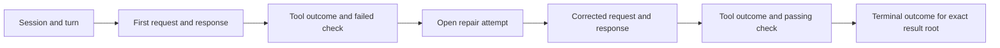

# RT-31. Versioned MCP session events and causal correlation

This experiment defines a versioned event envelope for sessions, turns, attempts, requests, responses, tool outcomes, checks, repairs and terminal outcomes. It captures normalized events from two independent connections to the existing MCP stdio adapter. Each connection rejects a stale revision and then applies a corrected request. Both connections reuse the same numeric request IDs, while their repaired Snapshot roots differ. [Issue #342](https://github.com/aivibeflow/LLMLang/issues/342) · [Existing MCP stdio adapter](../../toolchain-and-collaboration/RT-19/RT-19-MCP-STDIO-SCHEMA-INTEROPERABILITY-2026-11-24.md)

The logical event key combines session, turn, attempt, event kind and optional wire request ID. The immutable identity hashes the full versioned record, including its producer role, baseline Snapshot, adapter-build digest, normalized outcome, result root and parent event identity. A response must point to the exact request in its own session and attempt. A repair must follow a failed check in the prior attempt. A terminal result must follow a passing check on the exact same result root. A duplicate logical key with different bytes is a conflict. An exact redelivery is idempotent.



## Results

The two native sessions supply four tool mutation requests and 26 versioned events. The client independently recomputes each accepted repair's Snapshot root from the original two verified resources and the added module. An inspection between attempts confirms that the refused request leaves the workspace unchanged. The result stores normalized event metadata. Wire payloads and random workspace handles are omitted. [Versioned event ledger](MCP-SESSION-DAG-01/evidence.json)

All 48 shuffled complete deliveries produce a complete result. The corresponding partial histories remain pending. Nine controls distinguish exact redelivery, a conflicting record, a cross-session response with the same request ID, reuse of a wire ID in one connection, an incorrect wire ID, wrong producer role, wrong adapter revision, a missing repair and a terminal result attached to a failed attempt. The last control cannot reuse the earlier failure as evidence for a successful terminal result.

This is a bounded event model with one turn and two mutation attempts per session. The role assignments and session identities are supplied by the trusted fixture. The build digest identifies the tested adapter and domain source bytes. Live model instrumentation, negotiated capture policy, real identity authentication, durable concurrent ingestion, streaming and multiple validated tools per attempt remain open.

## Replay

Source baseline `9353973` on `research/all`. Replay used MCP `2025-11-25`, CPython 3.12.14 and jsonschema 4.26.0. The driver exchanges actual newline-delimited JSON-RPC with the existing RT-19 server process. Run from the repository root.

```sh
data=research/language-design/RT-31/MCP-SESSION-DAG-01
receipt=$(mktemp)
python -B "$data/run.py" "$receipt"
cmp "$data/evidence.json" "$receipt"
rm "$receipt"
```
