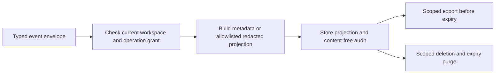

# RT-31. Metadata-only and redacted session recording

This prototype stores fictional MCP event envelopes in SQLite WAL. It supports metadata and redacted views with explicit per-workspace and per-operation permissions. The recorder constructs the stored projection before executing SQL. Metadata includes event kind, outcome and a bounded duration. Redacted capture adds one diagnostic code from a closed vocabulary. Arbitrary message text, unknown fields, payload hashes and nested content are discarded. [Issue #342](https://github.com/aivibeflow/LLMLang/issues/342) · [RT-31 research brief](RT-31-AI-ORIENTED-SYNTAX-AND-TOOLCHAIN-OPTIMIZATION.md)

| Boundary | Prototype behavior |
| --- | --- |
| Authorization | Capture, export, deletion, purge and audit have distinct grants. Workspace, operation and current grant epoch are checked in the same SQLite writer transaction as the operation. |
| Content | Only the selected structured projection reaches SQLite. Metadata export suppresses every stored redacted body. Unsupported recording modes are refused at entry. |
| Retention | Redacted rows expire after 10 fixture ticks, metadata rows after 20 and audit rows after 30. Queries hide expired rows before scheduled purge. |
| Deletion | Exact event deletion is scoped to its workspace. Repeating it is harmless. Purge removes expired rows in the authorized workspace. |
| Audit | Registered actor, workspace, operation, disposition and expiry are recorded without event body. A distinct grant controls audit export. |



## Results

Twenty-four fictional events across two workspaces and both recording modes exercise 49 synthetic markers, including raw and encoded forms and a rejected metadata field. None appear in expanded SQL, export views, the active database and WAL or the database after checkpoint. The valid diagnostic code survives redacted export and every arbitrary diagnostic string becomes the fixed placeholder. Metadata export contains no redacted bodies. [Deterministic evidence](PRIVATE-RECORDING-01/evidence.json)

All 23 controls pass. They cover workspace and mode separation, repeated deletion, expiration before purge, preserving peer rows, content-free audit, stale permission epochs and a new grant after reactivation. The authority changes permissions from a second SQLite connection. Revocation and a subsequent fresh check are distinct operations, with SQLite serializing the write-side permission and event changes.

The fixture assumes trusted actors, authority administration and a monotonic clock input. It records no live MCP session. The protocol tests logical deletion and checks for specific synthetic markers in this run. Physical remanence, backups, encrypted transport/storage, distributed grants, production data classification, clock governance, retention choices and operating a recorder with actual participants remain open.

## Replay

Source baseline `5c72421` on `research/all`. Replay used CPython 3.12.14 and SQLite 3.53.1 on Linux. Run from the repository root.

```sh
data=research/language-design/RT-31/PRIVATE-RECORDING-01
receipt=$(mktemp)
python -B "$data/run.py" "$receipt"
cmp "$data/evidence.json" "$receipt"
rm "$receipt"
```
