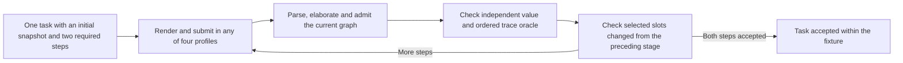

# RT-31 Staged authoring corpus across four syntax profiles

**Issue** [#342](https://github.com/aivibeflow/LLMLang/issues/342)

A comparison of authoring workflows needs the same task, semantic requirements and evidence gates for every syntax profile. This study supplies three two-step tasks over the existing expression fixture. It checks whether each stage has the expected values, ordered effects and allowed semantic edit scope. The tasks are baseline exercises for the shared subset. They carry no live agent or human performance results. [Four expression profiles](RT-31-HYBRID-PROFILE-2026-11-25.md)

## Corpus and acceptance contract

The [task specification](STAGED-AUTHORING-CORPUS-01/tasks.json) contains syntax-neutral initial states, human-readable objectives, required changes and allowed changed slots at each step. A slot selects an exact implementation or binding in a typed snapshot. A late call uses the currently selected provider. A pinned call keeps the exact primary provider selected by its call expression even when the late binding selects another implementation.

The runner renders reference submissions in infix, S-expression, JSON tree and hybrid syntax. It parses each submitted stage, constructs and validates the graph, then runs the interpreter on seven integers and both branches of the Boolean guard. An independent arithmetic and trace oracle supplies expected results. The gate also compares the actual consecutive selection maps to the required stage scope. Matching terminal bytes cannot compensate for a skipped or invalid earlier stage. A weaker terminal-only gate would be easier to run, but would miss violations of a staged migration or review requirement.



The diagram illustrates one workflow with checks after each step. Rejected stages leave the sequence unaccepted. The submitted source profile is separate from the task definition and the observation oracle.

## Results

| Task | Step one | Step two |
| --- | --- | --- |
| Rebind and adjust | Change the late provider binding and retain the entry implementation | Change the false-branch fallback and retain the new binding |
| Pin and change argument | Use the primary provider through an exact call pin while retaining the alternate late binding | Change the right operand offset while retaining the pin |
| Change trace and fallback | Reverse equal-valued operands, changing the effect order while preserving values | Change only the false branch and retain the new true-branch order |

The three tasks and three snapshots per task produce 36 admitted profile snapshots and 504 matching interpreter observations. Identical stages have the same graph root in all four profiles. The runner checks six negative controls in each profile. All 24 are refused at the expected stage or workflow boundary.

The skipped-stage control supplies only the correct terminal submission and fails sequence admission. Another presents that terminal submission too early and fails the first stage even though the final proposed graph is correct. Losing the pin changes values. Losing effect order preserves values and fails the trace gate. A neutral addition leaves checked values and traces equal but changes an out-of-scope entry slot during the binding-only stage. Malformed syntax refuses the submitted stage before observations. The [ledger](STAGED-AUTHORING-CORPUS-01/evidence.json) stores the exact rendered stages, graph roots, independent observations, submitted controls and outcomes. The study counts finite cases and does not measure time, tokens or repair effort.

This corpus covers typed scalar expressions, lazy branching, late binding, pinned calls and ordered effects. It leaves larger declarations, modules, ownership, resources, heterogeneous projects, proof obligations and statistical representativeness open. The expected changed slots and test inputs are fixed fixture requirements. General semantic equivalence and reviewer evaluation require separate evidence. [RT-31 research brief](RT-31-AI-ORIENTED-SYNTAX-AND-TOOLCHAIN-OPTIMIZATION.md)

## Reproduction

Use CPython 3.12.14 and Git from repository root. The runner checks its adapter, oracle dependencies and graph source pins at `ff3e7cd2a938fbda7e67c6b43a4818a666b30e1f`. The task corpus and runner are hashed in the ledger. Hash seeds 1 and 2 gave byte-identical output. Relative links and Mermaid source structure were checked. GitHub visual rendering was not manually verified.

```sh
study=research/language-design/RT-31/STAGED-AUTHORING-CORPUS-01
PYTHONHASHSEED=1 python -B "$study/run.py" >/tmp/llmlang-staged-corpus.json
cmp "$study/evidence.json" /tmp/llmlang-staged-corpus.json
```
