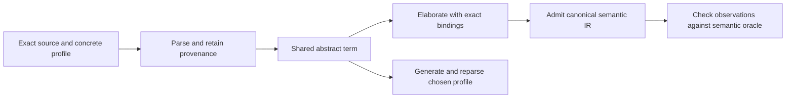

# RT-31 concrete syntax, abstract terms and admitted semantic IR

Different concrete source bytes can elaborate to one exact semantic graph. Identical abstract syntax can also elaborate to different graphs when contextual binding changes. The checked frontend therefore retains source provenance separately and validates the elaboration before accepting semantic input.

## Candidate boundaries

| Layer | Owns | Mapping |
| --- | --- | --- |
| Concrete Syntax Profile | Versioned grammar, source bytes and coordinates | Parse exact bytes under an explicitly selected profile. Report refusal before elaboration for unsupported versions. |
| Abstract Syntax Model | Shared structural term with unresolved or explicit names and constructs | Retain the source version and spans separately. Normalize only profile-defined layout and trivia. |
| Canonical Semantic IR | Admitted typed graph, exact bindings, effects and canonical representation | Elaborate with the pinned binding context, type rules and semantic validation. |
| Semantic Model | Meaning and allowed observations under the support profile | Compare value and ordered effects against an independent oracle. |
| Generator | A selected concrete profile's representation of a supported term | Generate from the supported abstract term and reparse. General IR-to-source synthesis needs its own mapping and fidelity scope. |



Hybrid diagnostics distinguish a path in the outer structured document from an offset in the embedded scalar expression. The structured path and relative offset must be carried with the exact source and selected grammar. [Four expression profiles](RT-31-HYBRID-PROFILE-2026-11-25.md) · [Original parser and generator comparison](RT-31-CROSS-PROFILE-SPG-2026-11-24.md)

## Checked evidence

The runner compares four profiles, rendered and formatting variants, and two selected providers. All 224 value and ordered-effect observations match the independent fixture oracle. Formatting changes source provenance while preserving the abstract term and graph. Different late bindings preserve the concrete source and term while changing the admitted graph and observations. The four profiles share one IR digest under the same binding. A different concrete profile version is refused, and malformed embedded syntax returns a nested path and relative offset.

The scope is closed scalar and effectful expressions. General declaration and module import, source mapping through arbitrary escapes, normalized profile compatibility and the normative language model remain open.

## Reproduce

Use CPython 3.12.14. Hash seeds 37 and 71 produce evidence SHA-256 `83753adedbfbfe663b60dacb3cf5683fa32a68121bed4db07e3ef78c2678b246`. [Evidence ledger](LAYER-BOUNDARIES-01/evidence.json)

```sh
LC_ALL=C PYTHONHASHSEED=37 PYTHONDONTWRITEBYTECODE=1 \
  python research/language-design/RT-31/LAYER-BOUNDARIES-01/check.py > /tmp/rt31-layer-boundaries.json
```
