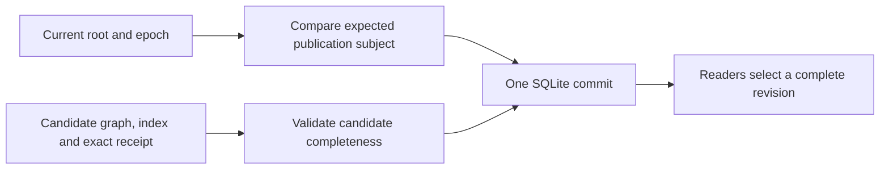

# RT-12 — Publish graph revisions with exact derived evidence in one transaction

## Question and method

What may readers observe after a process exits while publishing a semantic snapshot, its index and verification record? The [reverse index study](RT-12-SNAPSHOT-BOUND-REVERSE-INDEX-2026-11-25.md) distinguishes validation and lookup on one read snapshot. This experiment checks the writer boundary inside a single SQLite WAL database. The baseline is `5283336b5a842452d16a43bc70a20fb3c0bdcd02` on `research/all`. [Closed graph backup](RT-12-CLOSED-GRAPH-BACKUP-2026-11-25.md)

The fixture stages a content-addressed graph, exact reverse projection and a synthetic successful receipt bound to that graph root. A head row selects the active root and a local publication epoch. A candidate is internally ready when its graph hashes to the selected root, its projection agrees with the graph and its receipt names that exact root. Compare-and-swap checks the expected root and epoch. The comparison tests an atomic writer, a split writer that moves the head before evidence is present, and preparation of a complete candidate before any head move.



For each case a child process performs the named schedule and exits using `os._exit`. The parent reopens the database and checks the selected and candidate roots. This is process-exit evidence on a local database; the fixture supplies receipt validity as input.

## Results

| Schedule | Selected root | Selected snapshot complete | Candidate present and complete |
|---|---|---|---|
| Exit after staging and head update, before atomic commit | Old | Yes | Absent |
| Exit after the atomic commit | New | Yes | Yes |
| Commit head before index and receipt, then exit | New | No | Present, incomplete |
| Commit complete preparation, then exit before any head move | Old | Yes | Yes |
| Attempt with same old root at a later epoch | Old | Yes | Absent |
| Attempt with receipt bound to the wrong root | Old | Yes | Absent |

The split writer produces a durable selected root without its index and receipt. Moving the head after complete preparation is compatible with the selected-root invariant in this fixture, but leaves a prepared candidate to recover or collect. The single transaction keeps both staged visibility and selection within the same commit. The stale-epoch case demonstrates why the expected root alone would be an insufficient concurrency token for this proposed protocol. [Exact exit and reopen records](GRAPH-PUBLICATION-01/evidence.json)

The result applies to one SQLite database and its process-crash boundary. External blob storage, interrupted filesystem or Git publication, real receipt authorization, power-loss durability and distributed transactions remain separate work. [Semantic object storage tracking](https://github.com/aivibeflow/LLMLang/issues/319)

## Reproduction

Use CPython 3.12.14 and SQLite 3.53.1. The [runner](GRAPH-PUBLICATION-01/run.py) asserts all six process exit codes, graph identities and reopen observations. Hash seeds 1 and 2 produced identical data. The diagram was checked as Mermaid source.

```bash
fixture=research/packages-and-ecosystem/RT-12/GRAPH-PUBLICATION-01
LC_ALL=C PYTHONHASHSEED=1 python3 -B "$fixture/run.py" > /tmp/llmlang-rt12-graph-publication.json
cmp "$fixture/evidence.json" /tmp/llmlang-rt12-graph-publication.json
```
