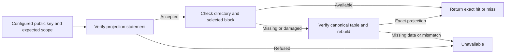

# RT-12 authority and canonical sparse index reconstruction

An optional sparse directory can return an exact hit or miss when a current authority record binds the intended logical table to the exact physical directory. A missing or damaged directory can be rebuilt from a verified canonical table. When those checks fail, the lookup reports unavailable.

## Candidate rules

| Identity or control | Scope |
| --- | --- |
| Logical table digest | Canonical, sorted table content. Both tested codecs and block sizes share it. |
| Physical projection | Codec, block size and exact directory digest. Each directory also commits to the compressed blocks and their ranges. |
| Authority record | A signed type discriminator, package scope, snapshot, table, authority generation, logical table digest and physical projection. The reader supplies the expected scope and current public key independently. |
| Exact sparse lookup | Check the directory against the authorized digest and verify the relevant compressed block before returning its result. |
| Canonical reconstruction | Verify the complete canonical table against its expected logical digest, rebuild with the declared layout, and compare the resulting directory digest before routing. |



The runner reuses the existing 8,192-row synthetic table and sparse projection reader. OpenSSL generates short-lived Ed25519 fixture keys. The configured key has authority only for the expected package scope, table, snapshot and generation. A separate signer and mismatched metadata serve as controls. The fixture scope label is synthetic. Production policy must supply the verified association to a real package root and immutable index snapshot. [Prior sparse integrity study](RT-12-INDEX-INTEGRITY-2026-11-25.md)

## Results

| Disposition | Lookups | Conditions |
| --- | ---: | --- |
| Exact sparse lookup | 6 | Two authorized physical layouts, each with two hits and one miss |
| Exact lookup after canonical reconstruction | 9 | Missing directory, damaged directory, or alternate layout presented under the original pin |
| Unavailable after reconstruction check | 9 | Missing or mismatched canonical data, or an authorized layout digest that cannot be reproduced |
| Unavailable at authority check | 30 | Missing record, wrong key or scope, old generation, wrong logical table digest, unsupported layout, or invalid directory digest |

All 15 exact results match the independent fixture lookup. None of the 39 unavailable results produce a hit or a miss. Gzip with 64 rows per block and bzip2 with 32 rows per block have distinct directory digests for the same canonical table. A valid signature alone cannot make an inconsistent projection usable. Production authority enrollment and rotation, selection of a portable wire profile, streaming hostile-input limits and concurrent reconstruction remain open.

## Reproduce

CPython 3.12.14 and OpenSSL 3.5.7 produced identical evidence at Python hash seeds 37 and 71. Fixture keys are temporary and excluded from the ledger, which records deterministic decisions and input digests. Evidence SHA-256 is `18ea10ec150f74c466e809652a99fcc1208d6e6684cf3c6dda9b1a252d42afab`. [Raw evidence](AUTHORIZED-INDEX-01/evidence.json)

```sh
LC_ALL=C PYTHONHASHSEED=37 PYTHONDONTWRITEBYTECODE=1 \
  python research/packages-and-ecosystem/RT-12/AUTHORIZED-INDEX-01/check.py > /tmp/rt12-authorized-index.json
```
