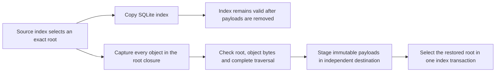

# Compare an index backup with a closed graph restore

**Scope:** PLAN §4.1 and [#319](https://github.com/aivibeflow/LLMLang/issues/319). A SQLite index, separate local content store and two immutable graph snapshots at base revision `bf043f1ccba812cd422c2ac9c2b33f592e0d3cf4` on `research/all`.

## Question and model

A consistent database backup can preserve an exact root while omitting its object bytes. The [collection study](RT-12-REACHABILITY-SWEEP-2026-11-25.md) distinguishes current roots, retention and reachability. This experiment asks what an independent restore needs when a SQLite index and the payload store have separate lifetimes.

The source holds two graph revisions that share a contract and differ in implementation. SQLite selects the active root. The content store uses SHA-256 names for canonical JSON object bytes and exact outgoing references. A portable envelope binds an expected root and includes every byte reachable from it. The restore checks each address and object representation, traverses the exact references, and requires complete closure with no unrelated entries before selecting the root in the destination index.



The expected root is supplied by the trusted fixture. Production restore would need to obtain it from an authenticated record or a local trust policy. A verified graph can be staged without changing the destination's active root.

## Results

The SQLite online backup preserves the original root and passes `PRAGMA integrity_check`. After the primary changes its selection and loses the old unpinned payloads, restoring from the backed-up index cannot load the original closure. The portable envelope captured earlier restores the original root and all three exact reachable objects in a separate store. An empty independent destination also reconstructs the same root and bytes.

The [ledger](CLOSED-GRAPH-BACKUP-01/evidence.json) records eight exact outcomes. Changing the required root, omitting a referenced object, changing bytes at one correct address, and adding an unrelated object each produce separate reasons. Injecting a failure before the index transaction commits leaves the destination's previous root selected. Retrying succeeds using the same verified portable envelope. The failure is injected inside the process and tests transaction rollback. It does not establish crash persistence across machine failure.

An index-only backup is smaller and can be useful when an external retention record guarantees the exact payload closure. A portable closed snapshot includes more data and can independently recreate the selection. Copying the current contents of the payload store after the index backup would need a shared retention or snapshot rule. Its success cannot be inferred from a valid SQLite file.

The fixture recreates one snapshot and checks immutable byte integrity before selection. It leaves source capture under concurrent mutations, large-bundle limits, physical flush and rename ordering, signed replication, package policy and long-term retention open.

## Reproduce

Use CPython 3.12.14 and SQLite 3.53.1 on Linux. The [runner](CLOSED-GRAPH-BACKUP-01/run.py) creates disposable SQLite and filesystem stores, regenerates the envelope, and records the complete outcomes and SQLite source ID.

```sh
set -eu
fixture=research/packages-and-ecosystem/RT-12/CLOSED-GRAPH-BACKUP-01
out=$(mktemp)
python3 -B "$fixture/run.py" > "$out"
cmp "$out" "$fixture/evidence.json"
```

The counts cover the exact fixture. Mermaid source was inspected directly.
