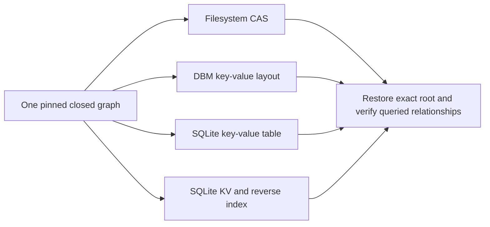
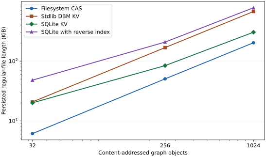

# RT-12 — Compare persisted layouts for the same closed semantic graph

## Question and method

How do a filesystem CAS, a simple KV store, a SQLite KV table and an indexed SQLite layout store the same exact graph? The [global artifact store study](GLOBAL-SEMANTIC-ARTIFACT-STORE.md) identifies storage alternatives. This experiment compares concrete local representations on one graph family. The baseline is `efb7a2bf2cf2ff1de74387f197bac8f8d70b56ae` on `research/all`. [Snapshot-bound reverse index](RT-12-SNAPSHOT-BOUND-REVERSE-INDEX-2026-11-25.md)

The graphs contain 32, 256 or 1,024 immutable nodes. Each node names its preceding node and, where present, a second earlier dependency with a different role. The selected last node reaches the complete closure. All four layouts store the same canonical JSON bytes under SHA-256 addresses and a separate root selector. The filesystem stores each value under a hash-derived path. CPython's simple DBM stores keyed bytes. The SQLite KV layout uses a `WITHOUT ROWID` table; the indexed variant adds a relational occurrence table and reverse lookup index. Both SQLite layouts use 4 KiB pages and are vacuumed before measuring.

The runner traverses each root, checks every object's exact address and restores the complete expected byte map. It compares four representative reverse queries, including an absent target, against the canonical forward inventory. The three layouts without the relational index scan the reconstructed graph for these queries. The SQLite index queries its derived rows. This measures agreement and persisted regular-file lengths; filesystem allocation, query latency and write amplification require other measurements.



## Results

All twelve layouts restore the complete graph and match all four queried reverse-dependency results per profile. The figure shows the sum of regular-file byte lengths after close, including the root selector. Both axes are logarithmic.



| Graph objects | Filesystem CAS | Stdlib DBM KV | SQLite KV | SQLite with reverse index |
|---:|---:|---:|---:|---:|
| 32 | 6,282 B | 21,273 B | 20,545 B | 49,217 B |
| 256 | 51,686 B | 172,370 B | 86,081 B | 213,057 B |
| 1,024 | 207,614 B | 691,539 B | 311,361 B | 798,785 B |

For the largest case, the filesystem layout uses 1,025 files while the SQLite layouts each use two. The 2,045 reverse rows and their index add 487,424 persisted bytes relative to SQLite KV alone. These fixture values expose the cost of the materialized projection separately from the database's key-value storage. File and directory allocation overhead could change the physical space ordering, so the table applies specifically to regular-file length. [Exact byte counts, roots and query results](STORAGE-LAYOUTS-01/evidence.json)

The experiment supplies a common exact graph oracle and a bounded size comparison. It does not select a production store. Larger and more representative graph shapes, byte packing, physical allocation, concurrent publication, recovery, and query latency remain to be measured. [Semantic object storage tracking](https://github.com/aivibeflow/LLMLang/issues/319)

## Reproduction

Use CPython 3.12.14 with stdlib `dbm.dumb`, SQLite 3.53.1 and Matplotlib 3.10.8. The [runner](STORAGE-LAYOUTS-01/run.py) asserts closed reconstruction, content addresses and query equality. Hash seeds 1 and 2 produced identical ledgers. The [chart script](STORAGE-LAYOUTS-01/chart.py) regenerates the SVG from the ledger. The SVG was visually checked using a raster preview.

```bash
fixture=research/packages-and-ecosystem/RT-12/STORAGE-LAYOUTS-01
LC_ALL=C PYTHONHASHSEED=1 python3 -B "$fixture/run.py" > /tmp/llmlang-rt12-storage-layouts.json
cmp "$fixture/evidence.json" /tmp/llmlang-rt12-storage-layouts.json
MPLCONFIGDIR=/tmp/llmlang-mpl-storage LC_ALL=C python3 -B "$fixture/chart.py"
```
