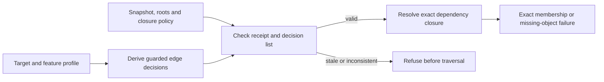

# RT-12 — Profile-bound conditional package closure

- **Date** — 2026-11-25
- **Tracking** — [PLAN §7.2](../../../PLAN.md#72-libraries-packages-templates-and-artifact-ecosystem) · [#333](https://github.com/aivibeflow/LLMLang/issues/333)
- **Status** — Reproduced against the existing exact package resolver

## Question and setup

Can conditional dependency decisions be reused when the target or selected features change? The current resolver consumes Boolean decisions keyed by exact source hash and edge ID. This keeps the edge address explicit. The caller is responsible for associating each decision with the profile that produced it. The experiment compares the existing interface with a wrapper that checks the snapshot, exact roots, closure policy, target, feature vector and locally derived decision list. [Resolver](../PROTOTYPES/PACKAGE-INDEX-01/package_closure.py) · [Package system](PACKAGE-SYSTEM.md)

The fixture contains eight exact objects. Required guards select Linux or Windows and optional network features. The network and shared tail include a cycle. Logging is an optional edge with transitive required dependencies. Four availability variants remove one exact object. The oracle computes the intended reachable members separately from the resolver's traversal.



## Results

The comparison covers 16 current profiles, 16 profiles that supplied decisions, three policies and five availability configurations. It replays 3,840 combinations through each admission rule.

| Existing policy with unbound decisions | Wrong membership | Missed required-object failure | Incorrect refusal | Total disagreements |
|---|---:|---:|---:|---:|
| Roots only | 0 | 0 | 0 | 0 |
| Required closure | 664 | 160 | 160 | 984 |
| Required and optional closure | 398 | 232 | 232 | 862 |

The pinned rule agrees with the oracle for all 240 current receipts. It returns exact closure in 188 cases and missing-object failure in 52. It refuses all 3,600 receipts issued for another profile. This includes compatible-looking outcomes when a change happens to leave membership unchanged. Additional controls refuse a stale snapshot, different roots or policy, a missing decision, and a changed decision under an unchanged profile declaration. The original resolver already refuses a missing Boolean for the active fixture edge. Its 16 existing closure tests also pass. [Evidence ledger](CONDITIONAL-CLOSURE-01/evidence.json)

The package index's `included` field describes target membership. A disabled optional edge can therefore report an included target when another active edge reaches it. The fixture also confirms that the current prototype's `target` edge kind records metadata without driving traversal. Target-conditioned required edges control the tested closure. A production policy still needs to specify whether an independent target edge kind participates in traversal.

## Limits

The exact rule assumes a trusted, immutable snapshot identity and transparent local evaluation of these known guards. It supplies no signature, generic feature language, target precedence, or distributed receipt authority. The finite agreement supports binding decisions to their actual inputs and keeping target membership distinct from the selection of an individual edge. Package delivery, policy selection and production compatibility remain open.

## Reproduction

Run from the repository root with CPython 3.12.14. The runner imports the current prototype, checks the finite oracle and writes a deterministic receipt. [Runner](CONDITIONAL-CLOSURE-01/run.py)

```sh
set -eu
dir=research/packages-and-ecosystem/RT-12/CONDITIONAL-CLOSURE-01
observed=$(mktemp)
trap 'rm -f "$observed"' EXIT
python3 -B "$dir/run.py" > "$observed"
cmp "$dir/evidence.json" "$observed"
```
