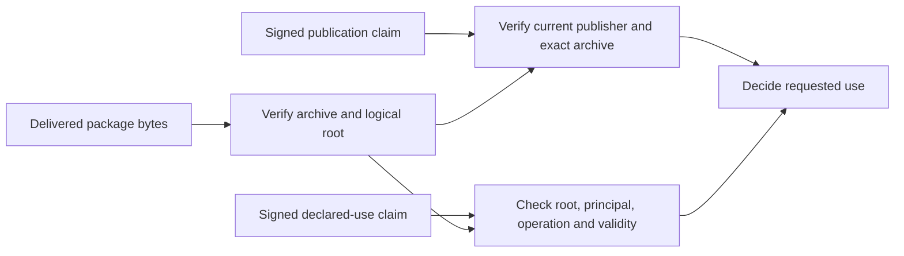

# RT-12 — Package integrity, publisher authority and declared use

- **Date** — 2026-11-25
- **Tracking** — [PLAN §7.2](../../../PLAN.md#72-libraries-packages-templates-and-artifact-ecosystem) · [#333](https://github.com/aivibeflow/LLMLang/issues/333)
- **Status** — Reproduced static archive and Ed25519 policy comparisons

## Question and contract

Which facts authorize a requested use of a package received from a mirror? The fixture verifies the machine archive, including payload hashes, and records both the logical package root and exact ZIP digest. A publication statement binds the root and archive digest to the current publisher role and policy. A separate declared-use statement binds the package root to one principal, operation, policy and validity interval. The experiment uses temporary Ed25519 keys and synthetic rights declarations. [Package system](PACKAGE-SYSTEM.md) · [Signed build predicate comparison](../../security/RT-16/RT-16-BUILD-ATTESTATION-2026-11-25.md)

The mirror can carry the original verified archive and publisher statement. A valid signature by the mirror key authenticates an actor but does not confer the publisher or rights-authority role. The rights statement in this candidate follows the logical content root. A new physical archive for the same root needs its own publication statement under the tested publication policy.



## Results

Three deliveries, eight publisher states and eight rights states produce 192 cases. The two valid deliveries are the original archive and an exact mirrored copy. The changed payload refuses integrity in every case. A separate oracle admits only the exact publication and declared-use inputs with either valid delivery.

| Rule used to decide the requested use | Accepted | Accepted without exact declared authority |
|---|---:|---:|
| Verified archive integrity | 128 | 126 |
| Integrity and cryptographically valid subject signature | 64 | 62 |
| Integrity and current publisher authority | 16 | 14 |
| Integrity, publisher authority and exact declared-use scope | 2 | 0 |

Repacking the machine tables preserves the logical root and the existing declared-use evidence. The old publication statement fails its physical archive binding, and a fresh publisher statement accepts the repacked bytes. Changing an export changes the logical root and defeats reuse of the old rights statement. [Evidence ledger](DECLARED-PACKAGE-RIGHTS-01/evidence.json)

## Limits

This is a technical comparison of stated authority. The fixture does not interpret license text or establish legal permission. Production policy still needs authoritative rights sources, scope and compatibility rules, trusted clocks, publisher rotation, key distribution and revocation. Alternate distribution policies may authorize a family of physical representations under an explicitly broader publication subject.

## Reproduction

Run from the repository root with CPython 3.12.14 and OpenSSL 3.5.7. The runner generates all package variants and keys in a temporary directory. The receipt records deterministic observations and package hashes. [Runner](DECLARED-PACKAGE-RIGHTS-01/run.py)

```sh
set -eu
dir=research/packages-and-ecosystem/RT-12/DECLARED-PACKAGE-RIGHTS-01
observed=$(mktemp)
trap 'rm -f "$observed"' EXIT
python3 -B "$dir/run.py" --openssl openssl > "$observed"
cmp "$dir/evidence.json" "$observed"
```
