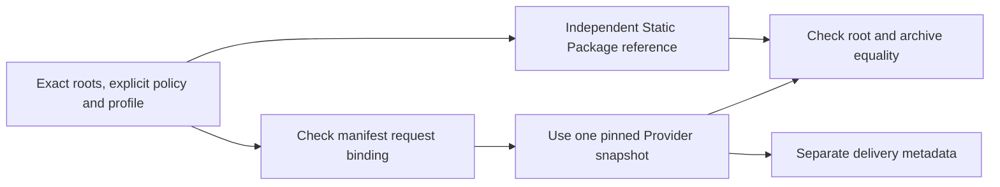

# RT-12 — Exact Dynamic Package requests and pinned Provider views

- **Date** — 2026-11-25
- **Tracking** — [PLAN §7.2](../../../PLAN.md#72-libraries-packages-templates-and-artifact-ecosystem) · [#333](https://github.com/aivibeflow/LLMLang/issues/333)
- **Status** — Reproduced request admission and Static/Dynamic equivalence

## Question and candidate contract

Can an exact Dynamic Package request produce the same package from different Provider snapshots without trusting display names or delivery metadata? The request contains a nonempty unique set of exact root hashes, an explicit dependency policy, a target and a Boolean optional feature. The candidate sorts roots for request identity. Before calling the Provider, it checks that the manifest's typed resolution inputs name the same target and feature. The Provider then uses one immutable snapshot for metadata, dependencies and streams. A delivery record can identify the chosen Provider and snapshot without contributing to package identity. [Package system](PACKAGE-SYSTEM.md) · [Public snapshot replay](RT-12-PUBLIC-SNAPSHOT-REPLAY-2026-11-25.md) · [Conditional closure](RT-12-CONDITIONAL-CLOSURE-2026-11-25.md)

The fixture uses two independent SQLite stores. They insert equal required objects in opposite orders, and one contains additional unrelated inventory. The static reference computes the reachable object set independently and constructs a ZIP archive from it. The test then sends the same request through both stores.



## Results

The matrix combines three policies, two targets and both values of the optional feature. All 36 archives verify. For each of the 12 requests, the two Dynamic Packages and the Static Package have the same exact bytes and package root. Each request profile has its own root. In this candidate, explicit resolution inputs participate in identity even when they produce equal member sets. Reordering two root references preserves request identity. [Evidence ledger](DYNAMIC-REQUEST-01/evidence.json)

Ten malformed or unsupported requests are refused. They cover nonobject envelopes, name-based or invalid hashes, duplicates or empty roots, missing or unknown policy, unknown target, an integer in a Boolean field, and an unexpected delivery label.

A Provider without the Linux-only required object refuses the Linux closure and preserves the prior destination. A Windows request against that Provider succeeds because the missing edge is inactive. A separate control uses equal roots-only membership with a different target and feature in the manifest. The underlying Provider accepts that manifest because the logical table projection agrees. The exact request gate refuses the stale profile. This identifies a request-binding requirement above the existing resolver.

## Limits

The comparison covers two local persistent stores, one optional feature and fixed target identifiers. It leaves external request serialization, authentication, distributed snapshot acquisition, unknown features, dependency-policy selection and remote delivery protocols open. The test models an independently prepared static manifest and validates it against the selected exact Provider result.

## Reproduction

Run from the repository root with CPython 3.12.14 and SQLite 3.53.1. The runner creates temporary stores and verifies the artifacts with the existing archive verifier. [Runner](DYNAMIC-REQUEST-01/run.py)

```sh
set -eu
dir=research/packages-and-ecosystem/RT-12/DYNAMIC-REQUEST-01
observed=$(mktemp)
trap 'rm -f "$observed"' EXIT
python3 -B "$dir/run.py" > "$observed"
cmp "$dir/evidence.json" "$observed"
```
