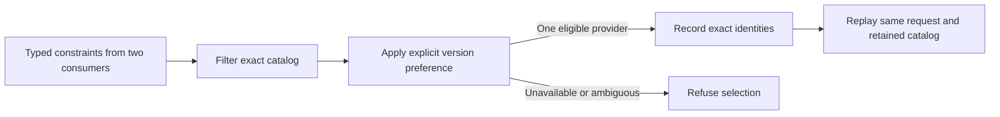

# RT-12 version selection and immutable dependency locks

A dependency resolver can use release labels during discovery and record only exact authority facts in the resulting lock. For the tested shared dependency, a selected implementation must satisfy the exact public specification, any implementation pin, evidence acceptance and capability constraints. A lock replays against its original catalog and request.

## Candidate model

| Stage | Required identity and behavior |
| --- | --- |
| Request | Root identity, exact specification hash, optional implementation hash, approved capabilities and resolver profile |
| Discovery | Filter the immutable catalog by stable library ID, specification, implementation pin, evidence admission and capabilities |
| Version preference | The fixture chooses the latest eligible numeric label. Distinct eligible bodies at the selected label are ambiguous. An explicit implementation pin can resolve the ambiguity. |
| Lock | Record exact catalog and request digests, stable library ID, specification hash and implementation hash |
| Replay | Read from the exact catalog, compare the request, and check the selected provider by exact identity. Updating or rebinding uses a new resolution. |

The lock is assumed to come from a trusted, immutable selection record. Trusting or publishing that record and verifying that an implementation actually satisfies the specification belong to separate evidence and authority gates. [Package and library contracts](RT-12-PACKAGE-AND-LIBRARY-CONTRACTS-2026-11-25.md) · [Exact provider lookup](RT-12-SNAPSHOT-CONTRACT-PROVIDER-INDEX-2026-11-25.md)



## Results

Seven immutable catalog profiles cover retired objects, a newer release, two different bodies with one version label, missing providers and providers with incompatible specifications or unaccepted evidence. Across 126 request profiles, the resolver selects 29, refuses 96 as unavailable and reports one ambiguity. An independent set-intersection oracle agrees for all 16,038 catalog-order comparisons. Selected locks are byte-equivalent across provider order and replay on the retained catalog.

The controls reject a different snapshot, changed capabilities and a same-label body absent from the pinned catalog. A retained old lock continues to replay after a newer snapshot exists. A fresh request against that newer snapshot can select a new body. The same-label fork is ambiguous unless an exact body is already requested. This study covers a fixed shared leaf and a fixture ordering rule. General constraint solving, parallel versions, authority for issuing locks and compatibility across wider catalogs remain open. [Exact closure semantics](RT-12-TYPED-TARGET-CLOSURE-2026-11-25.md)

## Reproduce

Use CPython 3.12.14. Both Python hash seeds 37 and 71 produced evidence SHA-256 `19c17447299122e98909660448b40d5fa00ccf72bbc4625d7c4dbd999c262590`. [Evidence ledger](LOCKED-RESOLUTION-01/evidence.json)

```sh
LC_ALL=C PYTHONHASHSEED=37 PYTHONDONTWRITEBYTECODE=1 \
  python research/packages-and-ecosystem/RT-12/LOCKED-RESOLUTION-01/check.py > /tmp/rt12-locked-resolution.json
```
