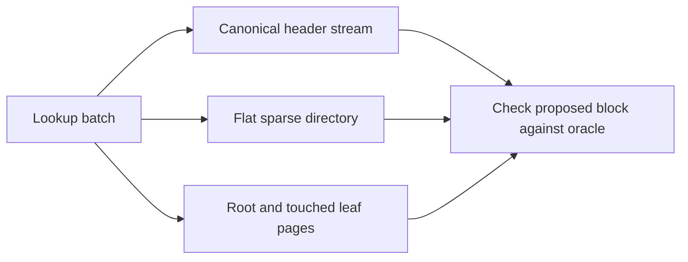
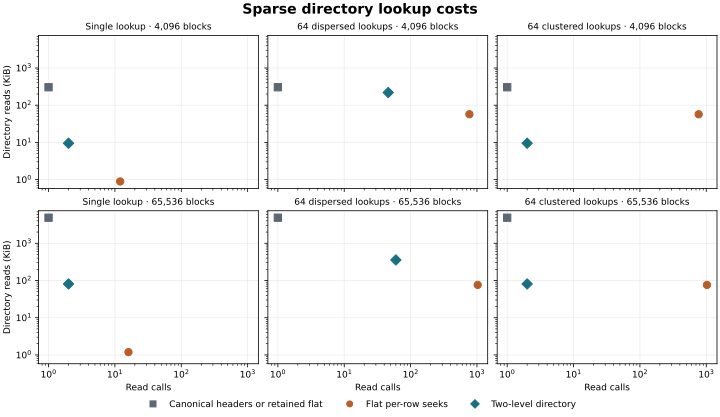

# RT-12 — Sparse lookup directories at several scales

- **Date** — 2026-11-25
- **Tracking** — [PLAN §7.2](../../../PLAN.md#72-libraries-packages-templates-and-artifact-ecosystem) · [#333](https://github.com/aivibeflow/LLMLang/issues/333)
- **Status** — Reproduced directory reads and immutable replacement bytes

## Question and alternatives

When does a separate sparse directory, and then a hierarchy of directory pages, pay for its extra storage? The fixture constructs canonical block headers for 16, 128, 4,096 and 65,536 ordered blocks. Each header is 76 bytes and contains the first key, physical offset, length and commitment. It compares an omitted directory, a flat directory retained once per request batch, a flat directory searched with per-row seeks, and a two-level directory with 64 slots per leaf. The two-level reader retains touched leaves within a batch and validates each loaded leaf against the root directory. [Package system](PACKAGE-SYSTEM.md) · [Index integrity and reconstruction](RT-12-INDEX-INTEGRITY-2026-11-25.md)

In this profile, the canonical headers are separately available as one contiguous sequence. The omitted mode reads that sequence once per batch and has zero derived storage. The experiment measures directory lookup only. It checks the selected block header against a separate key-to-block oracle and excludes candidate block decompression, system page traffic and caches spanning different batches.



## Results

All 2,064 routing decisions match across four scales, three query distributions and four lookup modes. The following measured pairs are bytes returned by file reads and read calls per batch. The omitted and retained-flat modes have the same read volume in this fixture.

| Blocks and query profile | Omitted or flat retained | Flat seeks | Two levels |
|---|---:|---:|---:|
| 16, one lookup | 1,216 B / 1 | 304 B / 4 | 1,292 B / 2 |
| 128, 64 clustered | 9,728 B / 1 | 34,048 B / 448 | 5,016 B / 2 |
| 4,096, one lookup | 311,296 B / 1 | 912 B / 12 | 9,728 B / 2 |
| 4,096, 64 dispersed | 311,296 B / 1 | 58,520 B / 770 | 223,744 B / 46 |
| 4,096, 64 clustered | 311,296 B / 1 | 58,368 B / 768 | 9,728 B / 2 |
| 65,536, 64 dispersed | 4,980,736 B / 1 | 77,976 B / 1,026 | 364,800 B / 60 |
| 65,536, 64 clustered | 4,980,736 B / 1 | 77,824 B / 1,024 | 82,688 B / 2 |



The omitted directory has the same lookup cost as loading a flat copy under the fixture's contiguous-header assumption. At 16 blocks it also reads fewer bytes with fewer calls than the hierarchy. At 4,096 blocks and 64 clustered queries, the hierarchy reduces both measures relative to flat per-row seeks. For dispersed queries at that scale, the hierarchy trades higher byte volume for fewer calls. Under a linear cost model of bytes plus a fixed byte-equivalent charge per call, it beats flat seeks in that case above about 228 byte-equivalents per call. This threshold uses the measurements and assumes no parallel requests or cross-batch caching.

At 65,536 blocks, the hierarchy adds 77,824 bytes over the flat directory, a 1.56% storage increase. Replacing one stable-length block commitment rewrites the 4,980,736-byte flat directory or one leaf plus the 77,824-byte root, for 82,688 bytes. This models immutable derived objects and verifies that exactly one leaf and one root entry change. Insertion, deletion, repacking and canonical data writes are outside the replacement measurement. [Exact matrix](HIERARCHICAL-DIRECTORY-01/evidence.json)

## Limits

Omit the optional index where the canonical headers already provide an economical access path. Evaluate hierarchy against measured locality, request cost and update patterns when headers or a flat directory are expensive to load. This fixture does not establish a production block count threshold. Remote coalescing, hierarchy depth, memory retention policy, representative package layout and root authentication still need separate evidence.

## Reproduction

Run from the repository root with CPython 3.12.14 and Matplotlib 3.10.8. The runner creates the directory files in a temporary directory and counts returned bytes and read calls. [Runner](HIERARCHICAL-DIRECTORY-01/run.py) · [Plot source](HIERARCHICAL-DIRECTORY-01/plot.py)

```sh
set -eu
dir=research/packages-and-ecosystem/RT-12/HIERARCHICAL-DIRECTORY-01
scratch=$(mktemp -d)
trap 'rm -rf "$scratch"' EXIT
python3 -B "$dir/run.py" > "$scratch/evidence.json"
cmp "$dir/evidence.json" "$scratch/evidence.json"
MPLCONFIGDIR="$scratch" python3 -B "$dir/plot.py" "$scratch/evidence.json" "$scratch/hierarchy-lookup.svg"
cmp "$dir/hierarchy-lookup.svg" "$scratch/hierarchy-lookup.svg"
```
