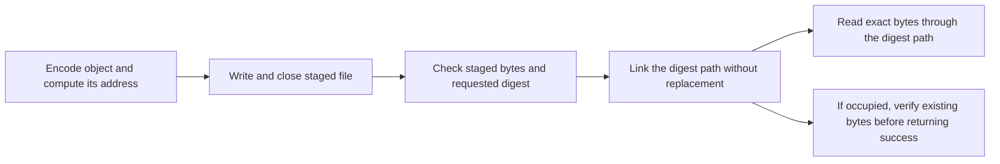

# RT-12 — Immutable object insertion and retry

Can readers distinguish an unpublished object from a verified object after an interrupted write? Can two writers publish the same bytes without replacing the existing object? The experiment isolates a filesystem content-addressed object from selection of a graph root. The branch baseline is `7424a061fc29c96c90eed3b4f6279ee4161aa449`. [Atomic graph publication](RT-12-ATOMIC-GRAPH-PUBLICATION-2026-11-25.md)

The fixture encodes a small typed record with sorted keys, compact UTF-8 JSON and order-preserving arrays. The path is the SHA-256 digest of the encoded bytes. The candidate insertion writes a temporary file in the same directory, closes it, checks the requested digest and bytes, and attempts a no-replace hard link. If the address already exists, the writer verifies its exact contents. Harness readers open only the digest path. The temporary name carries no committed reference.



Two concurrent writers wait on a barrier with distinct staged files. One publishes and the other verifies the existing bytes. A later repeat preserves the inode. Reversing key-insertion order leaves the candidate encoding unchanged. A differently serialized but equally decoded value is rejected at the canonical object's address. Reordering the argument array creates a separate address, and both revisions remain readable. [Machine-readable evidence](IMMUTABLE-INSERTION-01/evidence.json)

| Process exit point | Digest path immediately after exit | Staged names left | Retry |
|---|---|---:|---|
| Closed staged file before link | Absent | 1 | Publishes exact bytes |
| Immediately after successful link | Exact | 1 | Verifies existing bytes |
| Midway through truncating rewrite of an existing object | Invalid | 0 | Refuses the occupied path |

Each process exits with code 42 via `os._exit`. The parent verifies the digest path before retrying and removes stale temporary names only after that process exits. Removing the remaining temporary link after publication preserves the exact object. The direct write control leaves the previously valid canonical path unreadable. Retry detects that condition without repairing or replacing it.

The results support a candidate lifecycle of encode, stage, publish once, and verify on repeat. The prototype covers process exit on one Linux overlay filesystem. Filesystem and directory synchronization for power loss, cleanup while other writers are active, corruption repair, digest migration and the full SPG canonical encoding remain open. [Semantic object storage issue](https://github.com/aivibeflow/LLMLang/issues/319)

## Reproduction

The runner used CPython 3.12.14 and Linux 6.18.57 with the temporary directory on overlayfs. The receipt matched byte for byte with hash seeds 1 and 2. The diagram was checked as Mermaid source.

```bash
fixture=research/packages-and-ecosystem/RT-12/IMMUTABLE-INSERTION-01
LC_ALL=C PYTHONHASHSEED=1 python3 -B "$fixture/run.py" > /tmp/llmlang-rt12-immutable-insertion.json
cmp "$fixture/evidence.json" /tmp/llmlang-rt12-immutable-insertion.json
```
