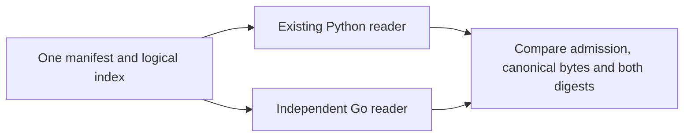

# RT-12 — Independent package identity and manifest admission

- **Date** — 2026-11-25
- **Tracking** — [PLAN §7.2](../../../PLAN.md#72-libraries-packages-templates-and-artifact-ecosystem) · [#333](https://github.com/aivibeflow/LLMLang/issues/333)
- **Status** — Reproduced encoding agreement and five manifest admission differences

## Question and setup

Can an independent package reader reproduce the prototype's canonical encoding and SHA-256 identities, and which manifest inputs distinguish the two readers? The experiment compares the existing Python prototype with a Go implementation of the typed encoding, index normalization, manifest verification, and package-root projection. Python uses `tomllib` and `hashlib`. Go uses BurntSushi TOML and the standard SHA-256 implementation. The test driver supplies the same input manifest and logical index to both readers. For each common acceptance, it compares the actual projected bytes, index hash and package root. [Package identity design](PACKAGE-MANIFEST-AND-IDENTITY.md) · [Python prototype](../PROTOTYPES/PACKAGE-IDENTITY-01/README.md)

The typed encoding uses distinct tags, big-endian lengths, decimal integer payloads, UTF-8 text, and ordered lists. It orders map keys by the bytes of the encoded keys. It also sorts logical index records by canonical bytes and rejects duplicate records. The index and package root use different hash domains. General canonical integers are tested independently of the integer range of a TOML parser.



## Results

| Input group | Both accept and agree | Both refuse | Admission differs |
|---|---:|---:|---:|
| 30 package manifests and indexes | 15 | 10 | 5 |
| 16 standalone canonical values | 15 | 1 | 0 |

Reordering TOML roots or logical index rows preserves the appropriate identity. Descriptive metadata, relocated index files and the omitted derived cache preserve the package root. A changed logical index record changes the root. Integer, Boolean and string resolution selectors yield three different roots. The typed controls also distinguish text from bytes, list order and composed from decomposed UTF-8. Both readers refuse duplicate manifest keys, missing roots, stale hashes, duplicate logical records and the tested invalid paths. [Evidence ledger](INDEPENDENT-PACKAGE-IDENTITY-01/evidence.json)

The five disagreements occur before common root comparison. For both `schema_version` and `index.format_version`, Python's equality check admits Boolean `true` and float `1.0` in place of integer `1`. The Go candidate requires an integer and refuses all four inputs. The Go TOML parser also refuses the positive integer one above the signed 64-bit maximum in resolution inputs, while Python accepts it and derives another package root. The two readers agree on the signed 64-bit endpoints and on larger integers passed directly through the standalone canonical encoding tests.

## Decision gates

Require an explicit integer type for manifest versions in the candidate schema. Declare the portable TOML integer range, or define an alternate representation for values exceeding that range, before stabilizing manifest admission. This study records those gaps in the current prototype. It exercises no production archive extraction, streaming index verification, signatures, hash agility or full cross-implementation schema conformance.

## Reproduction

Run from the repository root with Go 1.27.4 and CPython 3.12.14. The module lock checks the pinned TOML dependency and the runner builds its helper offline after download and disables automatic VCS stamping so a tracked archive can reproduce the result. [Go reader](INDEPENDENT-PACKAGE-IDENTITY-01/main.go) · [Python comparison runner](INDEPENDENT-PACKAGE-IDENTITY-01/run.py)

```sh
set -eu
dir=research/packages-and-ecosystem/RT-12/INDEPENDENT-PACKAGE-IDENTITY-01
scratch=$(mktemp -d)
trap 'rm -rf "$scratch"' EXIT
export GOPATH="$scratch/gopath" GOMODCACHE="$scratch/modules" GOCACHE="$scratch/cache"
(cd "$dir" && go mod download -modcacherw)
python3 -B "$dir/run.py" --go go > "$scratch/evidence.json"
cmp "$dir/evidence.json" "$scratch/evidence.json"
```
