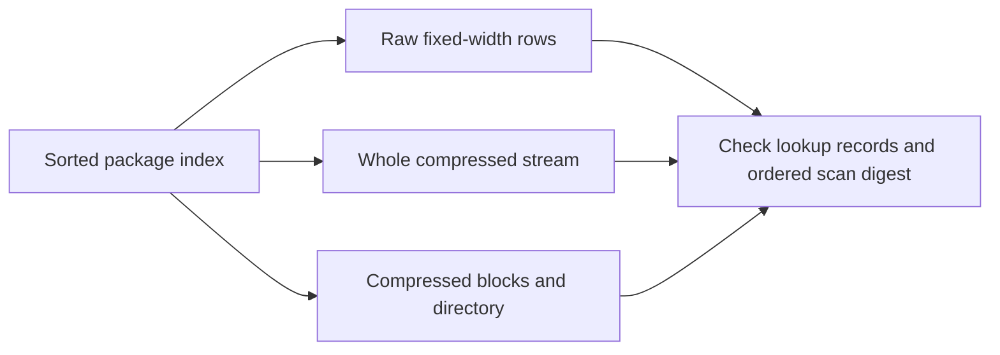
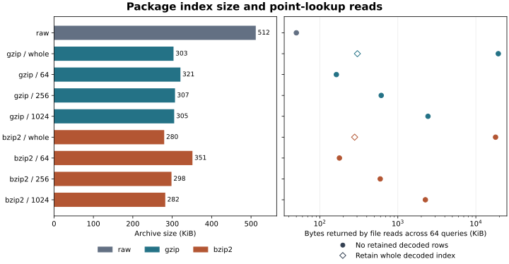

# RT-12 — Whole-stream and block compression for package indexes

- **Date** — 2026-11-25
- **Tracking** — [PLAN §7.2](../../../PLAN.md#72-libraries-packages-templates-and-artifact-ecosystem) · [#333](https://github.com/aivibeflow/LLMLang/issues/333)
- **Status** — Reproduced format comparison on one synthetic fixed-width index

## Question and methods

How do compression granularity and codec affect package-index size, point lookups, ordered scans and working memory? The fixture generates 8,192 sorted records of 64 bytes each. Each record has a 32-byte SHA-256 key and 32 bytes of repeated package and metadata fields. Sixty-four seeded point queries contain 32 exact hits and 32 misses. A dictionary supplies the lookup oracle. The ordered sequence supplies the scan digest. [Package system](PACKAGE-SYSTEM.md) · [Logical index schema](PACKAGE-INDEX-LOGICAL-SCHEMA.md)

The raw layout seeks directly to fixed-width rows and uses binary search. Whole-stream layouts use gzip or bzip2 at level 3. The fresh lookup mode decompresses the full raw index for each query. The retained mode decompresses the full index once and serves the 64 queries from it. Whole-stream scans use streaming readers. Independent block layouts compare 64, 256 and 1,024 records per block, with a directory holding each first key, offset and compressed size. They load that directory once per operation and decode a candidate block per lookup, even when two queries touch the same block.



Each operation passed the same row or digest oracle in all measured runs. Read volumes are bytes actually returned to the reader, including directories and repeated reads. These count application I/O, including bytes the OS may have cached. Timings cover one operation on a warm local temporary file and include validation. Seven sequential trials per configuration were run in shuffled order on an AMD EPYC 9V74 virtual machine with Linux x86-64 and an overlay filesystem. The separate memory trace reports peak Python-tracked live allocations during an operation. It excludes untracked native allocations and the OS page cache.

## Observations

| Layout and lookup mode | Archive KiB | Lookup read KiB | Lookup ms, median (min–max) | Lookup peak KiB | Scan ms, median | Scan peak KiB |
|---|---:|---:|---:|---:|---:|---:|
| Raw | 512.0 | 50.1 | 0.740 (0.679–0.802) | 4.6 | 0.419 | 33.0 |
| gzip whole, fresh | 303.3 | 19,412.7 | 79.944 (75.457–126.434) | 2,538.7 | 1.888 | 341.9 |
| gzip whole, retained | 303.3 | 303.3 | 1.611 (1.361–1.827) | 2,534.7 | 1.888 | 341.9 |
| gzip blocks of 64 | 320.8 | 163.1 | 1.296 (1.161–1.430) | 113.5 | 2.675 | 97.2 |
| gzip blocks of 256 | 307.1 | 612.9 | 3.181 (2.877–3.543) | 130.9 | 1.848 | 111.2 |
| gzip blocks of 1,024 | 304.9 | 2,437.0 | 10.680 (10.093–11.655) | 344.7 | 1.710 | 277.2 |
| bzip2 whole, fresh | 279.6 | 17,895.9 | 850.183 (803.298–928.540) | 2,172.0 | 14.022 | 72.1 |
| bzip2 whole, retained | 279.6 | 279.6 | 13.324 (12.802–15.711) | 2,168.5 | 14.022 | 72.1 |
| bzip2 blocks of 64 | 351.4 | 178.5 | 8.873 (8.296–10.324) | 64.1 | 17.625 | 55.7 |
| bzip2 blocks of 256 | 298.1 | 595.0 | 27.904 (26.252–29.698) | 81.9 | 14.565 | 62.2 |
| bzip2 blocks of 1,024 | 282.3 | 2,256.1 | 101.068 (99.275–110.725) | 264.6 | 12.852 | 197.1 |

Each ordered scan reads exactly the physical artifact size, including block directory bytes. The 128-entry directory at 64 rows per block adds 5,636 bytes to either codec. Whole bzip2 produces the smallest artifact, while the raw file is fastest at both local operations. For gzip, 64-row blocks use about 5.8% more space than the whole stream and read about 54% as many bytes as retained whole-index lookup. The retained whole-stream mode narrows the lookup latency range substantially at a higher peak of tracked allocations. For both codecs, growing blocks reduces archive size and raises read volume for dispersed point queries. [Exact evidence](INDEX-COMPRESSION-01/evidence.json) · [Raw timing and memory trials](INDEX-COMPRESSION-01/trials.csv)



## Limits

The comparison covers a single generated row distribution and one query mix. Archive footprint and application read counts reproduce exactly on the pinned build. Timing ranges describe seven repeated warm local trials and do not provide a service-level bound. Package-index format selection still depends on representative tables, locality and caching, cold or remote reads, codec portability, and authenticated directory and stream validation.

## Reproduction

From the repository root use CPython 3.12.14 with zlib 1.3.2, and Matplotlib 3.10.8 for the SVG. The run captures new timings and allocation peaks. Compare the exact receipt, since timing and allocation measurements may vary between runs. [Runner](INDEX-COMPRESSION-01/run.py) · [Plot source](INDEX-COMPRESSION-01/plot.py)

```sh
set -eu
dir=research/packages-and-ecosystem/RT-12/INDEX-COMPRESSION-01
scratch=$(mktemp -d)
trap 'rm -rf "$scratch"' EXIT
python3 -B "$dir/run.py" --trials 7 --measurements "$scratch/trials.csv" > "$scratch/evidence.json"
cmp "$dir/evidence.json" "$scratch/evidence.json"
MPLCONFIGDIR="$scratch" python3 -B "$dir/plot.py" "$scratch/evidence.json" "$scratch/index-compression.svg"
cmp "$dir/index-compression.svg" "$scratch/index-compression.svg"
```
