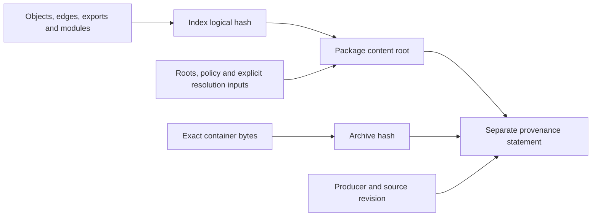

# RT-12 logical package content model

A package content root commits to the requested roots, dependency policy, explicit resolution inputs and canonical logical index. The index commits to included objects, typed dependencies, public exports and module membership. Evidence selected as package content participates in the same model as other selected objects. Provenance statements use a separate digest and can bind the package content root and exact archive without becoming package members.

## Records and validation

| Record | Fields and relationship |
| --- | --- |
| Package selection | Nonempty set of included root hashes, dependency policy, explicit resolution inputs and recomputed logical index hash |
| Included object | Exact content hash, object kind and canonical payload length |
| Typed dependency | Included source, stable edge ID within the source, kind, exact target hash, inclusion flag and optional condition |
| Export | Module ID and exact, case-sensitive export name mapped to an included object |
| Module | Stable module ID and set of included object members |
| Selected evidence | An evidence-kind edge binds the selected evidence hash. An included target has an object row and verified payload. An external evidence edge preserves its typed reference without establishing payload availability or trust. |
| Provenance | A separately validated assertion may bind the logical root, archive digest, producer and immutable source revision. Verification of its producer and policy belongs to the attestation layer. |

The identity preimage treats roots and module members as sets. Each canonical table admits a unique logical key. Validation checks included roots, edge sources and included targets, module members, and export module and object references. The archive verifier also checks the payload hash and length of each included object. Selection policy, feature evaluation and closure completeness require the provider's separate checks. [Existing logical index schema](PACKAGE-INDEX-LOGICAL-SCHEMA.md) · [Manifest projection](PACKAGE-MANIFEST-AND-IDENTITY.md)



## Replayed observations

The replay built and verified 14 packages against the existing manifest, normalized index and streamed archive prototypes. It also checked six refused configurations.

| Comparison | Observed distinction |
| --- | --- |
| Reorder roots and tables, change descriptive package name, or relocate index entries | All three variants preserve the logical index and content root and change the archive digest. In the ordering variant, the TOML root array remains in its supplied order. |
| Change included objects, dependency kind, exact target or condition, export name, module membership, or move evidence to an external reference | Each of seven variants changes the logical index and content root. |
| Change selected roots, dependency policy, or explicit resolution inputs | Each of three variants preserves the logical index and changes the content root. |
| Supply absent or repeated roots, absent export target, absent module member, or absent included evidence | All five invalid logical models are refused. |
| Change the producer's claimed source revision in a detached statement | Both sidecars bind the same root and archive and have different digests. These are unsigned fixture records. The current strict ZIP verifier refuses an undeclared provenance entry. |

The replay validates a candidate model and the observed identity distinctions. The current closure verifier and trust policy have their own research gates. Final wire encoding, real evidence authorization and a signed provenance carrier remain open. [Declared package rights study](RT-12-DECLARED-PACKAGE-RIGHTS-2026-11-25.md)

## Reproduce

Use CPython 3.12.14 from the repository root. Seeds 37 and 71 produce evidence SHA-256 `a436bdf4fd8e6cff429e64b7681725fb90d18f4baf4c644e0452a5a8f7e18f35`. The ledger records prototype source hashes, input payload identities and changes to the three digests. [Evidence ledger](PACKAGE-CONTENT-01/evidence.json)

```sh
LC_ALL=C PYTHONHASHSEED=37 PYTHONDONTWRITEBYTECODE=1 \
  python research/packages-and-ecosystem/RT-12/PACKAGE-CONTENT-01/check.py > /tmp/rt12-package-content.json
```
