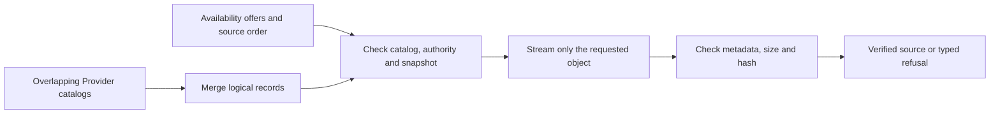

# RT-12 — Multi-Provider catalogs and exact selective retrieval

- **Date** — 2026-11-25
- **Tracking** — [PLAN §7.2](../../../PLAN.md#72-libraries-packages-templates-and-artifact-ecosystem) · [#333](https://github.com/aivibeflow/LLMLang/issues/333)
- **Status** — Reproduced merge and selective retrieval controls on SQLite snapshots

## Question and contract

How should a client select one exact object when several Providers describe overlapping inventory? The logical index merges matching logical rows and refuses conflicting metadata for the same logical key. Availability offers have separate fields for Provider, claimed snapshot, exact object, priority and availability. The client checks the approved logical index, source authority, available exact snapshot and object metadata, then verifies the requested payload stream's size and hash. Declared availability determines which candidates to consider. [Package system](PACKAGE-SYSTEM.md) · [Binary index merge](RT-12-BINARY-INDEX-TABLES-2026-11-25.md) · [Publisher and declared rights](RT-12-DECLARED-PACKAGE-RIGHTS-2026-11-25.md)

The fixture uses two authorized SQLite stores and one unapproved source. Two snapshots of a Provider remain open after an unrelated append. The old and new views still contain the same requested object bytes. A response for an old offer is eligible when the exact old view is retained. If the selected view is newer, the offer needs an explicit refresh. Ordinary failures let another approved and exact offer be considered.



## Results

Both catalog orders produce the same normalized union. A conflicting size for the same object key refuses the catalog merge. Across 13 availability scenarios and all 25 offer permutations, exact retrieval agrees with the authored result and never opens an unrelated payload. Choosing from availability labels alone selects the wrong Provider or an ineligible source in 19 cases.

| Control | Exact result |
|---|---|
| Advertised object missing at first Provider | Try the verified alternate |
| Old offer with current view only | Refuse that offer despite unchanged object bytes |
| Old offer with exact retained view | Read from the retained snapshot |
| Unapproved Provider with exact bytes | Consider the authorized alternate |
| Object metadata or payload differs | Refuse the mismatched response |
| Exact object outside the approved catalog | Refuse before opening a stream |
| Missing object with no alternate | Return unavailable |

The read evidence records only the requested Content Hash. A mismatched stream can be discarded and another exact candidate verified. Source authority and immutable snapshot identity remain visible independently of logical content. [Evidence ledger](MULTI-PROVIDER-RETRIEVAL-01/evidence.json)

## Limits

The fixture supplies the authorized Providers and offer priorities as inputs. It leaves authenticated offer publication, overlap reconciliation beyond strict logical row equality, retention guarantees, remote streaming and production selection policy open. Actual use authorization remains separate from content retrieval.

## Reproduction

Run from the repository root with CPython 3.12.14 and SQLite 3.53.1. The runner opens and compares temporary persistent snapshot stores and reports a deterministic receipt. [Runner](MULTI-PROVIDER-RETRIEVAL-01/run.py)

```sh
set -eu
dir=research/packages-and-ecosystem/RT-12/MULTI-PROVIDER-RETRIEVAL-01
observed=$(mktemp)
trap 'rm -f "$observed"' EXIT
python3 -B "$dir/run.py" > "$observed"
cmp "$dir/evidence.json" "$observed"
```
