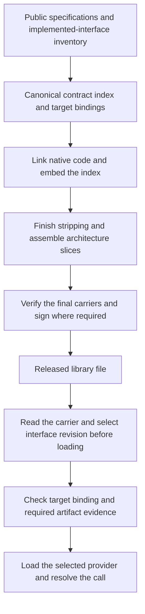

# RT-12 — Public contracts inside native shared libraries

- **Research item** — RT-12, [LL-022 package and provider model](../../../PLAN.md#ll-022--define-the-package-content-index-and-dynamic-provider-model)
- **Status** — Candidate design with bounded evidence, updated 2026-11-26
- **Baseline** — `c2d8e5104f83f2c2c1472416f4102e29efeba016` on branch `work`
- **Evidence** — Primary format documentation, candidate model and executable fixture

## Question and scope

Can a consumer receive a native shared library alone and read the contract of every public interface that the library implements before loading its code? This would let LLMLang inspect a binary-only provider, select the intended interface revision and check the declared binding while retaining the independently addressable public Specification in RT-12. The study covers format feasibility and byte recovery from LLMLang-controlled builds. It assumes access to the library file, control of the link or release recipe and authoritative build input enumerating public interface implementations.

A **contract** describes public types and behavior, including relevant preconditions, postconditions, errors, effects, capabilities, state rules and ownership. An **ABI binding** describes how a selected platform calls the implementation, including entry points, calling convention and type layouts. A **carrier** is the section, segment note or resource that holds LLMLang metadata in a platform binary. Export tables support symbol resolution. The richer contract and the mapping from logical operations to exported symbols come from LLMLang metadata. [Library specification layers](RT-12-PACKAGE-AND-LIBRARY-CONTRACTS-2026-11-25.md) · [Public interface model](LIBRARIES-AND-TEMPLATES.md#33-public-interface)

**H1** predicts that one two-interface payload survives each selected native build profile and is recoverable byte for byte from the released-format file, including each slice of a macOS universal file. **H2** predicts that a readable contract and the expected symbol names can coexist with a behavioral mismatch. The fixture tests H2 on Linux within a finite input domain.

## Prior art and platform carriers

| Platform and file | Proposed location and read path | Evidence and constraints |
| --- | --- | --- |
| Linux `.so` (ELF) | Vendor note with owner and type. Emit `.note.llmlang` as `SHT_NOTE` and require it in `PT_NOTE` for the selected release profile. The reader can find it through the program headers when section headers are absent. | Tested with GCC/GNU ld x86-64, linker garbage collection, `strip --strip-all` and removal of all section headers. With a different linker or script, check the final `PT_NOTE` layout and retention. A named read-only `SHT_PROGBITS` section is a simpler candidate when the section table is guaranteed. [ELF gABI notes](https://gabi.xinuos.com/elf/08-pheader.html#note-sections) · [GNU strip](https://www.sourceware.org/binutils/docs/binutils/strip.html) · [GNU linker KEEP](https://sourceware.org/binutils/docs-2.40/ld/Input-Section-Keep.html) |
| Windows `.dll` (PE/COFF) | Raw `RCDATA` resource in the PE resource directory, conventionally `.rsrc`. Pick a documented ID and language. Read the PE file directly or use `LoadLibraryExW` in data/resource mode and `FindResourceExW`, `LoadResource`, `SizeofResource` and `LockResource`. A file parser can restrict lookup to the exact DLL, including on another OS. | Tested with LLVM cross-builds for x64 and ARM64. The experiment reads the PE resource directory without running the DLL. The Win32 APIs and their language/resource lookup behavior are documented and remain untested here. [PE format](https://learn.microsoft.com/en-us/windows/win32/debug/pe-format#the-rsrc-section) · [RCDATA](https://learn.microsoft.com/en-us/windows/win32/menurc/rcdata-resource) · [LoadLibraryExW](https://learn.microsoft.com/en-us/windows/win32/api/libloaderapi/nf-libloaderapi-loadlibraryexw) · [FindResourceExW](https://learn.microsoft.com/en-us/windows/win32/api/libloaderapi/nf-libloaderapi-findresourceexw) · [Binary resource APIs](https://learn.microsoft.com/en-us/windows/win32/menurc/finding-and-loading-resources) |
| macOS `.dylib` (Mach-O) | Custom `__TEXT,__llm_contract` section added at link time. Locate it through the Mach-O load commands for a thin file. In a universal file, choose the intended architecture slice and then read that slice’s section. | Tested with LLD x86-64 and arm64 using link-time `-dead_strip -S` and an LLVM universal build. Each selected slice carried the same fixture payload. A native release must validate the actual post-processing and signatures. [Mach-O format](https://developer.apple.com/library/archive/documentation/Performance/Conceptual/CodeFootprint/Articles/MachOOverview.html) · [Mach-O header definitions](https://github.com/apple-oss-distributions/xnu/blob/main/EXTERNAL_HEADERS/mach-o/loader.h) · [Apple universal binaries](https://developer.apple.com/documentation/apple-silicon/building-a-universal-macos-binary) |
| Android `.so` and other ELF systems | The ELF note is a candidate where the target linker and package pipeline preserve it. For Android, extract the library for the actual ABI from the APK or inspect the corresponding installed file. Solaris explicitly documents vendor notes for ELF. | Format-level applicability. Android NDK, APK transformations, Solaris and other ELF systems were outside the run. [Android ABIs](https://developer.android.com/ndk/guides/abis) · [NDK prebuilt stripping](https://developer.android.com/ndk/guides/prebuilts) · [Oracle Solaris notes](https://docs.oracle.com/cd/E53394_01/html/E54813/chapter6-18048.html) |
| iOS Mach-O dynamic framework binary | Use a section in the library binary inside the framework, with normal framework packaging and signing for the supported deployment profile. | Format-level candidate. An earlier RT-13 fixture cross-linked an iOS arm64 dylib. Embedding and reading this contract in a signed iOS framework on a device remain open. [RT-13 Mach-O profiles](../../compiler-and-translation/RT-13/RT-13-FFI-MACHO-PROFILES-2026-11-25.md) · [Apple guidance on nested signing](https://developer.apple.com/documentation/Xcode/using-the-latest-code-signature-format) |

For Windows, `TYPELIB` in a DLL is precedent for self-describing COM interfaces. .NET assemblies carry CLR metadata under a different component model. Use either for interop when appropriate. LLMLang still needs a representation for its own effects, predicates and ownership rules. A Windows import `.lib` describes how to link to the DLL. A static `.lib` or `.a` is an archive whose metadata-bearing member might never be selected at final link. Static archives need an explicit member convention for inspection and a retention rule if metadata must propagate into the linked binary. [COM type libraries](https://learn.microsoft.com/en-us/dotnet/framework/interop/importing-a-type-library-as-an-assembly) · [.NET assembly format](https://learn.microsoft.com/en-us/dotnet/standard/assembly/file-format) · [RT-13 Windows COFF profiles](../../compiler-and-translation/RT-13/RT-13-FFI-WINDOWS-COFF-PROFILES-2026-11-25.md) · [GNU ld archive selection](https://sourceware.org/binutils/docs/ld/Options.html)

## Candidate LLMLang representation

Use one versioned envelope per native artifact or independently loadable slice. Its index has one logical record for each implemented public interface revision. Each record resolves to canonical public Specification bytes and a target-specific operation binding. A single envelope simplifies discovery and deduplication when several interfaces share a type or an implementation. For offline and standalone inspection, include the public type and predicate closure needed to interpret the published contract. Optional proof objects, private implementation and design can remain outside the binary. A digest-only entry is usable with an available store if a profile explicitly allows that dependency.

| Record | Candidate contents and checks |
| --- | --- |
| Envelope | Magic, schema version, lengths and bounded index, stable library ID, target or slice ABI profile. Define duplicate handling and size limits early. |
| Interface entry | Stable public interface ID, revision, digest of canonical typed Specification, and a reference inside the envelope to its public contract bytes. Sort uniquely by interface ID and revision, verify the digest, and reject conflicting duplicates or missing objects. |
| Target binding | Operation IDs mapped to actual entry points or a defined dispatch table, with ABI version, calling convention and public type layout or a reference to checked ABI evidence. Versioned ELF symbols, forwarded PE exports and Mach-O re-exports require an explicit resolution policy if admitted. |
| Delivery evidence | Package or publisher evidence may bind the final artifact digest, target, contract digests and binding to a build. Use external metadata or a precisely defined platform signature scope. A whole-file digest field inside its own file creates a circular dependency. |

The build compares the index with the compiler’s public implementation inventory and checks declared ABI bindings against the linked result. Export counts alone cannot establish completeness. One implementation can implement several interfaces or revisions, several operations can use a shared entry point, and an artifact may also contain ABI helpers unrelated to public contracts. There should be an explicit distinction between `missing metadata`, `unsupported or invalid metadata`, `absent interface` and `ABI mismatch`. For a contract-required profile these outcomes prevent automatic binding. A legacy native provider can still be described by an explicitly supplied contract bound to the exact artifact.

The following candidate pipeline shows where the publisher produces the metadata and where the consumer can inspect the final file before selecting a provider. The path to invocation includes separate checks for the selected ABI and the evidence required by the caller.



The specification digest identifies the same typed contract across supported OSs if the canonical bytes are the same. Different targets may have different call bindings and artifact digests. Compare contract digests across universal slices unless a target-specific contract is explicitly declared and exposed as such. Reopen the actual release output after the final transformation to check metadata survival, and ensure admission applies to the exact bytes the runtime selects, including relevant transitive providers. Windows Authenticode and macOS code signing each have a defined hash scope. Embed before signing and verify the final output according to the platform and publisher policy. A publisher signature authenticates the signed statement or protected bytes under that policy. Behavioral correspondence requires evidence suited to the property and its assumptions. [Authenticode hash scope](https://learn.microsoft.com/en-us/windows/win32/secbp/understanding-pe-signatures) · [Apple code signing hashes](https://developer.apple.com/documentation/technotes/tn3126-inside-code-signing-hashes) · [Loader resolution scope](../../compiler-and-translation/RT-13/RT-13-FFI-LOADER-SCOPE-2026-11-25.md) · [Opaque implementation evidence](RT-12-OPAQUE-IMPLEMENTATION-EVIDENCE-2026-11-25.md)

## Alternatives and trade-offs

| Approach | Benefit | Cost or missing property |
| --- | --- | --- |
| One embedded envelope with a record per interface | Single-file discovery before load, with common indexing and shared type objects. | Format adapters, retained bytes and release checks on each target. |
| A resource, section or note per interface | Platform tooling can locate individual records directly. | More native names and headers, duplicate common data, and additional rules for discovery and conflicts. |
| Sidecar or package/CAS only | Independent inspection, distribution and caching before the binary is downloaded. Useful for legacy libraries and larger evidence. | A library copied on its own may lose contract access. Pair with an exact artifact binding. |
| Exported query function | One runtime API can expose metadata after a trusted module has been loaded. | A load can run library initialization. The caller first has to agree on the query ABI. |
| Headers, debug information or symbol tables | Reuse existing interop and diagnostic tooling, including ABI hints. | Retention and representation vary. Public effects and behavior must still be supplied explicitly. |

## Experiment and results

The fixture embeds the same [579-byte JSON](NATIVE-CONTRACT-CARRIER-01/contracts.json) with two interface records, each with one operation and an independent C export. One record increments the input and one triples it. Each operation specifies inputs 1 through 8 inclusive. This fixture includes simple bindings inline to check carrier equality. Its JSON and fixture identifiers illustrate the model. It uses no production SPG encoding or contract evaluator.

The fixture locators are ELF owner `LLMLANG` with type `0x4c4c4d01`, PE resource type `RCDATA` with ID `101` and language `0`, and Mach-O section `__TEXT,__llm_contract`. The runner compares extracted bytes with the source payload and checks the fixture’s exported names with binary inspection tools separate from the linker. A companion build for each target omits the carrier while keeping both named exports. On Linux only, a positive and a deliberately divergent implementation are called via `ctypes` for all inputs in the fixture domain. The ledger stores exact artifact and contract digests, observed names and all mismatched input/output triples. These are categorical outcomes for fixed profiles. The table describes the entire sample.

| Profile | Embedded observations | Missing-carrier control | Native calls |
| --- | --- | --- | --- |
| Linux ELF x86-64 | Exact bytes and two exports in the linked, stripped, section-header-free and divergent files. GNU `readelf` found the section-header-free note through the program headers. | Note absent with both exports present. | Section-header-free file matched 16/16 specified results. Divergent file matched 8/16. All eight mismatches were in `reserve`. |
| Windows PE x64 and ARM64 | Exact bytes and two exports in both DLLs. | Resource absent with both exports present on each target. | Offline inspection on Linux. |
| macOS Mach-O x86-64 and arm64 | Exact bytes and two exports after link-time dead/debug stripping in both thin libraries and in each of the two universal slices. Extracted slices equaled their original thin library bytes. | Section absent with both exports present on each target. | Offline inspection on Linux. |

| Claim ID | Evidence class and claim | Scope, confidence and falsifier | Evidence and downstream use |
| --- | --- | --- | --- |
| RT12-NLC-01 | Prior art. Each core executable format has a carrier for application-defined data. | High within the documented file structures. Linker/profile retention is a separate empirical question. | Platform table and primary sources above. Choose format adapters. |
| RT12-NLC-02 | Experimental result. All three selected native carrier families preserved the same two contract records in the exercised build profiles. | Exact byte comparison and cross-build inspection. Another toolchain or packaging step could remove the carrier. | [Fixture and observed data](NATIVE-CONTRACT-CARRIER-01/evidence.json). Scope initial profiles. |
| RT12-NLC-03 | Experimental result. The Linux negative controls demonstrate that export agreement can coexist with absent metadata or contradictory behavior. | High for the fixture. The divergent implementation keeps the exact bytes and symbol names and fails all eight `reserve` cases. Broader guarantees require appropriate correspondence evidence. | [Linux observations](NATIVE-CONTRACT-CARRIER-01/evidence.json). Keep contract inspection and behavioral admission as separate checks. |
| RT12-NLC-04 | Hypothesis. An indexed envelope containing the public contract closure can support standalone interface inspection across LLMLang providers. | Pending schema, compiler inventory, real closure and reader tests. A hidden dependency on an omitted public object would falsify standalone inspection. | Candidate model above. Evaluate with LL-022 and the package contract model. |

## Reproduction and limits

Run on Debian 13.6 Linux x86-64 with glibc 2.41-12+deb13u4, CPython 3.12.14, GCC 14.2.0-19, GNU binutils 2.44, Clang 22.1.4, LLD 19.1.7 (`ld64.lld` and `lld-link`) and Debian LLVM utilities 19.1.7 (`llvm-rc`, `llvm-readobj`, `llvm-objdump`, `llvm-objcopy` and `llvm-lipo`). Clang and LLD revisions and the inputs’ SHA-256 digests are in the [machine-readable ledger](NATIVE-CONTRACT-CARRIER-01/evidence.json). [Runner](NATIVE-CONTRACT-CARRIER-01/check.py) contains the exact commands and flags. It assembles the ELF note into a stable-named object so a temporary assembler filename does not enter the unstripped symbol table. The run uses clean temporary directories and a 30-second limit per subprocess. The inputs and call enumeration are deterministic.

```sh
fixture=research/packages-and-ecosystem/RT-12/NATIVE-CONTRACT-CARRIER-01
PYTHONHASHSEED=37 python3 -B "$fixture/check.py" \
  --clang /path/to/clang --lld-bin /path/to/lld/bin --llvm-bin /path/to/llvm/bin \
  > /tmp/rt12-native-contracts.json
cmp /tmp/rt12-native-contracts.json "$fixture/evidence.json"
```

Expected exit status is zero for both commands with the captured tools and environment. Runs with Python hash seeds 37 and 71 in separate temporary directories yielded identical ledgers with SHA-256 `cffc6f1d97f4ccfe6efe3d8af15e966f11be8dc73178c60189946d5bf29c8cca`. Rebuilds with different tool distributions or CRTs may produce different artifact digests. The payload equality, outcomes and controls remain the experimental invariants. A portable production reader would parse the container structures with bounds and size checks. The fixture uses pinned binary diagnostics and trusted build inputs.

LTO, PE post-link processing, macOS post-link stripping and native signing verification, Windows resource API execution, Windows/macOS runtime loading, alternate ELF linkers, Android, iOS, malformed inputs and representative LLMLang contract closures remain untested. The Mach-O fixture uses linker-generated ad-hoc signatures to build the slices. OS validation and distribution signing remain unverified. The fixture performs no authenticity, ABI-layout proof or proof-to-artifact correspondence check.

## Recommendation and decision boundary

Use an embedded read-only contract index as a candidate native distribution profile. Keep independently addressable Specification objects as the contract identity and embed the public closure by default where the use case requires a standalone file. Validate carrier survival and complete inventory against exact release bytes. Keep ABI admission and behavioral evidence explicit.

Open design questions include canonical versioning, size limits for metadata and proofs, target-specific contracts, stable locator IDs, treatment of forwarders and re-exports, and the native signing and packaging matrix.

## Draft impact and traceability

This feasibility study feeds [LL-022](../../../PLAN.md#ll-022--define-the-package-content-index-and-dynamic-provider-model) and the [RT-12 library layer model](RT-12-PACKAGE-AND-LIBRARY-CONTRACTS-2026-11-25.md). The accepted build policy is recorded in [ADR-025](../../../draft/adr/025-optional-embedded-library-contract.md). It requires embedding by default for supported native shared libraries and allows a per-library opt-out. The remaining design questions and Q1–Q5 independent review are open. [Quality review protocol](../../research-management/QUALITY-REVIEW-PROTOCOL.md)

Local validation covered both fixture replays, document structure, relative links and Mermaid 11.12.2 syntax. GitHub rendering was outside the validation run.
