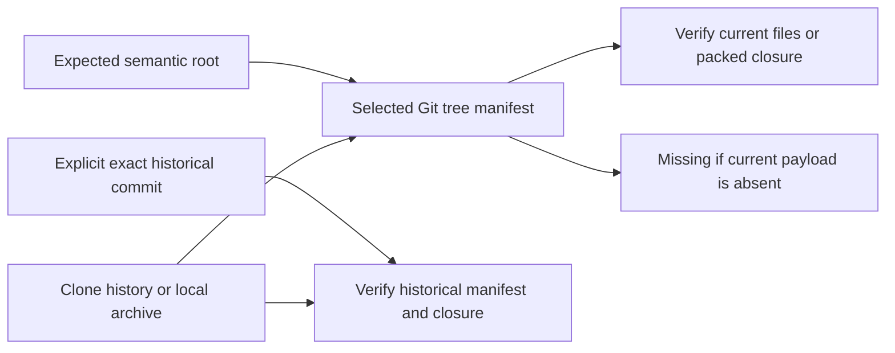

# RT-12 — Offline Git closure and explicitly selected history

## Question and method

Which semantic content can a clone or archive reconstruct when neither the original repository nor a live object store is available? The [portable backup study](RT-12-CLOSED-GRAPH-BACKUP-2026-11-25.md) distinguishes a valid SQLite root selection from its required payload. The [clean clone workload](../../toolchain-and-collaboration/RT-24/RT-24-CLEAN-CLONE-CLI-2026-11-25.md) rebuilds two self-contained layouts. This fixture tests a related distinction between the selected tree, the deliberately requested historical carrier and the history actually available to a clone. [PLAN §4.1](../../../PLAN.md#41-semantic-object-storage) · [#319](https://github.com/aivibeflow/LLMLang/issues/319)

Two semantic revisions share one contract and each have one implementation and snapshot object. One Git commit carries each closed tree. A third commit retains the current semantic root in its manifest and omits all payloads. A fourth carries the same current root and a packed closure. Semantic object names use SHA-256 over canonical JSON. The scratch Git repository uses its selected SHA-1 object format. Git delivers the repository bytes separately from their semantic address interpretation.

The fixture creates independent file-protocol clones without local object sharing or promised objects. It also extracts Git tree archives into directories without Git metadata. The full clones have their remote removed, and the original repository is made unavailable before reconstruction. The supplied current root and, where requested, exact historical Git revision are fixture inputs. The reader verifies the current manifest and traverses the tracked or packed closure with the existing [backup validator](CLOSED-GRAPH-BACKUP-01/run.py). It searches history only for a separately specified commit and checks that commit's manifest before reading objects.



## Results

| Control | Outcome | Verified objects |
| --- | --- | ---: |
| current closure in independent full clone | restored | 3 |
| historical closure in independent full clone | restored | 3 |
| current tree archive without Git history | restored | 3 |
| pointer-only current tree despite complete history | missing object | 0 |
| pointer-only archive with no history | missing object | 0 |
| approved historical carrier for exact pointer root | restored | 3 |
| wrong historical root remains refused | historical root mismatch | 0 |
| shallow clone contains closed current bundle | restored | 3 |
| shallow clone cannot restore pruned historical revision | historical tree unavailable | 0 |
| bundle tree archive restores without any database | restored | 3 |

All six restorations reproduce every expected object byte. Full history is enough to recover the missing current closure only when the reader selects the specific historical carrier that names the same root. The current-tree path still reports missing payloads when those files are omitted, even if a suitable Git commit exists locally. An archive or a shallow clone of the packed head recovers the current closure without access to any earlier tree. Its ability to recover the current state does not establish availability of older revisions.

A default current-tree portability guarantee can require the complete closure in that tree. A historical recovery mechanism can accept an explicit carrier and independently verify its root and exact bytes. Depending on an ambient older Git object without a retention or selection rule would make availability vary across clones. The fixture does not require SQLite or an external service during import.

## Reproduce and limits

The baseline was `a1b74b5f21432b40ff7e7ae1f9c9efd9432f6025` on `research/all`. Replay used CPython 3.12.14, Git 2.56.1 and Debian 13 x86-64 Linux 6.18.57. Run from the repository root:

```sh
fixture=research/packages-and-ecosystem/RT-12/OFFLINE-SEMANTIC-CLONE-01
out=$(mktemp)
python3 -B "$fixture/run.py" > "$out" &&
  cmp "$fixture/evidence.json" "$out" &&
  python3 -B "$fixture/chart.py"
```

The [ledger](OFFLINE-SEMANTIC-CLONE-01/evidence.json) records the deterministic Git commit identities, semantic roots, artifact byte counts and all outcomes. The [table generator](OFFLINE-SEMANTIC-CLONE-01/chart.py) renders the comparisons. This is a local, controlled clone and archive comparison. It leaves authenticated carrier selection, production packaging, remote retention, import limits, filesystem portability, and larger historical graphs open. [Runner](OFFLINE-SEMANTIC-CLONE-01/run.py)
