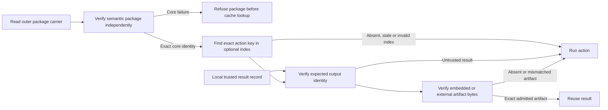

# RT-12 Optional package cache transport and exact result admission

**Issue** [#333](https://github.com/aivibeflow/LLMLang/issues/333)

A package can carry derived results for faster builds while preserving the package's logical content identity. Consumers also need to distinguish a structurally valid cache index from an applicable and independently trusted result. This study combines the existing package and cache-index prototypes in one bounded transport fixture. [Package cache proposal](PACKAGE-SYSTEM.md#13-optional-derived-result-cache-indexes)

## Candidate mechanism

The outer ZIP carries an unchanged, independently verified semantic package. Optional members carry an action index and result artifacts. The same index can be supplied as a detached byte sequence, and an artifact can be supplied from a separate content-addressed map. This layered carrier is one candidate and keeps the existing strict verifier for the inner archive. Direct embedding into the package's own layout could avoid nesting, but would require extending its optional inventory rules. Keeping all cache material detached gives the smallest mandatory delivery but may require more transport requests.

The inner package root and logical table digest come from the verified package and do not incorporate carrier data. An action key identifies the type-check request. The fixture includes the exact package root and object identities among its inputs and uses the existing versioned action-key projection, which also covers the language registry, toolchain, target, configuration and runtime. The action key omits the result hashes. A separate trusted local record identifies the accepted output hashes for the exact request. This fixture treats the trusted record as a supplied premise. It validates the index before lookup and checks the actual bytes of an admitted result artifact against its expected hash. All cache misses fall back to running the action. The fixture records this fallback decision and does not implement a compiler on that route. [Logical schema for optional cache records](PACKAGE-INDEX-LOGICAL-SCHEMA.md#71-optional-cache-indexes-are-separate-derived-data)



The diagram distinguishes package admission from the optional lookup. A cache miss cannot change the verified package identity. Cache data cannot repair the core if it fails verification.

## Results

The [ledger](OPTIONAL-ACTION-CACHE-01/evidence.json) contains 13 configurations, ten distinct outer ZIP digests and the full local decision outcomes. Twelve configurations admit the same package root, logical index digest and inner archive digest.

| Configuration group | Cases | Result |
| --- | ---: | --- |
| Embedded pair, detached index with embedded artifact, or embedded index with external artifact | 3 | Verified hit |
| No index, no artifact, or stale action key | 4 | Miss and local fallback |
| Incomplete action record or invalid JSON | 2 | Index refused and local fallback |
| Wrong artifact bytes at the admitted digest | 1 | Artifact refused and local fallback |
| Trusted result absent, or a different digest with the same action key | 2 | Result refused and local fallback |
| Invalid inner package with valid cache material | 1 | Package refused before cache lookup |

Three pairs hold outer bytes fixed while varying the attached index, external artifact availability or trusted result record. Each pair gives different cache decisions. Another control substitutes a well-formed, differently hashed result under the same action key. Its self-consistent content hash does not supply authority to reuse it. Separately, valid cache material cannot mask a changed required payload in the inner package. These categorical outcomes are reported without time or resource measurements.

The results establish omittable cache delivery and exact applicability for the fixture. Neither the outer ZIP structure nor the cache record format is selected as the production encoding. Real result verification, payload fetching, resource limits, duplicate and arbitrary input handling, cryptographic attestation, concurrent eviction and an extensible result-kind policy remain open. The inner archive verification stays the existing candidate package contract. [Derived package content identity](PACKAGE-MANIFEST-AND-IDENTITY.md)

## Reproduction

Use CPython 3.12.14 and Git at repository root. The runner checks the reused archive, version and cache-index modules against `5ab667bbbe59cde3c9c2777b0155aeadaf0df7b7`. Two runs with hash seeds 1 and 2 produced byte-identical ledgers. Relative links and Mermaid source structure were checked. GitHub rendering was not manually verified.

```sh
study=research/packages-and-ecosystem/RT-12/OPTIONAL-ACTION-CACHE-01
PYTHONHASHSEED=1 python -B "$study/run.py" >/tmp/llmlang-package-cache.json
cmp "$study/evidence.json" /tmp/llmlang-package-cache.json
```
