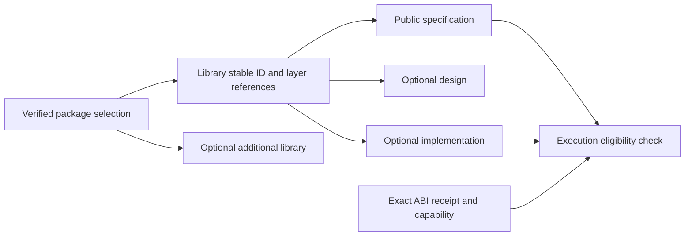

# RT-12 packages, libraries and exact public contracts

A Package identifies a distribution selection. A Library identifies a reusable component and its separately addressable Specification, Design and Implementation. Eight verified package profiles distinguish delivery changes, multiple libraries in one container, and changes to individual library layers. Ninety-six admission checks distinguish inspecting a public specification from eligibility to execute an implementation.

## Candidate records

| Record | Identity and responsibility |
| --- | --- |
| Package | Content root commits to the selected roots and logical index. The archive digest identifies one delivery. A package can carry several library roots. |
| Library | Stable component ID and separately typed, domain-separated layer hashes. The package index binds each delivered layer to exact object bytes. |
| Public specification | Machine-readable types, operation signatures, conditions, effects, capabilities, errors, state transitions and ownership. |
| Design | Optional architecture record with independent identity. |
| Implementation | Optional implementation record with its own identity. A checked execution decision additionally needs a matching implementation, ABI and capability. |

The fixture public specification describes a reservation operation with an explicit quantity range, positive input, success result, ledger-write effect, ownership of the result, and error settlement. It includes a typed representation rather than relying on prose semantics for identity. The example is included verbatim in the ledger. [Libraries and templates](LIBRARIES-AND-TEMPLATES.md) · [Package content model](RT-12-LOGICAL-PACKAGE-CONTENT-2026-11-25.md)



## Results

A descriptive carrier change preserves the package root and all three library layer hashes. A changed design or implementation changes the package root and its own layer hash while retaining the Specification hash. Changing error settlement changes the public Specification hash. Reusing the same specification bytes under another stable ID does not satisfy an exact library dependency. The package carrying two library roots shares one exact specification payload. A specification-only package supports contract inspection without supplying implementation eligibility.

| Outcome | Checks |
| --- | ---: |
| Exact specification available | 36 |
| Library or specification mismatch | 24 |
| Implementation absent | 6 |
| Exact implementation or receipt absent or stale | 12 |
| Capability absent after receipt matches | 9 |
| Eligible for the fixture's execution route | 9 |

The additional wrong-ABI case fails the exact implementation evidence check. The fixture verifies package byte membership and models receipt matching. Its implementation records describe synthetic adapters and receipt tuples. They do not establish the behavior, signature authority or safe execution of an opaque native artifact. Production binding, contract semantics and substitutability evidence remain separate. [Exact provider lookup](RT-12-SNAPSHOT-CONTRACT-PROVIDER-INDEX-2026-11-25.md)

## Reproduce

Use CPython 3.12.14. Runs with Python hash seeds 37 and 71 produce evidence SHA-256 `1d4332d96ea6f1458c51401ccb8fbadb73d0d1689c81f3697974ed08aa0d0e21`. [Evidence ledger](LIBRARY-CONTRACT-01/evidence.json)

```sh
LC_ALL=C PYTHONHASHSEED=37 PYTHONDONTWRITEBYTECODE=1 \
  python research/packages-and-ecosystem/RT-12/LIBRARY-CONTRACT-01/check.py > /tmp/rt12-library-contract.json
```
