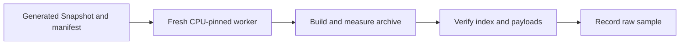
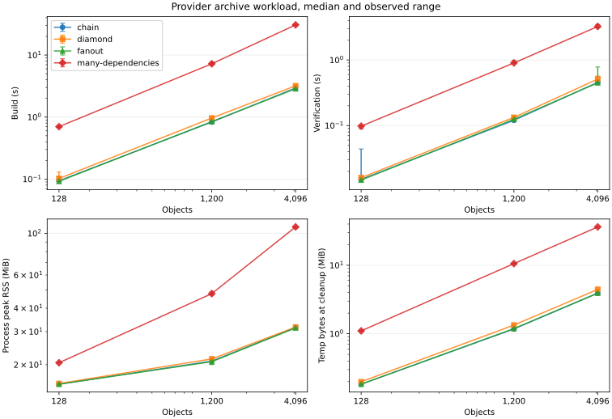

# RT-12. Single-core Provider benchmark baseline

This experiment measures archive build and verification across three fixture sizes and four dependency shapes. The existing Provider uses a manifest plus an immutable Snapshot, spools graph traversal and index data to disk, and publishes a ZIP archive. The original CI samples were useful for queue tuning. The repetitions here establish a local baseline for the same implementation. [Issue #333](https://github.com/aivibeflow/LLMLang/issues/333) · [Package system](PACKAGE-SYSTEM.md)

## Setup

- Source commit `dfa156d06811585907bb6a3a79495d8100cbe27e` on `research/all`. The driver ran the existing benchmark worker with `PYTHONHASHSEED=0`, a 1,024-record build budget and a 4,096 KiB SQLite cache budget.
- Debian 13, Linux 6.18.57, x86-64 AMD EPYC 9V74, logical CPU 0 via `taskset`, four-CPU cgroup quota and 16 GiB cgroup memory limit. Temporary files were on the local `overlay` mount. The VM is shared and CPU exclusivity, clock frequency and cold filesystem caches were uncontrolled.
- CPython 3.12.14, SQLite 3.53.1 and zlib 1.3.2. The chart uses Matplotlib 3.10.8. Fresh worker processes ran serially in five blocks with shuffled case order with the fixed shuffle seed 333. No samples were removed.
- Fixture sizes were 128, 1,200 and 4,096 reachable objects. The graph shapes were a chain, repeated diamonds, root fan-out and a DAG with up to 16 outgoing edges per object. Payloads were short synthetic strings. The 1,200-object size matches the existing CI closure fixtures and the 4,096-object size passes the build record budget by a factor of four.
- Build timing includes `tracemalloc` and temporary-directory measurement overhead. Verification is timed separately and validates index references, exact manifest roots and payload hashes. Process RSS includes fixture construction and verification. The reported temporary-directory bytes are the largest summed file size observed at cleanup, so transient spikes and verifier scratch storage fall outside that metric.



## Results

All 60 archives passed verification. For each shape and size, edge counts, manifest lengths and archive lengths were stable across the five runs.

| Shape | 128 objects | 1,200 objects | 4,096 objects |
| --- | ---: | ---: | ---: |
| Chain | 0.094 [0.092–0.109] | 0.833 [0.803–0.849] | 2.951 [2.775–3.135] |
| Diamond | 0.102 [0.098–0.130] | 0.968 [0.939–1.009] | 3.198 [3.117–3.287] |
| Fan-out | 0.092 [0.091–0.102] | 0.847 [0.808–0.944] | 2.866 [2.674–3.137] |
| Many dependencies | 0.701 [0.685–0.712] | 7.242 [7.049–7.666] | 30.710 [30.118–31.092] |

Build time in seconds, shown as median [observed minimum–maximum]. [Raw sample CSV](provider-baseline/samples.csv)



At 4,096 objects, the many-dependency workload has 65,400 edges. The other workloads have 4,095–5,119. The dense workload's median build takes 30.710 s, with 3.242 s for verification, 108.26 MiB peak process RSS, 36.30 MiB temporary bytes at cleanup and a 16.02 MiB archive. The sparse shapes take 2.866–3.198 s to build and use 31.39–31.72 MiB peak RSS. Their archives occupy 2.36–2.59 MiB. Median traced build-time Python peaks span 1.68–1.73 MiB across all four large cases. Throughput spans 133–1,429 objects per second. The different growth in process RSS and traced allocations makes the latter insufficient as a standalone sizing metric.

These are controlled inputs and affinity on a shared host. The samples provide a shape-sensitive regression baseline with observed ranges. Dedicated hardware, representative Store I/O and payloads, cold/warm stratification, higher scales, independent machines and acceptance thresholds remain open. The reported ranges are empirical spread from five samples per workload.

## Replay

From the repository root, run the collector with a new output path. The CSV reader checks all trial cells, edge counts and stable byte counts. Timings are expected to vary by host and run.

```sh
data=research/packages-and-ecosystem/RT-12/provider-baseline
taskset -c 0 python -B "$data/measure.py" /tmp/llmlang-provider-samples.csv
MPLCONFIGDIR=/tmp/llmlang-provider-mpl python -B "$data/summarize.py" \
  "$data/samples.csv" --plot /tmp/llmlang-provider-baseline.svg
cmp "$data/baseline.svg" /tmp/llmlang-provider-baseline.svg
```
