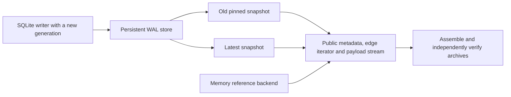

# RT-12 — Public snapshot reads and persistent Provider assembly

- **Date** — 2026-11-25
- **Tracking** — [PLAN §7.2](../../../PLAN.md#72-libraries-packages-templates-and-artifact-ecosystem) · [#333](https://github.com/aivibeflow/LLMLang/issues/333)
- **Status** — Existing public API and SQLite adapter reproduced in a writer schedule

## Question and contract

Can the Provider assemble the same archive through one public snapshot read API while a persistent store advances? The API supplies an opaque snapshot identifier, exact object metadata, an iterator over dependency rows and a read-only object stream. The factory opens a leased view. Consumers close streams and consume dependency iterators while the view remains open. Optional exports and modules can be supplied through separate public readers. [Public content store protocol and SQLite adapter](../PROTOTYPES/PACKAGE-INDEX-01/content_store.py) · [Provider adapter](../PROTOTYPES/PACKAGE-INDEX-01/package_provider.py)

The replay wraps each snapshot in a façade that exposes only the required public reads. It checks a root with 131 dependency rows and two distinct payloads, the larger of which spans three payload chunks. A separate process appends an unrelated object after the first chunk of the pinned read.



## Results

A snapshot opened before the required target is present continues to refuse that target after it is added. The failed assembly preserves a pre-existing destination. Once opened after the target addition, a snapshot assembles the archive while the separate writer commits. That reader retains its snapshot identity and cannot see the unrelated append. A newly opened view sees the append. Its archive remains byte-identical because the append is outside the declared closure. The independent in-memory reader generates these same archive bytes.

| Public observation | Each of the three successful assemblies |
|---|---:|
| Object metadata reads | 2 |
| Dependency iterators | 2 |
| Dependency rows yielded | 131 |
| Payload streams opened and closed | 2 |
| Stream read calls including end of stream | 6 |
| Payload bytes read | 2,099,220 |
| Largest returned chunk | 1,048,576 |

The independent archive verifier accepts all three archives. A separate ZIP reader also verifies the exact payload inventory and streamed hashes. The closed snapshot refuses a new metadata read. All nine existing Content Store tests pass. [Evidence ledger](PUBLIC-SNAPSHOT-REPLAY-01/evidence.json)

## Limits

The result verifies the public API and a persistent experimental adapter for this local backend. It assumes caller-managed lease and stream lifetimes. Production retention and publication authorization, remote snapshot transfer, recovery of abandoned leases and behavior under extended reader lifetimes remain open.

## Reproduction

Run from the repository root with CPython 3.12.14 and SQLite 3.53.1. The runner creates all databases and archives in a temporary directory and uses a separate process for the writer. [Runner](PUBLIC-SNAPSHOT-REPLAY-01/run.py)

```sh
set -eu
dir=research/packages-and-ecosystem/RT-12/PUBLIC-SNAPSHOT-REPLAY-01
observed=$(mktemp)
trap 'rm -f "$observed"' EXIT
python3 -B "$dir/run.py" > "$observed"
cmp "$dir/evidence.json" "$observed"
```
