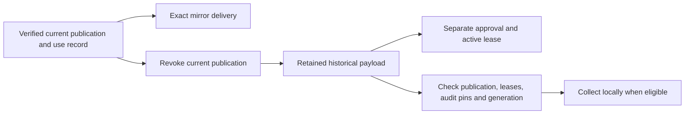

# RT-12 publication, retention and collection lifecycle

The lifecycle separates current distribution authority, historical access and local object retention. In the bounded model, revocation blocks delivery through an exact mirror immediately. A separately approved historical reader can still read through its retention lease. Collection requires a fresh plan after the last lease is released.

## Candidate interfaces

| Transition or query | Required evidence |
| --- | --- |
| Publication | Verified package root, exact archive, current publisher role and publication generation |
| Mirror delivery | Exact archive bytes, current publication and a separate verified declared-use record for the package root, principal, operation and generation |
| Repacked delivery | A new physical digest and matching publication statement. A valid root-bound declared-use record can continue to apply. |
| Revocation | Removes current delivery authority. Previously signed bytes may remain physically retained. |
| Historical access | A separate approval, active lease for that principal and the retained payload |
| Collection | Current mark generation, no live publication, no leases and no audit retention pin. A stale generation triggers a new mark. |

The fixture checks two previously verified evidence ledgers by SHA-256. One covers native Ed25519 publication signatures, archive integrity and declared-use records. The other covers SQLite mark-and-sweep ordering, pinned readers and incomplete closure. The lifecycle model composes their checked boundaries for a single logical package and local replica. [Publication signatures and declared rights](RT-12-DECLARED-PACKAGE-RIGHTS-2026-11-25.md) · [Reachability and concurrent sweep](RT-12-REACHABILITY-SWEEP-2026-11-25.md)



## Results

| Comparison | Outcomes |
| --- | --- |
| 256 mirrored delivery decisions | 1 admitted, 224 unavailable publications, 16 archive mismatches and 15 unavailable permissions |
| 48 collection decisions | 1 collection, 1 already absent, 22 retained and 24 stale marks requiring retry |
| Eight targeted controls | A revoked exact mirror refuses delivery. A separately approved lease allows historical read. Repacked bytes require a matching publication. Releasing the final lease requires a new mark before collection. |

Collection in the fixture records local payload absence. A mirror's retention or deletion requires its own evidence and lifecycle agreement. The study models explicit rights claims rather than interpreting license text. Production authority choices, legal interpretation, trusted clocks and remote acknowledgment remain open.

## Reproduce

Use CPython 3.12.14. Runs with Python hash seeds 37 and 71 produce the same evidence SHA-256 `c2faaeea85b7f21b9b2fc5356485ed6e87cacf8a8fc391f8fd0515d157a4530a`. [Evidence ledger](PUBLICATION-LIFECYCLE-01/evidence.json)

```sh
LC_ALL=C PYTHONHASHSEED=37 PYTHONDONTWRITEBYTECODE=1 \
  python research/packages-and-ecosystem/RT-12/PUBLICATION-LIFECYCLE-01/check.py > /tmp/rt12-publication-life.json
```
