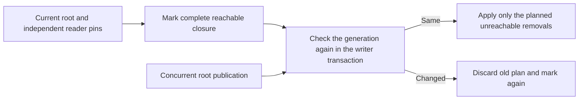

# Check graph reachability across publication and collection

**Scope:** PLAN §4.1 and [#319](https://github.com/aivibeflow/LLMLang/issues/319). Local SQLite WAL fixture at `7464b5277edd6c0c987b85e02377fd963791219d` on `research/all`.

## Question and model

The [global semantic store proposal](GLOBAL-SEMANTIC-ARTIFACT-STORE.md) leaves collection and retention open. [Git retention experiments](../../toolchain-and-collaboration/RT-23/RT-23-PINNED-GIT-RETENTION-2026-11-25.md) show how a historical identity can remain known after its payload becomes unavailable. This fixture tests the same reachability distinction in a local graph index and checks whether publication can race with a stale sweep plan.

The database contains metadata for eight immutable object names, reference edges, local payload-presence flags and multiple pins. The current pin selects a root. Independent reader pins can preserve older roots. A generation counter changes with pin mutations and successful collection; the required closure is checked before a root can be published. The collector follows all active pins using a recursive query with set semantics. The fixture treats a reachable incomplete or unavailable object as uncertainty, closing the entire sweep. Payload availability is modeled transactionally in the same database.



The alternative locked route holds the SQLite writer lock from mark through sweep. Its behavior distinguishes consistency from availability for a writer that has staged a candidate but has not pinned it.

## Results

Six controlled schedules use two SQLite connections and deterministic ordering of writes. The [ledger](REACHABILITY-SWEEP-01/evidence.json) records root and payload availability.

| Schedule | Tested outcome |
| --- | --- |
| Mark, publish another root, then sweep without a generation check | The new root is selected, but the sweep removes its payloads and leaves the selected closure incomplete. |
| Mark, publish another root, then compare generation before sweep | Reject the stale plan, recompute, and preserve the new root's complete closure. |
| Hold the writer lock from mark through sweep | Concurrent publication gets `SQLITE_BUSY`. Its later attempt refuses the swept, incomplete candidate. The current root stays readable. |
| Two reader pins preserve an old root after publication | Releasing the first pin leaves the old closure readable. Releasing the last allows collection. A shared object remains available via the current root. |
| Rooted cycle and subsequent unpin | The recursive traversal terminates, retains both members while pinned, and collects both afterward. |
| Reachable dependency marked incomplete | Refuse the sweep and preserve every payload. |

For a split mark/sweep, all mutations visible to reachability must advance the comparison generation or run under the same exclusion rule. A coarse generation can force retries after an unrelated update. Holding the writer lock is simpler and can delay publishers. Protecting a staged candidate with a pin before collection offers a distinct lifetime guarantee. Merely knowing an immutable root name cannot keep its payload reachable. This result supports recording pins and the validity snapshot separately from object identity.

The object names and cyclic edge fixture are illustrative. Canonical SCC addressing remains separate. The modeled collection updates availability in SQLite without deleting external files. External CAS leases and crash recovery, detached writers, remote replication, abandoned-reader expiry, and the cost of maintaining precise generations remain open.

## Reproduce

Run with CPython 3.12.14 and SQLite 3.53.1 on Linux. The [runner](REACHABILITY-SWEEP-01/run.py) creates new temporary WAL databases and captures the native SQLite source ID. All control counts are exact for the stated fixture.

```sh
set -eu
fixture=research/packages-and-ecosystem/RT-12/REACHABILITY-SWEEP-01
out=$(mktemp)
python3 -B "$fixture/run.py" > "$out"
cmp "$out" "$fixture/evidence.json"
```

Mermaid source was inspected directly.
