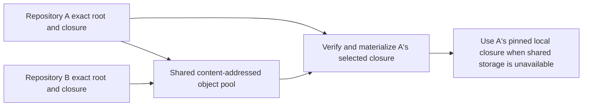

# RT-12 — Compare repository-local and shared immutable closures

## Question and method

What must a repository retain locally when it shares immutable objects with other repositories? The [concrete storage comparison](RT-12-CONCRETE-STORAGE-LAYOUTS-2026-11-25.md) measures four layouts for one graph. This experiment compares two selected repository roots with overlapping closures and explicitly models shared-store unavailability. The baseline is `25d12d038acecec1e9a55e6714a06b4d5c08d694` on `research/all`. [Closed graph backup](RT-12-CLOSED-GRAPH-BACKUP-2026-11-25.md)

For each case two immutable roots reference 4, 64 or 256 common nodes. Each repository's selected manifest specifies its root and the exact allowed closure. The runner verifies a SHA-256 digest at every traversal step and requires the reached set to match the selected inventory. It compares two separate local closures, a shared object directory with per-repository references, and a shared directory plus one materialized local closure. The shared directory is a local stand-in for the availability boundary. The experiment neither uses Git clone nor deploys remote storage.



A manifest carries a selection and required coverage scope in this model. Authenticating that selection is an input assumption. The verifier reads only objects reachable through that selected root, with an independent membership boundary for every address.

## Results

| Common nodes | Two separate local closures | Shared object pool | Shared pool plus one full local closure |
|---:|---:|---:|---:|
| 4 | 3,390 B | 1,788 B | 3,483 B |
| 64 | 53,538 B | 26,862 B | 53,631 B |
| 256 | 214,362 B | 107,274 B | 214,455 B |

The counts sum the regular-file lengths of object bytes and exclude the selection manifest records. In this fixture both repositories consume all common nodes. The shared pool stores those nodes once. Keeping one full local closure duplicates the common nodes and one root, so that configuration is slightly larger than two separate local copies. It supplies a pinned offline read path for the selected repository and a shared online path for both. [Exact object counts and controls](REPOSITORY-CLOSURE-SCOPES-01/evidence.json)

Both local closures work with the shared directory absent. Shared-only lookup is unavailable when the directory is absent. Materializing A's verified closure lets A continue offline; it leaves B's unmaterialized root unavailable. Adding B's root to A's claimed closure fails exact coverage. Selecting B's root without listing it also fails, even though the same shared pool contains the object. Corruption in the shared copy flags that object and leaves the earlier verified local copy intact.

The candidate distinction is between deduplicated physical storage, an exact authorized repository selection and a locally available closure. Availability and sharing can vary independently. This fixture covers content verification and local directory availability. It leaves remote transport, authenticated authorization, concurrent materialization, retention management and filesystem allocation costs open. [Semantic object storage tracking](https://github.com/aivibeflow/LLMLang/issues/319)

## Reproduction

Use CPython 3.12.14. The [runner](REPOSITORY-CLOSURE-SCOPES-01/run.py) builds temporary directories, records graph roots and exact byte counts, and asserts eleven controls at each graph size. Hash seeds 1 and 2 produced the same receipt. The diagram was checked as Mermaid source.

```bash
fixture=research/packages-and-ecosystem/RT-12/REPOSITORY-CLOSURE-SCOPES-01
LC_ALL=C PYTHONHASHSEED=1 python3 -B "$fixture/run.py" > /tmp/llmlang-rt12-repository-closures.json
cmp "$fixture/evidence.json" /tmp/llmlang-rt12-repository-closures.json
```
