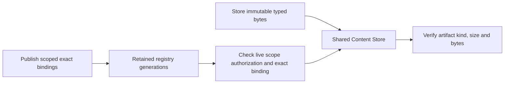

# RT-12 shared artifact storage and scoped registry reads

A shared Content Store can reuse one immutable payload across registries or scopes. Registry bindings supply the authorized discovery relationship between a scope, exact operation, and exact artifact. A Stored Artifact hash alone carries no authorization to read it through a registry.

## Candidate interfaces

| Interface | Boundary |
| --- | --- |
| `put_object(payload, kind, dependencies)` | Store a domain-tagged immutable payload and its explicit outgoing dependency set. An exact retry retains its address and generation. |
| `open_snapshot()` | Open a leased Content Store reader for exact kind, size, dependencies and read-only payload stream. |
| `publish(expected_head, rows)` | Validate referenced kinds and existing objects. Publish a complete, unique registry binding set under an expected registry head. |
| `discover(generation, scope, grants)` | List bindings visible to the supplied scope in one exact registry generation. |
| `exact(generation, scope, grants, operation, artifact)` | Require authorization and exact snapshot membership before reading, then verify kind, size and payload digest. |

The fixture uses the existing immutable SQLite Content Store and a separate SQLite registry. Operation identity commits to its meaning and target context. A change to the same-named operation's target yields a different address. Identical body bytes idempotently share one object, and the same raw suffix under the proof domain yields a distinct address. [Content Store snapshot replay](RT-12-PUBLIC-SNAPSHOT-REPLAY-2026-11-25.md) · [Global Store proposal](GLOBAL-SEMANTIC-ARTIFACT-STORE.md)



## Results

Twenty-four registry discovery profiles match the fixture catalog, including a nonexistent generation and absent scope grants. Across 216 exact reads, 12 return expected bytes and 204 report unavailable. The two scope bindings reuse one identity at the first generation. At the next generation, one scope adopts a new implementation and the other keeps the original. A retained old generation still names its original implementation subject to the currently supplied grant.

Four publication controls refuse a conflicting row set, stale head, absent artifact and wrong artifact kind. Both the retained head and the uncommitted generation are checked after refusal. The fixture includes no deletion or garbage collection during publication. The Content Store and registry transactions are independent, and production deployment must coordinate retention, live authorization, compatibility evidence and remote read receipts. [Scoped multi-provider retrieval](RT-12-MULTI-PROVIDER-RETRIEVAL-2026-11-25.md)

## Reproduce

Use CPython 3.12.14 and SQLite 3.53.1. With hash seeds 37 and 71, evidence SHA-256 is `eba112b2da6901537c2994c604a7293962f1e711ac2d4f1594c1cbd20f0b91fb`. [Evidence ledger](SCOPED-REGISTRY-01/evidence.json)

```sh
LC_ALL=C PYTHONHASHSEED=37 PYTHONDONTWRITEBYTECODE=1 \
  python research/packages-and-ecosystem/RT-12/SCOPED-REGISTRY-01/check.py > /tmp/rt12-scoped-registry.json
```
