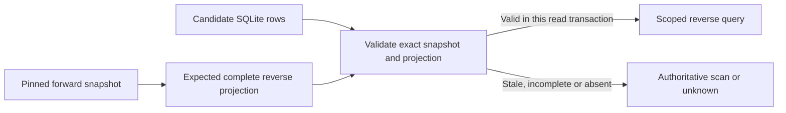

# RT-12 — Bind reverse dependency lookup to a complete snapshot index

## Question and method

When may a reverse lookup return an exact empty result, and how can it distinguish a stale index from a complete current one? This experiment compares trusted current-label lookup, a projection checked against an authoritative digest, and fallback to the exact forward edge list. The baseline is `7c187fb7aa8d629a8723860e9414d75c87385f2f` on `research/all`. [Global semantic artifact store](GLOBAL-SEMANTIC-ARTIFACT-STORE.md) · [Closed graph backup](RT-12-CLOSED-GRAPH-BACKUP-2026-11-25.md)

The fixture uses two semantic snapshots with typed forward edges. An edge has source, target, relationship role and occurrence. Retargeting a caller or adding a second occurrence changes the authoritative projection. The materialized SQLite index stores each occurrence and indexes exact snapshot label, target and role. The consumer obtains the expected digest independently from the selected forward rows. The checked path compares every materialized row to that digest before relying on the lookup. If it cannot validate the projection, the strict alternative reports unknown and the availability-oriented alternative scans the authoritative forward rows.



The scan serves as the independent oracle in this fixture. The experiment includes six queries for each candidate, including one absent dependency and a role-specific query. Exact row multiplicity remains visible.

## Results

| Candidate reverse index | Incorrect unchecked query results out of six | Exact projection admitted |
|---|---:|---|
| Current exact rows | 0 | Yes |
| Current rows inserted in reverse order | 0 | Yes |
| Previous rows with the current label | 3 | No |
| One missing occurrence | 2 | No |
| Extra edge from an inactive graph | 2 | No |
| Existing edge with its role changed | 2 | No |
| Edges collapsed by source-target pair | 3 | No |
| Missing index | 5 | No |

The strict policy admits only the two exact projections. The scan fallback agrees with the canonical result in all 48 cases. Collapsing source-target pairs loses information even when the query appears to return the expected source names. An empty raw index response can represent absence or incomplete indexing; the authoritative scope check distinguishes those meanings. [Per-query observations](REVERSE-INDEX-SCOPE-01/evidence.json)

A separate SQLite WAL schedule removes an edge after validation on another connection. A reader that validates and queries in the same read transaction sees the matching row set. A later unbound query uses the new rows and drops the occurrence, even though earlier validation succeeded. The proof of completeness must cover the exact query snapshot or an immutable admitted generation. This fixture uses a full-row check to demonstrate the boundary and makes no query-speed claim.

The authority in the study is the explicit forward edge inventory. Persisting source correspondence, publishing an immutable index generation, checking large projections without repeated full scans and authenticating the selected manifest require separate evidence. The result proposes an index admission contract for typed reverse dependencies. [Semantic object storage tracking](https://github.com/aivibeflow/LLMLang/issues/319)

## Reproduction

Use CPython 3.12.14 with SQLite 3.53.1. The [runner](REVERSE-INDEX-SCOPE-01/run.py) records the canonical digest, six query inputs, all observed discrepancies and the exact interleaving outputs. It creates local databases in WAL mode and removes them after the run. Hash seeds 1 and 2 produced byte-identical output. The diagram was checked as Mermaid source.

```bash
fixture=research/packages-and-ecosystem/RT-12/REVERSE-INDEX-SCOPE-01
LC_ALL=C PYTHONHASHSEED=1 python3 -B "$fixture/run.py" > /tmp/llmlang-rt12-reverse-index.json
cmp "$fixture/evidence.json" /tmp/llmlang-rt12-reverse-index.json
```
