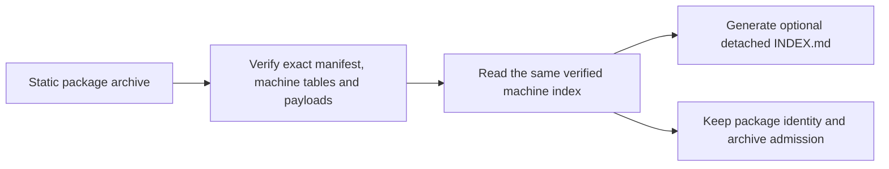

# RT-12 — Static package archives and a derived human index

- **Date** — 2026-11-25
- **Tracking** — [PLAN §7.2](../../../PLAN.md#72-libraries-packages-templates-and-artifact-ecosystem) · [#333](https://github.com/aivibeflow/LLMLang/issues/333)
- **Status** — Reproduced ZIP archive and detached Markdown projection

## Question and contract

Can a static package offer a human-readable index without making that document authoritative for its contents? The existing static ZIP prototype includes the manifest, four machine index tables and exact payloads. An assembler checks table references, logical digests and payload bytes. The candidate publishes an optional detached `INDEX.md`, containing the checked package root, index identity, table counts and exports. The renderer verifies one private archive image and reads the machine tables from that same image. [Package system](PACKAGE-SYSTEM.md) · [Archive prototype](../PROTOTYPES/PACKAGE-INDEX-01/package_archive.py)

The advisory document is checked by rederiving it from the verified archive. Its presence and bytes are outside the package root. The renderer escapes Markdown and HTML syntax in names so data fields appear as text. The archive profile has an exact member inventory. It requires a distinct profile change to embed an additional advisory document.



## Results

| Case | Archive and human-index result |
|---|---|
| Exact rebuild | Same archive bytes, package root and document |
| Display metadata edit | New archive bytes with the same package root and document |
| Machine-table relocation | New archive bytes with the same package root and document |
| Changed exported object's target | New package root and document |
| Export with punctuation | Escaped literal text in the document |
| Current detached document | Matches the projection |
| Edited or stale detached document | Fails the projection comparison |
| Detached document omitted | Archive still verifies |
| Undeclared embedded `INDEX.md` | Existing strict archive verifier refuses it |
| Changed payload | Existing strict archive verifier refuses it |

The fixture confirms a deterministic static archive and a reproducible derived document with distinct roles. Display metadata and storage-path edits can preserve the document because its fields come from the logical index. A changed export causes the old document to fail its comparison even when the package's display name stays the same. [Evidence ledger](STATIC-INDEX-01/evidence.json) · [Generated example](STATIC-INDEX-01/example-index.md)

## Limits

The result covers the existing ZIP/JSONL prototype and one detached-format candidate. The reader materializes the small fixture tables after checking them. Large index rendering, pagination, styling, independent signature policy, embedded variants and production wire-format selection remain open. Package acceptance continues to depend on the machine archive and its exact payloads.

## Reproduction

Run from the repository root with CPython 3.12.14. The runner builds the archive variants in a temporary directory and emits the comparison ledger and the deterministic example document. [Runner](STATIC-INDEX-01/run.py)

```sh
set -eu
dir=research/packages-and-ecosystem/RT-12/STATIC-INDEX-01
scratch=$(mktemp -d)
trap 'rm -rf "$scratch"' EXIT
python3 -B "$dir/run.py" --example "$scratch/example-index.md" > "$scratch/evidence.json"
cmp "$dir/evidence.json" "$scratch/evidence.json"
cmp "$dir/example-index.md" "$scratch/example-index.md"
```
