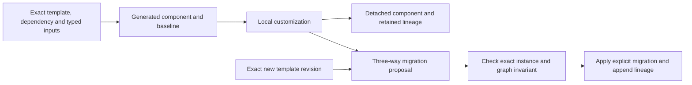

# RT-12 template instantiation, customization, detachment and migration

A typed retry template expands into an independently editable component. An update produces a separate proposal bound to the exact instance and both template revisions. Of 648 prospective migrations, 280 apply with their expected graph and lineage, 333 contain a local conflict, and 35 violate a graph invariant.

## Candidate lifecycle

| Operation | Contract |
| --- | --- |
| Instantiate | Admit exact template and dependency identities, typed parameters and the required capability. Record the source revision and original generated graph. |
| Customize | Apply a local semantic patch and validate the component. Retain the previous generated baseline for comparison. |
| Detach | Retain the component, graph and source lineage while disabling template-managed migrations. |
| Plan | Compute a three-way change from the old generated graph, local graph and new expansion. Preserve unrelated local changes and refuse competing edits to the same field. |
| Apply | Check the exact instance hash and recompute the proposal. After validation, update the generated baseline and append both template revisions to the component's migration trace. |



## Checked results

The fixture combines an integer attempt count, integer backoff duration and a finite retry mode. A cross-field invariant caps the product of attempts and delay. Expansion is deterministic under parameter reordering. Boolean and unknown parameters, a changed dependency and a missing capability are refused. An incomplete target shape is also refused.

The comparison crosses 24 valid local states with 27 prospective template revisions. The oracle checks field agreement and the cross-field invariant independently. Successful cases retain the component's stable ID and record the exact predecessor instance and both template revisions. A stale instance or changed proposal fails before applying any change. Detachment preserves the local graph and lineage. Explicit parameter choices continue to mask changes to the corresponding defaults while other upstream changes can migrate.

The results cover three scalar fields and a single immutable dependency. A production SPG lifecycle needs stable generated node and edge identity, structural additions and deletions, authority for adopting a migration and verification of its observable effects. [Template proposal](LIBRARIES-AND-TEMPLATES.md)

## Reproduce

Use CPython 3.12.14. Replays with Python hash seeds 37 and 71 produce evidence SHA-256 `802665b55232fb8f826c0edbb885044c261e1f3a6733fd5f6dc5a97e0c3ff063`. [Evidence ledger](TEMPLATE-LIFECYCLE-01/evidence.json)

```sh
LC_ALL=C PYTHONHASHSEED=37 PYTHONDONTWRITEBYTECODE=1 \
  python research/packages-and-ecosystem/RT-12/TEMPLATE-LIFECYCLE-01/check.py > /tmp/rt12-template-lifecycle.json
```
