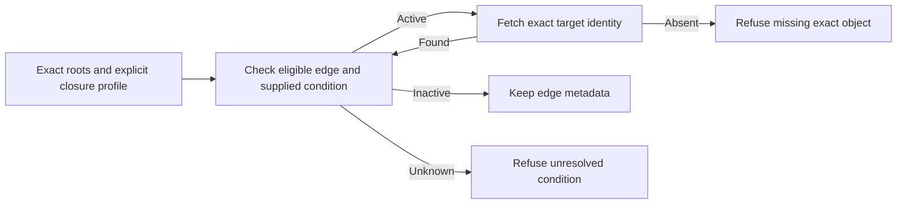

# RT-12 typed target edges and fail-closed package closure

The meaning of a typed target edge materially changes package selection. Across 648 requests run under both policies, treating matching target edges as active changes the result in 258 requests. A candidate request therefore binds the target-edge policy and explicit condition facts alongside its exact roots and ordinary dependency policy.

## Candidate semantics

| Edge or request | Rule in the tested model |
| --- | --- |
| Roots only | Include the exact requested roots. Keep outgoing edge descriptions and evaluate no closure guards. |
| Required closure | Recursively include each active required target by exact hash. |
| Optional edge | Include its target and transitive required dependencies only under the optional-closure policy and a satisfied explicit feature condition. |
| Typed target edge | Two tested interpretations are metadata-only and conditional reachability. The latter follows matching target edges under required and optional closure. |
| Evidence edge | Keep the typed reference. Payload inclusion follows explicit root selection or another reachability edge for this fixture. |
| Unavailable condition or target | Refuse if an eligible edge lacks a required fact. Refuse if an exact selected object is absent. An inactive edge can reference an absent object. |

The walk deduplicates exact hashes and handles cycles. It separates the state of an individual edge from membership of the target, which can also be selected through a different edge or as a root. The model uses only supplied target and feature facts. It never consults the host. [Profile-bound guard decisions](RT-12-CONDITIONAL-CLOSURE-2026-11-25.md) · [Logical package model](RT-12-LOGICAL-PACKAGE-CONTENT-2026-11-25.md)



## Results

The fixture has seven exact objects, a required cycle, disjoint Linux and Windows edges, a trace feature edge and an evidence reference. It derives 1,296 outcomes from three closure policies, two root sets, twelve exact inventory profiles, three target fact states, three feature fact states and two target edge interpretations. All outcomes match a fixture-specific independent membership oracle.

| Closure policy | Requests with changed membership or disposition |
| --- | ---: |
| Roots only | 0 |
| Required | 162 |
| Required and optional | 96 |

All six targeted controls agree with the declared boundaries. Removing the exact Linux object fails even when the inventory contains a differently hashed object under the same conceptual name. Removing the inactive Windows object leaves a Linux request admissible. Without target facts, conditional target traversal returns unresolved. A roots-only request bypasses guard evaluation but still refuses an absent exact root. The fixture records the two interpretations and leaves compatibility and production policy selection open.

## Reproduce

Use CPython 3.12.14 from the repository root. Evidence SHA-256 is `a35f2484f339e3af1f4fbeff9e627598b158df899c02a81052747a8d217c9533` for both Python hash seeds 37 and 71. [Evidence ledger](TYPED-CLOSURE-01/evidence.json)

```sh
LC_ALL=C PYTHONHASHSEED=37 PYTHONDONTWRITEBYTECODE=1 \
  python research/packages-and-ecosystem/RT-12/TYPED-CLOSURE-01/check.py > /tmp/rt12-typed-closure.json
```
