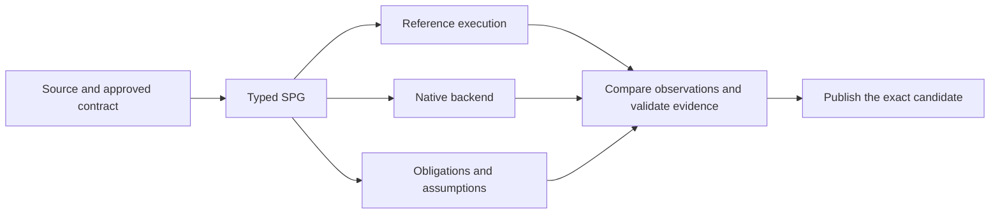

# LLMLang Feasibility by Research Direction

A realistic goal is a typed core with checkable contracts and a Toolchain that stores exact program versions, validates changes, and publishes only candidates that pass validation. Guarantees apply to a specific language profile, set of observations, target environment, and tool version. Portability, proof coverage, foreign code import, and hardware support can expand as more profiles become verifiable.

The feasible scope below is an estimate under the stated conditions, based on the models, prototypes, and comparative experiments in the register. Each result applies within its original scope. Selecting an integrated architecture requires a separate comparison. **SPG** means typed semantic program graph. **ABI** means application binary interface, including the calling convention. **FFI** means foreign function interface. [Research register](../../RESEARCH.md) · [Taxonomy](RESEARCH-TAXONOMY.md) · [Option matrix](RESEARCH-OPTION-MATRIX-01.md) · [Plan](../../PLAN.md)

## Feasible Scope for a First End-to-End Profile

Choose a closed subset with typed calls, explicit errors, ordered effects, and resource ownership, and use one platform for native validation. Check the same scenario through reference execution and a native backend. Before publication, include negative tests for provider substitution, changes to effects, and stale evidence.

The diagram shows the proposed end-to-end profile. Before publication, check that results, errors, and effects agree for the exact candidate. Bind proofs and assumptions to that same revision. The interpreter simplifies observation checks, native compilation provides access to the ABI and system facilities, and independent comparison can expose discrepancies between the two. [Shared semantics corpus](../language-design/RT-03/RT-03-04-SHARED-SEMANTICS-CORPUS.md) · [Integrated candidate comparison](RESEARCH-OPTION-MATRIX-01.md#56-bounded-source-to-publication-candidate-space)

## Guarantees to Exclude

- **Undecidable in general.** Exact automated decisions about equivalence, reachability, termination, and complexity for arbitrary programs with unbounded computation. For individual properties, use restricted classes of programs, certificates, and an explicit unknown outcome. RT-04–08, RT-32–34.
- **Require additional inputs or control.** Recovering ambiguous intent, safe substitution without a contract, complete analysis with hidden inputs, consistent publication for uncontrolled readers, and hard deadlines on arbitrary hardware. RT-02, RT-06, RT-11–16, RT-19–24, RT-26, RT-35–38.
- **Beyond the evidence to date.** Universal speedups, full self-hosting, broad bidirectional translation, physical worst-case execution time (WCET) based on emulation, and verification of an SMP kernel based on a single-core pilot. Evaluate these goals separately for selected profiles. RT-11, RT-21, RT-25, RT-28–31, RT-37–38.

## Summary by Research Direction

### RT-01 — Goals and reference workloads

**Feasible scope.** The Toolchain can support contract-driven development with agents, validation of changes, and explicit human approval. Start with CLI workflows and measure outcomes on predefined tasks.

**Limit.** A single CLI corpus cannot establish productivity gains across all teams and projects. Independent observations on representative tasks are needed.

[LLMLang concept](../language-design/RT-01/LLMLang-CONCEPT.md) · [Development Engine RFC](../toolchain-and-collaboration/RT-14/RFC-DEVELOPMENT-ENGINE.md) · [Reference workloads](../language-design/RT-01/RT-01-REFERENCE-WORKLOADS.md)

### RT-02 — Intent and requirements

**Feasible scope.** Maintain versioned, typed requirements, trace formulas to their source passages, surface discrepancies, and request approval of the exact revision.

**Limit.** An ambiguous or incomplete request does not uniquely determine intent. Agreement with a formula cannot establish that the chosen interpretation matches the author's expectations.

[Scenario 15](../language-design/RT-02/RESEARCH-SCENARIO-15-BUSINESS-INTENT-TO-FORMAL-CONTRACT.md) · [Scenario 17](../language-design/RT-02/RESEARCH-SCENARIO-17-TYPED-REQUIREMENT-IR.md) · [Controlled review protocol](../language-design/RT-02/RT-02-CONTROLLED-REVIEW-PROTOCOL-2026-11-25.md)

### RT-03 — Core semantics

**Feasible scope.** Define an executable core with typed calls, explicit errors, cancellation, ordered effects, and cleanup rules. Specify the observations allowed for concurrency in each profile.

**Limit.** Noncommuting actors with arbitrary message delivery order cannot guarantee one result and trace unless the scheduler or the program is constrained.

[Source cleanup CFG](../language-design/RT-03/RT-03-SOURCE-CLEANUP-CFG-2026-11-25.md) · [Core language semantics research](../language-design/RT-03/CORE-LANGUAGE-SEMANTICS.md)

### RT-04 — Types, effects, and ownership

**Feasible scope.** Check types, effects, and linear ownership of resources. Allow refinement predicates in supported theories. Use explicit FFI contracts for transfers of resources and authority.

**Limit.** There is no general terminating solver for arbitrary refinement predicates. A compiler cannot determine the behavior of an opaque foreign call from its signature alone.

[Queued foreign ownership](../language-design/RT-04/RT-04-QUEUED-FOREIGN-OWNERSHIP-2026-11-25.md) · [Concurrent grant revocation](../language-design/RT-04/RT-04-CONCURRENT-GRANT-REVOCATION-2026-11-25.md)

### RT-05 — SPG and semantic identity

**Feasible scope.** Store immutable, typed program graph objects. Canonicalize the model under fixed rules and track content identity, occurrence identity, and history separately. Restrict the classes of cycles supported.

**Limit.** A fixed-length hash cannot guarantee freedom from collisions over an unbounded set of objects. Canonicalization by behavioral equivalence is undecidable for arbitrary programs.

[Typed SPG study](../semantic-representation/RT-05/RT-05-TYPED-SEMANTIC-PROGRAM-GRAPH.md) · [Typed SPG import validation](../semantic-representation/RT-05/RT-05-TYPED-SPG-IMPORT-VALIDATION.md)

### RT-06 — Dependencies and impact analysis

**Feasible scope.** Extract exact dependencies for a closed, typed subset. Collect evidence for dynamic resolution, track unsuccessful lookups, and conservatively widen the scope of recomputation.

**Limit.** For open-world dynamic calls, a set of possible edges cannot be guaranteed both exact and complete without a model of the environment. Exact call reachability is undecidable for arbitrary code.

[Scenarios 18–28](../language-design/RT-02/RESEARCH-SCENARIO-18-REQUIREMENT-EVOLUTION-AND-SEMANTIC-IMPACT.md) · [Scenario 25](../semantic-representation/RT-06/RESEARCH-SCENARIO-25-FORMAL-SEMANTIC-DEPENDENCY-ANALYSIS.md)

### RT-07 — Formal semantics and verification

**Feasible scope.** Connect reference semantics, translation, proof obligations, and independently checkable proofs. Admit results for the exact fragment, assumptions, and trusted components involved.

**Limit.** No total solver can decide every property of arbitrary programs. A verdict that relies on trusted axioms cannot establish an unconditional guarantee about the source without a proved translation correspondence.

[Pinned Logos verdict audit](../formal-verification/RT-07/RT-07-LOGOS-VERDICT-PROOF-2026-11-25.md) · [Formal verification architecture](../formal-verification/RT-07/LLMLang-FORMAL-VERIFICATION.md)

### RT-08 — Testing and evidence

**Feasible scope.** Automate test generation, property checking, counterexample search, and evidence provenance tracking. Record coverage limits and conditions for evidence reuse separately.

**Limit.** Finite samples cannot prove a property over an untested infinite domain. Exhaustive enumeration applies only to a closed, fully specified finite model.

[Scenarios 15–24](../language-design/RT-02/RESEARCH-SCENARIO-15-BUSINESS-INTENT-TO-FORMAL-CONTRACT.md) · [Scenarios 26–34](../formal-verification/RT-07/RESEARCH-SCENARIO-26-MINIMAL-FORMAL-SEMANTIC-CORE.md)

### RT-09 — Compiler and intermediate representations

**Feasible scope.** Build a checkable pipeline from parsing through the typed SPG to lower-level IRs. Validate transformations against results, errors, and relevant effects.

**Limit.** Preserving values alone cannot establish preservation of effect order, undefined behavior, poison semantics, or memory behavior. A general lowering guarantee requires semantics for both sides.

[Mutable byte-view preservation](../compiler-and-translation/RT-09/RT-09-13-MUTABLE-BYTE-VIEW-PRESERVATION.md) · [Scenario 96 — LLVM UB, poison, and semantic preservation](../compiler-and-translation/RT-13/RESEARCH-SCENARIO-96-LLVM-UB-POISON-AND-SEMANTIC-PRESERVATION.md)

### RT-10 — Runtime and operating systems

**Feasible scope.** Provide a portable runtime and native adapters with specified POSIX versions, ABIs, and contracts for resources and system behavior. Test slices of I/O and concurrency in target environments.

**Limit.** Identical system effects and timing cannot be guaranteed across operating systems and machines with different schedulers, ABIs, and peripherals.

[POSIX runtime architecture](../runtime-and-systems/RT-10/POSIX-RUNTIME-ARCHITECTURE.md) · [Resumable reference and VM execution](../runtime-and-systems/RT-10/RT-10-RESUMABLE-EXECUTION-2026-11-25.md)

### RT-11 — Incremental builds and caching

**Feasible scope.** Cache actions by the full known set of inputs that determine their results. Track action keys, semantic identity, and artifact bytes separately. Recompute the affected scope when the inputs are incomplete.

**Limit.** An untracked input can invalidate a cache hit. Measurements from individual scenarios cannot establish a speedup for every graph, edit, and environment.

[Semantic compilation cache](../toolchain-and-collaboration/RT-11/SEMANTIC-COMPILATION-CACHE.md) · [speedup estimate](../toolchain-and-collaboration/RT-11/COMPILATION-CACHE-SPEEDUP-ESTIMATE.md)

### RT-12 — Libraries, packages, and templates

**Feasible scope.** Version immutable packages, public contracts, and templates. Support partial indexing, resolve exact dependency closure, and validate fetched objects against identity and publication policy.

**Limit.** A public interface is bound by name. The implementation selected for it is identified by its hash, which incorporates the behavioral specification. A change in specified behavior therefore changes the implementation hash, even when the public name stays the same. When the binding selects a different hash, check the new implementation against the public contract. Licensing rights and publisher trust require separate evidence. An exact closure cannot safely account for hidden dependencies.

[Libraries and templates](../packages-and-ecosystem/RT-12/LIBRARIES-AND-TEMPLATES.md) · [Global semantic artifact store](../packages-and-ecosystem/RT-12/GLOBAL-SEMANTIC-ARTIFACT-STORE.md)

### RT-13 — Backends and interoperability

**Feasible scope.** Combine reference execution with native backends for explicit target profiles. Import and export libraries across checked ABI boundaries with contracts and a support matrix.

**Limit.** Matching symbols, sizes, and layouts do not establish ABI compatibility across calling conventions. Full platform support requires checking the ABI, loader, and runtime environment.

[Atomic lowering](../compiler-and-translation/RT-13/RT-13-ATOMIC-BYTE-WORD-LOWERING-2026-11-24.md) · [LLVM preservation corpus](../compiler-and-translation/RT-13/RESEARCH-SCENARIO-96A-LLVM-INTEGER-PRESERVATION.md)

### RT-14 — Agent-assisted development

**Feasible scope.** Provide a structured editing API, versioned Knowledge Context and Task Context, explicit context gaps, and mandatory validation of the resulting change.

**Limit.** A fixed context cannot guarantee completeness for arbitrary tasks and repositories. A task description cannot confer authority to act.

[Development Engine RFC](../toolchain-and-collaboration/RT-14/RFC-DEVELOPMENT-ENGINE.md) · [open-question research program](RESEARCH-PROGRAM-OPEN-QUESTIONS-2026-11-19.md) · [Task authority model](../toolchain-and-collaboration/RT-14/RT-14-TASK-AUTHORITY-2026-11-25.md)

### RT-15 — Collaboration and Git

**Feasible scope.** Store a reproducible program representation in Git, show semantic diffs, automatically merge compatible changes, and stop on conflicts.

**Limit.** A conflict-free text merge cannot establish semantic compatibility. Incompatible requirements cannot both be preserved automatically without a policy choice or a change to the requirements.

[Git semantic repository](../toolchain-and-collaboration/RT-15/GIT-SEMANTIC-REPOSITORY.md) · [ADR-014](../../draft/adr/014-git-semantic-merge.md)

### RT-16 — Security and trust

**Feasible scope.** Bind authority to the scope, revision, and action. Isolate workers, verify artifact provenance, and bind publication to the current authorization decision.

**Limit.** An external effect that has already occurred cannot be revoked. A signature can authenticate the signer and protect integrity. The truth of the signed claim requires separate evidence.

[Threat Model 01](../security/RT-16/RT-16-THREAT-MODEL-01.md) · [Scenario 76 — regular-expression resource bounds](../language-design/RT-03/RESEARCH-SCENARIO-76-REGULAR-EXPRESSION-SEMANTICS-AND-RESOURCE-BOUNDS.md)

### RT-17 — Diagnostics and developer experience

**Feasible scope.** Make diagnostics structured and bind each one to an exact revision, location, and obligation. Reuse that format across the CLI, IDE, CI, and agent prompts.

**Limit.** An observed error may have multiple causes and fixes. There is no guarantee of recovering a unique cause or an intent-preserving fix. Measure the effectiveness of suggestions.

[Scenario 95 — diagnostics for humans and coding agents](../toolchain-and-collaboration/RT-17/RESEARCH-SCENARIO-95-DIAGNOSTICS-FOR-HUMANS-AND-AGENTS.md) · [Development Engine RFC](../toolchain-and-collaboration/RT-14/RFC-DEVELOPMENT-ENGINE.md)

### RT-18 — Conformance, evolution, and ecosystem

**Feasible scope.** Version language and library profiles. Check callable compatibility within a coherent build using one Toolchain. Add separate adapters for external formats and ABIs where needed.

**Limit.** Internal type compatibility cannot guarantee binary, protocol, or behavioral compatibility between independently built versions without separate contracts.

[Libraries and templates](../packages-and-ecosystem/RT-12/LIBRARIES-AND-TEMPLATES.md) · [POSIX runtime architecture](../runtime-and-systems/RT-10/POSIX-RUNTIME-ARCHITECTURE.md) · [Accepted decision](../../draft/ARCHITECTURE-DECISIONS.md)

### RT-19 — Toolchain Server

**Feasible scope.** Provide a transport-neutral API, immutable snapshots, Change Set transactions, and checkable write preconditions. Journal publication and recover it using exact identifiers.

**Limit.** A local database transaction cannot make Git, the filesystem, and a remote push atomic as a group. Observable consistency requires a shared protocol and readers that follow it.

[SQLite/Git process recovery](../toolchain-and-collaboration/RT-19/RT-19-SQLITE-GIT-PROCESS-RECOVERY-2026-11-24.md) · [Toolchain Server and Semantic Development API](../toolchain-and-collaboration/RT-19/RT-19-TOOLCHAIN-SERVER-AND-SEMANTIC-DEVELOPMENT-API.md)

### RT-20 — Change planning and verified commits

**Feasible scope.** Build a plan from a snapshot and account for migration, retention, or version splits at each call site. Check completeness and freeze the exact tree before committing.

**Limit.** A complete plan cannot be guaranteed for unknown executors, dynamic targets, and opaque environments. Validation of another tree cannot establish validity of the candidate.

[RT-20 — LLM Patch Planning, Caller Migration, Hash Propagation, and Verified Commit](../toolchain-and-collaboration/RT-20/RT-20-LLM-PATCH-PLANNING-AND-HASH-PROPAGATION.md) · [RT-19](../toolchain-and-collaboration/RT-19/RT-19-TOOLCHAIN-SERVER-AND-SEMANTIC-DEVELOPMENT-API.md)

### RT-21 — Self-development and bootstrap

**Feasible scope.** Port individual tools to LLMLang as it gains the required types, operations, and ABI support. Check reproducibility of the interpretation and generation stages with pinned bootstrap tools.

**Limit.** Self-compilation still depends on trust in the seed compiler and environment. A successful port of one tool cannot establish that the full Toolchain can be self-hosted.

[RT-21 — LLMLang Self-Development](../toolchain-and-collaboration/RT-21/RT-21-LLMLANG-SELF-DEVELOPMENT-AND-BOOTSTRAP-ROADMAP.md) · [RT-03 Core Semantics](../language-design/RT-03/CORE-LANGUAGE-SEMANTICS.md) · [Bootstrap pilot](../toolchain-and-collaboration/RT-21/RT-21-STRUCTURED-DEPENDENCY-BOOTSTRAP-2026-11-25.md)

### RT-22 — Git and worktrees over MCP

**Feasible scope.** Expose narrow repository and worktree operations through an MCP adapter. Use exact preconditions, authorization, and recoverable operation identifiers.

**Limit.** The MCP transport supplies neither authority to mutate state nor atomicity across push, checkout, and local updates.

[RT-22 — LLMLang Git Repository and Worktree MCP Surface](../toolchain-and-collaboration/RT-22/RT-22-LLMLANG-GIT-REPOSITORY-AND-WORKTREE-MCP.md) · [RT-19](../toolchain-and-collaboration/RT-19/RT-19-TOOLCHAIN-SERVER-AND-SEMANTIC-DEVELOPMENT-API.md)

### RT-23 — Shared Toolchain across worktrees

**Feasible scope.** Share reads of immutable objects, maintain separate File View and interface-mapping versions, and use a generation or snapshot for consistent reads.

**Limit.** Reading independently mutable files without a common generation cannot guarantee a coherent snapshot during updates and garbage collection.

[RT-23 — Single-Instance Toolchain with Shared Semantic State and Incremental Multi-Worktree File Views](../toolchain-and-collaboration/RT-23/RT-23-SINGLE-INSTANCE-TOOLCHAIN-AND-INCREMENTAL-MULTI-WORKTREE.md) · [RT-19](../toolchain-and-collaboration/RT-19/RT-19-TOOLCHAIN-SERVER-AND-SEMANTIC-DEVELOPMENT-API.md) · [Generation checks on reads](../toolchain-and-collaboration/RT-23/RT-23-NATIVE-GENERATION-READS-2026-11-25.md)

### RT-24 — Canonical representation, diff, and merge

**Feasible scope.** Reconstruct a typed graph from an exact Git tree, compare occurrences and bindings, and perform three-way merges with semantic validation and explicit conflicts.

**Limit.** Conflicting Git merge bases cannot guarantee a unique semantically correct merge without an explicit policy. Equal roots cannot recover lost occurrence history.

[RT-24 — Canonical Semantic Representation, Diff, and Three-Way Merge](../toolchain-and-collaboration/RT-24/RT-24-CANONICAL-SEMANTIC-REPRESENTATION-DIFF-AND-MERGE.md) · [Identity and SPG Reconciliation](../toolchain-and-collaboration/RT-24/RT-24-IDENTITY-AND-SPG-RECONCILIATION.md)

### RT-25 — Allocators

**Feasible scope.** Support allocator selection for pinned target and linker configurations. Bind deallocation to the owner and choose policies based on workloads, latency, and memory use.

**Limit.** An unrelated allocator cannot safely free memory without a compatible contract. Individual comparisons cannot identify the best allocator for all workloads.

[RT-25 — Memory Allocator Compatibility, Selection, and Benchmarking](../runtime-and-systems/RT-25/RT-25-MEMORY-ALLOCATOR-COMPATIBILITY-AND-BENCHMARKING.md) · [Rust System compatibility probe](../runtime-and-systems/RT-25/RT-25-RUST-SYSTEM-ALLOCATOR-COMPATIBILITY.md)

### RT-26 — Resource accounting and limits

**Feasible scope.** Track hierarchical budgets, reserve access, and release resources after terminal confirmation. Enforce limits through supported cooperative and OS mechanisms.

**Limit.** Hard deadlines and exact accounting of all costs are unattainable in an uncontrolled environment without clocks, events, and controlled scheduling. Revoking access does not release resources before operations settle.

[RT-26 — Hierarchical Resource Accounting, Limits, Throttlers, and Handlers](../runtime-and-systems/RT-26/RT-26-HIERARCHICAL-RESOURCE-ACCOUNTING-AND-ENFORCEMENT.md) · [Native disk accounting](../runtime-and-systems/RT-26/RT-26-NATIVE-DISK-ACCOUNTING-2026-11-25.md)

### RT-27 — Physical SPG storage

**Feasible scope.** Use deterministic, indexed records or blocks, checked loading, parallel reads, and an explicit retention policy. Select layouts against Git histories and edit patterns.

**Limit.** No single layout can guarantee minimum Git storage, minimum read amplification, and optimal local updates for all edit distributions.

[RT-27 — SPG Repository Storage Format Requirements](../toolchain-and-collaboration/RT-27/RT-27-SPG-REPOSITORY-STORAGE-FORMAT-REQUIREMENTS.md) · [Git Representation and Semantic Merge](../toolchain-and-collaboration/RT-15/GIT-REPRESENTATION-AND-SEMANTIC-MERGE.md)

### RT-28 — Polyglot migration

**Feasible scope.** Migrate in units linked to their sources and reconcile them again after upstream updates. Compare behavior within a limited profile and support mixed-language execution and rollback.

**Limit.** Automatic equivalent migration cannot be guaranteed for arbitrary programs with opaque dependencies and mismatched semantics.

[RT-28 — Incremental Polyglot Migration and Semantic Mirroring](../compiler-and-translation/RT-28/RT-28-INCREMENTAL-POLYGLOT-MIGRATION-AND-SEMANTIC-MIRRORING.md) · [RT-19](../toolchain-and-collaboration/RT-19/RT-19-TOOLCHAIN-SERVER-AND-SEMANTIC-DEVELOPMENT-API.md) · [zlib pilot](../compiler-and-translation/RT-28/RT-28-ZLIB-RELEASE-MIRROR-2026-11-25.md)

### RT-29 — Rust as an implementation foundation

**Feasible scope.** Consider Rust for the Toolchain and runtime. Reuse checked components where contracts align, and evaluate ownership, ABI, panic behavior, and ecosystem support against the workload.

**Limit.** Safe Rust guarantees do not extend automatically across unsafe code, FFI, or the external environment. The implementation language does not determine LLMLang semantics.

[RT-29 research brief](../compiler-and-translation/RT-29/RT-29-RUST-FOUNDATION-FOR-LLMLANG-CAPABILITIES.md)

### RT-30 — Bidirectional translation

**Feasible scope.** Generate C, C++, Go, and Rust, and import explicitly admitted subsets. Document the profile, observation model, provenance, and any shared runtime.

**Limit.** A universal round trip preserving all observations across these languages is impossible without restrictions, emulation, or a richer model. Semantic import alone cannot recover the original formatting.

[RT-30 research brief](../compiler-and-translation/RT-30/RT-30-BIDIRECTIONAL-SEMANTIC-TRANSLATION.md) · [RT-13](../compiler-and-translation/RT-13/RT-13-LLVM-WASM-BYTE-VIEW-LOWERING.md) · [Translation matrix](../compiler-and-translation/RT-30/RT-30-WRAPPING-TRANSLATION-MATRIX-2026-11-25.md)

### RT-31 — Syntax for AI-assisted development

**Feasible scope.** Develop several syntax profiles with checkable mappings to a common semantic layer. Measure accuracy and cost on pinned models and tasks.

**Limit.** No single syntax can be guaranteed best for every person, model, and task. Semantic equivalence of profiles cannot guarantee preservation of ambiguous source text or formatting.

[RT-31 research brief](../language-design/RT-31/RT-31-AI-ORIENTED-SYNTAX-AND-TOOLCHAIN-OPTIMIZATION.md) · [RT-03](../language-design/RT-03/CORE-LANGUAGE-SEMANTICS.md) · [Shared SPG across profiles](../language-design/RT-31/RT-31-CROSS-PROFILE-SPG-2026-11-24.md)

### RT-32 — From SPG to Lean

**Feasible scope.** Generate definitions and obligations from exact SPGs and contracts, check them with the Lean kernel, and track the full closure of dependent claims and axioms.

**Limit.** A checked theorem about a generated model cannot prove a property of the source without a correspondence between the generator and source semantics. Signing a certificate does not discharge a foreign assumption.

[RT-32 — Verified SPG-to-Lean Pipeline](../formal-verification/RT-32/RT-32-VERIFIED-SPG-TO-LEAN-PIPELINE.md) · [Exact SPG observation binding](../formal-verification/RT-32/RT-32-SPG-LEAN-OBSERVATION-BINDING-2026-11-24.md)

### RT-33 — Proof orchestration

**Feasible scope.** Choose Lean, SMT, or TLA+ according to the obligation and profile capabilities. Independently check applicability, combine only exact and compatible results, and report unknown outcomes.

**Limit.** Several incomplete or conditional results cannot yield an unconditional proof without a checked composition rule. No selection procedure can guarantee a complete solver for arbitrary obligations.

[RT-33 — Proof Backend Selection and Verification Orchestration](../formal-verification/RT-33/RT-33-PROOF-BACKEND-SELECTION-AND-ORCHESTRATION.md) · [RT-07](../formal-verification/RT-07/LLMLang-FORMAL-VERIFICATION.md)

### RT-34 — Complexity and resource contracts

**Feasible scope.** Infer and check bounds for supported loops, recursion, and calls under explicit cost models. Bind each budget to the exact provider and stated assumptions.

**Limit.** Automatically determining exact complexity and optimality is undecidable in general for arbitrary code. An abstract operation count alone cannot bound time on a particular device.

[RT-34 research brief](../formal-verification/RT-34/RT-34-AUTOMATIC-COMPLEXITY-INFERENCE.md) · [complexity benchmark plan](../formal-verification/RT-34/RT-34-COMPLEXITY-BENCHMARK.md) · [Call cost binding](../formal-verification/RT-34/RT-34-CALL-COST-BINDING-2026-11-25.md)

### RT-35 — Function discovery

**Feasible scope.** Rank candidates by structural and semantic features. Filter against hard requirements and substitute only after checking compatibility and resolving the exact binding.

**Limit.** Vector similarity and textual matches cannot establish substitutability. Incomplete indexes and approximate searches cannot establish that no suitable implementation exists.

[RT-35 — Semantic Function Discovery and Retrieval](../semantic-representation/RT-35/RT-35-SEMANTIC-FUNCTION-DISCOVERY-AND-RETRIEVAL.md) · [RT-03](../language-design/RT-03/CORE-LANGUAGE-SEMANTICS.md) · [Discovery and binding pilot](../semantic-representation/RT-35/RT-35-SCOPED-RETRIEVAL-2026-11-25.md)

### RT-36 — Assumptions and conditional proofs

**Feasible scope.** Track typed, scoped, versioned assumptions and their authorization. Check closure and consistency within the supported profile, and invalidate dependent results when inputs change.

**Limit.** Approval of an assumption does not prove how the outside world behaves. An unproved or inconsistent assumption cannot justify an unconditional guarantee.

[RT-36 — Formal Verification Assumptions, Trust Boundaries and Conditional Proof Management](../formal-verification/RT-36/RT-36-FORMAL-VERIFICATION-ASSUMPTIONS-AND-TRUST.md)

### RT-37 — Freestanding execution and firmware

**Feasible scope.** Build a limited profile with explicit startup and runtime closure, memory-mapped I/O, interrupts, and static budgets. Extend support through pinned STM32F1, STM32F4, and ESP32 boards as hardware evidence becomes available.

**Limit.** QEMU results cannot establish physical timing, DMA, or actual peripheral behavior. Worst-case execution time requires a hardware model, defined execution conditions, and validation on the target.

[RT-37 brief](../runtime-and-systems/RT-37/README.md) · [Cortex-M3 closure](../runtime-and-systems/RT-37/RT-37-CORTEX-M3-FREESTANDING-CLOSURE-2026-11-24.md)

### RT-38 — Operating systems and verifiable microkernels

**Feasible scope.** Develop a limited RV64 pilot with separate contracts for memory, scheduling, IPC, and isolation. Relate the model to a bootable binary and expand hardware coverage incrementally.

**Limit.** A single-core pilot cannot establish SMP guarantees, whole-microkernel correctness, or the safety of arbitrary drivers. These claims require separate models and correspondence with binary execution on the target profiles.

[RT-38 brief](../runtime-and-systems/RT-38/README.md) · [RV64 isolation](../runtime-and-systems/RT-38/RT-38-RV64-PMP-SV39-TRAP-ISOLATION-2026-11-24.md)
