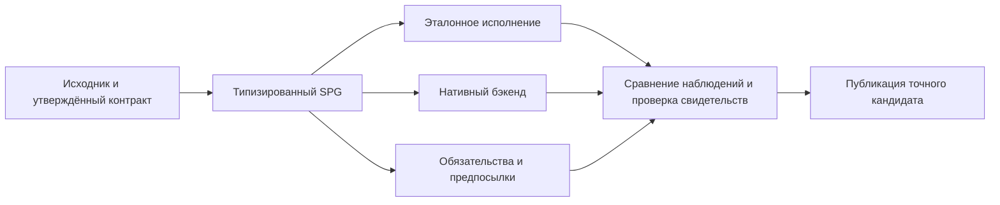

# LLMLang — реализуемый максимум по направлениям исследований

Реалистичная цель — типизированное ядро с проверяемыми контрактами и Toolchain, который хранит точные версии программ, проверяет изменения и публикует только допущенного кандидата. Гарантии относятся к конкретному профилю языка, набору наблюдений, целевой среде и версии инструментов. Переносимость, доказательства, импорт чужого кода и работа с устройствами расширяются по мере появления проверяемых профилей.

Максимум ниже — оценка достижимого объёма при указанных условиях. Она опирается на модели, прототипы и сравнительные испытания из реестра. Исследовательские результаты сохраняют свои границы, а выбор интегрированной архитектуры требует отдельного сравнения. Термины **SPG** и **ABI** означают типизированный семантический граф программы и двоичный интерфейс вызова соответственно. **FFI** — граница вызова кода на другом языке. [Реестр исследований](../../RESEARCH.md) · [Таксономия](RESEARCH-TAXONOMY.md) · [Матрица вариантов](RESEARCH-OPTION-MATRIX-01.md) · [План](../../PLAN.md)

## Совместимый максимум для первого сквозного профиля

Выбрать закрытый срез с типизированными вызовами, явными ошибками и порядком эффектов, владением ресурсами и одной платформой для нативной проверки. Проверить один и тот же сценарий через эталонное исполнение и нативный бэкенд. Включить отрицательные проверки для подмены провайдера, изменения эффекта и устаревшего свидетельства перед публикацией.

Схема показывает предлагаемый сквозной профиль. Для публикации соответствие результатов, ошибок и эффектов проверяется на точном кандидате. Доказательства и допущения привязываются к той же ревизии. Интерпретатор упрощает проверку наблюдений, нативная компиляция даёт доступ к ABI и системным возможностям, а независимая сверка помогает обнаружить расхождения между ними. [Общий корпус семантики](../language-design/RT-03/RT-03-04-SHARED-SEMANTICS-CORPUS.md) · [Сравнение интегрированных вариантов](RESEARCH-OPTION-MATRIX-01.md#56-bounded-source-to-publication-candidate-space)

## Какие гарантии исключить

- **Неразрешимы в общем случае.** Точное автоматическое решение эквивалентности, достижимости, завершения и сложности для произвольных программ с неограниченным вычислением. Для отдельных свойств работают ограниченные классы программ, сертификаты и явный статус «неизвестно». RT-04–08, RT-32–34.
- **Требуют дополнительных входов или контроля.** Восстановление неоднозначного намерения, безопасная подстановка без контракта, полный анализ с невидимыми входами, согласованная публикация у неконтролируемых читателей и жёсткие сроки на произвольном оборудовании. RT-02, RT-06, RT-11–16, RT-19–24, RT-26, RT-35–38.
- **Пока выходят за пределы подтверждённого.** Универсальное ускорение, полная самосборка, широкая двусторонняя трансляция, физический WCET по результатам эмуляции и верификация SMP-ядра по одноядерному пилоту. Эти возможности оцениваются отдельно для выбранных профилей. RT-11, RT-21, RT-25, RT-28–31, RT-37–38.

## Сводки по направлениям

### RT-01 — Цели и рабочие сценарии

**Реализуемый максимум.** Toolchain может поддержать разработку по контрактам с агентом, проверкой изменений и явным утверждением человеком. Начать с CLI и измерять результат на заранее заданных задачах.

**Граница.** Из одного CLI-корпуса нельзя вывести гарантии роста продуктивности для всех команд и проектов. Нужны независимые наблюдения на репрезентативных задачах.

[LLMLang concept](../language-design/RT-01/LLMLang-CONCEPT.md) · [Development Engine RFC](../toolchain-and-collaboration/RT-14/RFC-DEVELOPMENT-ENGINE.md) · [Эталонные рабочие сценарии](../language-design/RT-01/RT-01-REFERENCE-WORKLOADS.md)

### RT-02 — Намерение и требования

**Реализуемый максимум.** Вести версионированные типизированные требования, связывать формулы с исходными фрагментами, показывать расхождения и запрашивать подтверждение точной ревизии.

**Граница.** Однозначно восстановить намерение из неоднозначного или неполного запроса нельзя. Совпадение с формулой не подтверждает, что выбранное толкование соответствует ожиданиям автора.

[Scenario 15](../language-design/RT-02/RESEARCH-SCENARIO-15-BUSINESS-INTENT-TO-FORMAL-CONTRACT.md) · [Scenario 17](../language-design/RT-02/RESEARCH-SCENARIO-17-TYPED-REQUIREMENT-IR.md) · [Протокол контролируемого ревью](../language-design/RT-02/RT-02-CONTROLLED-REVIEW-PROTOCOL-2026-11-25.md)

### RT-03 — Семантика ядра

**Реализуемый максимум.** Определить исполняемое ядро с типизированными вызовами, явными ошибками, отменой, порядком эффектов и правилами очистки. Для конкурентности описать допустимые наблюдения по профилю.

**Граница.** Для некоммутирующих акторов с произвольным порядком доставки нельзя гарантировать единый результат и трассу без ограничения планирования или программы.

[Source cleanup CFG](../language-design/RT-03/RT-03-SOURCE-CLEANUP-CFG-2026-11-25.md) · [Core language semantics research](../language-design/RT-03/CORE-LANGUAGE-SEMANTICS.md)

### RT-04 — Типы, эффекты и владение

**Реализуемый максимум.** Проверять типы, эффекты и линейное владение ресурсами. Разрешать уточнения в поддерживаемых теориях. Описывать передачу ресурсов и полномочий через FFI явными контрактами.

**Граница.** Общий решатель произвольных предикатов уточнения с гарантированным завершением невозможен. Компилятор не может вывести поведение непрозрачного иностранного вызова из его сигнатуры.

[Queued foreign ownership](../language-design/RT-04/RT-04-QUEUED-FOREIGN-OWNERSHIP-2026-11-25.md) · [Concurrent grant revocation](../language-design/RT-04/RT-04-CONCURRENT-GRANT-REVOCATION-2026-11-25.md)

### RT-05 — SPG и семантическая идентичность

**Реализуемый максимум.** Хранить неизменяемые типизированные объекты графа программы. Канонизировать модель с фиксированными правилами, хранить идентичность содержимого, вхождений и историю отдельно. Ограничить поддерживаемые циклы.

**Граница.** Хеш фиксированной длины не может гарантировать отсутствие коллизий для неограниченного множества объектов. Общая канонизация по поведенческой эквивалентности произвольных программ неразрешима.

[Typed SPG study](../semantic-representation/RT-05/RT-05-TYPED-SEMANTIC-PROGRAM-GRAPH.md) · [Typed SPG import validation](../semantic-representation/RT-05/RT-05-TYPED-SPG-IMPORT-VALIDATION.md)

### RT-06 — Зависимости и анализ влияния

**Реализуемый максимум.** Извлекать точные зависимости для закрытого типизированного подмножества. Для динамического разрешения собирать свидетельства, учитывать отрицательные обращения и консервативно расширять область пересчёта.

**Граница.** Для открытых динамических вызовов нельзя одновременно гарантировать точный и полный набор возможных рёбер без модели окружения. Точное определение достижимости вызова для произвольного кода неразрешимо.

[Scenarios 18–28](../language-design/RT-02/RESEARCH-SCENARIO-18-REQUIREMENT-EVOLUTION-AND-SEMANTIC-IMPACT.md) · [Scenario 25](../semantic-representation/RT-06/RESEARCH-SCENARIO-25-FORMAL-SEMANTIC-DEPENDENCY-ANALYSIS.md)

### RT-07 — Формальная семантика и проверка

**Реализуемый максимум.** Связать эталонную семантику, перевод, обязательства и независимо проверяемые доказательства. Принимать вывод для точного фрагмента, набора предпосылок и проверяющих компонентов.

**Граница.** Тотальный решатель всех свойств произвольных программ невозможен. Вердикт проверяющего с доверенными аксиомами не даёт безусловной гарантии исходной программе без доказанной связи перевода.

[Pinned Logos verdict audit](../formal-verification/RT-07/RT-07-LOGOS-VERDICT-PROOF-2026-11-25.md) · [Formal verification architecture](../formal-verification/RT-07/LLMLang-FORMAL-VERIFICATION.md)

### RT-08 — Тестирование и доказательства

**Реализуемый максимум.** Автоматизировать генерацию тестов, проверку свойств, поиск контрпримеров и учёт происхождения свидетельств. Отдельно хранить границы покрытия и условия повторного использования.

**Граница.** Конечная выборка не доказывает свойство на непроверенной бесконечной области. Исчерпывающий перебор применим лишь при закрытой и полной конечной модели.

[Scenarios 15–24](../language-design/RT-02/RESEARCH-SCENARIO-15-BUSINESS-INTENT-TO-FORMAL-CONTRACT.md) · [Scenarios 26–34](../formal-verification/RT-07/RESEARCH-SCENARIO-26-MINIMAL-FORMAL-SEMANTIC-CORE.md)

### RT-09 — Компилятор и промежуточные представления

**Реализуемый максимум.** Построить проверяемый конвейер от разбора до типизированного SPG и нижних IR. Валидировать преобразования по результатам, ошибкам и значимым эффектам.

**Граница.** Сохранение значения само по себе не гарантирует сохранение порядка эффектов, UB, poison или поведения памяти. Без семантики обеих сторон общая гарантия lowering недоступна.

[Mutable byte-view preservation](../compiler-and-translation/RT-09/RT-09-13-MUTABLE-BYTE-VIEW-PRESERVATION.md) · [Scenario 96 — LLVM UB, poison, and semantic preservation](../compiler-and-translation/RT-13/RESEARCH-SCENARIO-96-LLVM-UB-POISON-AND-SEMANTIC-PRESERVATION.md)

### RT-10 — Runtime и ОС

**Реализуемый максимум.** Поддержать переносимый runtime и нативные адаптеры с указанными версиями POSIX, ABI, ресурсными и системными контрактами. Проверять срезы ввода-вывода и конкурентности на целевых средах.

**Граница.** Нельзя обеспечить идентичные системные эффекты и сроки на всех ОС и машинах при различающихся планировщиках, ABI и периферии.

[POSIX runtime architecture](../runtime-and-systems/RT-10/POSIX-RUNTIME-ARCHITECTURE.md) · [Resumable reference and VM execution](../runtime-and-systems/RT-10/RT-10-RESUMABLE-EXECUTION-2026-11-25.md)

### RT-11 — Инкрементальная сборка и кеш

**Реализуемый максимум.** Кешировать действия по полному известному набору определяющих результат входов. Различать ключ действия, семантическую идентичность и байты артефакта. При неполноте пересчитывать затронутую область.

**Граница.** Кеш не может гарантировать корректный hit при неучтённом входе. Универсальное ускорение для всех графов, правок и сред из измерений отдельных сценариев не следует.

[Semantic compilation cache](../toolchain-and-collaboration/RT-11/SEMANTIC-COMPILATION-CACHE.md) · [speedup estimate](../toolchain-and-collaboration/RT-11/COMPILATION-CACHE-SPEEDUP-ESTIMATE.md)

### RT-12 — Библиотеки, пакеты и шаблоны

**Реализуемый максимум.** Версионировать неизменяемые пакеты, публичные контракты и шаблоны. Индексировать частями, разрешать точное замыкание и проверять загрузку по идентичности и политике публикации.

**Граница.** Публичный интерфейс связывается по имени. Выбранная для него реализация идентифицируется хешем, который учитывает спецификацию поведения. Поэтому изменение специфицированного поведения меняет хеш реализации, даже если публичное имя остаётся прежним. Когда связывание выбирает реализацию с другим хешем, её соответствие публичному контракту проверяется отдельно. Лицензионные права и доверие к издателю требуют отдельных свидетельств. Невидимые зависимости нельзя безопасно включить в точное замыкание.

[Libraries and templates](../packages-and-ecosystem/RT-12/LIBRARIES-AND-TEMPLATES.md) · [Global semantic artifact store](../packages-and-ecosystem/RT-12/GLOBAL-SEMANTIC-ARTIFACT-STORE.md)

### RT-13 — Бэкенды и взаимодействие

**Реализуемый максимум.** Сочетать эталонное исполнение и нативные бэкенды для явных целевых профилей. Импортировать и экспортировать библиотеки через проверенные границы ABI с контрактами и матрицей поддержки.

**Граница.** Совпадение символов, размеров и layout не гарантирует ABI-совместимость разных соглашений вызова. Нельзя обещать полноценную поддержку платформы без проверки её ABI, загрузчика и среды исполнения.

[Atomic lowering](../compiler-and-translation/RT-13/RT-13-ATOMIC-BYTE-WORD-LOWERING-2026-11-24.md) · [LLVM preservation corpus](../compiler-and-translation/RT-13/RESEARCH-SCENARIO-96A-LLVM-INTEGER-PRESERVATION.md)

### RT-14 — Разработка с агентами

**Реализуемый максимум.** Дать агенту API структурированных правок, версионированные Knowledge Context и Task Context, явные пробелы контекста и обязательную проверку итоговой правки.

**Граница.** Фиксированный контекст не гарантирует полноту для произвольной задачи и репозитория. Из описания цели нельзя вывести полномочия на действие.

[Development Engine RFC](../toolchain-and-collaboration/RT-14/RFC-DEVELOPMENT-ENGINE.md) · [open-question research program](RESEARCH-PROGRAM-OPEN-QUESTIONS-2026-11-19.md) · [Модель полномочий задачи](../toolchain-and-collaboration/RT-14/RT-14-TASK-AUTHORITY-2026-11-25.md)

### RT-15 — Совместная работа и Git

**Реализуемый максимум.** Хранить воспроизводимое представление программы в Git, показывать семантический diff, автоматически объединять совместимые изменения и останавливать конфликтные.

**Граница.** Слияние без текстового конфликта не гарантирует семантической совместимости. При несовместимых требованиях автоматическое сохранение обоих намерений невозможно без выбора политики или изменения требований.

[Git semantic repository](../toolchain-and-collaboration/RT-15/GIT-SEMANTIC-REPOSITORY.md) · [ADR-014](../../draft/adr/014-git-semantic-merge.md)

### RT-16 — Безопасность и доверие

**Реализуемый максимум.** Привязать полномочия к области, ревизии и действию. Ограничить исполнение работников, проверить происхождение артефактов и связывать публикацию с актуальным решением об авторизации.

**Граница.** Нельзя отозвать уже завершённый внешний эффект. Подпись удостоверяет заявителя и целостность, но не истинность подписанного вывода.

[Threat Model 01](../security/RT-16/RT-16-THREAT-MODEL-01.md) · [Scenario 76 — regular-expression resource bounds](../language-design/RT-03/RESEARCH-SCENARIO-76-REGULAR-EXPRESSION-SEMANTICS-AND-RESOURCE-BOUNDS.md)

### RT-17 — Диагностика и опыт разработки

**Реализуемый максимум.** Сделать диагностику структурированной, привязать её к точной ревизии, месту и обязательству. Общий формат можно использовать в CLI, IDE, CI и агентских подсказках.

**Граница.** Из наблюдаемой ошибки нельзя гарантированно вывести единственную первопричину или исправление, соответствующее намерению. Эффективность подсказок требует измерений.

[Scenario 95 — diagnostics for humans and coding agents](../toolchain-and-collaboration/RT-17/RESEARCH-SCENARIO-95-DIAGNOSTICS-FOR-HUMANS-AND-AGENTS.md) · [Development Engine RFC](../toolchain-and-collaboration/RT-14/RFC-DEVELOPMENT-ENGINE.md)

### RT-18 — Соответствие, эволюция и экосистема

**Реализуемый максимум.** Версионировать профили языка и библиотеки. Проверять callable-совместимость в согласованной сборке одним Toolchain. Вводить отдельные адаптеры для тех внешних форматов и ABI, где они нужны.

**Граница.** Из внутренней совместимости типов нельзя гарантировать двоичную, протокольную или поведенческую совместимость независимо собранных версий без отдельных контрактов.

[Libraries and templates](../packages-and-ecosystem/RT-12/LIBRARIES-AND-TEMPLATES.md) · [POSIX runtime architecture](../runtime-and-systems/RT-10/POSIX-RUNTIME-ARCHITECTURE.md) · [Принятое решение](../../draft/ARCHITECTURE-DECISIONS.md)

### RT-19 — Toolchain Server

**Реализуемый максимум.** Предоставить транспортно-независимый API, неизменяемые снимки, транзакции Change Set и проверяемые условия записи. Журналировать и восстанавливать публикацию по точным идентификаторам.

**Граница.** Локальная транзакция БД не делает Git, файловую систему и удалённый push единой атомарной операцией. Для наблюдаемой согласованности нужны общий протокол и контролируемые читатели.

[SQLite/Git process recovery](../toolchain-and-collaboration/RT-19/RT-19-SQLITE-GIT-PROCESS-RECOVERY-2026-11-24.md) · [Toolchain Server and Semantic Development API](../toolchain-and-collaboration/RT-19/RT-19-TOOLCHAIN-SERVER-AND-SEMANTIC-DEVELOPMENT-API.md)

### RT-20 — Планирование правок и проверенный коммит

**Реализуемый максимум.** Строить план по снимку, учитывать миграцию, сохранение или разделение версий для каждого вызова. Проверять полноту и замораживать точное дерево перед коммитом.

**Граница.** Гарантия полного плана для неизвестных исполнителей, динамических целей и непрозрачного окружения недостижима. Успех валидации другого дерева нельзя переносить на кандидат.

[RT-20 — LLM Patch Planning, Caller Migration, Hash Propagation, and Verified Commit](../toolchain-and-collaboration/RT-20/RT-20-LLM-PATCH-PLANNING-AND-HASH-PROPAGATION.md) · [RT-19](../toolchain-and-collaboration/RT-19/RT-19-TOOLCHAIN-SERVER-AND-SEMANTIC-DEVELOPMENT-API.md)

### RT-21 — Саморазработка и bootstrap

**Реализуемый максимум.** Переносить отдельные инструменты на LLMLang по мере покрытия нужных типов, операций и ABI. Проверять воспроизводимость стадий интерпретации и генерации на закреплённом начальном наборе инструментов.

**Граница.** Самосборка не устраняет доверие к начальному компилятору и среде. Работа одного перенесённого инструмента не устанавливает возможность полностью самохостящегося Toolchain.

[RT-21 — LLMLang Self-Development](../toolchain-and-collaboration/RT-21/RT-21-LLMLANG-SELF-DEVELOPMENT-AND-BOOTSTRAP-ROADMAP.md) · [RT-03 Core Semantics](../language-design/RT-03/CORE-LANGUAGE-SEMANTICS.md) · [Пилот bootstrap](../toolchain-and-collaboration/RT-21/RT-21-STRUCTURED-DEPENDENCY-BOOTSTRAP-2026-11-25.md)

### RT-22 — Git и worktree через MCP

**Реализуемый максимум.** Предоставить узкие операции работы с репозиторием и worktree через адаптер MCP. Использовать точные предусловия, авторизацию и восстанавливаемые идентификаторы операций.

**Граница.** Транспорт MCP сам по себе не даёт права на изменение и не превращает push, checkout и обновление локального состояния в одну атомарную транзакцию.

[RT-22 — LLMLang Git Repository and Worktree MCP Surface](../toolchain-and-collaboration/RT-22/RT-22-LLMLANG-GIT-REPOSITORY-AND-WORKTREE-MCP.md) · [RT-19](../toolchain-and-collaboration/RT-19/RT-19-TOOLCHAIN-SERVER-AND-SEMANTIC-DEVELOPMENT-API.md)

### RT-23 — Общий Toolchain для нескольких worktree

**Реализуемый максимум.** Совместно читать неизменяемые объекты, хранить отдельные версии File View и отображений интерфейсов, использовать поколение или снимок для согласованного чтения.

**Граница.** При чтении независимо изменяемых файлов без общего поколения нельзя гарантировать целостный снимок между обновлениями и сборкой мусора.

[RT-23 — Single-Instance Toolchain with Shared Semantic State and Incremental Multi-Worktree File Views](../toolchain-and-collaboration/RT-23/RT-23-SINGLE-INSTANCE-TOOLCHAIN-AND-INCREMENTAL-MULTI-WORKTREE.md) · [RT-19](../toolchain-and-collaboration/RT-19/RT-19-TOOLCHAIN-SERVER-AND-SEMANTIC-DEVELOPMENT-API.md) · [Проверка поколений при чтении](../toolchain-and-collaboration/RT-23/RT-23-NATIVE-GENERATION-READS-2026-11-25.md)

### RT-24 — Каноническое представление, diff и merge

**Реализуемый максимум.** Восстанавливать типизированный граф из точного Git-дерева, сравнивать вхождения и связывания, выполнять трёхстороннее слияние с проверкой итоговой семантики и явными конфликтами.

**Граница.** При нескольких несогласующихся базах Git нельзя гарантировать единственное семантически правильное слияние без явной политики. Равенство корней не восстанавливает утраченную историю вхождений.

[RT-24 — Canonical Semantic Representation, Diff, and Three-Way Merge](../toolchain-and-collaboration/RT-24/RT-24-CANONICAL-SEMANTIC-REPRESENTATION-DIFF-AND-MERGE.md) · [Identity and SPG Reconciliation](../toolchain-and-collaboration/RT-24/RT-24-IDENTITY-AND-SPG-RECONCILIATION.md)

### RT-25 — Аллокаторы

**Реализуемый максимум.** Поддержать выбор аллокатора для закреплённых комбинаций целей и линковки. Явно связывать освобождение с владельцем. Выбирать политику по нагрузкам, задержкам и памяти.

**Граница.** Нельзя безопасно освобождать память произвольным чужим аллокатором без совместимого контракта. Из отдельных сравнений нельзя вывести лучший аллокатор для всех нагрузок.

[RT-25 — Memory Allocator Compatibility, Selection, and Benchmarking](../runtime-and-systems/RT-25/RT-25-MEMORY-ALLOCATOR-COMPATIBILITY-AND-BENCHMARKING.md) · [Rust System compatibility probe](../runtime-and-systems/RT-25/RT-25-RUST-SYSTEM-ALLOCATOR-COMPATIBILITY.md)

### RT-26 — Учёт ресурсов и лимиты

**Реализуемый максимум.** Вести иерархические бюджеты, резервировать доступ и закрывать ресурс после терминального подтверждения. Вводить ограничения через поддерживаемые кооперативные и системные механизмы.

**Граница.** Жёсткие сроки и точный учёт всех затрат недостижимы на неконтролируемой среде без часов, событий и управляемого планирования. Отмена допуска не возвращает ресурсы до завершения операций.

[RT-26 — Hierarchical Resource Accounting, Limits, Throttlers, and Handlers](../runtime-and-systems/RT-26/RT-26-HIERARCHICAL-RESOURCE-ACCOUNTING-AND-ENFORCEMENT.md) · [Native disk accounting](../runtime-and-systems/RT-26/RT-26-NATIVE-DISK-ACCOUNTING-2026-11-25.md)

### RT-27 — Физическое хранение SPG

**Реализуемый максимум.** Использовать детерминированные индексируемые записи или блоки, проверяемую загрузку, параллельное чтение и явную политику удержания. Выбрать раскладку по истории Git и моделям правок.

**Граница.** Одна раскладка не гарантирует одновременно минимальный объём Git, минимальный read amplification и лучший локальный апдейт для всех распределений изменений.

[RT-27 — SPG Repository Storage Format Requirements](../toolchain-and-collaboration/RT-27/RT-27-SPG-REPOSITORY-STORAGE-FORMAT-REQUIREMENTS.md) · [Git Representation and Semantic Merge](../toolchain-and-collaboration/RT-15/GIT-REPRESENTATION-AND-SEMANTIC-MERGE.md)

### RT-28 — Многоязычная миграция

**Реализуемый максимум.** Мигрировать по единицам с исходной привязкой и повторной сверкой после обновлений upstream. Сравнивать поведение на ограниченном профиле, поддерживать смешанное исполнение и откат.

**Граница.** Автоматическое эквивалентное перенесение произвольной программы с непрозрачными зависимостями и расхождениями семантики нельзя гарантировать.

[RT-28 — Incremental Polyglot Migration and Semantic Mirroring](../compiler-and-translation/RT-28/RT-28-INCREMENTAL-POLYGLOT-MIGRATION-AND-SEMANTIC-MIRRORING.md) · [RT-19](../toolchain-and-collaboration/RT-19/RT-19-TOOLCHAIN-SERVER-AND-SEMANTIC-DEVELOPMENT-API.md) · [Пилот на zlib](../compiler-and-translation/RT-28/RT-28-ZLIB-RELEASE-MIRROR-2026-11-25.md)

### RT-29 — Rust как основание реализации

**Реализуемый максимум.** Использовать Rust как кандидат для Toolchain и runtime, переиспользовать проверенные компоненты там, где совпадают контракты. Сопоставлять владение, ABI, panic и экосистему по задачам.

**Граница.** Гарантии safe Rust не распространяются автоматически через unsafe, FFI и внешнюю среду. Семантику LLMLang нельзя выводить из выбора языка реализации.

[RT-29 research brief](../compiler-and-translation/RT-29/RT-29-RUST-FOUNDATION-FOR-LLMLANG-CAPABILITIES.md)

### RT-30 — Двусторонняя трансляция

**Реализуемый максимум.** Генерировать C, C++, Go и Rust и импортировать явно допущенные подмножества. Документировать профиль, модель наблюдений, происхождение и возможный общий runtime.

**Граница.** Универсальный round trip с сохранением всех наблюдений этих языков невозможен без ограничений, эмуляции или расширения модели. Семантический импорт сам по себе не восстанавливает исходное оформление.

[RT-30 research brief](../compiler-and-translation/RT-30/RT-30-BIDIRECTIONAL-SEMANTIC-TRANSLATION.md) · [RT-13](../compiler-and-translation/RT-13/RT-13-LLVM-WASM-BYTE-VIEW-LOWERING.md) · [Матрица трансляции](../compiler-and-translation/RT-30/RT-30-WRAPPING-TRANSLATION-MATRIX-2026-11-25.md)

### RT-31 — Синтаксис для работы с ИИ

**Реализуемый максимум.** Развивать несколько синтаксических профилей с проверяемым отображением в общий семантический слой. Измерять точность и стоимость на зафиксированных моделях и задачах.

**Граница.** Нельзя гарантировать единый лучший синтаксис для всех людей, моделей и задач. Эквивалентность синтаксических профилей не гарантирует сохранение неоднозначного исходника или оформления.

[RT-31 research brief](../language-design/RT-31/RT-31-AI-ORIENTED-SYNTAX-AND-TOOLCHAIN-OPTIMIZATION.md) · [RT-03](../language-design/RT-03/CORE-LANGUAGE-SEMANTICS.md) · [Общий SPG для нескольких профилей](../language-design/RT-31/RT-31-CROSS-PROFILE-SPG-2026-11-24.md)

### RT-32 — SPG → Lean

**Реализуемый максимум.** Генерировать определения и обязательства из точных SPG и контрактов, проверять ядром Lean, отслеживать полное замыкание зависимых утверждений и аксиом.

**Граница.** Проверенная теорема о сгенерированной модели не даёт доказательства исходника без связи генератора и исходной семантики. Подпись сертификата не устраняет чужую предпосылку.

[RT-32 — Verified SPG-to-Lean Pipeline](../formal-verification/RT-32/RT-32-VERIFIED-SPG-TO-LEAN-PIPELINE.md) · [Exact SPG observation binding](../formal-verification/RT-32/RT-32-SPG-LEAN-OBSERVATION-BINDING-2026-11-24.md)

### RT-33 — Оркестрация доказательств

**Реализуемый максимум.** Выбирать Lean, SMT или TLA+ по типу обязательства и возможностям профиля. Независимо проверять применимость, объединять только точные совместимые выводы, сообщать о неизвестном.

**Граница.** Несколько неполных или условных ответов не дают безусловное доказательство без проверенного правила композиции. Для произвольных обязательств нельзя гарантировать успешный выбор полного решателя.

[RT-33 — Proof Backend Selection and Verification Orchestration](../formal-verification/RT-33/RT-33-PROOF-BACKEND-SELECTION-AND-ORCHESTRATION.md) · [RT-07](../formal-verification/RT-07/LLMLang-FORMAL-VERIFICATION.md)

### RT-34 — Сложность и ресурсные контракты

**Реализуемый максимум.** Выводить и проверять границы для поддерживаемых циклов, рекурсии и вызовов в явных моделях стоимости. Сопоставлять бюджет с точным провайдером и определёнными предпосылками.

**Граница.** Общий автоматический вывод точной сложности и оптимальности для произвольного кода неразрешим. Счётчик абстрактных операций сам по себе не ограничивает время на конкретном устройстве.

[RT-34 research brief](../formal-verification/RT-34/RT-34-AUTOMATIC-COMPLEXITY-INFERENCE.md) · [complexity benchmark plan](../formal-verification/RT-34/RT-34-COMPLEXITY-BENCHMARK.md) · [Привязка стоимости вызова](../formal-verification/RT-34/RT-34-CALL-COST-BINDING-2026-11-25.md)

### RT-35 — Поиск функций

**Реализуемый максимум.** Ранжировать кандидатов по структуре и семантическим признакам. Фильтровать по жёстким требованиям и выполнять подстановку после проверки совместимости и точного связывания.

**Граница.** Близость векторов и совпадение текста не гарантируют взаимозаменяемость. При неполном индексе или приближённом поиске нельзя выводить отсутствие подходящих реализаций.

[RT-35 — Semantic Function Discovery and Retrieval](../semantic-representation/RT-35/RT-35-SEMANTIC-FUNCTION-DISCOVERY-AND-RETRIEVAL.md) · [RT-03](../language-design/RT-03/CORE-LANGUAGE-SEMANTICS.md) · [Пилот поиска и связывания](../semantic-representation/RT-35/RT-35-SCOPED-RETRIEVAL-2026-11-25.md)

### RT-36 — Предпосылки и условные доказательства

**Реализуемый максимум.** Вести типизированные предпосылки с точной областью, полномочиями и версиями. Проверять замыкание, непротиворечивость в поддерживаемом профиле и инвалидировать зависимые выводы.

**Граница.** Одобрение предпосылки не доказывает реальное поведение внешнего мира. При недоказанной или противоречивой предпосылке нельзя выдавать безусловную гарантию.

[RT-36 — Formal Verification Assumptions, Trust Boundaries and Conditional Proof Management](../formal-verification/RT-36/RT-36-FORMAL-VERIFICATION-ASSUMPTIONS-AND-TRUST.md)

### RT-37 — Freestanding и firmware

**Реализуемый максимум.** Собрать ограниченный профиль с явной startup/runtime-замкнутостью, MMIO, прерываниями и статическими бюджетами. Расширять поддержку по закреплённым платам STM32F1, STM32F4 и ESP32 при наличии аппаратных данных.

**Граница.** QEMU не устанавливает гарантии физического времени, DMA и реальных периферийных эффектов. Для WCET нужны модель железа, условия исполнения и подтверждение на целевой платформе.

[RT-37 brief](../runtime-and-systems/RT-37/README.md) · [Cortex-M3 closure](../runtime-and-systems/RT-37/RT-37-CORTEX-M3-FREESTANDING-CLOSURE-2026-11-24.md)

### RT-38 — ОС и проверяемое микроядро

**Реализуемый максимум.** Развивать ограниченный RV64-пилот с отдельными контрактами памяти, планирования, IPC и изоляции. Связывать модель с загрузочным двоичным артефактом и постепенно расширять аппаратное покрытие.

**Граница.** Одноядерный пилот не обосновывает SMP, полное микроядро или безопасность произвольных драйверов. Такие гарантии требуют отдельных моделей и соответствия бинарного исполнения на целевых профилях.

[RT-38 brief](../runtime-and-systems/RT-38/README.md) · [RV64 isolation](../runtime-and-systems/RT-38/RT-38-RV64-PMP-SV39-TRAP-ISOLATION-2026-11-24.md)
