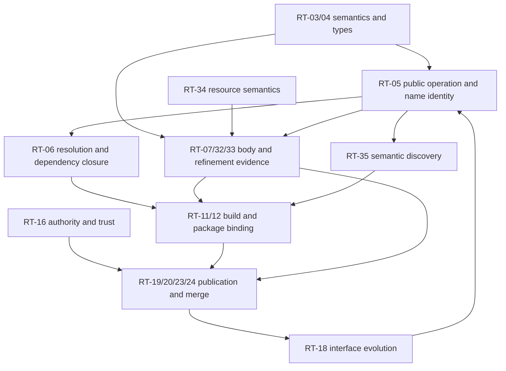

# LLMLang Cross-Aspect Research Dependency Map

**Status:** Initial dependency hypothesis; relationships require validation  
**Updated:** 2026-11-24
**Companion:** [Research Taxonomy](RESEARCH-TAXONOMY.md)

## 1. Purpose and interpretation

This map describes how choices in one LLMLang aspect can affect other aspects. It is a research-planning instrument, not a normative architecture and not a claim that every edge has already been proven.

The direction of an edge is **source aspect → affected aspect**. It means a change or choice in the source can impose requirements on, constrain, enable, or alter the trade-offs of the target.

Relationship types:

- **Requires:** the target depends on a capability or decision in the source.
- **Constrains:** the source narrows the viable vectors or design space of the target.
- **Influences:** the source changes target trade-offs or parameters, but does not necessarily rule out options.
- **Conflicts with:** specified vectors cannot coexist under stated assumptions. This is a symmetric incompatibility, recorded once with its conditions.
- **Enables:** the source makes a target capability or vector practical.

Confidence:

- **Established:** follows from an explicit dependency in the current model or a demonstrated result within stated scope.
- **Strong hypothesis:** architecturally compelling, but requires cross-aspect validation.
- **Open hypothesis:** plausible relationship that needs research.

A dependency is never “established” merely because two documents mention each other. Record evidence and scope.

## 2. High-level dependency structure

~~~mermaid
flowchart TD
  G[RT-01 Goals and constraints]
  I[RT-02 Intent and requirements]
  S[RT-03 Core semantics]
  T[RT-04 Types, effects, ownership, capabilities]
  P[RT-05 Program representation and identity]
  D[RT-06 Dependency semantics and impact]
  F[RT-07 Formal semantics and verification]
  E[RT-08 Tests, validation, evidence]
  C[RT-09 Compiler and IR]
  R[RT-10 Runtime and execution]
  B[RT-11 Build and cache]
  L[RT-12 Libraries and packages]
  X[RT-13 Backends and interoperability]
  A[RT-14 AI authoring and change]
  V[RT-15 Version control and merge]
  Q[RT-16 Security and trust]
  UX[RT-17 Developer experience]
  EV[RT-18 Conformance and evolution]
  TS[RT-19 Toolchain Server and semantic development API]
  CP[RT-20 LLM patch planning and verified commit]

  G --> I
  G --> S
  I --> S
  S --> T
  S --> P
  T --> P
  S --> F
  T --> F
  P --> D
  S --> D
  D --> B
  P --> B
  F --> E
  F --> D
  S --> E
  P --> C
  S --> C
  T --> C
  C --> R
  S --> R
  T --> R
  R --> L
  P --> L
  F --> L
  C --> X
  R --> X
  P --> V
  D --> V
  A --> E
  P --> A
  S --> A
  Q --> A
  I --> CP
  P --> CP
  D --> CP
  E --> CP
  A --> CP
  V --> CP
  Q --> CP
  TS --> CP
  CP --> TS
  Q --> R
  Q --> L
  E --> EV
  L --> EV
  X --> EV
~~~

The graph is intentionally simplified. It omits feedback edges for readability; the detailed edge register below records the principal dependencies. It is not a strict topological ordering: several topics can be researched in parallel, and later findings may send work back upstream.

## 3. Directed dependency register

A [pinned RT-03 crosswalk](../language-design/RT-03/RT-03-DOWNSTREAM-EDGE-EVIDENCE-2026-11-25.md) binds all 24 outgoing edges to scope-specific evidence or an explicit proxy. DEP-094 still lacks a selected LLMLang-authored bootstrap tool.

| Edge | From → to | Relation | Rationale / affected choices | Confidence |
|---|---|---|---|---|
| DEP-001 | RT-01 → RT-02 | Constrains | Product goals, intended users, and acceptable human review determine what intent and requirement capture must express. | Strong hypothesis |
| DEP-002 | RT-01 → RT-03 | Constrains | The [typed CLI vertical slice](../language-design/RT-01/RT-01-TYPED-CLI-VERTICAL-SLICE-2026-11-25.md) checks a finite POSIX byte-I/O and checked-arithmetic profile against the workload oracle in interpretation and generated execution. General source and usable profile boundaries remain open. | Strong hypothesis with bounded execution evidence |
| DEP-003 | RT-02 → RT-03 | Influences | Requirement and contract concepts need semantic values, predicates, states, and observable behavior to be defined. | Strong hypothesis |
| DEP-004 | RT-03 → RT-04 | Constrains | Type/effect/ownership choices must preserve the core evaluation and observable semantics. A foreign descriptor queued for another process retains a lock before any receipt. [Queued foreign ownership](../language-design/RT-04/RT-04-QUEUED-FOREIGN-OWNERSHIP-2026-11-25.md) | Strong hypothesis with scoped native evidence |
| DEP-005 | RT-03 → RT-05 | Constrains | Graph node kinds and value identity must retain distinctions that affect meaning. Reversing effectful operands changes the ordered trace with the same result in the typed SPG fixture. [SPG-02](../semantic-representation/RT-05/RT-05-TYPED-SEMANTIC-PROGRAM-GRAPH.md#7-results-and-falsifiers); current-main recheck [RT-00 DEP-005](RT-00/RT-00-DEP-005-EVIDENCE-RECHECK-2026-11-23.md) Resolved local bindings distinguish expanded token collisions in a native Rust fixture. [Macro binding identity](../semantic-representation/RT-05/RT-05-MACRO-BINDING-IDENTITY-2026-11-25.md) Shared mutable locations distinguish otherwise equal cell contents under native reads, writes and reference comparison. [Mutable reference topology](../semantic-representation/RT-05/RT-05-MUTABLE-REFERENCE-TOPOLOGY-2026-11-25.md) Native binary64 extrema differ in NaN selection and operand-order ties, which can change typed operation observations. [Native F64 minimum and maximum](../semantic-representation/RT-05/RT-05-NATIVE-F64-MINMAX-2026-11-25.md) Checked F64-to-I64 truncation, integrality checks and native coercions produce different typed results. [Cross-runtime F64 to I64 conversion](../semantic-representation/RT-05/RT-05-F64-I64-CONVERSION-2026-11-25.md) | Strong hypothesis with scoped experimental evidence |
| DEP-006 | RT-04 → RT-05 | Influences | Types, effects, capabilities, and ownership may be hash-relevant or may be referenced as separate artifacts; the identity boundary depends on their semantics. Scalar type and ownership-result rechecks are bounded in [RT-00 DEP-006](RT-00/RT-00-DEP-006-TYPE-IDENTITY-EVIDENCE-RECHECK-2026-11-23.md); inline versus referenced identity and broader source completeness remain open. Identical method code can observe different bound captures and reference relationships. [Stateful bound method](../semantic-representation/RT-05/RT-05-STATEFUL-BOUND-METHOD-2026-11-25.md) A typed overlapping-copy graph distinguishes pointwise final-state conditions from ordered finite read and write traces. [Dafny mapping for overlapping copy and frames](../semantic-representation/RT-05/RT-05-DAFNY-SPG-COPY-FRAME-2026-11-25.md) A checked algebraic isomorphism preserves logical values while two native encodings give different meanings to shared valid words. [Primitive and algebraic encodings](../language-design/RT-04/RT-04-PRIMITIVE-ALGEBRAIC-ENCODINGS-2026-11-25.md) A quantified lifetime can admit both input-derived and static-provider results within the same advertised region. [Polymorphic lifetimes](../language-design/RT-04/RT-04-POLYMORPHIC-LIFETIMES-2026-11-25.md) An exact dependent natural index can hold a result beyond its native fixed-width representation. [Dependent boundary values](../language-design/RT-04/RT-04-DEPENDENT-BOUNDARY-VALUES-2026-11-25.md) A durable transition requires exact current owner, incarnation and generation even when an earlier typed request and receipt are retained. [Durable typed transitions](../language-design/RT-04/RT-04-DURABLE-TYPED-STATE-2026-11-25.md) Scoped mutable region acquisition checks exact disjointness and ownership lifetime before native concurrent use. [Scoped mutable regions](../language-design/RT-04/RT-04-SCOPED-MUTABLE-REGIONS-2026-11-25.md) Native cancellation and explicit finalization produce different diagnostic ownership even when every acquired local guard releases once. [Async resource cancellation](../language-design/RT-04/RT-04-ASYNC-RESOURCE-CANCELLATION-2026-11-25.md) Typed attenuation and residual failure admission preserve effects already performed before an error. [Typed capability errors](../language-design/RT-04/RT-04-TYPED-CAPABILITY-ERRORS-2026-11-25.md) An explicit result annotation can stabilize public type identity across private inference changes. [Generic context inference](../language-design/RT-04/RT-04-GENERIC-CONTEXT-INFERENCE-2026-11-25.md) Raw ABI match, associated logical result type, pointwise range and relational order carry separate evidence. [Type, contract and relational evidence](../language-design/RT-04/RT-04-TYPE-CONTRACT-RELATION-2026-11-25.md) | Open hypothesis |
| DEP-007 | RT-03 → RT-07 | Requires | Formal semantics and proofs need a precisely defined source-language fragment and observation model. An ordered failure trace distinguishes two rewrites that a result-only or successful-run model could miss. [Observable rewrite correctness](../formal-verification/RT-07/RT-07-OBSERVABLE-REWRITE-CORRECTNESS.md#checked-results); current-main CI recheck [RT-00 DEP-007](RT-00/RT-00-DEP-007-OBSERVATION-MODEL-RECHECK-2026-11-23.md) The same verified Dafny caller yields different native results when the external implementation or ABI decoding changes. [Dafny kernel-style lookup and foreign boundary](../formal-verification/RT-07/RT-07-DAFNY-KERNEL-FOREIGN-BOUNDARY-2026-11-25.md) Caller-only Boogie verification stays identical across different provider bodies. Exact provider checks and independent Lean and CPC obligations establish different scopes of evidence. [Dafny modular proof closure](../formal-verification/RT-07/RT-07-DAFNY-MODULAR-PROOF-CLOSURE-2026-11-25.md) Proven guards distinguish hidden stores with intervening alias reads and constrain coalescing to its declared I/O observation. [Observation evidence recheck](RT-00/RT-00-OBSERVATION-EVIDENCE-DEPENDENCY-RECHECK-2026-11-25.md) Finite control distinguishes liberal satisfaction from termination, and declared profiles refuse incomplete observations. [Control accounts](../formal-verification/RT-07/RT-07-FINITE-CONTROL-SEMANTIC-ACCOUNTS-2026-11-25.md) · [Observation profiles](../formal-verification/RT-07/RT-07-DECLARED-OBSERVATION-PROFILE-2026-11-25.md) Separate projections can erase tag/trace correlations used by downstream contexts. [Joint refinement](../formal-verification/RT-07/RT-07-JOINT-OBSERVATION-REFINEMENT-2026-11-25.md) | Strong hypothesis with checked witnesses |
| DEP-008 | RT-04 → RT-07 | Constrains | Proof rules and encodings must account for type/effect/resource semantics, or explicitly exclude them. Current-main evidence compares a typed trace proof and ownership-result checker in [RT-00 DEP-008](RT-00/RT-00-DEP-008-TYPED-PROOF-BOUNDARY-RECHECK-2026-11-23.md); composition and source binding remain open. | Strong hypothesis |
| DEP-009 | RT-05 → RT-06 | Requires | Dependency analysis needs stable typed entities and a defined semantic identity model. A valid digest can cover an executable call whose edge is missing. Checking stored call occurrences against declared edges closes this gap in the DAG fixture. [Import validation](../semantic-representation/RT-05/RT-05-TYPED-SPG-IMPORT-VALIDATION.md#results); current-main recheck [RT-00 DEP-009](RT-00/RT-00-DEP-009-SPG-ADMISSION-RECHECK-2026-11-23.md) Execution, verification and audit follow typed closures. A metadata value observed at runtime becomes a semantic dependency for that scope. [Dependency role closures](../semantic-representation/RT-06/RT-06-DEPENDENCY-ROLE-CLOSURE-2026-11-25.md) Candidate index tests pass under the recorded versions while the canonical identity and observation decisions are pending. [SPG index reconciliation](../semantic-representation/RT-06/RT-06-SPG-INDEX-RECONCILIATION-2026-11-25.md) | Scoped experimental evidence for the edge check |
| DEP-010 | RT-03 → RT-06 | Requires | Sound semantic dependency analysis depends on the language's formal behavior and observable boundary. The finite control fixture requires state-sensitive traversal after a flag-changing cycle. [Conditional dependency closure](../semantic-representation/RT-06/RT-06-CONDITIONAL-DEPENDENCY-CLOSURE-2026-11-25.md) A syntactically single call can be skipped on a feasible route. The source fixture loses that route when a joined summary assumes the call always executes. [Path-boundary audit](RT-00/RT-00-DEPENDENCY-REGISTER-AND-PATH-BOUNDARY-2026-11-25.md) The typed SPG fixture preserves complete guarded may-sets while expanding an unknown input locally. [Guarded SPG dependency discovery](../semantic-representation/RT-06/RT-06-SPG-GUARDED-DEPENDENCY-DISCOVERY-2026-11-25.md) | Established within Scenarios 25–34 scope with additional bounded experimental evidence |
| DEP-011 | RT-06 → RT-11 | Requires | Safe incremental planning/cache invalidation depends on dependency completeness and conservative unknown handling. Earlier absent header candidates are required evidence for safe reuse of a selected compile action. Scoped fallback covers unknown required inputs. [Negative header dependencies](../toolchain-and-collaboration/RT-11/RT-11-HEADER-LOOKUP-FALLBACK-2026-11-25.md) A controlled edit fixture checks equal linked bytes while local, group and broad inputs select different compile counts. [Native edit locality](../toolchain-and-collaboration/RT-11/RT-11-NATIVE-EDIT-LOCALITY-2026-11-25.md) Pairwise checks can miss a third-order effect. A checked invariant or exact intermediate evidence constrains composition. [Three-edit non-interference](../toolchain-and-collaboration/RT-11/RT-11-THREE-EDIT-INTERFERENCE-2026-11-25.md) Changed topology can invalidate provider-first SCC scheduling and omit required facts if unscheduled dependencies default to empty. [SCC dependency scheduling](../semantic-representation/RT-06/RT-06-SCC-DEPENDENCY-SCHEDULING-2026-11-25.md) | Established within Scenarios 18–25 scope |
| DEP-012 | RT-05 → RT-11 | Requires | Action cache keys need exact semantic inputs. In the SPG fixture, a binding change alters an execution result at the same caller hash, so execution reuse needs the relevant binding and implementation closure. [SPG-03](../semantic-representation/RT-05/RT-05-TYPED-SEMANTIC-PROGRAM-GRAPH.md#7-results-and-falsifiers); current-main recheck [RT-00 DEP-012](RT-00/RT-00-DEP-012-CACHE-IDENTITY-RECHECK-2026-11-23.md) The native owned-result fixture also changes 5,720 observations per transfer order at unchanged caller and contract identity after exact provider rebind. [Owned-result provider binding](../compiler-and-translation/RT-13/RT-13-BOUND-OWNED-PROVIDERS-2026-11-25.md) Keeping exact possible providers still allows stale reuse when guarded selection changes. The finite proof-of-concept preserves each state-to-provider pair. [Guarded dispatch identity](../semantic-representation/RT-05/RT-05-GUARDED-DISPATCH-IDENTITY-2026-11-25.md) Exact assembly reuse can preserve code and test keys while type, contract and proof inputs change. [Six-stage native propagation](../toolchain-and-collaboration/RT-11/RT-11-SIX-STAGE-PROPAGATION-2026-11-25.md) Identical loadable segments suffice for the declared arithmetic scope, while self-file reads require exact artifact bytes. [ELF metadata reuse](../toolchain-and-collaboration/RT-11/RT-11-ELF-METADATA-REUSE-2026-11-25.md) Typed build roles bind exact inputs and outputs, and proof applicability can change while the theorem and executable remain equal. [Typed action receipts](../toolchain-and-collaboration/RT-11/RT-11-TYPED-ACTION-RECEIPTS-2026-11-25.md) An unchanged ELF driver selects different transitive providers under changed loader order or an earlier newly available candidate. An unknown required closure skips cache lookup and publication. [Native runtime closure](../toolchain-and-collaboration/RT-11/RT-11-NATIVE-RUNTIME-CLOSURE-2026-11-25.md) Cross-language C/Rust receipts admit finite return equality only within the exact directional observation scope and refuse an incomplete manifest even when rehashed. [Cross-language closure receipts](../toolchain-and-collaboration/RT-11/RT-11-CROSS-LANGUAGE-RECEIPTS-2026-11-25.md) | Strong hypothesis with a scoped counterexample to caller-only reuse |
| DEP-013 | RT-03 → RT-08 | Constrains | Tests, models, and proof claims need a defined meaning for program execution and observations. The executable reference and mutation replay show that value-only or unordered projections and success-only inputs hide specified defects. [Observation evidence recheck](RT-00/RT-00-OBSERVATION-EVIDENCE-DEPENDENCY-RECHECK-2026-11-25.md) Exact exhaustive agreement requires complete input and schedule coverage plus a complete observation or checked lifting. [Exhaustive evidence boundary](../compiler-and-translation/RT-13/RT-13-EXHAUSTIVE-EVIDENCE-BOUNDARY-2026-11-25.md) Shrinking a witness must preserve the disputed observation and remain an admitted candidate. [Differential shrinking](../compiler-and-translation/RT-13/RT-13-DIFFERENTIAL-SHRINKING-2026-11-25.md) | Strong hypothesis with scoped reference and mutation evidence |
| DEP-014 | RT-07 → RT-08 | Enables | Formal semantics and verified proof boundaries enable stronger evidence than tests alone. A checked write-swap rule covers modeled inputs under the guard. A separate comparison must bind the exact emitted target and its observation scope. [Observation evidence recheck](RT-00/RT-00-OBSERVATION-EVIDENCE-DEPENDENCY-RECHECK-2026-11-25.md) The identical-branch rule must preserve the guard or discharge an independent erasure condition. [Identical branch guard](../formal-verification/RT-07/RT-07-IDENTICAL-BRANCH-GUARD-2026-11-25.md) Structural admission, exact refinement and executed assertions provide distinct evidence. Shared freeze choices show why direction and outcome correlation matter. [LLVM validator and choice scope](../compiler-and-translation/RT-13/RT-13-LLVM-VALIDATOR-CHOICE-SCOPE-2026-11-25.md) Chaining evidence needs an exact intermediate or checked bridge with explicit domain and observation scopes. [Compiler pass composition](../compiler-and-translation/RT-13/RT-13-COMPILER-PASS-COMPOSITION-2026-11-25.md) The integrated command replays four scoped evidence artifacts and their trust boundaries. [Optimization research replay](../compiler-and-translation/RT-13/RT-13-OPTIMIZATION-REPLAY-2026-11-25.md) | Strong hypothesis with a scoped checked rule and exact-target controls |
| DEP-015 | RT-05 → RT-09 | Requires | Compiler stages need canonical program entities/IR and reproducible references to semantic inputs. Native specialization can copy a method body into the caller while late-bound calls select a linked implementation. Both require distinct bindings from nominal type identity. [Generic provider binding](../semantic-representation/RT-05/RT-05-GENERIC-PROVIDER-BINDING-2026-11-25.md) The graph IR must distinguish node representation identity from execution occurrences. Reusing a value can suppress ordered effects. [Graph occurrence preservation](../compiler-and-translation/RT-13/RT-13-GRAPH-OCCURRENCE-PRESERVATION-2026-11-25.md) | Strong hypothesis with a scoped graph correspondence theorem |
| DEP-016 | RT-03 → RT-09 | Constrains | Lowering and optimization must preserve source observations, including reads around an aliased store. The checked-add target validator distinguishes ordered callbacks and stores on an error edge. [Mutable byte-view preservation](../compiler-and-translation/RT-09/RT-09-13-MUTABLE-BYTE-VIEW-PRESERVATION.md#results) · [Whole-domain checked add](../compiler-and-translation/RT-13/RT-13-LLVM-CHECKED-ADD-OBSERVATIONS-2026-11-24.md) The owned-result fixture checks both C and generated Rust against one reference for each provider binding, including exact disposition, ordered effects and descriptor audit. [Owned-result provider binding](../compiler-and-translation/RT-13/RT-13-BOUND-OWNED-PROVIDERS-2026-11-25.md) Binary64 contraction changes 77 value observations, and equal NaN classifications can still have different raw encodings. [Binary64 contraction and raw NaNs](../compiler-and-translation/RT-13/RT-13-BINARY64-CONTRACTION-2026-11-25.md) LLVM accepts flags that change rounding, signed-zero behavior or the admitted NaN domain. The paired strict and flagged experiment identifies where source evidence is required. [LLVM floating-point flags](../compiler-and-translation/RT-13/RT-13-LLVM-FP-FLAGS-2026-11-25.md) Three LLVM driver revisions reproduce the constrained dynamic zero discrepancy, and forced inlining removes the preserving call boundary in the scoped experiment. [Dynamic rounding across LLVM versions](../compiler-and-translation/RT-13/RT-13-LLVM-DYNAMIC-ROUNDING-VERSIONS-2026-11-25.md) Kernel-checked guarded substitution separates binary64 rule equivalence from native lowering correspondence. [F64 extrema agreement guard](../formal-verification/RT-32/RT-32-F64-EXTREMA-AGREEMENT-GUARD-2026-11-25.md) Checked binary64 conversion preserves the refusal and its defined result through a guarded branch or masked value. Inclusive positive bounds expose poison. [LLVM checked F64 to I64 lowering](../compiler-and-translation/RT-13/RT-13-LLVM-F64-I64-LOWERING-2026-11-25.md) A resolved runtime provider and ordered observations are independent preservation conditions for the native two-effect fixture. [RT-09 ordered runtime realization](../compiler-and-translation/RT-09/RT-09-RUNTIME-ORDERED-REALIZATION-2026-11-25.md) Checked signed division keeps target traps behind source guards and binds effect validation to the exact host import. [RT-09 checked Wasm division](../compiler-and-translation/RT-09/RT-09-WASM-CHECKED-DIVISION-2026-11-25.md) Exact dependency rebinding changes the linked validation subject even when the caller object is unchanged. [RT-09 incremental translation closure](../compiler-and-translation/RT-09/RT-09-INCREMENTAL-TRANSLATION-CLOSURE-2026-11-25.md) The hosted rollback fixture requires both cleanup status and ordered effects alongside state and ownership. [RT-13 cross-backend rollback](../compiler-and-translation/RT-13/RT-13-ORDERED-ROLLBACK-CROSS-BACKEND-2026-11-25.md) Repeated native agreement cannot establish source correlation when a target permits independent frozen values. [RT-13 LLVM correlated choice](../compiler-and-translation/RT-13/RT-13-LLVM-CORRELATED-FREEZE-2026-11-25.md) | Design obligation with scoped experimental evidence |
| DEP-017 | RT-04 → RT-09 | Constrains | Type, effect, ownership, and capability rules determine which transformations and target representations are legal. | Strong hypothesis |
| DEP-018 | RT-03 → RT-10 | Constrains | Runtime behavior must implement the language's evaluation, state, error, concurrency, and resource semantics. The pipe fixture distinguishes short progress, EOF, would-block and signal delivery across two adapter paths. [Nonblocking pipe I/O](../runtime-and-systems/RT-10/RT-10-POSIX-NONBLOCKING-PIPE-IO.md#method-and-results) An environmental snapshot claim assumes ordered publication and authoritative generation identity. Wrapped IDs admit mixed observations. [Coherent environment](../formal-verification/RT-07/RT-07-COHERENT-ENVIRONMENT-2026-11-25.md) Argument evaluation order changes the failing operand and effect prefix in the bounded native comparison. [Effectful call evaluation](../formal-verification/RT-07/RT-07-CALL-EVALUATION-2026-11-25.md) Runtime checkpoint resume preserves exact source effects, outcomes and fuel while refusing reused receipts. [Resumable reference and VM execution](../runtime-and-systems/RT-10/RT-10-RESUMABLE-EXECUTION-2026-11-25.md) A checked signal schedule distinguishes interrupted and restarted primitives, with positive and EOF results requiring their own dispositions. [Native signal and primitive contracts](../runtime-and-systems/RT-10/RT-10-NATIVE-SIGNAL-PRIMITIVES-2026-11-25.md) Repeated cancellation can interrupt awaited cleanup and publish prematurely without a protected finalizer and explicit terminal settlement. [Async terminal resource settlement](../runtime-and-systems/RT-10/RT-10-ASYNC-TERMINAL-SETTLEMENT-2026-11-25.md) | Strong hypothesis with scoped adapter evidence |
| DEP-019 | RT-04 → RT-10 | Constrains | Ownership, effects, capabilities, and memory model determine runtime services and ABI boundaries. Direct release/acquire and a global sequential order give different observations in 98 bounded programs. Publication with repeated flag values shows why the runtime contract must specify which write supplies the read. [Scenario 118](../language-design/RT-04/RESEARCH-SCENARIO-118-ATOMIC-EXECUTION-RELATIONS.md) The RMW and fence extension distinguishes immediate predecessors, release sequences and correctly placed publication fences. [RMW and fences](../language-design/RT-04/RT-04-RMW-RELEASE-SEQUENCES-AND-FENCES-2026-11-24.md) Provably empty read/write frames support isolated calls. Audited shared-frame assumptions require separate history evidence. [Dafny concurrent frames and native histories](../formal-verification/RT-07/RT-07-DAFNY-CONCURRENT-FRAME-HISTORY-2026-11-25.md) Two-location store buffering has native witnesses under weak orders and a checked sequencing contradiction under a total order. [Atomic store buffering](../runtime-and-systems/RT-10/RT-10-ATOMIC-STORE-BUFFERING-2026-11-25.md) | Strong hypothesis with bounded model evidence |
| DEP-020 | RT-10 → RT-12 | Influences | Library contracts and implementations depend on runtime and platform services available to packages. | Strong hypothesis |
| DEP-021 | RT-05 → RT-12 | Requires | Reusable libraries/packages need stable artifact identities and reproducible dependency references. | Strong hypothesis |
| DEP-022 | RT-07 → RT-12 | Constrains | Public contracts and compatibility claims need an explicit evidence model, especially for opaque implementations. In a composed contract, a known result on one branch cannot establish coverage of other admitted handoffs. [Per-branch composition coverage](../formal-verification/RT-07/RT-07-NONVACUOUS-CONTRACT-COMPOSITION-2026-11-25.md) | Strong hypothesis with a scoped composition theorem |
| DEP-023 | RT-09 → RT-13 | Requires | Backend alternatives consume a defined lowering interface and source semantic contract. The atomic lowering study identifies IR obligations, and the execution witness corpus supplies forbidden outcomes for future backend checks. [Scenario 116](../compiler-and-translation/RT-13/RESEARCH-SCENARIO-116-ATOMIC-BACKEND-LOWERING-OBLIGATIONS.md) · [Scenario 118](../language-design/RT-04/RESEARCH-SCENARIO-118-ATOMIC-EXECUTION-RELATIONS.md) Byte-width lowering and helper closure depend on exact ISA features. [Atomic lowering](../compiler-and-translation/RT-13/RT-13-ATOMIC-BYTE-WORD-LOWERING-2026-11-24.md) Cranelift and LLVM share a checked-add observation and ABI fixture. [JIT comparison](../compiler-and-translation/RT-13/RT-13-CRANELIFT-CHECKED-ADD-2026-11-24.md) Exact checked LLVM predicates replay in Lean using offline LRAT under an explicit native reflection assumption. [Lean bit-vector replay](../compiler-and-translation/RT-13/RT-13-LLVM-CHECKED-ADD-LEAN-2026-11-25.md) A specialized signed arithmetic proof checks the same predicates with standard Lean axioms. [Symbolic checked-add proof](../compiler-and-translation/RT-13/RT-13-LLVM-CHECKED-ADD-SYMBOLIC-2026-11-25.md) | Scoped target evidence and design obligation |
| DEP-024 | RT-10 → RT-13 | Influences | Target backends and FFI must agree with runtime, ABI, data layout, and platform behavior. An observable dynamic environment adds rounding and sticky exception state to the target boundary. LLVM 19.1.7 constrained literal cancellation still changes negative zero in the scoped O3 replay. [Dynamic rounding and flags](../compiler-and-translation/RT-13/RT-13-LLVM-DYNAMIC-ROUNDING-2026-11-25.md) Full and ThinLTO reproduce the constrained cancellation discrepancy across three versions. Retained calls and volatile operands preserve the witness. [Dynamic rounding through LTO](../compiler-and-translation/RT-13/RT-13-LLVM-DYNAMIC-ROUNDING-LTO-2026-11-25.md) Equal machine-level signatures still require an exact tagged representation and runtime selection before calls expose typed results. [Tagged runtime bindings](../runtime-and-systems/RT-10/RT-10-TAGGED-RUNTIME-BINDING-2026-11-25.md) The POSIX output fixture requires an exact written-prefix receipt before a typed caller may resume a vector operation. [Typed POSIX vector output](../runtime-and-systems/RT-10/RT-10-POSIX-WRITEV-TYPED-PROGRESS-2026-11-25.md) POSIX descriptor and ambient cwd lookup admit different scopes on shared Linux libc profiles. [Descriptor-relative POSIX](../runtime-and-systems/RT-10/RT-10-DIRECTORY-RELATIVE-POSIX-2026-11-25.md) The native ppoll path owns Linux timeout mutation and kernel signal mask sizing independently of the libc call shape. [POSIX ppoll ABI](../runtime-and-systems/RT-10/RT-10-PPOLL-FFI-BOUNDARY-2026-11-25.md) Optional capacity negotiation, exact native outcomes and portable observations require distinct evidence scope. [POSIX pipe claim scope](../runtime-and-systems/RT-10/RT-10-PIPE-CONFORMANCE-SCOPE-2026-11-25.md) WASI reactor admission binds the startup mode and runtime import to the verified source write observation. [RT-13 WASI reactor output](../compiler-and-translation/RT-13/RT-13-WASI-REACTOR-WRITE-2026-11-25.md) | Strong hypothesis with scoped experimental evidence |
| DEP-025 | RT-05 → RT-15 | Requires | Semantic diff/merge requires canonical repository representation and stable identity rules. | Established in ADR-014 as an architectural prerequisite |
| DEP-026 | RT-06 → RT-15 | Influences | Merge conflict detection and impact validation benefit from semantic dependency and impact information. | Strong hypothesis |
| DEP-027 | RT-05 → RT-14 | Requires | Structured AI changes need stable graph entities, typed operations, and inspectable semantic context. | Strong hypothesis |
| DEP-028 | RT-03 → RT-14 | Constrains | The change protocol must not allow an LLM to bypass language-level semantic validation. | Strong hypothesis |
| DEP-029 | RT-08 → RT-14 | Enables | Independent validation/evidence services provide deterministic acceptance gates for model-proposed changes. The exact impact fixture requires snapshot-bound completeness before narrowing review and revalidation actions. [Typed change-impact planning](../semantic-representation/RT-06/RT-06-TYPED-CHANGE-IMPACT-2026-11-25.md) | Strong hypothesis |
| DEP-030 | RT-16 → RT-10 | Constrains | Runtime isolation, capability checks, and trusted low-level primitives depend on security policy. A local SQLite effect can check exact grant ancestry within its transaction. Foreign effects need a distinct synchronization guarantee. [Concurrent grant revocation](../language-design/RT-04/RT-04-CONCURRENT-GRANT-REVOCATION-2026-11-25.md) A local mediated grant needs current scope and exact native file identity and permissions. [Mediated native descriptors](../runtime-and-systems/RT-10/RT-10-MEDIATED-DESCRIPTORS-2026-11-25.md) | Strong hypothesis |
| DEP-031 | RT-16 → RT-12 | Constrains | Artifact publication, dependency resolution, provenance, and registry trust depend on supply-chain policy. | Strong hypothesis |
| DEP-032 | RT-16 → RT-14 | Constrains | Agent permissions, tool execution, approvals, and auditability depend on the security and authority model. | Strong hypothesis |
| DEP-033 | RT-08 → RT-18 | Enables | Conformance and compatibility claims require reproducible tests, proofs, or other scoped evidence. | Strong hypothesis |
| DEP-034 | RT-12 → RT-18 | Influences | Package/library evolution and compatibility policy shape ecosystem and standard-library evolution. | Strong hypothesis |
| DEP-035 | RT-13 → RT-18 | Influences | Supported targets and backend guarantees affect portability and conformance profiles. | Strong hypothesis |
| DEP-036 | RT-03 → RT-11 | Influences | Purity, state, effects, and observable environment inputs determine which computations can be cached and the sound invalidation scope. Equal typed call projections hide 1,256 cross-profile result, rejection or trace changes. [Scoped handler comparison](../language-design/RT-03/RT-03-HANDLER-DOWNSTREAM-2026-11-25.md#dependency-map-evidence) | Bounded evidence with broader hypothesis open |
| DEP-037 | RT-03 → RT-15 | Influences | Evaluation order, state, effects, errors, and concurrency determine semantic equivalence and which edits can be merged independently. Equal scalar projections hide 214 composition-order distinctions under scoped state handlers. [Scoped handler comparison](../language-design/RT-03/RT-03-HANDLER-DOWNSTREAM-2026-11-25.md#dependency-map-evidence) | Bounded evidence with broader hypothesis open |
| DEP-038 | RT-03 → RT-16 | Influences | The language's state, effect, resource, and concurrency semantics define guarantees and threat boundaries available to security controls. The fixture distinguishes rejected, logged and skipped writes when a handler guards negative updates. [Scoped handler comparison](../language-design/RT-03/RT-03-HANDLER-DOWNSTREAM-2026-11-25.md#dependency-map-evidence) | Bounded evidence with broader hypothesis open |
| DEP-039 | RT-03 → RT-18 | Influences | Changes to evaluation, effects, errors, and observable behavior affect conformance profiles and semantic compatibility across versions. Total and guarded handler profiles differ on 256 of 500 checked comparisons with identical static call projections. [Scoped handler comparison](../language-design/RT-03/RT-03-HANDLER-DOWNSTREAM-2026-11-25.md#dependency-map-evidence) | Bounded evidence with broader hypothesis open |
| DEP-040 | RT-05 → RT-12 | Requires | Package indexes and dynamic dependency resolution require stable object identities and exact, verifiable Content Hash references. A follower checks the complete exact inventory across locally held and transferred objects before atomically selecting a successor. [Graph replica recovery](../packages-and-ecosystem/RT-12/RT-12-GRAPH-REPLICA-RECOVERY-2026-11-25.md) External collection requires exact leased reachability and recoverable quarantine. A root shared with a current graph survives removal of an older graph. [External CAS collection](../packages-and-ecosystem/RT-12/RT-12-EXTERNAL-CAS-COLLECTION-2026-11-25.md) Integrated generation qualification rules out a mixed graph and provider projection with no corresponding revision. [Integrated graph index](../packages-and-ecosystem/RT-12/RT-12-INTEGRATED-GRAPH-INDEX-2026-11-25.md) | Strong hypothesis |
| DEP-041 | RT-12 → RT-05 | Influences | Package content roots, manifests, and index canonicalization may require explicit separation between object identity, logical package identity, and physical archive identity. A portable Git carrier reproduces exact local graph and index identity independently of the source metadata database and shared content store. [Portable graph publication](../packages-and-ecosystem/RT-12/RT-12-PORTABLE-GRAPH-PUBLICATION-2026-11-25.md) Two verified physical envelope versions preserve the original typed digest and require an eligible reader at each immutable address. [Typed object lifecycle](../packages-and-ecosystem/RT-12/RT-12-TYPED-OBJECT-LIFECYCLE-2026-11-25.md) | Scoped portable storage evidence, canonical identities open |
| DEP-042 | RT-12 → RT-11 | Influences | Compact indexes, partial retrieval, and provider-side closure resolution can share cache and incremental-computation infrastructure; cache correctness depends on exact dependency closure and snapshot identity. Optional delivery can retain exact package identity while serving five action-result families. Fully detached delivery leaves package-only bytes unchanged, and an offline self-contained export needs both the index and payloads. [Package cache delivery](../toolchain-and-collaboration/RT-11/RT-11-PACKAGE-CACHE-DELIVERY-2026-11-25.md) Ed25519 verification and current authority constrain the merge before any byte lookup. Independent native rebuild comparison refuses a signed, byte-consistent alternative result for the same request. [Signed cache admission](../toolchain-and-collaboration/RT-11/RT-11-SIGNED-REBUILD-ADMISSION-2026-11-25.md) | Strong hypothesis |
| DEP-043 | RT-16 → RT-12 | Constrains | Dynamic providers, package provenance, signatures, and multi-provider resolution must obey explicit trust and supply-chain boundaries; content hashes alone do not establish publisher trust. | Strong hypothesis |
| DEP-044 | RT-12 → RT-17 | Influences | Compact package catalogs and selective metadata retrieval affect context efficiency, discoverability, and the usability of LLM-facing tooling. | Strong hypothesis |
| DEP-045 | RT-14 → RT-19 | Requires | The Toolchain API operationalizes structured agent changes, context retrieval, provenance, and request/change lifecycle without binding them to one transport. | Strong hypothesis |
| DEP-046 | RT-05 → RT-19 | Requires | Semantic workspaces and typed mutations need stable entity identities, immutable content hashes, and snapshot roots. | Strong hypothesis |
| DEP-047 | RT-15 → RT-19 | Constrains | Import/export, external-edit detection, branch synchronization, and semantic merge must preserve Git portability and the repository representation contract. | Strong hypothesis |
| DEP-048 | RT-16 → RT-19 | Constrains | Workspace scoping, tool permissions, acceptance, commit, sandboxing, and audit requirements constrain every server adapter and operation. | Strong hypothesis |
| DEP-049 | RT-19 → RT-17 | Influences | Structured semantic operations, stable diagnostics, and bounded context may improve agent and human workflows; this requires comparative usability evidence. Versioned LSP edit application also needs negotiated coordinates and a source occurrence binding. The wire fixture distinguishes correct offsets, valid wrong ranges and identical tokens at different occurrences. [LSP position encodings](../toolchain-and-collaboration/RT-17/RT-17-LSP-POSITION-ENCODINGS-2026-11-25.md) | Open hypothesis with scoped protocol evidence |
| DEP-050 | RT-19 → RT-11 | Influences | Persistent workspace and semantic stores may reuse action-cache infrastructure, but workspace durability and cache validity are separate concerns. SQLite retains checked receipts and payloads across offline restart. WAL snapshots preserve active reads across eviction, and current action scope still gates reuse. [Persistent cache layers](../toolchain-and-collaboration/RT-11/RT-11-PERSISTENT-LAYERED-CACHE-2026-11-25.md) | Scoped SQLite evidence, production integration open |
| DEP-051 | RT-02 → RT-20 | Requires | A complete patch plan needs traceable requirements to determine the initial semantic changes and the obligations propagated to callers. | Strong hypothesis |
| DEP-052 | RT-05 → RT-20 | Constrains | Hash-relevant references determine which caller values change. Exact implementation pins propagate a callee edit in the SPG fixture. A binding-resolved call also requires checking execution impact when its caller value stays equal. [SPG-03](../semantic-representation/RT-05/RT-05-TYPED-SEMANTIC-PROGRAM-GRAPH.md#7-results-and-falsifiers) | Strong hypothesis with scoped experimental evidence |
| DEP-053 | RT-06 → RT-20 | Requires | Complete reverse-reference discovery and dependency evidence are prerequisites for a sound caller-impact closure and plan completeness audit. A location-only traversal omits targets in the finite control fixture. Full source coverage and publication-gate integration remain open. [Conditional dependency closure](../semantic-representation/RT-06/RT-06-CONDITIONAL-DEPENDENCY-CLOSURE-2026-11-25.md) An actual two-parent merge can combine checked branches and select a provider under an unchecked state. State-bound coverage and a fresh fallback distinguish the three scoped cases. [Guarded merge evidence](../toolchain-and-collaboration/RT-24/RT-24-GUARDED-MERGE-EVIDENCE-2026-11-25.md) Treat provider closure with a missing transition or an exhausted exploration bound as insufficient for caller-impact completeness. [Path-boundary audit](RT-00/RT-00-DEPENDENCY-REGISTER-AND-PATH-BOUNDARY-2026-11-25.md) | Strong hypothesis with additional bounded experimental evidence |
| DEP-054 | RT-08 → RT-20 | Requires | Plan execution and commit gates require validation evidence bound to exact candidate hashes, dependency closure, and toolchain configuration. | Strong hypothesis |
| DEP-055 | RT-14 → RT-20 | Influences | The agent change protocol must enforce plan-before-mutation, mandatory planned work, and controlled completion rather than trusting model self-report. | Strong hypothesis |
| DEP-056 | RT-15 → RT-20 | Constrains | Git commit creation, branch concurrency, exact-tree staging, and no-commit-on-failure constrain the completion transaction. | Strong hypothesis |
| DEP-057 | RT-16 → RT-20 | Constrains | Authorization must distinguish plan approval, semantic mutation, validation, commit, and remote push; agents must not bypass completion gates. | Strong hypothesis |
| DEP-058 | RT-19 → RT-20 | Enables | Workspaces, Change Sets, immutable snapshots, and repository coordination provide the operational substrate for CIP planning and verified commit. | Strong hypothesis |
| DEP-059 | RT-20 → RT-19 | Influences | Caller migration decisions, hash propagation, mandatory plan execution, and validation-gated commit add workflow and API requirements to the Toolchain Server. | Strong hypothesis |
| DEP-060 | RT-07 → RT-06 | Constrains | Solver-backed path pruning in dependency analysis requires sound negative evidence; replayed witnesses establish possible routes, while timeout/UNKNOWN and unverified UNSAT must preserve a conservative may-dependency result. The dependency consumer additionally needs a complete transition encoding. A timed-out solver result or a state-budget stop supplies no negative conclusion about omitted routes. [Path-boundary audit](RT-00/RT-00-DEPENDENCY-REGISTER-AND-PATH-BOUNDARY-2026-11-25.md) | Emerging; bounded result-policy evidence and one real worker-timeout experiment in Scenarios 102–108 |
| DEP-263 | RT-19 → RT-15 | Constrains | A durable workspace acceptance journal may record accepted-but-not-yet-exported state, but Git-visible canonical inputs remain the reconstructible authority; export/commit receipts must bind the exact accepted root and be idempotently reconciled after interruption. | Strong hypothesis; three bounded transaction-boundary candidates compared in RT-19, crash recovery remains untested |
| DEP-264 | RT-15 → RT-19 | Constrains | Git is the reconstruction boundary, while its ref updates are separate from SQLite acceptance. Eight process exits check durable accepted-pending state, exact candidate publication, historical receipts and shared-head CAS. [RT-19 process recovery](../toolchain-and-collaboration/RT-19/RT-19-SQLITE-GIT-PROCESS-RECOVERY-2026-11-24.md) | Scoped real SQLite/Git evidence |

## 4. Important feedback loops and conditional relationships

[Native named record evaluation](../semantic-representation/RT-05/RT-05-NAMED-RECORD-EVALUATION-2026-11-25.md) adds scoped DEP-005 evidence. A canonical typed field map with a separately ordered observable projection aligns with 3,888 Rust and CPython observations. A sorted field-only projection collapses different first failures and traces. The allowed omission of sequence positions is restricted to closed total literals.

RT-03 is a foundational source for the type/effect model, semantic identity, formal verification, compiler/runtime behavior, incremental computation, semantic merge, security, and conformance. [RT-04 alternatives research](../language-design/RT-04/RT-04-TYPE-EFFECT-OWNERSHIP-AND-CAPABILITY-ALTERNATIVES.md) now decomposes the type/effect/ownership/capability design space and maps it against profiles A–D; this is a comparative survey, not an accepted architecture. The direct edges DEP-036–DEP-039 have scoped handler evidence and remain broader research hypotheses derived from [RT-03 core semantics](../language-design/RT-03/CORE-LANGUAGE-SEMANTICS.md); they do not imply that any particular semantic profile has been accepted. RT-20 adds a further feedback loop: the Toolchain workflow must enforce the dependency and identity model, while practical caller-migration and hash-propagation experiments may reveal missing distinctions in RT-05/RT-06 or transaction requirements in RT-19.

[Partial record ownership](../semantic-representation/RT-05/RT-05-PARTIAL-RECORD-OWNERSHIP-2026-11-25.md) adds a phase distinction to DEP-004/005/006. A closed Rust fixture separates written acquisition order, rollback order for acquired fields and declaration order for completed fields. A completed move ends the record-level obligation and starts a separate release responsibility.

[Scenarios 102–108](../semantic-representation/RT-06/RESEARCH-SCENARIO-102-SOLVER-UNKNOWN-AND-SOUND-PATH-PRUNING.md) supply bounded evidence for DEP-060: the evidence threshold for removing a dependency/path is stricter than the threshold for retaining a possible path, an externally timed-out worker can be reaped while preserving UNKNOWN, and reusing a stale predicate or omitting a may-alias target across direct or call-mediated mutation can lose feasible behavior. Scenario 107 extracts aliases and a toggle effect from a bounded AST subset and preserves concrete routes, but a joined alias set can add infeasible routes when target choice correlates with state. Scenario 108 enumerates the finite fixture paths and removes those infeasible routes while keeping all paths for independent choices. This result does not establish scalable path-sensitive analysis, general source-to-route completeness, parser/CFG correctness, memory/concurrency isolation, solver trust, or complete effect/alias summaries.

These are not simple one-way dependencies. They must be tested explicitly:

1. **Semantic core ↔ type/effect/resource model (RT-03 ↔ RT-04).** The core semantics determines what types and effects must express; the selected type/effect model may require changing the semantic core.

   [COR-09](../language-design/RT-03/RT-03-04-SHARED-SEMANTICS-CORPUS.md#7-cor-09--typed-calls-and-private-local-state) provides a bounded witness for DEP-004 and DEP-005. Two well-typed bodies with the same static RT-04 projection return different results when their local assignments are reordered. A graph used for behavioral comparison or identity must preserve this ordering, either directly or through another representation that captures its meaning.

   [COR-10](../language-design/RT-03/RT-03-04-SHARED-SEMANTICS-CORPUS.md#8-cor-10--what-a-state-handler-exposes) adds a witness for DEP-036. The same call declarations and scalar result coexist with different write observations under private and logging handlers. A reuse key for the full observation must distinguish those interpretations or establish their equivalence under a narrower observation contract.

   [COR-11](../language-design/RT-03/RT-03-04-SHARED-SEMANTICS-CORPUS.md#9-cor-11--actor-traces-and-failure-policies) adds evidence for DEP-005, DEP-036, and DEP-037. Per-sender FIFO permits several outcomes for noncommuting writes. Sorting by sender spelling then makes a rename observable even at the scalar boundary. An explicit protocol order survives the tested rename when its references are updated together. Merge and reuse rules need to preserve the selected ordering and failure semantics.

   [COR-13 / Scenario 35](../language-design/RT-04/RESEARCH-SCENARIO-35-RESOURCE-RETURN-AND-CLEANUP.md) is a discriminator for DEP-004: on the handle-return branch, fallible cleanup distinguishes ordinary `CleanupFailed` from transfer-first `error_with_value`, changing required ownership checks and the observable result/owner tuple. Ten tests cover a hand-encoded projection, and the unknown branch fork's common cleanup events match the RT-03 evaluator and path model. Three RT-04 probes accept primitive `Result` and reject nested `Owned`/`ErrorWithValue` descriptors as unknown. The caller must dispose of the owned value before propagating the error; current typed calls do not represent this result shape. Return semantics and source correspondence remain unvalidated.

   The [source cleanup CFG](../language-design/RT-03/RT-03-SOURCE-CLEANUP-CFG-2026-11-25.md) checks DEP-004 over 128 executions of a restricted concrete fragment. Pending return and exceptional continuation edges preserve different ownership outcomes. Wider typed source and resource correspondence remain open.

   Scenario 119 extends DEP-004 and supplies evidence for DEP-006. Changing close disposition can add an obligation to an existing result tag and invalidate a caller match. Renaming a private callee binding preserves the inferred result type. A compatibility summary that retains only the tags will miss the first change. [Ownership in matched call results](../language-design/RT-04/RESEARCH-SCENARIO-119-OWNED-RESULT-MATCHING.md)

   The [RT-11 binding benchmark](../toolchain-and-collaboration/RT-11/RT-11-BINDING-INVALIDATION-BENCHMARK.md) supplies a separate witness for DEP-011 and DEP-012. A stable external symbol lets a caller's compile action reuse an object while the selected implementation changes executable behavior. The link and verification actions need the concrete dependencies consumed at their stages.

2. **Semantic identity ↔ dependency semantics (RT-05 ↔ RT-06).** Hash boundaries determine which dependency edges propagate identity; dependency semantics determine which inputs must be committed by an artifact hash.
3. **Formal semantics ↔ canonical IR (RT-03/05 ↔ RT-07/09).** The IR must be expressive enough for the language but small enough for independently validated semantics and proof encodings.
4. **Runtime ↔ effects/ownership/concurrency (RT-04 ↔ RT-10).** Runtime primitives may reveal missing language concepts; language concepts may require a different runtime boundary.

   DEP-019 also covers the lifetime boundary between RT-04 and RT-10. The nested scope fixture observes a task body finish with a borrow and pending cleanup still live in its descendant. [Structured scope join](../runtime-and-systems/RT-10/RT-10-STRUCTURED-SCOPE-JOIN.md#results)

   The Linux foreign-cleanup fixture adds a native witness to DEP-019. Closing the provider's original descriptor need not release a file lock when a foreign duplicate shares the open file description. Predicting subsequent admission requires alias information. [Linux owned cleanup](../language-design/RT-04/RT-04-LINUX-OWNED-CLEANUP-2026-11-24.md#results)

   Scenario 120 adds SQLite evidence for DEP-019. A live prepared statement prevents ordinary close and delays destruction under `close_v2`. A wrapper's ownership contract needs to track this dependency separately from the close result and the connection capability. [Cleanup dependencies in SQLite](../language-design/RT-04/RESEARCH-SCENARIO-120-SQLITE-CLEANUP-DEPENDENCIES.md)

   Scenario 121 finds different return obligations for the same complete dependency graph. The busy path returns a live connection when local cleanup leaves an outside dependent. The deferred path consumes the connection while outside owners still determine when destruction completes. Static admission depends on proof of the complete live set, including dependents outside the caller's ownership. [Local close recovery](../language-design/RT-04/RESEARCH-SCENARIO-121-SQLITE-LOCAL-CLOSE-RECOVERY.md)

   Scenario 122 distinguishes coverage from freshness for that proof. A foreign call can leave the local state unchanged while introducing a dependent. An observation of the complete set can also become stale. A consumer of negative dependency evidence needs both properties for the relevant subject and use. [Completeness and freshness of close evidence](../language-design/RT-04/RESEARCH-SCENARIO-122-CLOSE-EVIDENCE-FRESHNESS.md)

   Scenario 123 finds that refusing close at runtime after local finalization retains the connection and the diagnostics from the executed prefix. A call contract needs to specify which effects have run before a refusal and which capabilities the caller must carry forward. [Shared close workload](../language-design/RT-04/RESEARCH-SCENARIO-123-CLOSE-CALL-BOUNDARY.md)

   Scenario 124 checks the concurrency premise of that decision. A producer between validation and close makes a matched generation insufficient. The FFI wrapper needs a guard or exclusive capability whose authority extends to every alias that can create dependents. [Close synchronization](../language-design/RT-04/RESEARCH-SCENARIO-124-CLOSE-SYNCHRONIZATION.md)

   Scenario 125 finds that a callback can prepare under the same recursive lock. It also finds that an unfinished backup makes ordinary close busy with zero enumerated statements. Guard scope therefore depends on callback admission and dependent-kind coverage, including the roles of resources in a foreign operation. [Reentry and coverage](../language-design/RT-04/RESEARCH-SCENARIO-125-CLOSE-REENTRY-AND-COVERAGE.md)

   Scenario 126 adds compatibility and acquisition constraints for multiple resource roles. The runtime needs canonical identity so aliases share a reservation check. A blocking implementation also needs to order or combine reservations. The result contract determines when reservations transfer to a backup and when a failed initialization releases them. [Multi-resource FFI roles](../compiler-and-translation/RT-13/RESEARCH-SCENARIO-126-MULTI-RESOURCE-FFI-ROLES.md)

   Scenario 127 traces role checks to source aliases and conditional release. The proof gains precision when it relates the second call's roles to the identities and lifetime of the first reservation. A dynamic refusal carries the earlier live reservations. [Source role correlation](../language-design/RT-04/RESEARCH-SCENARIO-127-SOURCE-ROLE-CORRELATION.md)

   Scenario 128 relates release after foreign failure to the documented disposition. SQLite can report a finish error after consuming the backup. An indeterminate receipt instead carries both role identities until reconciliation. The scope of its possible effects determines which later operations remain compatible. [Foreign reservation outcomes](../compiler-and-translation/RT-13/RESEARCH-SCENARIO-128-FOREIGN-RESERVATION-OUTCOMES.md)

   Scenario 129 adds invocation identity to the consumption evidence. The same pair of resource identities can belong to a later call, so a delayed result can be valid for an earlier invocation and inapplicable to the current reservation. Compatibility and evidence reuse both depend on respecting that lifetime. [Invocation-specific cancellation evidence](../runtime-and-systems/RT-10/RESEARCH-SCENARIO-129-CANCELLATION-AND-INVOCATION-EVIDENCE.md)

   Scenario 130 checks the lifetime of the evidence after a process exit. Durable allocation prevents the same pair from reusing its generation in one continuing store. A terminal journal recovers a lost response when its record committed. Separate effect and result commits leave a pending outcome that needs reconciliation. [Durable invocation results](../runtime-and-systems/RT-10/RESEARCH-SCENARIO-130-DURABLE-INVOCATION-RESULTS.md)

   Scenario 131 connects these role constraints to the owned-return and cleanup order. Changing the transfer point changes which identities remain reserved when the caller checks an aliased operation. Two executions agree on the ordered effects and resulting obligations in the shared fixture. [Shared owned-result workload](../language-design/RT-04/RESEARCH-SCENARIO-131-SHARED-OWNED-RESULT-WORKLOAD.md)

   Scenario 132 adds caller control flow. Release authority depends on the result arm, and the resulting disposition determines availability of the resource roles at the next call. The same change alters ordered effects, diagnostics, and obligations. [Typed caller recovery](../language-design/RT-04/RESEARCH-SCENARIO-132-TYPED-CALLER-RECOVERY.md)

   Scenario 133 carries those dependencies through a Rust target. A changed source binding changes the generated roles and later admission, while the explicit close result determines which previous roles the guard checks. [Generated Rust for owned results](../compiler-and-translation/RT-13/RESEARCH-SCENARIO-133-GENERATED-RUST-OWNED-RESULTS.md)
5. **Backend ↔ language subset (RT-03/04 ↔ RT-09/13).** Backend capability must not silently define source semantics. A target may reject a valid source program, require a different implementation strategy, or impose an explicitly declared profile.
6. **Requirements ↔ verification evidence (RT-02 ↔ RT-07/08).** A proof can establish implementation conformance to a formal contract; it cannot establish that the contract correctly captures human intent.
7. **AI change model ↔ Git/semantic merge (RT-14 ↔ RT-15).** Both need stable operations, baselines, provenance, conflict semantics, and reviewable changes.
8. **Cache ↔ dependency completeness (RT-06 ↔ RT-11).** An incomplete dependency graph can make cache reuse unsound. When completeness is unknown, the cache must conservatively recompute or decline reuse.
9. **Artifact identity ↔ package/target context (RT-05 ↔ RT-12/13).** Target/environment inputs belong in an artifact identity only when they change its meaning; otherwise they may belong in binding or action context.
10. **AI change protocol ↔ Toolchain API (RT-14 ↔ RT-19).** The AI-facing change model defines the semantic intent and provenance; RT-19 defines durable workspaces, transaction boundaries, adapters, and repository synchronization.
11. **Semantic repository ↔ Toolchain synchronization (RT-15 ↔ RT-19).** Git portability and semantic merge constrain import/export and external-edit reconciliation; Toolchain experiments may expose missing repository-level atomicity or recovery requirements.

The ordered call-effect fixture informs DEP-004 and DEP-037. Exact trace witnesses require preservation of shared guards across calls. [Ordered call effects](../language-design/RT-04/RT-04-ORDERED-CALL-EFFECT-SUMMARIES.md#method-and-results)

The [external-effect revocation experiment](../language-design/RT-04/RT-04-EXTERNAL-EFFECT-REVOCATION-2026-11-25.md) gives a scope boundary for DEP-030. A shared writer fence can serialize the revocation with a rename without making the rename and database receipt one recoverable transaction.

## 5. Research sequence

Use dependency depth and risk of architectural rework to order research. This is a sequence of research waves, not a waterfall. Parallel work is encouraged within a wave and across independent branches.

| Wave | Research focus | Topics | Why now / exit condition |
|---|---|---|---|
| 0 — Scope and inventory | Goals, constraints, taxonomy, existing assumptions | RT-01, RT-17 (initial UX needs) | Agree on the problem boundary; classify existing documents and unresolved questions. |
| 1 — Semantic foundations | Intent/requirements, observable semantics, state/errors, core execution model | RT-02, RT-03 | Produce candidate semantic foundations and explicit unresolved concepts. |
| 2 — Type and representation foundations | Types/effects/ownership/capabilities; SPG/IR; canonical identity | RT-04, RT-05 | Produce compatible candidate combinations for the language core and program representation. |
| 3 — Formal and dependency foundations | Formal semantics/proof boundary; dependency completeness and impact; evidence model | RT-06, RT-07, RT-08 | Establish what can be proven, what remains unknown, and what evidence supports dependency claims. |
| 4 — Execution and transformation | Compiler pipeline, runtime, target/backends, build/cache | RT-09, RT-10, RT-11, RT-13 | Evaluate end-to-end semantic preservation, execution and incremental-computation options. |
| 5 — Reuse and change | Libraries/packages, AI change protocol, Git/merge, security | RT-12, RT-14, RT-15, RT-16 | Evaluate integration boundaries and collaboration/supply-chain risks against the core. |
| 6 — Ecosystem and synthesis readiness | DX, conformance, evolution, unresolved cross-cutting concerns | RT-17, RT-18 and all unresolved P0/P1 edges | Confirm coverage, close dependency gaps, and prepare normalized option vectors for whole-specification synthesis. |

### Parallelism and provisional assumptions

- RT-02 and RT-03 can progress in parallel if requirement work records semantic assumptions explicitly.
- RT-04 and RT-05 can begin with provisional semantic models, but must be revisited after RT-03.
- RT-06 and RT-07 should proceed together: dependency analysis needs formal semantics, while proof requirements expose missing dependency distinctions.
- RT-09 and RT-10 can investigate alternatives in parallel, but must share a source semantic contract and explicit target assumptions.
- RT-12 and RT-13 can investigate representative use cases before finalizing the core, but cannot freeze package or backend formats.
- RT-14 and RT-15 can proceed in parallel after the graph/change model is sufficiently stable; their shared change identity and conflict model must be reconciled.
- RT-16 is cross-cutting and should audit each wave, not be postponed entirely to Wave 5.
- Existing implementation prototypes may continue when they test a bounded hypothesis, but they must not be treated as commitment to a language-wide architecture.

The SCW-31 envelope fixture adds evidence for DEP-007. A valid wire schema can carry a different observation formula. Rebuilding the envelope from the typed source rejects the substitution before interpretation. [Source-owned query envelope](../formal-verification/RT-07/RT-07-SOURCE-OWNED-QUERY-ENVELOPE.md#implementation-and-checks)

The SCW-32 finite comparison adds evidence for the interpretation boundary of DEP-007. Exchanging same-sort bindings can change the denotation of a rendered term. [Logos scalar denotation](../formal-verification/RT-07/RT-07-LOGOS-SCALAR-DENOTATION-2026-11-24.md)

The SCW-32 expression theorem proves preservation at DEP-007 for arbitrary typed expressions and related constant valuations in the restricted evaluator. Models for upstream proof acceptance and arbitrary program-level binding remain separate dependencies. [Logos scalar preservation](../formal-verification/RT-07/RT-07-LOGOS-SCALAR-PRESERVATION-2026-11-24.md)

The SCW-32 valuation theorem discharges the expression result's parser-constant relation when the exact table constructor succeeds. The mapping from a concrete source pair to that table's source valuation remains a program-level obligation. [Logos valuation binding](../formal-verification/RT-07/RT-07-LOGOS-VALUATION-BINDING-2026-11-24.md)

The SCW-32–33 program theorem establishes one direction of the valuation relationship in DEP-007. The interpreted exact CPC assumptions characterize dependence for the concrete source pair constructed from that wire valuation. [Logos program assumptions](../formal-verification/RT-07/RT-07-LOGOS-PROGRAM-ASSUMPTIONS-2026-11-24.md)

The SCW-32/34 upstream model theorem extends DEP-007 to the pinned Logos model evaluator for every supported result under related constants. Agreement is checked under the upstream proof toolchain. Well-formed model extension and complete checker proof composition remain separate. [Logos upstream scalar model](../formal-verification/RT-07/RT-07-LOGOS-UPSTREAM-SCALAR-MODEL-2026-11-24.md)

The SCW-34 program theorem composes this DEP-007 result with the source-wire proof in the same pinned upstream kernel. The exact parsed assumptions have the stated source meaning in an agreeing model. [Logos single-kernel program theorem](../formal-verification/RT-07/RT-07-LOGOS-SINGLE-KERNEL-PROGRAM-2026-11-24.md)

RT-19’s storage contract and transaction-boundary rechecks distinguish immutable object insertion from mutable workspace acceptance. The new protocol comparison supports DEP-263/264 as strong planning hypotheses: preserve Git reconstructibility and make accepted-but-pending export durable and idempotent. The proposed coordinator has not been implemented; the edges require validation through crash injection and exact-tree recovery.

The SCW-34 extension proof refines DEP-007 and RT-36's upstream trust boundary. Exact typed overlays preserve well-formedness. The unconditional existence result consumes a pinned theorem with a native computation axiom. [Logos model extension](../formal-verification/RT-07/RT-07-LOGOS-MODEL-EXTENSION-2026-11-24.md)

The isolated model witness rebuild shows that a kernel proof of empty-language canonicity removes the native axiom from unconditional model existence in DEP-007. Adopting the replacement and auditing full verdict soundness remain open for RT-36. [Logos kernel model witness](../formal-verification/RT-07/RT-07-LOGOS-KERNEL-MODEL-WITNESS-2026-11-24.md)

The SCW-32 reverse theorem extends DEP-007 to every admitted concrete pair after parser table validation. Revaluing existing declarations preserves their SMT identities and the canonical query's interpretation. [Logos concrete-pair lifting](../formal-verification/RT-07/RT-07-LOGOS-CONCRETE-PAIR-LIFTING-2026-11-24.md)

The SCW-34 source refutation theorem proves the DEP-007 implication from a sound verdict for the actual parsed assumptions to equality of source observations. The verdict soundness theorem and well-formed base model are explicit premises. [Logos source refutation composition](../formal-verification/RT-07/RT-07-LOGOS-SOURCE-REFUTATION-COMPOSITION-2026-11-24.md)

[Cross-profile record cleanup](../semantic-representation/RT-05/RT-05-CROSS-PROFILE-RECORD-CLEANUP-2026-11-25.md) adds scoped RT-04/RT-05 and compiler correspondence evidence. Rust and C++ agree on failed staged acquisition and diverge on implicit completed drop order. A shared exact semantic body is supported by the explicit cleanup lowering over this observation model.

## 6. Existing research-line placement

The current Scenario 15–34 sequence is a substantial research line primarily spanning RT-02, RT-06, RT-07, and RT-08:

- Scenarios 15–18: intent-to-contract, typed Requirement IR, requirement evolution, semantic impact.
- Scenarios 19–24: impact planning, dependency discovery/classification, counterfactual analysis, coverage-guided and adaptive interaction discovery.
- Scenarios 25–28: formal semantic dependency analysis, minimal formal core, symbolic relational verification, typed IR and proof boundary.
- Scenarios 29–34: independently checked proof boundary, CPC assumption binding, strict QF_LIA profile, canonical typed relational query IR, parser-state binding, and source-to-query semantic correspondence.

This sequence is not a substitute for the other taxonomy areas. In particular, proving one narrow deterministic fragment does not define the complete LLMLang language semantics or settle the full type, ownership, effect, concurrency, runtime, or backend designs.

The ordered instruction fixture adds evidence for DEP-015 and DEP-023. A stable caller address can lower to a different artifact when a reachable provider changes. [Ordered SPG lowering](../compiler-and-translation/RT-09/RT-09-ORDERED-SPG-LOWERING.md#model-and-observations)

[CLI action keys](../language-design/RT-01/RT-01-CLI-ACTION-KEYS-2026-11-25.md) extend DEP-012 to an end-to-end RT-01 workload. A native provider replacement leaves the semantic entry unchanged but changes the checked build action. Scoping the manifest to its actual linked dependency preserves safe reuse elsewhere.

## 7. Maintaining the map

For each new or revised edge:

- Assign a stable DEP-NNN ID.
- Record source and target research-area IDs, relation type, rationale, affected vectors, evidence, confidence, and assumptions.
- State whether the edge is mandatory, conditional, or merely influential.
- Record the conditions under which the edge could be removed or reversed.
- Link to exact research sections or experiments where possible.
- Revisit edges whenever a foundational vector changes or a new research result contradicts an assumption.

Do not turn a strong hypothesis into a hard compatibility constraint without evidence. Do not silently discard an option because it complicates another topic; record the interaction and assess complete specifications during synthesis.

For RT-06 and RT-11, a scoped-lookup result can depend on absent rows and on lower-priority candidates. Per-key reuse requires whole-layer admission, and the consultation record still follows the exact revisions. [Negative binding reads](../semantic-representation/RT-06/RT-06-SCOPED-BINDING-READ-DEPENDENCIES.md#results)

## 8. Self-development and bootstrap dependencies (RT-21)

RT-21 is a staged capability goal, not a prerequisite to completing the language design and not synonymous with compiler self-hosting. The first useful milestone depends on a bounded semantic slice and an independently testable bootstrap implementation.

| Edge | From → to | Relation | Rationale / affected choices | Confidence |
|---|---|---|---|---|
| DEP-094 | RT-03 → RT-21 | Requires | A LLMLang-authored tool needs a stable executable semantic subset; the subset must define values, control flow, functions, errors, and observable effects used by that tool. | Strong hypothesis |
| DEP-061 | RT-05 → RT-21 | Requires | Reproducible tool representation, semantic editing, and dependency analysis require canonical graph/IR objects and explicit identity boundaries. | Strong hypothesis |
| DEP-062 | RT-09 → RT-21 | Requires | A bootstrap compiler and typed intermediate representation are needed to build LLMLang tools deterministically. | Strong hypothesis |
| DEP-063 | RT-10 → RT-21 | Requires | A minimal runtime and explicit platform capability boundary are needed for tools that inspect and validate repository state. | Strong hypothesis |
| DEP-064 | RT-11 → RT-21 | Enables | Reproducible build/test orchestration and dependency-aware invalidation make LLMLang tools maintainable in the project's own CI loop. | Strong hypothesis |
| DEP-065 | RT-19 → RT-21 | Enables | The semantic development API allows LLM/IDE/CLI clients to inspect and change LLMLang tools through structured workspaces and change sets. | Strong hypothesis |
| DEP-066 | RT-20 → RT-21 | Constrains | Safe self-development requires complete impact planning, caller/hash propagation, and validation gates for the supported semantic subset; incomplete analysis must fail closed. | Strong hypothesis |

The first self-development milestone does not require compiler self-hosting. A small host-language bootstrap layer may remain responsible for trusted low-level compilation/runtime/platform primitives while higher-level validators, analyzers, and build logic migrate to LLMLang. This boundary is a recommendation to evaluate, not an accepted architecture.

[Mutable log recovery](../toolchain-and-collaboration/RT-19/RT-19-MUTABLE-LOG-RECOVERY-2026-11-25.md) tests a related RT-19 external-state boundary with real Linux appends and SQLite receipts. A receipt can outlive an in-place truncation, and a complete frame can be separated from its receipt by process termination. Current operation identity and log integrity both constrain recovery.

## 9. Repository/worktree provider integration (RT-22)

RT-22 introduces an external-orchestrator dependency without making LLMLang dependent on AIVibeFlow. The LLMLang side owns the Toolchain repository/worktree capability contract and its semantic synchronization behavior. The external platform owns provider selection, workflow/job orchestration, and platform policy. See [RT-22](../toolchain-and-collaboration/RT-22/RT-22-LLMLANG-GIT-REPOSITORY-AND-WORKTREE-MCP.md) for the LLMLang contract and its cross-project reference.

| Edge | From → to | Relation | Rationale / affected choices | Confidence |
|---|---|---|---|---|
| DEP-067 | RT-19 → RT-22 | Requires | MCP repository/worktree operations must reuse the transport-neutral Toolchain API and its workspace, identity, transaction, authorization, and recovery boundaries. | Strong hypothesis |
| DEP-068 | RT-20 → RT-22 | Constrains | A local commit candidate tied to semantic changes must bind the exact impact plan, snapshot, exported tree, and verification evidence; stale inputs invalidate the candidate. | Strong hypothesis |
| DEP-069 | RT-15 → RT-22 | Influences | Git representation, semantic merge, and external-edit reconciliation determine how repository/worktree operations preserve portable and reviewable state. | Strong hypothesis |
| DEP-070 | RT-16 → RT-22 | Requires | Delegated repository scopes, credential isolation, path containment, and operation-level authorization are necessary for safe external orchestration. | Strong hypothesis |
| DEP-071 | RT-22 → RT-21 | Enables | AIVibeFlow can provide a durable development environment for LLMLang while the Toolchain retains semantic visibility over its repository and worktree operations. | Open hypothesis |

## 10. Single-instance and incremental multi-worktree runtime (RT-23)

[Cross-map ref revalidation](../toolchain-and-collaboration/RT-24/RT-24-CROSS-MAP-REFS-2026-11-25.md) compares retaining the initial two-ref observation with rechecking a fresh export composition and verifying that exact peer OID. A second export advance distinguishes fresh evaluation from enforcing freshness in the publication transaction.

RT-23 separates immutable semantic development from regular-file Git isolation. A single Toolchain Server serves multiple worktree File Views; semantic Change Sets do not require worktrees; interface mappings are versioned separately. File tracking is incremental and scoped to the affected worktree, with bounded reconciliation when event continuity is lost.

| Edge | From → to | Relation | Rationale / affected choices | Confidence |
|---|---|---|---|---|
| DEP-072 | RT-05 → RT-23 | Requires | Shared semantic object reuse depends on immutable content-addressed identities and explicit snapshot roots; worktree identity must not be conflated with semantic identity. Native multi-file reads through the current name can mix typed closed generations. A reachable Git commit or appropriately retained immutable directory preserves an exact read in the fixture. [Pinned generation reads](../toolchain-and-collaboration/RT-23/RT-23-NATIVE-GENERATION-READS-2026-11-25.md) | Strong hypothesis with scoped native read evidence |
| DEP-073 | RT-19 → RT-23 | Constrains | The Toolchain Server lifecycle, storage, durable operations, and concurrency model must support one process serving multiple independent worktree handles and clients. Recovery of an old scoped request can use an exact index in the same pinned authoritative Git commit. [Indexed Git journal recovery](../toolchain-and-collaboration/RT-23/RT-23-INDEXED-JOURNAL-RECOVERY-2026-11-25.md) | Strong hypothesis |
| DEP-074 | RT-22 → RT-23 | Constrains | The external Repository/Worktree MCP contract needs explicit single-server and incremental File View guarantees without exposing implementation-specific watcher details. | Strong hypothesis |
| DEP-075 | RT-11 → RT-23 | Influences | Incremental file identity, event journals, Git metadata, and bounded invalidation can reuse incremental computation principles, but filesystem freshness is distinct from build-cache validity. | Open hypothesis |
| DEP-076 | RT-16 → RT-23 | Constrains | Shared process state, cross-worktree isolation, path containment, watcher input validation, and per-job grants constrain the multi-tenant server design. | Strong hypothesis |
| DEP-077 | RT-23 → RT-21 | Enables | One shared Toolchain instance and semantic-only workflows reduce infrastructure duplication for LLMLang self-development while preserving isolated regular-file worktrees. | Open hypothesis |

## 11. AI authoring context models (RT-14)

Knowledge Context and Task Context are related but distinct candidate objects. Knowledge Context describes the versioned information available to an agent; Task Context describes the work, scope, constraints, deliverables, and completion obligations. Neither context substitutes for the semantic dependency graph, a Change Impact Plan, or the independent authorization model.

| Edge | From → to | Relation | Rationale / affected choices | Confidence |
|---|---|---|---|---|
| DEP-078 | RT-05 → RT-14 | Requires | Knowledge Context entries and Task Context baselines need stable references to exact semantic objects and snapshots; context identity must remain distinct from the identity of referenced objects. | Strong hypothesis |
| DEP-079 | RT-06 → RT-14 | Constrains | Context selection and any completeness claim depend on sound dependency discovery and explicit UNKNOWN/insufficient-context outcomes; relevance ranking alone cannot establish dependency completeness. | Strong hypothesis |
| DEP-080 | RT-02 → RT-14 | Constrains | Task objectives, constraints, and acceptance obligations must retain traceability to human intent, typed requirements, and contracts rather than silently replacing their authoritative meaning. | Strong hypothesis |
| DEP-081 | RT-16 → RT-14 | Requires | Knowledge retrieval, redaction, task delegation, and agent actions must obey independent authorization, data-minimization, and audit policy; context membership or task assignment must not itself grant capabilities. | Strong hypothesis |
| DEP-082 | RT-14 → RT-19 | Requires | The Toolchain API must expose inspectable, revision-bound Knowledge Context assembly and Task Context lifecycle operations with provenance, concurrency, and recovery semantics. | Strong hypothesis |
| DEP-083 | RT-14 → RT-20 | Constrains | A Task Context may bind an agent request to scope, baseline, and completion obligations, but must remain consistent with the authoritative Change Impact Plan and must not bypass plan-before-mutation or validation gates. | Strong hypothesis |
| DEP-084 | RT-19 → RT-14 | Enables | Workspaces, snapshots, Change Sets, and durable operation records provide the substrate for reproducible Knowledge Context manifests and versioned Task Context state. | Strong hypothesis |
| DEP-085 | RT-20 → RT-14 | Influences | Caller-impact decisions, plan completeness, and mandatory validation obligations inform what a task context must expose and what counts as completed work; the task model must not duplicate CIP's authoritative change plan. | Strong hypothesis |

These edges are planning hypotheses. They identify the research dependencies for LL-026 and LL-027; they do not select a schema, context assembly algorithm, task lifecycle, or authorization policy.

## 12. Canonical semantic representation, diff, and merge (RT-24)

[Merge-only changes after rebase](../toolchain-and-collaboration/RT-24/RT-24-REBASE-MERGE-RESIDUALS-2026-11-25.md) distinguish exact graph closure from retention of reviewed call-site changes at two-parent merge commits. The fixture requires old and new parent tuples, the old automatic merge and the exact reviewed caller change. Terminal agreement alone misses a lost intermediate migration.

The typed tree diff fixture informs DEP-087. A deterministic semantic comparison can preserve exact call selectors across a retarget while Git evidence varies independently. [Typed tree diff](../toolchain-and-collaboration/RT-24/RT-24-TYPED-TREE-DIFF.md#model-and-observations)

RT-24 is a research proposal, not an accepted SPG schema, identity model, canonical encoding, or merge policy. It depends on the source semantics and identity/dependency evidence, and must preserve the separate responsibilities of RT-20 caller/hash propagation and RT-22/RT-23 repository/worktree integration.

| Edge | From → to | Relation | Rationale / affected choices | Confidence |
|---|---|---|---|---|
| DEP-086 | RT-03 → RT-24 | Requires | Canonical snapshots and semantic diff must represent source meaning across physical input layouts. The closed-inventory study checks one root and a byte-stable export for each of two layouts across 24 input trees. [Canonical Git layouts](../toolchain-and-collaboration/RT-24/RT-24-CANONICAL-GIT-LAYOUTS-2026-11-24.md) | Scoped exact Git and semantic evidence |
| DEP-087 | RT-05 → RT-24 | Requires | Merge needs identities for values, managed selections, and asserted continuity. The SPG fixture shares values across separate selections and matches splits or merges through declared lineage. A separate slot-based fixture finds cross-slot graph conflicts after local composition. The managed identity policy remains open. [Closed-inventory merge](../toolchain-and-collaboration/RT-24/RT-24-CLOSED-THREE-WAY-MERGE.md#results) · [SPG-05](../semantic-representation/RT-05/RT-05-TYPED-SEMANTIC-PROGRAM-GRAPH.md#7-results-and-falsifiers) [Versioned I64 Git merge](../toolchain-and-collaboration/RT-24/RT-24-VERSIONED-I64-GIT-MERGE-2026-11-25.md) checks exact parent decoding and typed-root binding across a physical format upgrade. | Strong hypothesis with scoped experimental evidence
| DEP-088 | RT-06 → RT-24 | Requires | Repository-wide validation needs coverage from the actual source inventory through the reverse edges. The bounded Git fixture detects missing exact targets and common omissions from two graph readers. [MERGE-01/03](../toolchain-and-collaboration/RT-24/RT-24-MERGED-TREE-SOURCE-COMPLETENESS.md#5-results) A compiler-selected header and feature profile can change source call coverage with identical caller bytes. [Configuration-bound caller coverage](../toolchain-and-collaboration/RT-24/RT-24-CONFIG-CALLER-COVERAGE-2026-11-25.md) | Strong hypothesis with scoped experimental evidence |
| DEP-089 | RT-15 → RT-24 | Constrains | Git branch ancestry and repository merge inputs constrain base/ours/theirs acquisition, but Git file-level merge is not a substitute for semantic three-way merge. Exact tree reconstruction on Linux still requires a separate name-profile check for merged files and directory prefixes. [Profile-bound Git paths](../toolchain-and-collaboration/RT-24/RT-24-PROFILE-BOUND-GIT-PATHS-2026-11-25.md) Sparse visibility, promised payload availability and committed tree membership each require separate checks. [Partial and sparse Git reconstruction](../toolchain-and-collaboration/RT-24/RT-24-PARTIAL-SPARSE-RECONSTRUCTION-2026-11-25.md) | Strong hypothesis |
| DEP-090 | RT-19 → RT-24 | Enables | The semantic development API and durable snapshot/object services provide the operations and storage boundary needed to expose semantic import, diff, merge, and evidence. | Strong hypothesis |
| DEP-091 | RT-20 → RT-24 | Requires | Caller migration and hash propagation depend on complete, exact occurrence coverage. In the bounded fixture, a source-only omission triggers the existing RT-20 human review and full-revalidation actions. [MERGE-03/04](../toolchain-and-collaboration/RT-24/RT-24-MERGED-TREE-SOURCE-COMPLETENESS.md#5-results) | Strong hypothesis with evidence for the incomplete-input gate |
| DEP-092 | RT-22 → RT-24 | Influences | Repository/worktree operations determine how exact Git trees, external edits, and commit candidates are acquired and reconciled with semantic state. Submodule reconstruction requires agreement between the declared pin and the gitlink before reading the exact authorized external commit. [Pinned gitlink reconstruction](../toolchain-and-collaboration/RT-24/RT-24-PINNED-GITLINK-RECONSTRUCTION-2026-11-25.md) | Strong hypothesis |
| DEP-093 | RT-23 → RT-24 | Enables | Synchronized File Views can bind semantic snapshots and commit evidence to exact trees. The fixture reconstructs one semantic snapshot from two physical trees and checks fresh evidence at the tree boundary. [MERGE-07](../toolchain-and-collaboration/RT-24/RT-24-MERGED-TREE-SOURCE-COMPLETENESS.md#5-results) A separate mapping candidate pins revisions and catalog identity before publication. [Interface mapping merge](../toolchain-and-collaboration/RT-23/RT-23-INTERFACE-MAPPING-MERGE.md#experiment-and-results) Resolving a branch for each file can mix generations across publication. Pinning its reachable commit preserves the old root. [Pinned generation reads](../toolchain-and-collaboration/RT-23/RT-23-NATIVE-GENERATION-READS-2026-11-25.md) Parent receipts can both pass while a new configuration activates an unverified or ungranted native provider. [Configured native merge](../toolchain-and-collaboration/RT-24/RT-24-CONFIGURED-MERGE-PUBLICATION-2026-11-25.md) | Strong hypothesis with scoped tree and mapping evidence with scoped native read evidence |

These edges are research hypotheses derived from the current RT-24 candidate contract and its stated dependencies. They do not make RT-24's proposed representation or algorithm normative. Revisit them if the RT-24 scope or the immutable-component/single-toolchain boundary changes.

The portable identity byte fixture informs DEP-087. Address comparison depends on the canonical preimage, including numeric encoding, string handling and ordered collections. [Portable identity bytes](../semantic-representation/RT-05/RT-05-PORTABLE-IDENTITY-BYTES.md#profile-and-results)

The [multiple merge base fixture](../toolchain-and-collaboration/RT-24/RT-24-MULTIPLE-MERGE-BASES-2026-11-25.md) distinguishes clean Git synthesis from agreement across exact real ancestors. Publication evidence can need a binding to the selected base policy as well as the candidate tree and tips.

[Scoped rerere reuse](../toolchain-and-collaboration/RT-24/RT-24-RERERE-SCOPED-RESOLUTION-2026-11-25.md) separates the native conflict cache, ordered semantic parent roles, and the revision of a scoped approval. An unchanged textual conflict and closed candidate can still select the wrong exact caller.

## 13. Runtime memory allocators and allocation strategy (RT-25)

RT-25 evaluates allocator choices for the Rust-based LLMLang runtime and toolchain. It is a measurement and compatibility study, not a prior commitment to replace the platform allocator or to expose allocator selection as a language feature. The study must distinguish Rust-owned allocations, allocations crossing FFI boundaries, and memory owned by external libraries.

| Edge | From → to | Relation | Rationale / affected choices | Confidence |
|---|---|---|---|---|
| DEP-095 | RT-01 → RT-25 | Constrains | Allocator workloads and acceptance criteria must derive from representative LLMLang compiler, graph, package, cache, and concurrent-toolchain workloads rather than synthetic allocation loops alone. | Strong hypothesis |
| DEP-096 | RT-04 → RT-25 | Constrains | Ownership, lifetime, aliasing, concurrency, and resource-cleanup behavior constrain which allocations can safely share an allocator and where allocator boundaries must remain explicit. | Strong hypothesis |
| DEP-097 | RT-10 → RT-25 | Requires | Runtime ABI, process initialization/shutdown, threading, platform services, and FFI boundaries determine how a selected allocator can be installed and safely used. | Strong hypothesis |
| DEP-098 | RT-11 → RT-25 | Influences | Build/cache workloads and their allocation/retention patterns affect allocator performance and memory-pressure measurements; allocator changes must not invalidate reproducibility assumptions. | Open hypothesis |
| DEP-099 | RT-13 → RT-25 | Constrains | Backend targets, native linking, C ABI interoperability, and platform availability constrain allocator portability and deployment choices. | Strong hypothesis |

These edges schedule the study; they do not imply that any allocator is compatible with every target or that allocator choice should become part of LLMLang language semantics. Revisit them when the runtime target profile or FFI ownership model changes.

The 2026-11-24 workload-fit recheck finds that DEP-095 is only partially satisfied: the existing graph benchmark is synthetic, while package/archive, cache, and persistent concurrent Toolchain workloads are not yet executable allocator fixtures. The current result supports a bounded glibc/jemalloc comparison only and does not select either provider. Rust/toolchain and candidate-library availability, executable workloads, the RT-10/RT-13 target and FFI matrix, and controlled pressure/tail measurements remain explicit dependencies. [RT-25 workload-fit recheck](../runtime-and-systems/RT-25/RT-25-WORKLOAD-FIT-RECHECK-2026-11-24.md)

## 14. Hierarchical resource accounting and real-time enforcement (RT-26)

[Native worker settlement](../language-design/RT-01/RT-01-RESOURCE-WORKER-SETTLEMENT-2026-11-25.md) links RT-01 workload expectations with the RT-04 and RT-26 resource boundary. A response sent before a file handle closes and a write attempted after cancellation fail separate observed requirements.

RT-26 studies resource accounting and enforcement as a potential high-level LLMLang capability. Its central unit is a task or task scope, including nested and delegated task hierarchies. It must distinguish language-level contracts and policy from runtime mechanisms and OS/container enforcement. The research must not assume that every resource metric is available or enforceable with equal precision on every target.

| Edge | From → to | Relation | Rationale / affected choices | Confidence |
|---|---|---|---|---|
| DEP-100 | RT-03 → RT-26 | Constrains | Resource scopes, budget declarations, limit events, and handler outcomes must have precise evaluation, error, effect, and observable semantics. A transaction binds limit events, typed decisions and hierarchical hard caps even when native output settles less than its admitted reservation. [Durable limit handlers](../runtime-and-systems/RT-26/RT-26-DURABLE-LIMIT-HANDLERS-2026-11-25.md) | Strong hypothesis |
| DEP-101 | RT-04 → RT-26 | Constrains | Ownership, effects, capabilities, and concurrency determine who may allocate, consume, transfer, observe, or modify a task's resource budget. | Strong hypothesis |
| DEP-102 | RT-10 → RT-26 | Requires | Runtime task identity, scheduling, coroutine lifecycle, cancellation, cleanup, and platform services provide the execution points needed for accounting and enforcement. Distinct logical and kernel disk counters can produce different budget decisions; exact primitive settlement binds the task metric. [Native disk accounting](../runtime-and-systems/RT-26/RT-26-NATIVE-DISK-ACCOUNTING-2026-11-25.md) | Strong hypothesis |
| DEP-103 | RT-13 → RT-26 | Constrains | Backend and target differences determine which counters, accounting APIs, preemption mechanisms, and enforcement guarantees are available. | Strong hypothesis |
| DEP-104 | RT-16 → RT-26 | Constrains | Resource exhaustion can be an isolation and denial-of-service boundary; untrusted tasks require authority checks, containment, and fail-safe behavior when enforcement is unavailable. | Strong hypothesis |
| DEP-105 | RT-18 → RT-26 | Influences | Portability profiles and conformance policy must state which resource metrics and enforcement guarantees are required, optional, approximate, or unsupported. | Strong hypothesis |
| DEP-106 | RT-19 → RT-26 | Influences | Toolchain Server workspaces, requests, agents, and delegated operations may be modeled as task hierarchies with independent and aggregate resource budgets. | Open hypothesis |
| DEP-107 | RT-20 → RT-26 | Influences | Change plans and validation workflows may need explicit resource budgets and auditable limit handling for long-running or delegated operations. | Open hypothesis |
| DEP-108 | RT-25 → RT-26 | Influences | Allocator choice changes the observability and cost of memory accounting, retained-memory measurements, and memory-limit enforcement. | Strong hypothesis |

These edges are research dependencies, not accepted architecture. In particular, they do not establish that all metrics can be attributed exactly to a coroutine, that every limit can be enforced synchronously, or that OS-level controls map one-to-one to language task scopes.

## 15. SPG repository storage and Git-efficient persistence (RT-27)

[Cross-runtime I64 encoding](../semantic-representation/RT-05/RT-05-CROSS-RUNTIME-I64-ENCODING-2026-11-25.md) exercises the distinction between canonical wire bytes and typed semantic identity. Precision loss at the decoder alters a graph before storing or hashing it, even when the wire parser reports success.

[Executable clean clones](../toolchain-and-collaboration/RT-24/RT-24-CLEAN-CLONE-CLI-2026-11-25.md) compare packed and per-entry Git storage against byte-exact round-trip and native build reconstruction. Restoring exact semantic entries still leaves a separate check for runtime and tool identities.

RT-27 studies the physical repository representation for large SPG collections. It must support metadata inspection before payload deserialization, content-hash cache checks, independently addressable records/blocks, parallel reads where practical, deterministic reconstruction, and realistic Git history behavior for workloads dominated by adding/removing immutable objects. The research requirements do not select a format.

| Edge | From → to | Relation | Rationale / affected choices | Confidence |
|---|---|---|---|---|
| DEP-109 | RT-05 → RT-27 | Requires | Object identity, content addressing, lineage, and semantic-object granularity determine which records can be independently stored and reused. Binary64 serialization requires an explicit literal bit or numerical quotient policy before computing typed object keys. [Cross-runtime F64 identity](../semantic-representation/RT-05/RT-05-CROSS-RUNTIME-F64-IDENTITY-2026-11-25.md) | Strong hypothesis |
| DEP-110 | RT-11 → RT-27 | Influences | Cache keys, object reuse, invalidation, and access patterns determine metadata placement and payload read behavior. | Strong hypothesis |
| DEP-111 | RT-15 → RT-27 | Constrains | Git object/delta storage, pack/repack, clone/fetch, and reviewable history constrain viable physical layouts. A nine-history comparison retains exact graphs while exposing tradeoffs between pack size, active compaction, fetch and reconstruction memory. [Divergent Git histories](../toolchain-and-collaboration/RT-27/RT-27-DIVERGENT-GIT-HISTORY-2026-11-25.md) Normal push, stale rejection, fetch and tag preserve exact graph identity and recover indexes despite bounded active compaction. [Segmented Git transport](../toolchain-and-collaboration/RT-27/RT-27-SEGMENTED-GIT-TRANSPORT-2026-11-25.md) Typed SPG prototype records change the final pack ordering across storage layouts, preserving the same selected roots. [Prototype SPG packs](../toolchain-and-collaboration/RT-27/RT-27-PROTOTYPE-SPG-PACKS-2026-11-25.md) | Strong hypothesis |
| DEP-112 | RT-19 → RT-27 | Constrains | Toolchain snapshots, repository operations, and concurrent access require durable, recoverable storage semantics. A scoped filesystem effect is recoverable from its exact prepared operation bytes under an immutable namespace. [External receipt recovery](../toolchain-and-collaboration/RT-19/RT-19-EXTERNAL-RECEIPT-RECOVERY-2026-11-25.md) | Strong hypothesis |
| DEP-113 | RT-22 → RT-27 | Influences | Repository/worktree APIs determine import/export and reconstruction boundaries for the selected storage representation. | Strong hypothesis |
| DEP-114 | RT-23 → RT-27 | Constrains | Shared semantic state, multiple worktrees, incremental File Views, and concurrent readers constrain storage concurrency and locality. Native Git collection removes an unreachable pinned commit after a branch rewrite, while reader refs and reachable journal ancestry retain it on both ref backends in a controlled fixture. [Pinned Git retention](../toolchain-and-collaboration/RT-23/RT-23-PINNED-GIT-RETENTION-2026-11-25.md) | Strong hypothesis with scoped native retention evidence |
| DEP-115 | RT-24 → RT-27 | Requires | Canonical semantic export, diff, merge, and reconstruction require deterministic serialization and exact snapshot membership. Native LFS storage requires separate evidence for the committed pointer, object availability and payload integrity. [Git LFS object admission](../toolchain-and-collaboration/RT-24/RT-24-LFS-OBJECT-ADMISSION-2026-11-25.md) Offline Git clones reproduce exact graph roots and required metadata across both object formats when the tracked carrier contains the full closure. [Closed Git representation](../toolchain-and-collaboration/RT-27/RT-27-GIT-CLOSED-REPRESENTATION-2026-11-25.md) Clean native Git merges can assemble canonically decodable records whose joint contract or ABI constraints fail. [Whole-graph merge gate](../toolchain-and-collaboration/RT-27/RT-27-TEXT-MERGE-GATE-2026-11-25.md) A fixed-bucket candidate reconstructs actual prototype SPG state from Git. Exact pinned metadata enables zero payload reads and decodes on a full acquisition hit. [Typed SPG records from Git](../toolchain-and-collaboration/RT-27/RT-27-SPG-PROFILED-RECORDS-2026-11-25.md) Large ELF artifacts remain portable through whole blobs or ordered chunks, with detached bytes carrying an explicit external dependency. [Large binary closure](../toolchain-and-collaboration/RT-27/RT-27-LARGE-BINARY-CLOSURE-2026-11-25.md) A generated readable diff keeps the same text across repacking and checks scope against the exact recovered SPG. [Typed SPG review projection](../toolchain-and-collaboration/RT-27/RT-27-SPG-REVIEW-PROJECTION-2026-11-25.md) | Strong hypothesis |

These edges are research dependencies, not a storage decision. In particular, they do not imply that Git efficiently delta-compresses every binary/container representation or that one-file-per-object is acceptable.

The [recursive group storage comparison](../semantic-representation/RT-05/RT-05-RECURSIVE-GROUP-STORAGE-2026-11-25.md) checks exact reconstruction, sparse reads and group-bound cache behavior. New physical bytes can fall while all member semantics are invalidated through the pinned group.

## 16. Incremental polyglot migration and semantic mirroring (RT-28)

RT-28 depends on LLMLang's semantic identity, dependency, verification, compiler/frontend, runtime, Toolchain, repository, and merge foundations. It also creates a cross-project workflow boundary with AIVibeFlow. The source-language repository and the LLMLang semantic mirror are distinct repositories with distinct providers and authority.

| Edge | From → to | Relation | Rationale / affected choices | Confidence |
|---|---|---|---|---|
| DEP-116 | RT-02 → RT-28 | Requires | Migration contracts and defect oracles need traceable requirements, observable behavior, ambiguity handling, and reviewed semantic intent. | Strong hypothesis |
| DEP-117 | RT-03 → RT-28 | Constrains | Cross-language equivalence and effect/trace comparison depend on precise source and LLMLang observation semantics. | Strong hypothesis |
| DEP-118 | RT-04 → RT-28 | Constrains | Ownership, aliasing, effects, errors, concurrency, and capabilities constrain safe Migration Unit boundaries and interop. | Strong hypothesis |
| DEP-119 | RT-05 → RT-28 | Requires | Mirror representation and source-to-mirror correspondence depend on semantic object identity, occurrence, lineage, and content-addressed values. | Strong hypothesis |
| DEP-120 | RT-06 → RT-28 | Requires | Incremental reconciliation needs dependency/caller discovery and conservative impact closure. | Strong hypothesis |
| DEP-121 | RT-07 → RT-28 | Constrains | Any formal refinement claim needs a trusted semantic model and explicit proof boundary; unsupported cases remain unproven. | Strong hypothesis |
| DEP-122 | RT-08 → RT-28 | Requires | Differential, stateful, fuzz, and regression evidence need reproducible test and evidence contracts. | Strong hypothesis |
| DEP-123 | RT-09 → RT-28 | Enables | Compiler frontends and IR provide candidate source-language semantic extraction mechanisms and their completeness limits. | Strong hypothesis |
| DEP-124 | RT-10 → RT-28 | Constrains | Mixed-language execution, side effects, cancellation, cleanup, and runtime state require explicit runtime/ABI boundaries. | Strong hypothesis |
| DEP-125 | RT-11 → RT-28 | Influences | Incremental computation and caching can bound re-analysis and re-verification, subject to sound invalidation. | Strong hypothesis |
| DEP-126 | RT-13 → RT-28 | Requires | Cross-language calling conventions, type representation, and FFI/ABI compatibility are prerequisites for in-process interoperation. | Strong hypothesis |
| DEP-127 | RT-14 → RT-28 | Influences | Agent task context, source provenance, delegated scopes, and approval boundaries shape safe migration workflows. | Strong hypothesis |
| DEP-128 | RT-16 → RT-28 | Constrains | Untrusted source/build/test inputs, credentials, supply chain, sandboxing, and publication authority constrain the entire process. | Strong hypothesis |
| DEP-129 | RT-18 → RT-28 | Influences | Language/toolchain evolution and compatibility policy determine how mirrors remain supported over long-lived upstream histories. | Strong hypothesis |
| DEP-130 | RT-19 → RT-28 | Enables | Workspaces, Change Sets, snapshots, durable operations, and semantic APIs provide the LLMLang editing and evidence substrate. | Strong hypothesis |
| DEP-131 | RT-20 → RT-28 | Requires | Source changes mapped to mirror changes need impact plans, per-call-site decisions, hash propagation, and validation-gated completion. | Strong hypothesis |
| DEP-132 | RT-22 → RT-28 | Constrains | Source and mirror repository operations need scoped provider grants, durable operation identity, and recovery without provider confusion. | Strong hypothesis |
| DEP-133 | RT-23 → RT-28 | Enables | Shared semantic state and incremental File Views can support concurrent MU work and bounded upstream reconciliation. | Strong hypothesis |
| DEP-134 | RT-24 → RT-28 | Requires | Source-to-mirror reconciliation needs semantic import/export, typed diff, identity continuity, and conflict-aware three-way merge. | Strong hypothesis |
| DEP-135 | RT-27 → RT-28 | Constrains | Large mirror repositories require efficient, deterministic storage and metadata-first access as the number of mirrored objects grows. | Open hypothesis |

These edges are research hypotheses, not accepted architecture. They describe dependencies across different LLMLang ecosystem layers; they do not imply that every dependency requires a language-core change. RT-28 must classify each capability as language semantics, compiler/Toolchain, runtime/library, or external migration service, and justify any proposal to move a capability inward. Source import, indexing, semantic diff, SPG storage, and repository operations are Toolchain/infrastructure concerns unless a concrete language-semantic gap is demonstrated. Migration Project/Unit records, Mirror Binding lifecycle, upstream event processing, contribution workflow, approvals, and cutover orchestration belong to AIVibeFlow or another independent migration service. AIVibeFlow is not a prerequisite for LLMLang's language or Toolchain.

## 17. Rust as a foundation and reference for LLMLang capabilities (RT-29)

RT-29 integrates Rust-focused language scenarios and generated-Rust evidence into a capability-level assessment. It distinguishes Rust as semantic prior art, an implementation language/component ecosystem, and an interoperability target. These are different adoption decisions and must not be conflated.

| Edge | From → to | Relation | Rationale / affected choices | Confidence |
|---|---|---|---|---|
| DEP-136 | RT-03 → RT-29 | Constrains | Rust behavior can inform candidate observable semantics, but LLMLang's own reference semantics must define evaluation, errors, effects, cleanup, and concurrency independently. | Strong hypothesis |
| DEP-137 | RT-04 → RT-29 | Requires | Ownership, borrowing, lifetimes, types, effects, capabilities, and resource protocols are central to judging which Rust mechanisms fit LLMLang's candidate contracts. | Strong hypothesis |
| DEP-138 | RT-09 → RT-29 | Influences | Rust compiler architecture, typed representations, diagnostics, LLVM integration, and optimization validation are candidate implementation techniques, not semantic authorities. | Strong hypothesis |
| DEP-139 | RT-10 → RT-29 | Influences | Rust runtime libraries and async/concurrency mechanisms may supply implementation components, subject to LLMLang runtime semantics and portability requirements. | Strong hypothesis |
| DEP-140 | RT-13 → RT-29 | Constrains | Rust target support, LLVM lowering, C ABI, unsafe boundaries, and foreign ownership rules constrain reuse and cross-language interoperability. | Strong hypothesis |
| DEP-141 | RT-18 → RT-29 | Influences | Rust edition/compiler evolution and dependency compatibility provide prior art for versioning and compatibility policy; they do not define LLMLang's policy. | Open hypothesis |
| DEP-142 | RT-25 → RT-29 | Requires | Allocator compatibility, Rust-owned allocations, FFI ownership boundaries, and deployment behavior are part of assessing Rust as an implementation foundation. | Strong hypothesis |
| DEP-143 | RT-29 → RT-03 | Influences | The integrated comparison may expose semantic gaps, counterexamples, or candidate vectors that require revisiting the LLMLang semantic profile. | Open hypothesis |
| DEP-144 | RT-29 → RT-04 | Influences | The capability matrix may refine ownership/type/effect alternatives or identify Rust-specific mechanisms that do not fit LLMLang's requirements. | Open hypothesis |
| DEP-145 | RT-29 → RT-09 | Influences | Reusable compiler libraries or Rust implementation patterns may alter compiler architecture choices after prototype and maintenance review. | Open hypothesis |
| DEP-146 | RT-29 → RT-10 | Influences | Reusable runtime components may change runtime implementation options, but only behind LLMLang-defined semantic contracts. | Open hypothesis |
| DEP-147 | RT-29 → RT-13 | Influences | The study may identify feasible Rust-based backend, ABI, and interoperability adapters or their limitations. | Open hypothesis |

These edges are research hypotheses, not adoption decisions. Rust's ownership model, borrow checker, Drop, traits, async runtime, compiler architecture, and package ecosystem must be assessed independently. Reuse is justified only where semantic fit, portability, security, maintenance, and reproducible evidence support it.

## 18. Bidirectional semantic translation across LLMLang and C/C++/Go/Rust (RT-30)

[Native record layout](../compiler-and-translation/RT-13/RT-13-NATIVE-RECORD-LAYOUT-2026-11-25.md) separates physical member correspondence and function behavior at an exact external provider. Aggregate size and alignment fail to distinguish same-size field reorderings. A binary-checked layout adapter and a distinct output check jointly protect the closed C fixture.

RT-30 studies source-to-target generation and target-to-LLMLang import as separate preservation problems, plus round-trip and cross-target migration. The C runtime is a hypothesis for realizing LLMLang constructs, not a semantic authority or a reason to constrain the language to C.

| Edge | From → to | Relation | Rationale / affected choices | Confidence |
|---|---|---|---|---|
| DEP-148 | RT-03 → RT-30 | Requires | A precise LLMLang observation model and reference semantics are prerequisites for stating what each backend must preserve. | Strong hypothesis |
| DEP-149 | RT-04 → RT-30 | Requires | Types, ownership, effects, capabilities, object lifecycle, and resource protocols determine representability and runtime obligations. | Strong hypothesis |
| DEP-150 | RT-05 → RT-30 | Constrains | SPG identity, typed relationships, and provenance affect import, generated artifacts, stable bindings, and incremental round trips. | Strong hypothesis |
| DEP-151 | RT-07 → RT-30 | Requires | Translation claims need independent preservation obligations, differential checks, and explicit proof/evidence boundaries. | Strong hypothesis |
| DEP-152 | RT-09 → RT-30 | Requires | Frontend, IR, lowering, code generation, diagnostics, and incremental compiler architecture are core translation mechanisms. Directional replay keeps typed importer scope separate from the compiled target and its observable effects. [RT-30 directional replay](../compiler-and-translation/RT-30/RT-30-DIRECTIONAL-REPLAY-2026-11-25.md) | Strong hypothesis |
| DEP-153 | RT-10 → RT-30 | Requires | Runtime contracts and target-specific runtime implementations determine whether high-level LLMLang semantics can be realized on C and other targets. A single C provider serves four adapter languages with exact shared ownership, generation refusal and measured footprint. [RT-30 shared ownership runtime](../compiler-and-translation/RT-30/RT-30-SHARED-OWNERSHIP-RUNTIME-2026-11-25.md) | Strong hypothesis |
| DEP-154 | RT-13 → RT-30 | Requires | Target, ABI and FFI research constrain code generation. [By-value call conventions](../compiler-and-translation/RT-13/RT-13-BY-VALUE-CALL-ABI-2026-11-25.md) distinguish a common field layout from call-level register and hidden-pointer conventions and compare an explicit fixed bridge. | Strong hypothesis with scoped native evidence |
| DEP-155 | RT-18 → RT-30 | Influences | Language/compiler/runtime versioning and compatibility policy are required to make translation reproducible and maintainable. | Strong hypothesis |
| DEP-156 | RT-28 → RT-30 | Influences | Incremental migration, Mirror Bindings, mixed-language projects, and upstream reconciliation consume source import and semantic equivalence capabilities. | Strong hypothesis |
| DEP-157 | RT-29 → RT-30 | Influences | Rust-specific semantic and implementation findings inform the Rust frontend/backend and cross-language capability matrix. | Strong hypothesis |
| DEP-158 | RT-30 → RT-03 | Influences | Translation counterexamples and semantic gaps may require refining the LLMLang reference semantics or explicitly narrowing supported source profiles. | Open hypothesis |
| DEP-159 | RT-30 → RT-09 | Influences | Prototype results may change canonical IR, frontend/backend boundaries, target selection, and compiler architecture. | Open hypothesis |
| DEP-160 | RT-30 → RT-10 | Influences | C-runtime feasibility and target runtime gaps may refine runtime decomposition and semantic support contracts. | Open hypothesis |
| DEP-161 | RT-30 → RT-13 | Influences | Cross-target preservation and ABI probes may refine backend and interoperability architecture. | Open hypothesis |

These edges are research hypotheses, not implementation commitments. Semantic equivalence, ABI compatibility, source fidelity, and textual round-tripping must remain distinct claims.

## 19. AI-oriented syntax, semantic separation, and Toolchain optimization (RT-31)

[Unicode source binding](../semantic-representation/RT-05/RT-05-UNICODE-SOURCE-BINDING-2026-11-25.md) adds scope to DEP-005. Correct source-profile spelling resolution can still produce a wrong capture if the graph conflates an assignment cell with a shadowing binding.

RT-31 requires a stable semantic oracle and compiler boundary before syntax profiles can be compared. MCP session observability supplies reproducible evidence, but it is a Toolchain/platform concern and must not become language semantics or unrestricted content surveillance.

| Edge | From → to | Relation | Rationale / affected choices | Confidence |
|---|---|---|---|---|
| DEP-162 | RT-03 → RT-31 | Requires | Syntax-profile equivalence is meaningful only against an explicit LLMLang semantic model and observation boundary. | Strong hypothesis |
| DEP-163 | RT-05 → RT-31 | Constrains | Semantic identity and provenance must remain stable across parsing, elaboration, syntax-profile conversion, and regeneration. | Strong hypothesis |
| DEP-164 | RT-07 → RT-31 | Requires | Profile-equivalence and AI correctness claims need independent proof/evidence boundaries and explicit falsifiers. | Strong hypothesis |
| DEP-165 | RT-08 → RT-31 | Requires | Controlled comparisons need reproducible fixtures, independent acceptance oracles, regression suites, and evidence provenance. | Strong hypothesis |
| DEP-166 | RT-09 → RT-31 | Requires | Multiple syntax profiles depend on frontend, AST/IR, elaboration, generator, diagnostics, and compiler-boundary decisions. | Strong hypothesis |
| DEP-167 | RT-14 → RT-31 | Influences | Agent context and instruction selection are experimental inputs that affect measured syntax performance and must be versioned independently. | Strong hypothesis |
| DEP-168 | RT-16 → RT-31 | Constrains | MCP session capture, redaction, retention, access, and export must obey security, privacy, and authorization boundaries. | Strong hypothesis |
| DEP-169 | RT-18 → RT-31 | Constrains | Syntax profiles, instructions, model metadata, and Toolchain builds need explicit versioning and compatibility/evolution rules for reproducible experiments. | Strong hypothesis |
| DEP-170 | RT-19 → RT-31 | Requires | Session recording and profile adapters should integrate through the transport-neutral Toolchain domain boundary rather than embedding language semantics in MCP. | Strong hypothesis |
| DEP-171 | RT-22 → RT-31 | Influences | Repository/worktree identity, durable event history, and concurrent agent sessions inform session correlation and audit provenance. | Strong hypothesis |
| DEP-172 | RT-24 → RT-31 | Constrains | Canonical semantic representation and typed transformations provide a candidate basis for profile-independent equivalence and change comparison. | Strong hypothesis |
| DEP-173 | RT-30 → RT-31 | Influences | Cross-language frontend/backend evidence can inform AST/IR separation, provenance preservation, and semantic-equivalence testing across representations. | Open hypothesis |
| DEP-174 | RT-31 → RT-03 | Influences | Syntax experiments may expose unclear semantic boundaries, but must report such gaps rather than silently redefine semantics to improve model scores. | Strong hypothesis |
| DEP-175 | RT-31 → RT-09 | Influences | Profile prototypes and AI error patterns may refine frontend/IR/generator architecture and diagnostics. | Strong hypothesis |
| DEP-176 | RT-31 → RT-14 | Influences | Session analytics may identify instruction/context failures; any revised context policy remains independently versioned and evaluated. | Strong hypothesis |
| DEP-177 | RT-31 → RT-19 | Influences | Recording and analytics requirements may refine MCP/Toolchain APIs, event contracts, and observability interfaces. | Strong hypothesis |

These edges are research hypotheses, not implementation commitments. MCP is a transport/interface boundary; session recording, analytics, and model optimization belong to Toolchain/platform services. Neither model-specific prompt instructions nor syntax-profile preferences are authoritative sources of LLMLang semantics.

## 20. Verified SPG-to-Lean pipeline (RT-32)

[Record ownership proof](../formal-verification/RT-32/RT-32-RECORD-OWNERSHIP-PROOF-2026-11-25.md) adds general obligations and exact archive comparison. General SPG extraction remains open.

RT-32 depends on authoritative semantics, typed SPG identities, proof architecture, evidence fixtures, compiler IR, and sound incremental invalidation. Lean is a verification representation and kernel checker, not the semantic authority or runtime of LLMLang.

| Edge | From → to | Relation | Rationale / affected choices | Confidence |
|---|---|---|---|---|
| DEP-178 | RT-03 → RT-32 | Requires | Generated Lean definitions and correctness claims need a precise LLMLang reference semantics and observable-behavior boundary. A finite kernel replay checks source spans, guard effects, cleanup and staged returns against exact external observations. [Source cleanup kernel replay](../formal-verification/RT-32/RT-32-SOURCE-CLEANUP-KERNEL-2026-11-25.md) | Strong hypothesis with scoped checked observations |
| DEP-179 | RT-05 → RT-32 | Requires | Translation inputs, source correspondence, and proof provenance require typed SPG nodes, stable semantic identity, and exact snapshot binding. Two scalar witnesses reconstruct the SPG body and contract bytes in Lean. A reordered witness fails binding even though its returned value is unchanged. [Exact SPG observation binding](../formal-verification/RT-32/RT-32-SPG-LEAN-OBSERVATION-BINDING-2026-11-24.md) [Signed I64 byte proof](../formal-verification/RT-32/RT-32-SIGNED-I64-BYTE-KERNEL-2026-11-25.md) checks the reversible typed byte component and native archive projection. Arbitrary action lists preserve observations under bijective mutable location renaming. [Mutable renaming kernel](../formal-verification/RT-32/RT-32-MUTABLE-RENAMING-KERNEL-2026-11-25.md) A fixed probe set determines the exact context and every admitted trace in the two-receiver model. [Bound-method observation completeness](../formal-verification/RT-32/RT-32-BOUND-METHOD-OBSERVATION-COMPLETENESS-2026-11-25.md) | Scoped kernel and replay evidence |
| DEP-180 | RT-07 → RT-32 | Requires | Embedding choices, proof obligations, TCB, assumptions, and independent proof checking must fit the formal-verification architecture. SMT triage can supply concrete witnesses and propose another route, while Lean checks the exact statement and the axiom policy. [Generated proof route comparison](../formal-verification/RT-32/RT-32-PROOF-ROUTE-COMPARISON-2026-11-25.md) | Strong hypothesis with a checked linear arithmetic comparison |
| DEP-181 | RT-08 → RT-32 | Requires | Independent negative and regression fixtures constrain translation and proof scope. [Worker kernel replay](../formal-verification/RT-32/RT-32-WORKER-CANCEL-KERNEL-2026-11-25.md) checks explicit counterexamples and eight exact native schedule equations separately from the general protocol proof. An integrated corpus checks exact kernel evidence and seven refusal categories from six pinned fixtures. [Admitted profiles and obligation corpus](../formal-verification/RT-32/RT-32-CORE-OBLIGATION-CORPUS-2026-11-25.md) | Strong hypothesis with bounded evidence |
| DEP-182 | RT-09 → RT-32 | Requires | A typed compiler/verification IR and explicit lowering boundary are needed to derive Lean terms while preserving source bindings and control flow. The restricted decoder and Lean lowering preserve complete condition effects and selected-arm observation. Byte parsing and source compilation retain distinct evidence. [Conditional embedding correspondence](../formal-verification/RT-32/RT-32-CONDITIONAL-EMBEDDING-CORRESPONDENCE-2026-11-25.md) | Strong hypothesis with a checked structured subset |
| DEP-183 | RT-11 → RT-32 | Influences | Dependency-aware caching and invalidation determine when previously checked proof artifacts may be safely reused. Closed reuse needs exact current artifacts and dispositions across the reachable proof graph. [Incremental proof invalidation](../formal-verification/RT-32/RT-32-INCREMENTAL-PROOF-INVALIDATION-2026-11-25.md) A local SQLite fixture separates modular and closed keys, verifies payloads, and atomically publishes the complete closure. [Persistent proof cache](../formal-verification/RT-32/RT-32-PERSISTENT-PROOF-CACHE-2026-11-25.md) | Strong hypothesis with checked reuse boundaries |
| DEP-184 | RT-24 → RT-32 | Constrains | Canonical semantic representation and deterministic snapshots constrain stable SPG-to-Lean input identity and reproducible proof provenance. | Strong hypothesis |
| DEP-185 | RT-32 → RT-07 | Influences | Embedding and source-correspondence results may refine formal semantics, proof architecture, and the trusted computing boundary. | Open hypothesis |
| DEP-186 | RT-32 → RT-09 | Influences | Proof-obligation extraction and Lean lowering experiments may refine canonical IR and compiler/source-mapping requirements. | Open hypothesis |
| DEP-187 | RT-32 → RT-11 | Influences | Proof dependencies may refine incremental verification keys and invalidation closure. In a scalar model the abstract caller theorem admits both provider witnesses, while the exact closed receipt becomes stale on rebind. [Modular caller](../semantic-representation/RT-05/PUBLIC-INTERFACE-MODULAR-CALLER-2026-11-24.md) · [Exact receipts](../semantic-representation/RT-05/PUBLIC-INTERFACE-VERIFICATION-REBIND-2026-11-24.md) | Scoped checked distinction. General correspondence and reuse costs remain open. |
| DEP-188 | RT-05 → RT-32 | Requires | The PDG must bind proof nodes and call-site dependency edges to canonical SPG function, call-site, contract, and snapshot identities without duplicating semantic authority. Two source occurrences can share one provider proof and still require two discharges. Receipt-derived inventory can falsely omit one occurrence. [SPG proof dependency occurrences](../formal-verification/RT-32/RT-32-SPG-PDG-OCCURRENCES-2026-11-25.md) | Strong hypothesis with a checked typed inventory fixture |
| DEP-189 | RT-32 → RT-11 | Influences | Typed proof-dependency closure and explicit assumption-discharge events may refine incremental invalidation and safe proof-artifact reuse. A leaf receipt update or a pending premise blocks the old closed result even when the modular caller result remains available. [Incremental proof invalidation](../formal-verification/RT-32/RT-32-INCREMENTAL-PROOF-INVALIDATION-2026-11-25.md) | Strong hypothesis with scoped replay and invalidation evidence |
| DEP-190 | RT-32 → RT-08 | Influences | Conditional/pending/proven/stale evidence states and PDG closure queries may refine unified evidence reporting and independent replay fixtures. An independently checked arrival-order model preserves applicable evidence and keeps version-bound unresolved dependencies conditional. [Exact caller evidence states](../formal-verification/RT-32/RT-32-CALLER-EVIDENCE-STATES-2026-11-25.md) | Strong hypothesis with scoped schedule and trust evidence |

These edges are research hypotheses, not an accepted embedding or verifier choice. A Lean kernel-checked theorem does not establish LLMLang source correctness unless the generated Lean representation is soundly bound to authoritative LLMLang semantics for the exact SPG snapshot.

## 21. Proof backend selection and verification orchestration (RT-33)

RT-33 depends on authoritative semantics, stable semantic identities, explicit proof obligations, evidence policy, and backend translation boundaries. It generalizes RT-32 without making Lean the mandatory destination for every proof.

| Edge | From → to | Relation | Rationale / affected choices | Confidence |
|---|---|---|---|---|
| DEP-191 | RT-03 → RT-33 | Requires | Backend-independent obligation classification and translation correctness require authoritative LLMLang semantics and a defined observation boundary. | Strong hypothesis |
| DEP-192 | RT-05 → RT-33 | Requires | Obligation and evidence identities must bind to exact SPG objects, contracts, and snapshots. | Strong hypothesis |
| DEP-193 | RT-07 → RT-33 | Requires | Backend selection, proof strength, trusted boundaries, and evidence aggregation are part of formal verification architecture. | Strong hypothesis |
| DEP-194 | RT-08 → RT-33 | Requires | Backend comparisons need independent oracles, adversarial fixtures, explicit evidence classes, and reproducible evaluation. | Strong hypothesis |
| DEP-195 | RT-09 → RT-33 | Requires | Backend adapters and translations need typed IR/lowering boundaries and source correspondence. | Strong hypothesis |
| DEP-196 | RT-11 → RT-33 | Influences | Backend/translator/configuration identities and dependency closure determine safe evidence caching and invalidation. | Strong hypothesis |
| DEP-197 | RT-32 → RT-33 | Influences | SPG-to-Lean correspondence and compositional proof dependencies provide one concrete backend route to compare and generalize. | Strong hypothesis |
| DEP-198 | RT-33 → RT-07 | Influences | Comparative selection and trust results may refine proof-obligation and verification/evidence architecture. | Open hypothesis |
| DEP-199 | RT-33 → RT-08 | Influences | Cross-backend result composition and abstention may refine unified evidence states and reporting. | Open hypothesis |
| DEP-200 | RT-33 → RT-11 | Influences | Orchestration measurements may refine action identities, proof caches, and incremental invalidation. | Open hypothesis |

These edges are research hypotheses, not implementation commitments. No backend is selected as universal, and backend-specific success cannot establish LLMLang correctness without a justified translation/correspondence boundary.

## 22. Automatic complexity inference and resource verification (RT-34)

[RT-34](../formal-verification/RT-34/RT-34-AUTOMATIC-COMPLEXITY-INFERENCE.md) distinguishes problem lower bounds, achievable bounds and concrete implementation guarantees. These edges are hypotheses; cost semantics and evidence must be evaluated before selecting an architecture.

| ID | Edge | Relationship | Rationale | Confidence |
|---|---|---|---|---|
| DEP-201 | RT-03 → RT-34 | Requires | Authoritative evaluation and termination semantics for source costs. | Strong hypothesis |
| DEP-202 | RT-04 → RT-34 | Requires | Types, size/representation relations, effects, ownership and lifetimes. A typed affine profile distinguishes length, selected count, work steps and peak entries, and binds the exact size relation in generated evidence. [Typed resource contracts](../formal-verification/RT-34/RT-34-RESOURCE-CONTRACT-IR-2026-11-25.md) | Strong hypothesis |
| DEP-203 | RT-05 → RT-34 | Requires | Exact semantic identity and complete call-binding dependency closure. | Strong hypothesis |
| DEP-204 | RT-07 → RT-34 | Requires | Sound proof/evidence scope and independent checking. Independent Lean checks distinguish explicit query-model lower/upper bounds, amortized history charges and live-entry invariants. [Read lower bound and FIFO cost](../formal-verification/RT-34/RT-34-READ-LOWER-AND-QUEUE-2026-11-25.md) Balanced DAG work, span and communication, distribution-bound expectation and output-width claims require distinct evidence profiles. [Parallel, expected and output costs](../formal-verification/RT-34/RT-34-PARALLEL-EXPECTED-OUTPUT-2026-11-25.md) | Strong hypothesis |
| DEP-205 | RT-08 → RT-34 | Requires | Independently reviewed benchmark oracles and adversarial controls. Fourteen provisional cases compare finite, symbolic and kernel evidence. Independent benchmark adjudication remains open. [Resource inference vectors](../formal-verification/RT-34/RT-34-INFERENCE-VECTORS-2026-11-25.md) | Strong hypothesis |
| DEP-206 | RT-11 → RT-34 | Influences | Exact proof keys and incremental invalidation. An affine [call-cost proof binding](../formal-verification/RT-34/RT-34-CALL-COST-BINDING-2026-11-25.md) distinguishes reuse of a conditional caller theorem from reuse of its selected provider's evidence. Exact linked provider and lowering evidence invalidates independently of unchanged caller bytes. [Resource-aware lowering](../formal-verification/RT-34/RT-34-RESOURCE-AWARE-LOWERING-2026-11-25.md) | Strong hypothesis with scoped checked cost evidence |
| DEP-207 | RT-26 → RT-34 | Influences | Runtime budget enforcement is distinct from static complexity. | Strong hypothesis |
| DEP-208 | RT-32 → RT-34 | Influences | Source-derived cost obligations and compositional PDG. The checked loop model distinguishes guarded cost and added work despite equal scalar results. [Nested-loop cost](../formal-verification/RT-34/RT-34-NESTED-LOOP-COST-2026-11-25.md) Generated loops and decreasing mutual recursion link an abstract bound to exact finite correspondence and provider receipts. [Loop and call correspondence](../formal-verification/RT-34/RT-34-LOOP-CALL-CORRESPONDENCE-2026-11-25.md) | Strong hypothesis with scoped checked costs |
| DEP-209 | RT-33 → RT-34 | Influences | Specialized analyzer/backend selection and conservative abstention. | Strong hypothesis |
| DEP-210 | RT-34 → RT-09 | Influences | Resource-preserving lowering or separate target cost evidence. Seven checked inequalities and equalities, paired with native observations, distinguish functional equality from resource preservation under batching, extra calls and erased logical work. [Resource-aware lowering](../formal-verification/RT-34/RT-34-RESOURCE-AWARE-LOWERING-2026-11-25.md) | Checked for one finite native and symbolic resource model |
| DEP-211 | RT-34 → RT-33 | Influences | New resource obligation forms and certificate capabilities. | Open hypothesis |

The [binary-search cost pilot](../formal-verification/RT-34/RT-34-BINARY-SEARCH-PROBE-BOUNDS-2026-11-25.md) gives scoped evidence for DEP-201 and DEP-204. A checked halving recurrence bounds probes. Sortedness and conditional-test cost belong to separate claims.

The [balanced recursion pilot](../formal-verification/RT-34/RT-34-MERGE-RECURRENCE-2026-11-25.md) gives scoped DEP-201 and DEP-208 evidence for strict recursive progress and checked work recurrences. A separate native comparison tests their applicability to one merge implementation.

## 23. Semantic Function Discovery and Retrieval (RT-35)

RT-35 studies semantic retrieval as a Toolchain capability. Approximate similarity may find candidates, but only explicit compatibility evidence can authorize a candidate binding; invocation remains bound to an exact immutable function hash.

| Edge | From → to | Relation | Rationale / affected choices | Confidence |
|---|---|---|---|---|
| DEP-212 | RT-03 → RT-35 | Requires | Function intent and behavioral meaning must be grounded in the language semantic model before semantic descriptions can be compared. | Strong hypothesis |
| DEP-213 | RT-04 → RT-35 | Requires | Types, ownership, effects, capabilities, contracts, and failure behavior define hard applicability and compatibility constraints. | Strong hypothesis |
| DEP-214 | RT-05 → RT-35 | Constrains | Function identity and canonical semantic representation must remain separate from derived fingerprints and search-index records. | Strong hypothesis |
| DEP-215 | RT-06 → RT-35 | Influences | Dependency completeness and reverse references inform discovery scope, index freshness, and invalidation. | Strong hypothesis |
| DEP-216 | RT-07 → RT-35 | Requires | Compatibility and unsafe-selection claims need sound evidence boundaries; similarity scores cannot serve as proofs. | Strong hypothesis |
| DEP-217 | RT-08 → RT-35 | Requires | Retrieval and selection need reproducible benchmark corpora, negative controls, and independent acceptance oracles. | Strong hypothesis |
| DEP-218 | RT-09 → RT-35 | Influences | Compiler and semantic-analysis outputs may supply normalized signatures, contracts, and behavior facts for canonical descriptions. | Strong hypothesis |
| DEP-219 | RT-11 → RT-35 | Constrains | Incremental computation and cache invalidation must track semantic-description, fingerprint, model, and index-version dependencies. | Strong hypothesis |
| DEP-220 | RT-12 → RT-35 | Influences | Package and library boundaries determine discoverability, metadata publication, and cross-package search scope. | Strong hypothesis |
| DEP-221 | RT-14 → RT-35 | Influences | Knowledge/Task Context and agent intent provide query inputs and explicit scope/constraint provenance. | Strong hypothesis |
| DEP-222 | RT-16 → RT-35 | Constrains | Authorization, namespace isolation, metadata visibility, poisoning resistance, and provenance constrain retrieval and explanation. | Strong hypothesis |
| DEP-223 | RT-18 → RT-35 | Constrains | Semantic descriptions, fingerprint schemas, embedding models, and indexes require independent versioning and evolution rules. | Strong hypothesis |
| DEP-224 | RT-19 → RT-35 | Requires | SFD must be exposed through transport-neutral Toolchain discovery operations, not embedded in MCP or language semantics. | Strong hypothesis |
| DEP-225 | RT-20 → RT-35 | Constrains | Candidate resolution must bind the exact selected function hash and preserve per-call-site compatibility and migration decisions. | Strong hypothesis |
| DEP-226 | RT-24 → RT-35 | Constrains | Canonical semantic representation and immutable snapshots provide the source for descriptions and snapshot-bound candidate identities. | Strong hypothesis |
| DEP-227 | RT-31 → RT-35 | Influences | Syntax-independent semantic representations and AI evaluation/observability inform query authoring and retrieval evaluation. | Strong hypothesis |
| DEP-228 | RT-35 → RT-05 | Influences | Experiments may refine which semantic facts belong in canonical function descriptions without making fingerprints part of identity. | Open hypothesis |
| DEP-229 | RT-35 → RT-09 | Influences | Retrieval prototypes may refine compiler/semantic-index interfaces and normalized function metadata. | Open hypothesis |
| DEP-230 | RT-35 → RT-11 | Influences | [Persistent index measurements](../semantic-representation/RT-35/RT-35-PERSISTENT-INDEX-GENERATIONS-2026-11-25.md) separate changed row writes from full projection validation and identify a readiness publication invariant. Query workloads and dependency-bounded recomputation remain open. | Bounded experiment |
| DEP-231 | RT-35 → RT-12 | Influences | Discovery results may refine package/library metadata and publication interfaces. | Open hypothesis |
| DEP-232 | RT-35 → RT-19 | Influences | SFD API, snapshot consistency, ranking explanations, and ambiguity handling may extend Toolchain Server contracts. | Strong hypothesis |
| DEP-233 | RT-35 → RT-20 | Influences | Exact hash resolution and compatibility evidence may refine call binding, caller migration, and change-impact planning. | Strong hypothesis |

These edges are research hypotheses, not implementation commitments. KNN/ANN is candidate retrieval, never the authority for compatibility or invocation. The exact function hash remains the call-binding identity; fingerprints and indexes are derived, replaceable Toolchain data.

[Scoped retrieval](../semantic-representation/RT-35/RT-35-SCOPED-RETRIEVAL-2026-11-25.md) exercises DEP-213, DEP-216, DEP-219, DEP-222, DEP-225 and DEP-226 on finite functions and three fixture scopes. A current index with an omitted compatible entry falsely binds when it supplies the candidate universe. The complete authorized snapshot registry preserves ambiguity, and previous-root evidence for an unchanged artifact stays unknown. Incremental lifecycle and production access-control checks remain open.

## Public-interface cross-area dependencies (proposed RT-05/20 vector)

[Calculator call-site split](../language-design/RT-01/RT-01-CLI-CALL-SITE-REFACTOR-2026-11-25.md) joins the RT-01 workload with RT-20 exact caller decisions. Source moves preserve graph identity, a public alias changes old behavior after splitting, and a warm store can mask absent source despite matching native results.

[Cross-map export proof](../toolchain-and-collaboration/RT-24/RT-24-CROSS-MAP-EXPORT-PROOF-2026-11-25.md) shows why resolving exact operation, binding and export identities is a separate gate from a clean semantic Git merge. An evidence predicate at the combined provider, ABI and scope distinguishes six eligible from 12 refused candidates in a closed fixture.

See [public interfaces](../semantic-representation/RT-05/PUBLIC-INTERFACES-AND-CONTRACT-REFINEMENT.md). These proposed conditional dependencies do not change numbered historical edges.

The cycle is an iterative research dependency, not a cyclic content-hash requirement. Name resolution, provider proof, exact binding and publication are distinct gates. RT-09/13 ABI/backend correspondence and RT-08 independent benchmark evidence constrain verification/build gates. No normative profile is selected.

[Recovery authority](../toolchain-and-collaboration/RT-19/RT-19-RECOVERY-AUTHORITY-2026-11-25.md) distinguishes current rights to inspect and reconcile an existing operation from authorization to produce new bytes. A native authority fence protects the local result from shared-database revocation races. Remote delivery and trust policy remain open.

## 24. Formal verification assumptions and trust boundaries (RT-36)

The [pinned Logos verdict proof audit](../formal-verification/RT-07/RT-07-LOGOS-VERDICT-PROOF-2026-11-25.md) checks the DEP-007 composition against the actual upstream verifier proof. Its exact transitive native axioms remain a trust decision under RT-36.

[RT-36 — Formal Verification Assumptions, Trust Boundaries and Conditional Proof Management](../formal-verification/RT-36/RT-36-FORMAL-VERIFICATION-ASSUMPTIONS-AND-TRUST.md). Candidate research dependencies (not implementation commitments):

| ID | Direction | Relation | Rationale | Confidence |
|---|---|---|---|---|
| DEP-234 | RT-07 → RT-36 | Requires | Formal semantics and proof context determine valid premise and guarantee judgments. Restricted affine certificates replay in Lean with standard axioms, with branch coverage and assertion generation as distinct dependencies. [Restricted affine checker](../formal-verification/RT-07/RT-07-RESTRICTED-AFFINE-CERTIFICATES-2026-11-25.md) | Strong hypothesis with scoped checked alternatives |
| DEP-235 | RT-05 → RT-36 | Requires | Exact semantic, contract, provider and binding identities scope assumptions. | Strong hypothesis |
| DEP-236 | RT-32 → RT-36 | Requires | PDG supplies conditional theorem dependencies and discharge. | Strong hypothesis |
| DEP-237 | RT-33 → RT-36 | Requires | Backend-neutral obligation/evidence composition and correspondence. | Strong hypothesis |
| DEP-238 | RT-13 → RT-36 | Influences | Foreign ABI, effects, ownership and runtime correspondence constrain trust. | Strong hypothesis |
| DEP-239 | RT-16 → RT-36 | Requires | Authorization, TCB, provenance and revocation threat model. | Strong hypothesis |
| DEP-240 | RT-08 → RT-36 | Requires | Independent oracle and negative controls for proof, closure and admission. | Strong hypothesis |
| DEP-241 | RT-36 → RT-11 | Influences | Separate proof, closure and policy invalidation keys. | Open hypothesis |
| DEP-242 | RT-36 → RT-20 | Influences | Provider changes and assumption revocation affect verified publication and change plans. | Open hypothesis |
| DEP-243 | RT-36 → RT-28 | Influences | Conditional verification supports incremental migration across opaque boundaries. | Open hypothesis |
| DEP-244 | RT-36 → RT-34 | Influences | Resource guarantees and environmental cost premises must propagate. | Open hypothesis |

See also public-interface refinement and RT-03/04/06/09/10/12/18/19/23/24. The RT-32/33/36 feedback loop is research iteration, not cyclic evidence discharge.

## 25. Freestanding firmware and OS kernels (RT-37/38)

[RT-37](../runtime-and-systems/RT-37/README.md) and [RT-38](../runtime-and-systems/RT-38/README.md) are proposed research directions. The following are dependency hypotheses, not validated design choices.

| ID | Edge | Type | Rationale | Confidence |
|---|---|---|---|---|
| DEP-245 | RT-03 → RT-37 | Requires | Freestanding evaluation and error semantics must remain explicit. | Strong hypothesis |
| DEP-246 | RT-04 → RT-37 | Requires | Ownership, effects and capabilities constrain registers, interrupts and DMA. Layout and access direction alone admit commands outside a checked protocol. The ISR study pulls call and tail-branch coverage from the linked vector and finds blocking and allocation below helpers. [MMIO metadata and capabilities](../runtime-and-systems/RT-37/RT-37-MMIO-METADATA-AND-CAPABILITIES-2026-11-24.md) · [Transitive ISR effects](../runtime-and-systems/RT-37/RT-37-CORTEX-M3-TRANSITIVE-ISR-EFFECTS-2026-11-24.md) | Scoped metadata and binary effect evidence |
| DEP-247 | RT-09 → RT-37 | Requires | Layout, ABI, startup and lowering determine target feasibility. The Cortex-M3 fixture checks ELF load ranges, initialization and reset vectors. [Cortex-M3 closure](../runtime-and-systems/RT-37/RT-37-CORTEX-M3-FREESTANDING-CLOSURE-2026-11-24.md) | Scoped emulator evidence |
| DEP-248 | RT-10 → RT-37 | Constrains | Explicit closure includes compiler-emitted helpers. One Cortex-M3 image links and boots despite an unresolved unwind symbol. [Cortex-M3 closure](../runtime-and-systems/RT-37/RT-37-CORTEX-M3-FREESTANDING-CLOSURE-2026-11-24.md) | Scoped counterexample to boot-only admission |
| DEP-249 | RT-13 → RT-37 | Requires | Target preservation includes MMIO and binary observations. Source controller parity holds across timer profiles while interrupt delivery differs, and an unmasked store changes a neighboring GPIO bit. Ordinary Cortex-M3 O0 codegen coalesces two read-to-clear IR loads into one machine load. [Cortex-M3 timer and GPIO](../runtime-and-systems/RT-37/RT-37-CORTEX-M3-SYSTICK-GPIO-2026-11-24.md) · [Volatile SysTick](../runtime-and-systems/RT-37/RT-37-CORTEX-M3-VOLATILE-COUNTFLAG-2026-11-24.md) | Scoped emulator and binary evidence |
| DEP-250 | RT-34 → RT-37 | Requires | Scoped resource and timing bounds constrain real-time claims. The Cortex-M3 stack study separates software depth, exception-frame storage and alignment padding. The reservation study compares packing, fixed SRAM extent and checked failure within the same arena. [Cortex-M3 stack](../runtime-and-systems/RT-37/RT-37-CORTEX-M3-STACK-BOUND-2026-11-24.md) · [Cortex-M3 bounded allocator](../runtime-and-systems/RT-37/RT-37-CORTEX-M3-BOUNDED-ALLOCATOR-2026-11-24.md) | Scoped binary and emulator evidence |
| DEP-251 | RT-36 → RT-37 | Requires | Device, timing and backend premises must be explicit. | Strong hypothesis |
| DEP-252 | RT-37 → RT-38 | Requires | Reuse validated freestanding profile and firmware evidence before kernel pilot. The RV64 experiment reuses ELF closure checking and extends the boundary to boot privilege, traps and physical/virtual access permissions. [RV64 isolation](../runtime-and-systems/RT-38/RT-38-RV64-PMP-SV39-TRAP-ISOLATION-2026-11-24.md) | Scoped emulator evidence |
| DEP-253 | RT-04 → RT-38 | Requires | Ownership and memory-model rules constrain isolation and SMP. A three-frame Sv39 allocation fixture checks ownership, rollback and zeroing against an independent trace; it rejects lifetime leaks and aliases. [RV64 frame ownership](../runtime-and-systems/RT-38/RT-38-RV64-FRAME-ALLOCATOR-2026-11-24.md) | Scoped proof model and emulator evidence |
| DEP-254 | RT-09 → RT-38 | Requires | Privileged ABI, assembly/intrinsics and lowering require correspondence. For local Sv39 maintenance, exact linked operands distinguish the wrong-address fence that QEMU's trace accepts. [Sv39 remap and revocation](../runtime-and-systems/RT-38/RT-38-SV39-REMAP-REVOKE-2026-11-24.md) Cooperative switching checks the linked integer context record, PC and stack restoration. [RV64 scheduling](../runtime-and-systems/RT-38/RT-38-RV64-COOPERATIVE-SCHEDULER-2026-11-24.md) | Scoped linked and emulator evidence |
| DEP-255 | RT-16 → RT-38 | Requires | Capability security and privilege boundaries constrain kernel invariants. In a one-mailbox RV64 fixture, generation matching blocks stale authority after regrant, and retirement blocks generation reuse. [RV64 IPC revocation](../runtime-and-systems/RT-38/RT-38-RV64-IPC-REVOCATION-2026-11-24.md) | Scoped syscall and emulator evidence |
| DEP-256 | RT-36 → RT-38 | Requires | Hardware, boot, HAL and compiler assumptions scope kernel proofs. A wrong shared-ASID switch passes QEMU's integrated IPC trace because the model flushes on a changed root. Linked instructions distinguish the omitted fence. [RV64 isolated IPC pilot](../runtime-and-systems/RT-38/RT-38-RV64-ISOLATED-IPC-PILOT-2026-11-24.md) | Scoped source, binary and emulator evidence |
| DEP-257 | RT-07 → RT-37 | Requires | Functional and resource proof semantics must be checked. | Strong hypothesis |
| DEP-258 | RT-08 → RT-37 | Requires | Independent reference and negative controls test profile feasibility. | Strong hypothesis |
| DEP-259 | RT-07 → RT-38 | Requires | Compositional proof and global invariants govern kernel claims. In the bounded lookup format, checked byte admission and evaluator equality supply the source-side premise for the original Isabelle correspondence. [Lookup source decoder](../runtime-and-systems/RT-38/RT-38-SEL4-LOOKUP-SOURCE-DECODER-2026-11-25.md) | Strong hypothesis with scoped checker evidence |
| DEP-260 | RT-08 → RT-38 | Requires | Independent reference and negative controls test kernel claims. | Strong hypothesis |
| DEP-261 | RT-32 → RT-37 | Influences | Typed evidence graph tracks hardware premise dependencies. | Strong hypothesis |
| DEP-262 | RT-33 → RT-38 | Influences | Backend-neutral evidence composition scopes source and binary claims. | Strong hypothesis |
