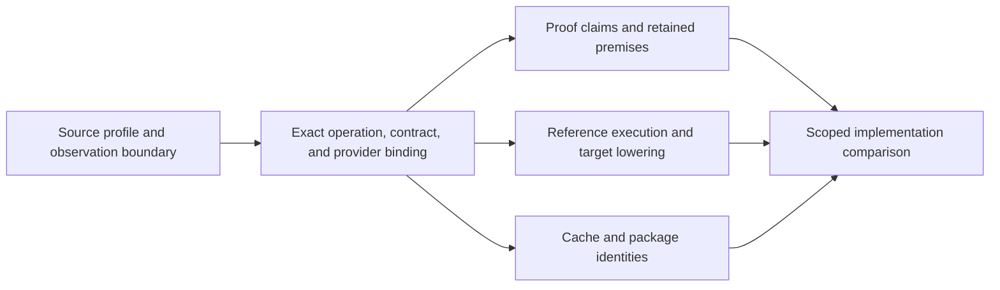

# Research Option Matrix 01 — Language and Execution Foundations

**Status:** Initial evidence-linked comparison; no vector selected
**Updated:** 2026-11-24
**Scope:** First synthesis slice across core semantics, type/effect/resource model, semantic representation, verification, runtime, backends, and security. This matrix does not choose a language architecture or replace the source studies.

## 1. Purpose

The research corpus contains multiple candidate profiles, prototypes, and recommendations, but the alternatives are not yet normalized into a single comparison that shows which combinations are coherent and what evidence supports them. This document records a first set of integrated vectors, compatibility conditions, evidence strength, and the experiments that would distinguish them. It feeds the whole-specification synthesis in `PLAN.md`.

The vectors are candidate bundles, not claims that all combinations within a column have already been implemented or proved. A missing incompatibility is not evidence of compatibility. Recommendations in source documents remain recommendations until an explicit decision is accepted.

## 2. Evidence and confidence scale

Evidence levels used here:

- **Implemented:** executable prototype or production behavior exists and is linked.
- **Mechanically checked:** a test suite or kernel-checked theorem passed for a named bounded scope.
- **Analytical:** comparative reasoning or a written architecture proposal exists without validating experiment.
- **Assumed:** required to make the vector coherent but not established by current evidence.

Confidence describes how strongly the current evidence supports the stated comparison, not how attractive the vector is.

## 3. Normalized decisions

For a closed two-integer profile, [restricted affine certificates](../formal-verification/RT-07/RT-07-RESTRICTED-AFFINE-CERTIFICATES-2026-11-25.md) replay both archived queries with standard Lean axioms and exact branch coverage. Direct Lean arithmetic closes the integer-only control while the affine route abstains. A wider checker needs a different rule and trust profile.

| Decision | Candidate vectors | Current evidence and scope | Open discriminator |
|---|---|---|---|
| Source execution semantics | **S-A Pure strict core** with immutable values and explicit error data. **S-B Imperative state core** with ordered commands and explicit store. **S-C Isolated concurrent processes** with local state and message traces. **S-D Effectful functional core** with explicit effect operations and handlers. | [COR-09–11](../language-design/RT-03/RT-03-04-SHARED-SEMANTICS-CORPUS.md) compare all four on one bounded scalar workload and record counterexamples for mutation order, handler behavior, and actor delivery. Lean proves preservation for a narrow Int/Bool expression subset. [Scenario 40](../language-design/RT-04/RESEARCH-SCENARIO-40-ASYNC-CANCELLATION-AND-CLEANUP.md) distinguishes cancellation signal, task termination, synchronous cleanup, and cleanup completion across Rust, Swift, and Go. | Compare a typed resource and message protocol that can block, fail, or transfer a reference. Determine where divergence, cleanup, and scheduling affect observations. Define whether cancellation completion waits for resource cleanup, and record peer-visible partial I/O. Compare API changes when a new recoverable error is introduced. A restricted [source cleanup CFG](../language-design/RT-03/RT-03-SOURCE-CLEANUP-CFG-2026-11-25.md) checks the distinction between Boolean evaluation, cleanup and actual return. |
| Expression/call evaluation and observable traces | **E-A Recursive left-to-right** for all operand classes; **E-B Selective sequencing** for effectful/communication events with explicitly relaxed pure work; **E-C Unspecified-but-sequenced** argument order; **E-D Reject conflicting unsequenced effects.** | [Scenario 59](../language-design/RT-03/RESEARCH-SCENARIO-59-BOOLEAN-SHORT-CIRCUIT-AND-EVALUATION-ORDER.md) studies conditional Boolean evaluation; [Scenario 77](../language-design/RT-03/RESEARCH-SCENARIO-77-CALL-ARGUMENT-EVALUATION-ORDER.md) compares broader call/operand ordering. Rust's listed expressions recurse left-to-right; Go orders calls/receives/logical operations while leaving some other operand relations unspecified; Java fixes left-to-right with abrupt-completion short-circuit; C++ sequences argument computations before the body but leaves parameter initialization order open. These are primary-spec analytical comparisons, not LLMLang compiler measurements. | Run one trace corpus with mutation/read conflicts, receiver failure, recoverable errors, divergence, default arguments/conversions, async task start, and optimizers. Define which reads/traps/allocations count as observable and state exactly which order constraints apply before contracts and body entry. |
| Floating-point format, edge behavior, and reproducibility | **F-A Strict reproducible default** with explicit relaxed scopes; **F-B IEEE value semantics plus selected target latitude**; **F-C Fast/relaxed by default with explicit strict operations; F-D Multiple named format and math profiles.** | [Scenario 45](../language-design/RT-03/RESEARCH-SCENARIO-45-NUMERIC-SEMANTICS-AND-OVERFLOW.md) lists float dimensions; [Scenario 78](../language-design/RT-03/RESEARCH-SCENARIO-78-FLOATING-POINT-REPRODUCIBILITY-AND-IEEE-EDGES.md) compares Rust, Go, Swift, and Zig specifications for NaNs, signed zero, fusion, and strict/optimized modes. Go permits fusion absent an explicit rounding boundary; Zig scopes strict/optimized modes; Rust documents non-preservation of arithmetic NaN payload bits. The [Binary64 contraction and raw NaNs](../compiler-and-translation/RT-13/RT-13-BINARY64-CONTRACTION-2026-11-25.md) fixture checks separate and fused rounding across six native or VM profiles. The contraction setting changes 77 of 6,859 value observations. The explicit fused result has divergent raw NaN bits for 114 inputs, so a guarantee of raw payload identity needs a separate rule. Three Clang and LLD pairs keep downward signed zero with a retained constrained call or volatile operands under native, full and ThinLTO links. Both LTO modes lose it for inlined literals. [Dynamic rounding through LTO](../compiler-and-translation/RT-13/RT-13-LLVM-DYNAMIC-ROUNDING-LTO-2026-11-25.md) | Run exact-bit fixtures across interpreter/VM and native backends, compiler versions, CPUs, and math libraries. Decide whether the contract covers primitive values, NaN payloads, formatting, transcendentals, exception flags, hashes, and serialized bytes. Include float mode/target/math library in semantic and evidence inputs where observable. |
| String literal syntax and interpolation | **L-A Escaped text plus explicit Bytes; L-B paired escaped/raw text and byte forms; L-C typed interpolation; L-D explicit formatting APIs only; L-E context-typed safe templates.** | [Scenario 46](../language-design/RT-03/RESEARCH-SCENARIO-46-STRINGS-UNICODE-AND-INDEXING.md) covers runtime string/Unicode semantics; [Scenario 79](../language-design/RT-03/RESEARCH-SCENARIO-79-STRING-LITERAL-SYNTAX-AND-INTERPOLATION.md) compares source spellings and template evaluation. Rust separates format macros from literals and provides hash-delimited raw/byte forms; Go uses interpreted/raw strings with byte escapes and no interpolation; Swift provides raw/multiline delimiters and overloadable typed interpolation; Zig uses byte-oriented and no-escape multiline forms. Analytical prior art only. | Prototype lexer/parser, formatter, and source emitter on quote/terminator/newline/escape/interpolation collisions. Define Text versus Bytes literal results, Unicode escape validity, multiline whitespace, interpolation conversion/effects/order, diagnostic recovery, and context-specific safe-template APIs. Verify generated literals round-trip exactly. |
| Comments, documentation, and lexical trivia | **C-A Line comments only; C-B line and nested block comments; C-C line and non-nested block comments.** Treat doc comments as explicit attributes, adjacency-attached declarations, or structured source trivia; choose whether directives are language attributes or tool conventions. | [Scenario 53](../language-design/RT-03/RESEARCH-SCENARIO-53-STATEMENT-TERMINATION-AND-NEWLINES.md) notes comment/newline interaction; [Scenario 80](../language-design/RT-31/RESEARCH-SCENARIO-80-COMMENTS-DOCS-AND-LEXICAL-TRIVIA.md) compares Rust, Go, Swift, and Zig comment/doc/directive rules. Evidence is specification-level. | Exercise nesting, delimiters inside literals, newline-sensitive tokenization, attachment/orphan errors, directive placement and trust, formatter/doc extraction, and source edits. Define retained trivia, source-map stability, and whether comments affect semantic hashes or only source artifacts. |
| Recursion, termination, and execution budgets | **T Total-by-default** with structural/well-founded recursion; **P general recursion** with divergence; **D typed divergence effect**; **F source-semantic fuel**; **M VM operator gas**; **E external runtime limits**; combinations remain possible. | [Scenario 36](../language-design/RT-03/RESEARCH-SCENARIO-36-RECURSION-TERMINATION-AND-FUEL.md) compares Lean, Koka/F*, Rust, WebAssembly, and Wasmtime. The abstract source-cost model derives `4*n+2` for one countdown and shows finite fuel cannot identify divergence alone. Koka's `div` flows through effect-polymorphic callbacks and its `hdiv` constraint prevents divergence hidden by self-referential functions in mutable heap; its built-in termination analysis recognizes only direct structural recursion. F* checks well-founded decreases across mutually recursive groups but limits arbitrary effect-polymorphic higher-order APIs. Bounded effect/scope, owned-return, and cleanup-reserve probes separate prior effects, outcomes, and owner debts. | Check divergence propagation through recursive SCCs, generic callbacks, heap-stored functions/unknown dispatch, and unsafe annotations; add recursive source programs and a common outcome model; compare source-fuel and VM-gas layers. Extend reserve results across body outcomes and cleanup divergence. Bind runtime engine/version, operator-cost schedule, imports, and interruption policy to evidence inputs. The [binary-search pilot](../formal-verification/RT-34/RT-34-BINARY-SEARCH-PROBE-BOUNDS-2026-11-25.md) separates strict progress, a tight probe bound and the functional input premise. The [balanced recursion pilot](../formal-verification/RT-34/RT-34-MERGE-RECURRENCE-2026-11-25.md) checks progress and separates exact output writes from a tight comparison envelope. |
| Type/effect/resource model | **T-A Explicit effects and capabilities over pure core;** **T-B Ownership/borrowing with imperative state;** **T-C Message/protocol types with isolated processes** | The RT-04 study, [Scenario 37](../language-design/RT-04/RESEARCH-SCENARIO-37-EFFECT-ROWS-HANDLERS-AND-OBSERVATION.md), [Scenario 38](../language-design/RT-04/RESEARCH-SCENARIO-38-EFFECTS-CAPABILITIES-AND-AUTHORITY.md), [Scenario 39](../language-design/RT-04/RESEARCH-SCENARIO-39-CLEANUP-FAILURE-AND-OWNERSHIP-TRANSFER.md), [Scenario 40](../language-design/RT-04/RESEARCH-SCENARIO-40-ASYNC-CANCELLATION-AND-CLEANUP.md), and [Scenario 41](../language-design/RT-04/RESEARCH-SCENARIO-41-TYPED-ERRORS-AND-API-EVOLUTION.md) separate effect bounds, handlers, authority, runtime availability, observable traces, async cancellation, cleanup, and typed error evolution. Koka rows can retain duplicate labels for nested handler evidence; F* indexed effects show an operation-set bound that deliberately forgets order/multiplicity. Capability examples range from handler availability to scoped object handles and cryptographic permission tokens; none makes the effect bound a record of realized behavior. Scenario 41 compares closed `Result`/error sets and typed throws with Go's wrapped error values; adding an error case, widening/erasing types, and retaining classification are distinct API evolution choices. The limited declaration-level checker covers selected bounds, call-site checks, and scoped capabilities, but its open-row marker does not implement row unification or handler coverage. COR-13 shows that transfer-first cleanup failure needs an error-with-value result that current typed calls cannot represent; RT-04's checker accepts primitive `Result` but rejects nested `Owned` and `ErrorWithValue` descriptors as unknown. No profile is validated as a complete type system. | Preserve ordered effect traces and payloads separately from static effect bounds; check authority scope/delegation independently of effect permission; test handler introduction/elimination/forwarding/masking, aliasing/borrowing, resource transfer, typed error evolution and classification, cancellation requests versus task completion, asynchronous cleanup ownership, and inter-process protocols against the same RT-03 observations. Scenario 119 checks a bounded named call with inferred ownership obligations. Compare local recovery with forwarding and measure exact match burden as close contracts change. Establish source and API correspondence and obtain independent review before selecting a carrier. [Owned result matching](../language-design/RT-04/RESEARCH-SCENARIO-119-OWNED-RESULT-MATCHING.md) |
| Generics, constraints, dispatch, and inference | **G-A Nominal traits/protocols with coherence; G-B structural interfaces and bounded type sets; G-C type classes with instance resolution; G-D hybrid static generics plus explicit dynamic object/existential types.** Inference is a separate scope choice: I-A local forward, I-B bidirectional expression, I-C function-body, or I-D global/module inference. | [Scenario 42](../language-design/RT-04/RESEARCH-SCENARIO-42-GENERICS-CONSTRAINTS-AND-DISPATCH.md) compares trait/protocol/type-set/class mechanisms; [Scenario 71](../language-design/RT-04/RESEARCH-SCENARIO-71-INTERFACE-IMPLEMENTATION-OWNERSHIP-AND-COHERENCE.md) isolates implementation ownership, overlap, retroactivity, and scoped lookup across Rust, Go, Swift, and Haskell. [Scenario 60](../language-design/RT-04/RESEARCH-SCENARIO-60-TYPE-INFERENCE-SCOPE-AND-ANNOTATIONS.md) compares Rust body-local inference and explicit item signatures, Go generic instantiation equations, and Swift contextual expression/statement inference. No common inference corpus run. | Implement matched generic and inference fixtures. Check associated-type relationships, downstream extension/conflicts, import-scoped selection, deterministic implementation choice, ambiguity/fallback, annotation burden, diagnostic locality, solver bounds, interface hashes, dependency invalidation, and separate-module compilation. Pin compiler versions and report inference acceptance separately from performance. |
| Optional values and nullability | **N-A Algebraic `Option<T>` for every payload and no nullable references; N-B nullable references plus optional value types; N-C typed `nil` for specified reference-bearing categories; N-D separate absence and failure types (`Option`/`Result`).** | [Scenario 62](../language-design/RT-04/RESEARCH-SCENARIO-62-OPTIONAL-VALUES-AND-NULLABILITY.md) compares Rust `Option`, Swift `Optional`, Go's category-specific `nil`, and Zig `?T`. [Scenario 109](../packages-and-ecosystem/RT-18/RESEARCH-SCENARIO-109-OPTIONAL-PRESENCE-ROUND-TRIP.md) runs a one-field JSON fixture: one-level optional collapses omitted/null under the chosen mapping, while nested optional and presence-tagged payload preserve absent/null/value; decode errors and uninitialized reads remain distinct. [Scenario 110](../packages-and-ecosystem/RT-18/RESEARCH-SCENARIO-110-WIRE-SCHEMA-EVOLUTION-AND-DEFAULTS.md) checks 16 old/new producer-consumer policy combinations: new defaulted fields accept old payloads, strict old readers reject new keys, permissive readers drop them, and changing defaults changes old-message interpretation. No LLMLang schema, serializer, or ABI rule is established. | Test nested optionality, initialization, exhaustive handling, nil-capable operations, interface/typed-nil cases, absence vs failure vs omitted input, and FFI/serialization boundaries; test version-skew and default evolution separately from unknown-field behavior; state ABI guarantees only per payload and target.
| Modules, imports, and initialization | **M-A Explicit namespace tree with privacy and re-exports; M-B package-wide declaration and import DAG; M-C distribution modules with layered access; M-D explicit readability/exports graph with dynamic service discovery.** | [Scenario 43](../language-design/RT-03/RESEARCH-SCENARIO-43-MODULES-IMPORTS-AND-INITIALIZATION.md) compares Rust module visibility/re-exports, Go package scope and initialization order, Swift module/package access levels, and Java readability/exports/services. Sources show distinct grouping, visibility, and initialization models; no build or conformance experiment yet. | Probe canonical declarations versus public aliases, cycle behavior, test visibility, transitive initialization dependencies, file-order determinism, dynamic provider sets, and incremental invalidation. Decide whether namespace, package, compilation unit, and distribution module need separate identities.
| Source import binding and qualification | **IB-A Qualified module binding by default; IB-B explicit selective direct imports; IB-C selective imports with aliases; IB-D wildcard/on-demand imports; IB-E explicit public re-exports.** Relative versus package-root paths and source binding versus runtime loading are independent axes. | [Scenario 43](../language-design/RT-03/RESEARCH-SCENARIO-43-MODULES-IMPORTS-AND-INITIALIZATION.md) addresses module/package graphs and initialization; [Scenario 81](../language-design/RT-31/RESEARCH-SCENARIO-81-IMPORT-BINDING-SYNTAX-AND-NAMESPACE-POLLUTION.md) compares source-level binding forms in Rust, Go, Swift, Java, and Python. Specification evidence only; no LLMLang resolver experiment. | Run duplicate-name, shadowing, alias, wildcard, facade/re-export, relative-path move, multi-file package, dynamic-load, and import-cycle fixtures. Record resolved declaration and local binding identity, diagnostics, public-path compatibility, and exact build invalidation. |
| Source-file and compilation-unit grammar | **SF-A Explicit package header, import prelude, declarations only; SF-B optional package header with file-local imports; SF-C file-to-module declaration; SF-D script/compact top-level entry form.** File-to-package mapping, top-level executable code, and deterministic file ordering are separate choices. | [Scenario 43](../language-design/RT-03/RESEARCH-SCENARIO-43-MODULES-IMPORTS-AND-INITIALIZATION.md) addresses module/package boundaries; [Scenario 81](../language-design/RT-31/RESEARCH-SCENARIO-81-IMPORT-BINDING-SYNTAX-AND-NAMESPACE-POLLUTION.md) addresses import bindings; [Scenario 82](../language-design/RT-31/RESEARCH-SCENARIO-82-SOURCE-FILE-STRUCTURE-AND-TOP-LEVEL-CODE.md) compares source-file grammar and entry forms across Go, Rust, Java, Swift, and Kotlin. Specification evidence only. | Compare one-file and multi-file units, file movement, import locality, parser metadata order, file enumeration, source entry selection, and script/library boundaries. Record how file identity, logical module identity, and compilation-unit identity affect resolver outputs and incremental builds. |
| Compile-time execution and macros | **P-A Declarative token/syntax rules; P-B procedural host-code transforms; P-C typed syntax-tree macros; P-D ordinary compile-time evaluation; combinations remain possible.** | [Scenario 44](../language-design/RT-03/RESEARCH-SCENARIO-44-COMPTIME-AND-MACRO-BOUNDARIES.md) compares Rust macro_rules/proc macros, Swift additive syntax-tree macros, Zig comptime, and C preprocessing as a textual lower bound. Sources distinguish hygiene, syntax/type checks, phase separation, and build trust; no LLMLang macro experiment or sandbox validation. | Implement matched declaration/schema/platform fixtures. Measure type awareness, output inspectability, hygiene, diagnostic spans, reproducibility, capability limits, cache invalidation, expansion termination/resource limits, and resulting artifact size. Treat determinism and sandboxing as separate evaluation axes.
| Numeric semantics and arithmetic modes | **N-A Fixed-width exact machine integers with trapping overflow; N-B defined modular/bit-vector overflow; N-C explicit checked/wrapping/saturating operation families; N-D profile-controlled safety and floating optimization modes.** | [Scenario 45](../language-design/RT-03/RESEARCH-SCENARIO-45-NUMERIC-SEMANTICS-AND-OVERFLOW.md) compares Rust, Go, Swift, and Zig docs on overflow, division, width, and floating-point modes; [Scenario 73](../language-design/RT-03/RESEARCH-SCENARIO-73-NUMERIC-LITERAL-TYPING-AND-CONVERSIONS.md) isolates contextual/exact literals, runtime conversion, and mixed-operand typing. Build configuration can affect behavior in some languages; no cross-backend fixture has been run. | Pin width/signedness, division and remainder rules, literal exactness/defaulting, conversion safety and peer typing, float modes, target and build flags. Compare boundary outcomes across debug/release and two backends; align bit-vector/IEEE model assumptions with proofs.
| Numeric literal lexical syntax | **NL-A Decimal and radix integer forms; NL-B grouped digits; NL-C decimal float point/exponent forms; NL-D hexadecimal floats; NL-E type suffixes; NL-F imaginary literal suffix; NL-G sign as separate operator or signed float form.** Token grammar is independent from contextual literal typing and runtime numeric semantics. | [Scenario 73](../language-design/RT-03/RESEARCH-SCENARIO-73-NUMERIC-LITERAL-TYPING-AND-CONVERSIONS.md) studies typing/defaulting; [Scenario 83](../language-design/RT-31/RESEARCH-SCENARIO-83-NUMERIC-LITERAL-LEXICAL-SYNTAX.md) compares Rust, Go, Swift, and Zig token spellings and lexer boundaries. Evidence is specification-level; no LLMLang lexer corpus exists. | Run token boundary fixtures for `.5`, `1.`, `1..2`, radix/exponent collisions, separator positions, suffix/identifier adjacency, signs, and malformed runs. Record raw token, parser interpretation, diagnostics, and formatter round-trip. |
| Function signature and call surface | **FS-A Positional names with declaration/body parameter identity; FS-B external argument labels distinct from body names; FS-C named arguments with declaration-order evaluation; FS-D default parameters; FS-E tuple/multiple results; FS-F variadic final parameter; FS-G contextual or explicit receiver.** Overloading and generic/effect/resource signature rules remain separate. | [Scenario 77](../language-design/RT-03/RESEARCH-SCENARIO-77-CALL-ARGUMENT-EVALUATION-ORDER.md) studies evaluation sequencing; [Scenario 84](../language-design/RT-31/RESEARCH-SCENARIO-84-FUNCTION-SIGNATURE-AND-CALL-SURFACE.md) compares declaration and caller surface in Rust, Go, Swift, and Java. [Scenario 88](../packages-and-ecosystem/RT-18/RESEARCH-SCENARIO-88-DEFAULT-ARGUMENT-EVALUATION-AND-API-COMPATIBILITY.md) separates default-expression evaluation epoch, order, environment, and dispatch/version source. No common API-evolution corpus run. | Test label/name changes, named argument order, default side effects, explicit/default order, caller/callee version behavior, overload/variadic ambiguity, bodyless declarations, method-to-function conversion, and exact client invalidation. |
| Local binding declaration syntax | **BD-A Explicit immutable/mutable keywords; BD-B one declaration keyword with per-binding mutability marker; BD-C concise inferred declaration operator; BD-D destructuring declaration patterns; BD-E initializer-required versus definite/zero initialization.** New binding versus assignment/redeclaration is a distinct rule. | [Scenario 50](../language-design/RT-03/RESEARCH-SCENARIO-50-NAMES-IDENTIFIERS-AND-SCOPE.md) studies scope/shadowing; [Scenario 67](../language-design/RT-04/RESEARCH-SCENARIO-67-MUTABILITY-AND-IMMUTABILITY-DEPTH.md) studies what mutability means; [Scenario 68](../language-design/RT-04/RESEARCH-SCENARIO-68-VALUE-CONSTRUCTION-AND-INITIALIZATION.md) studies initialization; [Scenario 85](../language-design/RT-31/RESEARCH-SCENARIO-85-LOCAL-BINDING-DECLARATION-SYNTAX.md) compares declaration forms in Rust, Go, Swift, and Zig. Syntax-level evidence only. | Exercise same-scope redeclaration, shadowing, inferred/annotated types, omitted initializers, destructuring and mismatch, closure capture, and declaration-versus-assignment identity. Record diagnostics, flow initialization, and incremental invalidation. |
| Strings, Unicode, and indexing | **U-A Valid UTF-8 text with byte/scalar views; U-B arbitrary byte string with explicit decoding; U-C grapheme-cluster Character iteration; U-D separate Bytes and Text types with explicit normalization policy.** | [Scenario 46](../language-design/RT-03/RESEARCH-SCENARIO-46-STRINGS-UNICODE-AND-INDEXING.md) compares Rust valid-UTF-8 strings, Go byte-sequence strings, Swift grapheme-oriented Character, and Unicode UAX #29/#15. Sources distinguish bytes, scalars, graphemes, canonical equivalence, and normalization; no performance or conformance run. | Fix invalid-encoding policy, indexing unit/complexity, normalization and equality/hash semantics, Unicode version, and byte/text boundary. Evaluate multilingual corpus, protocol round trips, concatenation normalization boundaries, and identifier-security cases.
| Regular-expression semantics and resource bounds | **RX-A Linear-time dialect by default; RX-B feature-rich backtracking with mandatory budgets; RX-C explicit bounded and rich engines; RX-D library-only engine choice.** Syntax capability, Unicode behavior, and complexity guarantee are independent. | [Scenario 76](../language-design/RT-03/RESEARCH-SCENARIO-76-REGULAR-EXPRESSION-SEMANTICS-AND-RESOURCE-BOUNDS.md) compares Rust regex, Go RE2-compatible regexp, .NET dual engines, and Swift Foundation ICU; no shared adversarial corpus or LLMLang engine selected. | Measure worst-case search/iteration/captures, compile resource bounds, hostile patterns/inputs, Unicode classes and offsets, timeouts/cancellation, and semantic versioning. |
| Public record and variant evolution | **E-A Closed/exhaustive types with major-version additions; E-B reserve openness at API introduction; E-C resilient library ABI with non-frozen layout/cases; E-D convention-based field evolution using keyed construction/default values.** | [Scenario 47](../packages-and-ecosystem/RT-18/RESEARCH-SCENARIO-47-PUBLIC-RECORD-EVOLUTION.md) compares Rust non_exhaustive/Cargo semver, Swift library evolution/frozen types, and Go keyed versus unkeyed literals. Documentation separates source, ABI, and behavior compatibility; no client/compiler experiment. | Test adding fields/cases and changing layout across recompilation, old binaries, serialization, and FFI. Evaluate fallback behavior, defaults/invariants, construction APIs, visibility, and whether openness/layout mode enters public interface identity.
| Clocks, time, and deadlines | **C-A Separate wall-clock timestamps and monotonic instants; C-B combined wall+monotonic values; C-C clock-generic APIs with continuous/suspending clocks; C-D injected clock sources for deterministic tests.** | [Scenario 48](../runtime-and-systems/RT-10/RESEARCH-SCENARIO-48-CLOCKS-TIME-AND-DEADLINES.md) compares Rust Instant/SystemTime, Go dual-reading Time, Swift Clock/ContinuousClock/SuspendingClock, and Java Instant/Clock/nanoTime. Documents separate wall time, elapsed measurement, suspend policy, and test injection; no cross-platform clock experiment yet. | Test wall-clock adjustment, suspend/resume, fake-clock timers, serialization, deadline overflow, sleep tolerance, and timezone-rule changes. State whether deadlines count sleep and whether values are process/clock-domain local.
| Operators, conversions, and precedence | **O-A Fixed built-in operators/no overload; O-B fixed precedence with trait-based overload; O-C declaration-extensible precedence and custom operators; O-D fixed operators with explicit peer-type resolution/coercions.** | [Scenario 49](../language-design/RT-03/RESEARCH-SCENARIO-49-OPERATORS-CONVERSIONS-AND-PRECEDENCE.md) compares precedence, evaluation order, overload surface, and conversions. [Scenario 59](../language-design/RT-03/RESEARCH-SCENARIO-59-BOOLEAN-SHORT-CIRCUIT-AND-EVALUATION-ORDER.md) compares intrinsic short-circuiting, strict operators, deferred operands and partial order guarantees in Rust, Go and Swift. No parser/runtime conformance fixture run. | Compare parse trees, effectful evaluation traces and optimizer rewrites, contextual literal typing, lossy conversions, and formatter/semantic-diff round trips. Decide whether imports can alter parsing, which operators may overload, and exactly which expression-order guarantees are normative.
| Equality, identity, and hashing | **E-Q Structural equality with explicit identity; E-P user-defined equality protocol with lawful equivalence required for hash collections; E-C built-in comparability constraints; E-I separate value equality and reference identity operators.** Ordering is an independent capability. | [Scenario 63](../language-design/RT-03/RESEARCH-SCENARIO-63-EQUALITY-IDENTITY-AND-HASHING.md) compares Rust `PartialEq`/`Eq`/`Hash`, Go type-directed comparability and interface runtime panics, Swift `Equatable`/`Hashable` and `===`, and Zig fixed operator semantics. [Scenario 90](../semantic-representation/RT-05/RESEARCH-SCENARIO-90-RUNTIME-HASHING-DETERMINISM-AND-PERSISTENT-IDENTITY.md) compares process-local table hashes, map iteration contracts, persistent fingerprints, and secure digests. No LLMLang conformance or collection benchmark run. | Test NaN and signed zero, equal-but-distinct references, cyclic/aliased structures, custom equality laws, hash consistency and mutable keys, Unicode canonical equivalence, dynamic comparability, and persistence of hash values across processes.
| Persistent artifact address and digest migration | **D-A Algorithm-tagged addresses with one active write suite; D-B verified dual-address mapping; D-C explicit store/schema epoch and bulk readdressing; D-D stable lineage ID plus immutable versioned digest locators.** Canonical representation version and artifact/domain type are separate axes. | [Scenario 90](../semantic-representation/RT-05/RESEARCH-SCENARIO-90-RUNTIME-HASHING-DETERMINISM-AND-PERSISTENT-IDENTITY.md) separates runtime and persistent hashes. [Scenario 91](../semantic-representation/RT-05/RESEARCH-SCENARIO-91-VERSIONED-CONTENT-ADDRESSES-AND-DIGEST-MIGRATION.md) compares Git transition mappings, OCI descriptors, and IPFS CID fields, then defines migration and SCC discriminators for LL-004/005. No migration prototype or performance run; no address format selected. | Test same canonical bytes under two digest suites; vary schema, domain, artifact kind, and semantic payload independently; exercise partial migration, interruption, recovery, old clients, recursive groups, caller references, signatures, GC, and mapping tampering. Keep lineage and trust distinct from content digests.
| Error propagation and recovery | **ER-A Explicit `Result`-like values with early-return propagation; ER-B typed throwing effect and scoped handlers; ER-C explicit checks with open error values and opt-in cause chains; ER-D typed internal failures with explicit erasure at API boundaries.** | [Scenario 64](../language-design/RT-03/RESEARCH-SCENARIO-64-ERROR-PROPAGATION-AND-RECOVERY.md) compares Rust `Result`/`?`, Swift typed throws/catch, Go explicit return checks and wrapping, and Zig inferred/declared error sets with `try`/`catch`. [Scenario 41](../language-design/RT-04/RESEARCH-SCENARIO-41-TYPED-ERRORS-AND-API-EVOLUTION.md) covers type evolution. [Scenario 97](../language-design/RT-04/RESEARCH-SCENARIO-97-CLEANUP-ERROR-COMPOSITION-AND-OWNERSHIP.md) isolates primary versus secondary cleanup failures, ordered suppression/aggregation, and the independent owner/resource state; its corpus remains unrun. | Compare call-signature changes, error conversion/wrapping, cause privacy, exhaustive recovery after new cases, async aggregation, cancellation/fuel/panic separation, and primary-plus-cleanup error preservation across typed ownership boundaries. Require a separate owned-value carrier when a transferred resource and terminal error must reach the caller together.
| Fatal failure and unwinding | **FF-A Always unwind and clean up before terminal failure; FF-B immediate abort; FF-C explicit profile-selected unwind/abort with constrained ABI crossings; FF-D isolate fatal failure to supervised task/process boundaries.** | [Scenario 65](../language-design/RT-03/RESEARCH-SCENARIO-65-FATAL-FAILURE-AND-UNWINDING.md) compares Rust panic strategies, Go panic/recover scope, Swift throws versus assertion/precondition/fatalError, and Zig `unreachable` across safety modes. No LLMLang failure-profile or cleanup-on-fatal experiment. | Inject invariant failures, cleanup faults, cancellation and partial I/O under debug/optimized builds, child-task boundaries and FFI; specify whether checks may be optimized away and how terminal traces encode committed effects.
| Names, identifiers, and lexical scope | **N-A Lexical scopes with shadowing; N-B lexical scopes with shadowing prohibited; N-C lexical scopes with narrow same-scope redeclaration; N-D runtime/dynamic namespace lookup.** | [Scenario 50](../language-design/RT-03/RESEARCH-SCENARIO-50-NAMES-IDENTIFIERS-AND-SCOPE.md) compares Rust, Go, Python, and Zig references. Scope boundaries, shadowing, namespace separation, declaration order, and runtime lookup are distinct; no resolver prototype run. | Resolve binding identity in nested scopes, patterns, closures, labels, type/value contexts, imports and prelude changes; test rename/use graph, diagnostics, and incremental invalidation under candidate policies.
| Access control and API boundaries | **A-A Private-by-default hierarchical modules with restricted re-exports; A-B package boundary with export-by-name convention; A-C layered package/module/file/declaration access.** | [Scenario 51](../language-design/RT-04/RESEARCH-SCENARIO-51-ACCESS-CONTROL-AND-API-BOUNDARIES.md) compares Rust, Go, and Swift on visibility, exports, re-export paths, and inaccessible signature types. No interface artifact or compatibility fixture run. | Separate resolution from access checks; measure public interface stability, signature leakage, facade re-exports, diagnostics, API compatibility, and downstream invalidation under moves/renames.
| Identifier repertoire and source safety | **U-A ASCII identifiers; U-B Unicode XID with NFC identity and advisory confusable checks; U-C Unicode identifiers with NFKC identity; U-D broad Unicode repertoire with versioned lexical rules and configurable source-security diagnostics.** | [Scenario 52](../language-design/RT-03/RESEARCH-SCENARIO-52-UNICODE-IDENTIFIERS-AND-SOURCE-SAFETY.md) compares Rust, Go, Swift, Python, and Unicode UAX #31 / UTS #39 / UTS #55. Reproducibility and reviewability consequences are identified; no lexer corpus or usability experiment run. | Pin Unicode data/version, compare NFC/NFKC/equality, test mixed-script and single-script confusables, rendering and source maps, case/filesystem/mangling boundaries; measure false positives with multilingual reviewers.
| Statement termination and line breaks | **S-A Explicit semicolons; S-B finite token-based automatic semicolon insertion; S-C newline statement separation with grammar-controlled continuation.** Treat block result semantics as an orthogonal choice. | [Scenario 53](../language-design/RT-03/RESEARCH-SCENARIO-53-STATEMENT-TERMINATION-AND-NEWLINES.md) compares Go, Rust, and Swift; [Scenario 89](../language-design/RT-31/RESEARCH-SCENARIO-89-ECMASCRIPT-AUTOMATIC-SEMICOLON-INSERTION.md) adds ECMAScript's grammar-driven ASI, restricted productions, and continuation cases. Specification evidence only; no LLMLang parser/formatter corpus run. | Test line-wrap/comment moves, operator and brace placement, EOF/newline variants, parse-tree stability, error localization, and formatter/AST round trips under each separator profile.
| Pattern matching and exhaustiveness | **M-A Exhaustive expression match on closed types; M-B exhaustive closed types with explicit forward-compatible unknown arm for open APIs; M-C non-exhaustive statement switch with optional default.** Pattern richness, guards, and branch ownership are additional axes. | [Scenario 54](../language-design/RT-03/RESEARCH-SCENARIO-54-PATTERN-MATCHING-AND-EXHAUSTIVENESS.md) compares Rust, Swift, and Go on pattern expressiveness, coverage checking, and future variants; no matcher/type-checker prototype run. [Scenario 111](../packages-and-ecosystem/RT-18/RESEARCH-SCENARIO-111-UNKNOWN-WIRE-VARIANT-PRESERVATION.md) separately compares reject, lossy fallback, and opaque relay preservation for an unknown serialized sum case; it does not validate source matching behavior. Official Protocol Buffers documentation distinguishes open-enum numeric preservation from closed-enum unknown-field handling (where repeated-value order can change); Avro maps an unknown symbol to a declared reader default or errors; RFC 8949 recommends exposing or forwarding unknown tags/simple values. | Test missing/redundant cases, guards, nested destructuring, ownership transfer, open-world values, enum evolution, unknown wire cases, and statement/value joins; assess diagnostics and downstream breakage.
| Refutable pattern failure and binding | **PF-A Irrefutable declarations only; PF-B branch-local binding; PF-C explicit exit-on-failure binding; PF-D Boolean pattern tests with flow-sensitive bindings; PF-E optional/result values.** Each form must specify definite assignment and partial cleanup. | [Scenario 74](../language-design/RT-03/RESEARCH-SCENARIO-74-REFUTABLE-PATTERN-FAILURE-AND-BINDING.md) complements Scenario 54 with Rust, Swift, Go, and C# failure surfaces; no LLMLang binding/failure form is selected. | Test nested mismatch, binding scope under Boolean control flow, exiting else blocks, moved payload cleanup, recoverable versus fatal mismatch, and CFG/diagnostic behavior. |
| Automatic disposal and resource lifetime | **AD-A Ownership-bound deterministic drop; AD-B explicit lexical defers; AD-C ARC memory lifetime plus explicit external-resource close; AD-D GC with nondeterministic finalizer fallback only.** Memory reclamation and resource release are separate. | [Scenario 75](../language-design/RT-04/RESEARCH-SCENARIO-75-AUTOMATIC-DISPOSAL-AND-LIFETIME.md) compares Rust, Zig, Swift, and Go triggers; async close and fatal-exit cleanup remain open. | Test nested acquisitions, early exits, ownership transfer, retained aliases/cycles, cancellation/unwind/abort, cleanup errors, and finalizer guarantees. A scoped Linux probe distinguishes local close, transport retention and receiver release. [Queued foreign ownership](../language-design/RT-04/RT-04-QUEUED-FOREIGN-OWNERSHIP-2026-11-25.md) |
| Closing resources with live dependents | **Require proof of no dependents. Recover from busy and preserve the open capability when local cleanup cannot finish. Consume the capability and defer destruction to its dependents.** | A 510-plan corpus compares these policies with local and outside statement owners and checks 356 admitted traces against SQLite 3.46.1. [Scenario 121](../language-design/RT-04/RESEARCH-SCENARIO-121-SQLITE-LOCAL-CLOSE-RECOVERY.md) | Test how a source and FFI contract establish complete dependencies. Compare diagnostics and progress when outside owners or untracked foreign handles remain. |
| Proof of no live dependents | **Prove complete coverage from source and call summaries. Check a complete and current runtime observation. Check the live set at a guarded close.** | A 4,116-execution corpus finds busy counterexamples for incomplete local knowledge and stale observations. Complete source proof and a current snapshot admit no busy cases in the corpus. SQLite confirms the effect of an intervening prepare. [Scenario 122](../language-design/RT-04/RESEARCH-SCENARIO-122-CLOSE-EVIDENCE-FRESHNESS.md) | Test capability identity, scope of dependent kinds, FFI effect coverage, and how the implementation guards inspection through close. |

| Loop results and control transfer | **L-A Statement-only loops with labeled exits; L-B result-producing infinite loops/labeled blocks plus statement condition/range loops; L-C all loop forms as expressions.** Label target categories and cleanup behavior are orthogonal. | [Scenario 55](../language-design/RT-03/RESEARCH-SCENARIO-55-LOOP-RESULTS-LABELS-AND-CONTROL-TRANSFER.md) compares Rust, Go, and Swift on loop forms, labeled break/continue, loop result types, and control-target boundaries; no CFG/ownership prototype run. | Compare search/retry scaffolding, break-value joins, nested target clarity, cleanup/failure across exits, closure boundaries, and CFG/semantic graph fidelity.
| Closures, capture, and escape | **C-A Inferred borrow/move capture with callable capability types; C-B implicit shared-variable capture with lifetime extension; C-C explicit capture lists and escape annotations.** Callable cardinality and thread-safety are separate type dimensions. | [Scenario 56](../language-design/RT-04/RESEARCH-SCENARIO-56-CLOSURE-CAPTURE-AND-ESCAPE.md) compares Rust, Go, and Swift on capture mode, callable behavior, escaping, cycles, and concurrency; no closure type/lifetime prototype run. | Test capture precision, retained resources, once/mutable/reusable callbacks, stored/async closures, thread-safety, reference cycles, cancellation/drop, and inference stability.
| Structured concurrency and task lifetimes | **T-A Structured child scopes that join on exit; T-B structured by default with explicit supervised detach; T-C unstructured spawn with explicit owned task handles.** Cancellation, failure aggregation, and inherited context are independent decisions. | [Scenario 57](../runtime-and-systems/RT-10/RESEARCH-SCENARIO-57-STRUCTURED-CONCURRENCY-AND-TASK-LIFETIMES.md) compares Swift task groups, Go goroutine conventions, and Rust scoped threads/runtime-dependent async tasks; no task-tree prototype run. | Inject child failure, noncooperative cancellation, early return, blocked resources and nested scopes; measure orphan tasks, exit latency, deterministic error handling, lifetime safety, and ability to supervise detached work.
| Async function types and scheduling | **A-A Async is a distinct function type/effect; A-B ordinary function returning explicit Future/Task; A-C async behavior arises only through explicit spawn. Invocation may be lazy, eager, or synchronous-unless-spawned; scheduler/executor is a separate choice.** | [Scenario 58](../runtime-and-systems/RT-10/RESEARCH-SCENARIO-58-ASYNC-FUNCTION-TYPES-AND-SCHEDULING.md) compares Rust future construction/polling, Swift async function types and task APIs, and Go goroutine launch; no LLMLang runtime experiment. [Scenario 94](../runtime-and-systems/RT-10/RESEARCH-SCENARIO-94-SCHEDULER-FAIRNESS-AND-LIVENESS.md) compares runtime guarantees, and [Scenario 112](../runtime-and-systems/RT-10/RESEARCH-SCENARIO-112-WEAK-STRONG-AND-BOUNDED-FAIRNESS.md) exhausts two starvation cycles: weak fairness rejects continuous-enabled starvation but allows intermittent-enabled starvation; strong fairness rejects both. A two-task round-robin bound holds only under fixed always-runnable/returning-step premises. This remains an abstract model, not runtime evidence. | Trace start/suspension/drop semantics, compare sequential await and explicit parallel composition, and test blocking calls, executor affinity, sync/async typing, FFI, fairness and actual target parallelism. Decide whether fairness is unspecified at language level or given by a versioned executor profile; do not infer I/O completion, lock acquisition, or task termination from scheduler fairness.
| Async/await surface syntax and context | **AS-A Async declaration modifier/prefix; AS-B async marker in signature; AS-C explicit Future/Task type only. AW-A Postfix await on operand; AW-B prefix await expression; AW-C implicit suspension. CT-A async-only function contexts; CT-B async closures/blocks; CT-C module top-level await.** These grammar axes do not decide scheduling or task start. | [Scenario 58](../runtime-and-systems/RT-10/RESEARCH-SCENARIO-58-ASYNC-FUNCTION-TYPES-AND-SCHEDULING.md) studies function types and start/scheduling; [Scenario 86](../language-design/RT-31/RESEARCH-SCENARIO-86-ASYNC-AWAIT-SYNTAX-AND-CONTEXTS.md) compares Rust, Swift, C#, and ECMAScript marker/await/context rules; [Scenario 87](../language-design/RT-31/RESEARCH-SCENARIO-87-ASYNC-AWAIT-PARSER-DIAGNOSTIC-CORPUS.md) specifies 18 proposed fixtures for parser/context/type-stage separation, precedence, module goals, recovery, and diagnostic spans. No LLMLang grammar has been validated. | Implement a version-pinned cross-language harness, then run each candidate LLMLang profile against the cases. Record syntax contexts and source mapping separately from runtime traces; keep task start/scheduling in Scenario 58. |
| Concurrent mutable state and memory model | **C-S Ownership/transfer first; C-A actor/isolation first; C-M shared memory with synchronization and DRF-SC guarantees; C-H safe high-level model with explicit unsafe/shared-memory boundary.** Data-race policy, logical race behavior, and atomic orders are separate decisions. | [Scenario 61](../language-design/RT-04/RESEARCH-SCENARIO-61-CONCURRENT-MUTABLE-STATE-AND-MEMORY-MODEL.md) compares Rust ownership/atomics and incomplete memory-model status, Go shared-memory DRF-SC plus race detector, and Swift actor isolation/Sendable with unchecked escape. [Scenario 113](../language-design/RT-04/RESEARCH-SCENARIO-113-STORE-BUFFERING-MEMORY-ORDERS.md) adds finite litmus relations and source-backed Rust/C++20 ordering-family versus Go's all-atomics-SC contract. Its independent-per-location row remains an abstract profile, not a claim about a concrete language. RMW counters distinguish per-object atomicity from unrelated-memory ordering; same-location read-read coherence is only one of four C++ coherence constraints and supplies no complete relaxed-memory semantics. [Scenario 114](../language-design/RT-04/RESEARCH-SCENARIO-114-RELEASE-SEQUENCES-AND-ACQUIRE-RELAY.md) isolates acquire/read-from relay and the C++20 removal of same-thread plain writes from release sequences. [Scenario 115](../language-design/RT-04/RESEARCH-SCENARIO-115-FENCES-AND-SEQUENTIAL-CONSISTENCY.md) documents fence synchronization through a linked atomic read-from and limits of the C++ `seq_cst` total order under mixed orders. [Scenario 116](../compiler-and-translation/RT-13/RESEARCH-SCENARIO-116-ATOMIC-BACKEND-LOWERING-OBLIGATIONS.md) links these source contracts to LLVM IR and target/width availability. It proposes validation of `Relaxed`→`monotonic` mapping rather than LLVM `unordered` and compares target-gated widths, lock fallback, and an explicit fallback API. Scenario 117 exercises write-write, read-write, and write-read coherence given explicit premises, complementing Scenario 113's read-read fixture. [Coherence relations](../language-design/RT-04/RESEARCH-SCENARIO-117-ATOMIC-WRITE-READ-COHERENCE.md) Scenario 118 derives those premises jointly for atomic loads and stores. It compares all-atomic sequential consistency with relaxed and direct release/acquire across 4,096 bounded programs, finding 98 with extra observations under the weaker rules. [Execution relations](../language-design/RT-04/RESEARCH-SCENARIO-118-ATOMIC-EXECUTION-RELATIONS.md) | Extend the comparison to RMW release sequences, fences, and mixtures of `SeqCst` with weaker orders. Compare with an independent weak-memory model. Prove source-to-IR mappings; choose width policy and specify fallback progress. Validate on multiple compilers/backends/targets. Exercise aliases/transfers/actor hops/FFI, distinguish data races from logic races, compare static diagnostics and dynamic detection, and validate backend behavior across targets.
| Copy, move, and reference semantics | **CM-A Value copy by default with explicit references; CM-B move by default with implicit trivial `Copy` and explicit `Clone`; CM-C nominal value/reference categories with optional copy-on-write; CM-D uniform descriptor/reference model.** Source value semantics and physical copying are separate. | [Scenario 66](../language-design/RT-04/RESEARCH-SCENARIO-66-COPY-MOVE-AND-REFERENCE-SEMANTICS.md) compares Rust move/`Copy`/`Clone`/borrow, Go by-value assignment including slice/map descriptors, Swift value/reference types and COW collections, and Zig values/pointers/result locations. No LLMLang aliasing or lowering experiment. | Test nested reference-bearing aggregates, mutation visibility, resource duplication/drop, generic copyability, COW identity, async capture, and ABI/copy elision while separating semantic observations from cost.
| Mutability and immutability depth | **MU-A Binding-only constness; MU-B explicit mutable access capabilities with controlled interior mutability; MU-C value-category constness; MU-D transitive/deep immutability with declared synchronized exceptions.** Default mutability is separate. | [Scenario 67](../language-design/RT-04/RESEARCH-SCENARIO-67-MUTABILITY-AND-IMMUTABILITY-DEPTH.md) compares Rust `mut`/borrows/cells, Go compile-time constants and runtime aliases, Swift `let` for value/reference types, and Zig declaration/pointer qualifiers. No LLMLang aliasing or deep-freeze experiment. | Test nested reachable graphs, unique versus shared aliases, generic and async access, lazy caches/COW, FFI objects, diagnostics, and effects on purity/dependency reuse; keep data-race safety distinct.
| Value construction and initialization invariants | **IN-A Complete explicit aggregates; IN-B useful recursive zero/default value; IN-C controlled construction with definite initialization and no early `self` escape; IN-D aggregate syntax plus validated builder/finalize for invariant-bearing types.** | [Scenario 68](../language-design/RT-04/RESEARCH-SCENARIO-68-VALUE-CONSTRUCTION-AND-INITIALIZATION.md) compares Rust complete struct literals and ordinary constructor functions, Go recursive zero values, Swift definite/two-phase initialization, and Zig comptime field defaults plus runtime init methods. No LLMLang partial-construction or API-evolution experiment. | Test invariant preservation, fallible construction after resource acquisition, partial cleanup, `self` escape/callback publication, recursive types, default safety, private fields, and client compatibility after field evolution.
| Subtyping and generic variance | **SV-A Equality-only concrete types plus explicit interfaces; SV-B invariant nominal generics with bounded views; SV-C declaration-site variance annotations; SV-D inferred structural variance.** Function input/output variance and mutable-container write safety require separate rules. | [Scenario 69](../language-design/RT-04/RESEARCH-SCENARIO-69-SUBTYPING-AND-VARIANCE.md) compares Rust's narrow lifetime/high-ranked subtyping, Java invariant generic instantiations plus wildcard/capture, Go identity/assignability/interfaces, and Swift generic/existential boundaries. No LLMLang substitution or variance evolution fixture. | Test mutable collections, producers/consumers, callback/function inputs and outputs, higher-order/effectful types, existential views, inference, API compatibility, and interface-hash invalidation.
| Aliases, nominal wrappers, and opaque abstractions | **TI-A Identity-preserving aliases plus nominal records; TI-B dedicated newtype declarations; TI-C opaque public API identities with hidden implementation; TI-D separately declared transparent layout/ABI guarantee.** These dimensions can compose and must remain independent. | [Scenario 70](../language-design/RT-04/RESEARCH-SCENARIO-70-TYPE-ALIASES-NEWTYPE-AND-OPAQUE-ABSTRACTIONS.md) compares Rust, Go, Swift, and Zig distinctions; no LLMLang identity, representation, or abstraction boundary is selected. | Probe assignment/inference/serialization, invariant bypass, separately compiled API evolution, opaque client operations, target ABI/layout, forwarding, optimizer behavior, and semantic artifact keys. |
| Sum-type layout, ABI, and interoperability | **SA-A Compiler-private optimized layout plus explicit bridges; SA-B stable tagged-union ABI; SA-C resilient opaque ABI; SA-D per-type private/resilient/C-tagged representation controls.** Exhaustiveness policy and representation contract remain distinct. | [Scenario 72](../compiler-and-translation/RT-13/RESEARCH-SCENARIO-72-SUM-TYPE-LAYOUT-ABI-AND-INTEROPERABILITY.md) compares Rust representations, Zig tagged/extern unions, Swift resilient/frozen enums, and C tagged-union practice; no LLMLang ABI profile or target measurement exists. | Test cross-target size/alignment/pass mode, version skew, unknown and invalid tags, C round trips, wire format, optimizer behavior, and explicit bridge overhead. |
| Cache result validity and trust | **C-A Exact-action result reuse with complete closure and validation; C-B approximate material restore followed by exact validation/re-execution; C-C recompute across trust boundaries; C-D attested shared results under configured authority.** These policies can compose. | [Scenario 93](../toolchain-and-collaboration/RT-11/RESEARCH-SCENARIO-93-CACHE-SOUNDNESS-RESULT-ENVELOPES-AND-TRUST.md) compares REAPI Action Cache/CAS and result records, Nix sandbox assumptions, and GitHub Actions prefix dependency restores plus writer scopes. No result schema, determinism rule, trust policy, or candidate is selected; LL-021 remains open. | Probe hidden env/network/clock dependencies, target/toolchain/timeout shifts, incomplete closure, nondeterminism, missing outputs, transient failures, forged blobs, untrusted writers, evidence scope drift, and prefix restore. Separate exact action applicability, byte integrity, producer authentication, and correctness. |
| Operation identity and implementation binding | **O-A Contract-addressed OpHash with independent implementation and binding; O-B body-sealed operation hash; O-C contract OpHash plus explicit Binding Hash for reproducible realizations; O-D canonical typed tuple of interface/contract/context references.** These are claim boundaries, not spelling alternatives. | [Scenario 92](../semantic-representation/RT-05/RESEARCH-SCENARIO-92-OPERATION-IDENTITY-AND-IMPLEMENTATION-BINDING.md) compares WIT interface contracts, Bazel execution Action identity, Nix derivation/output identity, and OCI byte digests. It distinguishes OpHash from Stable ID, Interface/Contract Hash, Implementation Hash, Binding Hash, Action Key, Artifact Hash and evidence. No vector is selected; LL-001/002/003/007/008/021 gates remain. | Test two implementations satisfying one contract but producing observably different allowed results; vary interface, effects, semantic profile, ABI, target, toolchain, timeout and capability binding independently. Decide whether calls pin abstract allowed behavior, one body, or both an OpHash and a Binding Hash; fail closed on incomplete contract/dependency evidence. |
| Program representation and identity | **R-A Stable entity IDs with immutable values.** **R-B Content addresses with explicit lineage.** **R-C Optional occurrence and scoped slot identity.** | The [lifecycle experiment](../semantic-representation/RT-05/RT-05-IDENTITY-LIFECYCLE-EXPERIMENT.md) compares continuity across moves. The [inline counterexample](../semantic-representation/RT-05/RT-05-RT-20-CALL-SITE-REFACTOR-EXPERIMENT.md) separates Contract conformance from equivalent behavior. The [recursive identity experiment](../semantic-representation/RT-05/RT-05-RECURSIVE-IDENTITY-EXPERIMENT.md) measures when explicit keys keep symmetric members distinct and when an SCC change propagates to callers. | Check authenticated lineage, real import, and scalable canonical labeling. Compare exact implementation dependencies with calls through typed `OpHash` and `ImplHash` envelopes. The [Rust macro binding fixture](../semantic-representation/RT-05/RT-05-MACRO-BINDING-IDENTITY-2026-11-25.md) distinguishes source provenance from resolved references and effect order. |
| Verification and evidence | **V-A One executable reference semantics with verified projections;** **V-B Formal semantics plus untrusted executable checker;** **V-C Test/model-checking evidence with conservative unknowns** | Scenarios 25–34 and pinned Lean/Logos experiments establish a narrow CPC parser binding and expression/query correspondence scope. RT-20/CIP adds plan and obligation structure, not execution evidence or behavioral correctness. No complete source-program proof architecture exists. | Specify proposition, input manifest, assumptions, tool/environment identity, soundness claim, and trusted computing base for each evidence class. Test stale evidence and unknown dependency cases. |
| Path feasibility and solver outcomes | **P-A Exact finite oracle; P-B tri-state solver with replayed SAT witnesses and conservative UNKNOWN; P-C bounded exact/solver hybrid; P-D solver UNSAT certificates checked independently.** | [Scenarios 98–101](../semantic-representation/RT-06/RESEARCH-SCENARIO-98-FINITE-AST-PATH-COVERAGE.md) compare exhaustive finite assignments and SymPy DPLL2 on bounded immutable Boolean fixtures. [Scenario 102](../semantic-representation/RT-06/RESEARCH-SCENARIO-102-SOLVER-UNKNOWN-AND-SOUND-PATH-PRUNING.md) adds eight status-policy cases and 128 fixed-seed formula comparisons; untrusted UNSAT, timeout, malformed output, and backend errors do not prune. [Scenario 103](../semantic-representation/RT-06/RESEARCH-SCENARIO-103-REAL-SOLVER-TIMEOUT-ISOLATION.md) forces a real DPLL2 timeout in an isolated worker, kills/reaps it, and retains UNKNOWN. [Scenario 104](../semantic-representation/RT-06/RESEARCH-SCENARIO-104-MUTABLE-PREDICATE-IDENTITY.md) shows name-based identity can lose reachable routes after mutation; explicit state versions and transition constraints recover them. [Scenario 105](../semantic-representation/RT-06/RESEARCH-SCENARIO-105-CALL-MUTATION-SUMMARIES.md) shows incomplete call summaries need a conservative state transition. [Scenario 106](../semantic-representation/RT-06/RESEARCH-SCENARIO-106-CALL-ALIAS-SETS-AND-FIELD-SENSITIVE-PATHS.md) shows may-alias call-site targets require a union of state transitions. [Scenario 107](../semantic-representation/RT-06/RESEARCH-SCENARIO-107-SOURCE-DERIVED-CALL-ALIASES.md) derives a bounded alias set from AST branches, covering concrete routes but losing value/alias correlation at a non-relational join. [Scenario 108](../semantic-representation/RT-06/RESEARCH-SCENARIO-108-PATH-SENSITIVE-ALIAS-PRECISION.md) recovers the exact finite route set for a correlated case by path enumeration; it is not scalable symbolic analysis. No architecture selected. | Repeat across hard formula families and versions; test startup/crash/protocol failure, memory/concurrency limits, and exact-size cutoffs; check a proof-producing UNSAT path; bind translation to a versioned source CFG and alias-/call-aware mutation summaries; compare non-relational and path-sensitive aliases. Treat solver agreement as diagnostic corroboration rather than proof. |
| Diagnostics and code repairs | **D-A Human-rendered text as primary output; D-B structured diagnostic records as the source of truth with CLI/JSON/LSP renderers; D-C structured records plus separately generated explanations; D-D structured records with explicit repair actions and applicability/preconditions.** These vectors compose. | [Scenario 87](../language-design/RT-31/RESEARCH-SCENARIO-87-ASYNC-AWAIT-PARSER-DIAGNOSTIC-CORPUS.md) proposes parser/context cases but does not establish a general contract. [Scenario 95](../toolchain-and-collaboration/RT-17/RESEARCH-SCENARIO-95-DIAGNOSTICS-FOR-HUMANS-AND-AGENTS.md) compares Rust structured suggestions/tests, LSP fields, TypeScript phase-separated queries, Elm's error corpus, and mixed human/LLM study results. No LLMLang diagnostic corpus or agent repair study exists. | Specify stable identity, source/version coordinates, causal related locations, phase/recovery state, renderer/schema versioning, and stale/incremental behavior. Evaluate human and agent strata separately with randomized output arms; score correct fixes and regressions, not preference or compile success alone. Do not infer repair authorization from a diagnostic or applicability label. |
| Runtime and backend | **B-A Interpreter/reference runtime first, with later native lowering;** **B-B Bytecode VM as primary execution contract;** **B-C Direct native/LLVM lowering with runtime services** | Scenario 96 describes the independent source and LLVM contracts. Scenario 96A preserves bounded integer values, failures, and effects at O0 and O3. The verifier also accepts a negative control that loses the source overflow edge. Backend and profile selection remain open. [Scenario 96](../compiler-and-translation/RT-13/RESEARCH-SCENARIO-96-LLVM-UB-POISON-AND-SEMANTIC-PRESERVATION.md) · [Scenario 96A](../compiler-and-translation/RT-13/RESEARCH-SCENARIO-96A-LLVM-INTEGER-PRESERVATION.md) | Run the same vertical slice through two independently implemented backends against the reference semantics. Compare behavior, diagnostics, performance, ABI and unsupported cases. Extend the integer corpus with pointer bounds, provenance and optimization-sensitive assumptions. Track and validate the source preconditions for each emitted LLVM promise. |
| Compilation and binding | **Exact implementation linkage.** **Separately linked stable ABI with pinned implementation selection.** | In the [RT-11 C benchmark](../toolchain-and-collaboration/RT-11/RT-11-BINDING-INVALIDATION-BENCHMARK.md), changing one implementation reduces caller recompilations from 12 to 4 under separate linkage. Both strategies still link and verify twelve changed executables. Body-visible consumers recompile in both. | Evaluate actual LLMLang code generation and prove which conditions and bindings affect each action before relying on projected keys. Measure runtime, artifact size, and link cost. |
| Security and authority | **Q-A Small trusted core with capability-mediated effects and untrusted LLM proposals;** **Q-B Sandboxed toolchain/runtime with signed evidence and explicit human authorization;** **Q-C Process isolation and declarative policy around execution** | The concept excludes LLM output from the trusted execution chain. [RT-16 Threat Model 01](../security/RT-16/RT-16-THREAT-MODEL-01.md) now identifies lifecycle boundaries and tests 24 authorization/evidence decisions for principal, repository, action, base, target, expiry, verifier identity, result, and replay. [Scenario 38](../language-design/RT-04/RESEARCH-SCENARIO-38-EFFECTS-CAPABILITIES-AND-AUTHORITY.md) compares contextual effect handlers, scoped object capabilities, cryptographic authorization tokens, and runtime host imports. The evidence digest is unkeyed, so it does not authenticate a producer. Issuer, revocation, artifact trust, sandbox boundaries, and signed evidence remain unresolved. | Test the authorization rules in a persistent concurrent service, then validate authenticated evidence, package provenance, sandbox boundaries, and recovery. The [concurrent grant revocation fixture](../language-design/RT-04/RT-04-CONCURRENT-GRANT-REVOCATION-2026-11-25.md) compares child, ancestor and global gates for an atomically stored effect. |

| Toolchain persistence and acceptance boundary | **TS-A One embedded DB transaction coordinator** (one physical database with separately owned immutable-object and workspace-transaction contracts); **TS-B Object store plus workspace journal/outbox** (separate logical/durable contracts, which may initially share a DB); **TS-C Git commit as acceptance** (exact tree is the accepted record; local indexes rebuild). | [RT-19 component recheck](../toolchain-and-collaboration/RT-19/RT-19-STORAGE-BACKEND-CONTRACT-RECHECK-2026-11-23.md) and [transaction/recovery protocol comparison](../toolchain-and-collaboration/RT-19/RT-19-TRANSACTION-RECOVERY-PROTOCOL-COMPARISON-2026-11-24.md) show 9/9 tests for each adjacent prototype and non-equivalent atomic units. The in-memory prototype lacks durable acceptance; SQLite lacks workspaces. | First test TS-B logical separation with one embedded DB coordinator and a durable outbox; inject crashes at object write, workspace CAS/accept, export, and Git ref/receipt boundaries. TS-A is a physical realization of TS-B, not a conflicting logical choice. TS-C can be the synchronization receipt but does not model a durable pre-publication workspace. Production schema, Git reconciliation, source completeness, security, realistic workloads and maintainer adoption remain open. |
| Multi-file snapshot publication | **P-A Per-file replace plus generation manifest; P-B immutable generation directory plus atomic pointer; P-C private complete tree plus Git ref compare-and-swap.** | The current Toolchain prototype uses temp-file, `fsync`, and replace for one file only; 9/9 tests pass, and README excludes multi-file and Git publication. ADR-014 requires repository-level validation and Git reconstruction. [RT-19 publication-boundary recheck](../toolchain-and-collaboration/RT-19/RT-19-MULTIFILE-PUBLICATION-BOUNDARY-RECHECK-2026-11-24.md) | Compare crash-visible states, stale external edits, concurrent publishers, deletions/modes/symlink policy, and supported filesystem/Git behavior. The recheck favors exact Git-tree/ref publication as the next experiment, coordinated with durable accepted-pending state; no production layout or adapter is selected. |
| Workspace concurrency and retry semantics | **C-A Per-workspace revision CAS; C-B shared accepted-head CAS; C-C immutable branch acceptance plus semantic merge.** | Prototype 01 allows two workspaces on one base to accept distinct roots, including competing updates to one Stable ID. Reapplying the same Change Set ID returns `StaleRevision`; there is no stored idempotency outcome. [RT-19 concurrent workspace CAS recheck](../toolchain-and-collaboration/RT-19/RT-19-CONCURRENT-WORKSPACE-CAS-RECHECK-2026-11-24.md) | Compare strict shared-head serialization with branch/merge concurrency in a persistent multi-process coordinator. Bind operation keys to actor, scope, expected parent/revision, and canonical request digest; test same-key retries, changed-payload reuse, races, and crash recovery. No acceptance policy is selected. |

[Cross-profile record cleanup](../semantic-representation/RT-05/RT-05-CROSS-PROFILE-RECORD-CLEANUP-2026-11-25.md) compares retaining native destruction order with lowering an explicit portable order. Rust and C++ agree on early cleanup and disagree on every successful implicit cleanup pair. The explicit route yields identical checked semantic graphs and traces for both profiles in the fixture. Treat physical layout and provider-code identity as separate from the trace-level projection.

[Generic provider binding](../semantic-representation/RT-05/RT-05-GENERIC-PROVIDER-BINDING-2026-11-25.md) compares inlined and separately linked static specialization, trait-object dispatch and explicit dictionaries. A stale inlined object keeps the previous body across linking. All other tested routes follow the linked provider, and an unrelated provider edit leaves the caller object unchanged.

[Signed I64 byte proof](../formal-verification/RT-32/RT-32-SIGNED-I64-BYTE-KERNEL-2026-11-25.md) establishes a reversible typed byte component and checks 181 native archive equations. Exact decimal and token routes still require their own parser correspondence.

[Cross-runtime I64 encoding](../semantic-representation/RT-05/RT-05-CROSS-RUNTIME-I64-ENCODING-2026-11-25.md) compares bare JSON number consumption, a safe-integer restriction, preserved numeric source tokens, canonical decimal text and fixed-width hexadecimal. The exact routes share the same typed graph root. Bare JavaScript numbers change 56 observed values. Payload size and parser compatibility remain separate from semantic identity.

[Stateful bound method](../semantic-representation/RT-05/RT-05-STATEFUL-BOUND-METHOD-2026-11-25.md) compares code, captured values and explicit shared mutable cells in C and Rust. Identical method code remains reusable while the executable receiver descriptor retains the state its observations depend on.

[Mutable reference topology](../semantic-representation/RT-05/RT-05-MUTABLE-REFERENCE-TOPOLOGY-2026-11-25.md) compares physical identifiers, separate-root projection and a shared canonical cell table. The shared table preserves native mutation and reference observations across relabeling. Immutable value sharing and concrete mutable aliasing have distinct identity requirements.

## 4. Integrated candidate vectors

[RT-05 named record evaluation](../semantic-representation/RT-05/RT-05-NAMED-RECORD-EVALUATION-2026-11-25.md) distinguishes full source-order hashing, a typed field map with explicit observable order, and field-only hashing. The observable-order projection shares a hash for all 177 equivalent pairs with no collisions across distinct fixture behaviors. Field-only hashing collides on 228 distinct pairs. Broader purity, failure, ownership and source-coverage obligations remain open.

These bundles show plausible cross-area combinations for later whole-specification comparison. They are not selections or rankings.

| Candidate | Core bundle | Main benefit to evaluate | Main cost or failure mode | Compatibility conditions | Evidence maturity |
|---|---|---|---|---|---|
| **C1 — Verifiable pure-first language** | S-A + T-A + R-A or R-C + V-A + B-A then B-C + Q-A | Small semantic core, compositional reasoning, explicit environmental effects, potential for strong incremental reuse | Pure-first style may complicate conventional resource-heavy code; moving from interpreter to native lowering raises proof obligations; identity model remains unsettled | Effect/capability semantics must define observations and hash boundaries; runtime effects need explicit handlers; entity identity choice must preserve change and reuse requirements | Analytical architecture; bounded A/D expression, effect, Result, cancellation, branch, and resource prototypes exist, but no integrated vertical slice |
| **C2 — Systems language with explicit ownership** | S-B + T-B + R-A + V-A/V-C + B-A or B-B then native + Q-A/Q-B | Direct control over memory/resources and conventional systems APIs | Alias/state semantics enlarge proof, impact-analysis, cache, and merge surfaces; unsafe boundary must be explicit and auditable | Ownership rules, observable store semantics, effect order, and concurrency memory model must agree; proof scope must state unsafe/FFI assumptions | Partial resource/effect prototypes; no complete ownership checker, execution semantics, or backend |
| **C3 — Isolated concurrent language** | S-C + T-C + R-A/R-C + V-A plus trace/model checking + B-B/B-C + Q-B/Q-C | Concurrency and distributed work become explicit; isolation can limit shared-memory races | Nondeterministic traces, protocol evolution, cancellation, scheduling, and runtime complexity challenge deterministic evidence reuse | A scheduled trace is a witness for one run. A stable scalar needs evidence across allowed schedules. Explicit order needs protocol keys preserved by rename | [COR-11](../language-design/RT-03/RT-03-04-SHARED-SEMANTICS-CORPUS.md#9-cor-11--actor-traces-and-failure-policies) enumerates closed finite traces and compares ordering and failure policies; [COR-12](../language-design/RT-03/RT-03-04-SHARED-SEMANTICS-CORPUS.md#cor-12--blocking-protocol-progress) distinguishes buffered progress from rendezvous blocking on two finite protocols. Cancellation, fairness, broader protocols, and runtime correspondence remain open |
| **C4 — Effectful functional language** | S-D + T-A with handlers + R-A/R-C + V-A or V-C + B-A with explicit runtime handlers + Q-A | Pure regions remain compositional while effectful code can describe state and I/O explicitly | Handler ordering and composition add proof and lowering obligations | The language must define which handlers observe operations, how effect rows are checked, and which activity belongs in external observations and dependency keys | [COR-10](../language-design/RT-03/RT-03-04-SHARED-SEMANTICS-CORPUS.md#8-cor-10--what-a-state-handler-exposes) exercises one scoped state effect across typed calls. The same state interface admits different traces and terminal outcomes. General handlers, row unification, and handler-aware summaries remain open |

No candidate is currently shown to satisfy all product goals, including easy small utilities, human readability, model neutrality, platform support, and independently checkable correctness. Those goals need explicit operational criteria before scoring candidates.

The [recursive-group storage study](../semantic-representation/RT-05/RT-05-RECURSIVE-GROUP-STORAGE-2026-11-25.md) compares physical layout costs under one semantic group identity. Member sharding preserves exact reconstruction and saves sparse reads after admission, while cache reuse still depends on the recursive context.

[Native record layout](../compiler-and-translation/RT-13/RT-13-NATIVE-RECORD-LAYOUT-2026-11-25.md) compares name, aggregate dimensions, binary-checked field layout, and exact observed behavior. The fixed byte-buffer C entry exposes same-size layout mismatches while keeping the called function type constant. Adaptation recovers verified reorderings and packing. The unchanged-layout behavior mutation still needs a separate exact provider claim.

## 5. Compatibility constraints and dependencies

| Constraint | Consequence | Evidence status |
|---|---|---|
| A selected type/effect profile must refine the chosen core semantics and preserve its observation model. | RT-03 and RT-04 cannot be selected independently. | Strong dependency hypothesis, DEP-004; incomplete cross-profile fixtures identify concrete gaps. |
| Canonical identity must commit to exactly the semantic distinctions that affect behavior, while action/evidence keys also include their own inputs. | RT-05 decisions constrain dependency extraction, cache invalidation, verification reuse, and merge. | Broadly supported by prototype work; canonical SPG and hash envelopes remain undecided. |
| A backend or runtime may reject unsupported programs, but may not silently alter source semantics. | Every backend candidate needs an explicit supported subset and preservation evidence. | Design invariant in `PLAN.md`; no selected backend has passed the required cross-backend gate. |
| Any effect observable outside a local computation must appear in semantics, evidence inputs, and relevant dependency/identity relations. | Hidden I/O, scheduler state, ambient capabilities, or resource behavior can invalidate equivalence and reuse. | Analytically established requirement; concrete effect and environment inventory remains incomplete. |
| Security authority and evidence provenance are separate from content identity. | Hash equality cannot establish publisher trust, authorization, or proof authenticity. | Repeated in package/security research; operational trust design remains open. |
| Unknown or incomplete semantic/dependency information cannot be promoted to success or safe reuse. | Incomplete source extraction and unsupported constructs require conservative behavior. | Several prototypes implement fail-closed unknown handling within their stated scope; end-to-end completeness is unproved. |
| A solver may prune a may-path only when its negative result has an accepted trust or checking basis. | Timeout/UNKNOWN, malformed output, or unverified UNSAT retains a possible path and can conservatively broaden dependencies. | Scenarios 102–103 validate the result-policy boundary and one actual worker timeout; Scenarios 104–106 show stale name-based predicates and incomplete alias sets can be unsound across direct and call-mediated mutation; Scenario 107 demonstrates that a non-relational source alias join is conservative but can add infeasible routes; Scenario 108 recovers route precision only for a finite enumerated source subset. Broader hard instances, worker failure modes, proof checking, and source-path completeness remain open (DEP-060). |

See dependency edges DEP-004–010, DEP-012–019, DEP-023–024, and DEP-030–039 in [Research Dependency Map](RESEARCH-DEPENDENCY-MAP.md). Validate or revise these edges as the discriminating experiments run.

[By-value call conventions](../compiler-and-translation/RT-13/RT-13-BY-VALUE-CALL-ABI-2026-11-25.md) compare explicit direct entry binding and a fixed pointer bridge across System V and Microsoft x64 code generated on Linux. Equal field layout cannot establish direct call compatibility. Both checked paths preserve 1,024 native output vectors each. Broader target and foreign claim policy remain open.

### 5.1 Compatibility of ownership, close, and dependency proof

The resource experiments constrain combinations of four choices. The caller can observe logical close or completed destruction. A call can transfer ownership before cleanup or stage the transfer. An error can carry diagnostics alone or include outstanding capabilities and reconciliation obligations. A close may require source proof, let the caller recover from busy, or consume the capability and defer destruction. A candidate that uses a runtime observation also needs a rule for the scope and freshness of that observation.

The table records counterexamples within Scenarios 119–122 and the conditions under which the corresponding option remains viable. These are constraints on parts of a candidate. The prototypes exercise separate fragments of the call path, so compatibility of a full language profile remains to be checked on a common workload.

| Combination to evaluate | Discriminating evidence | Condition for a compatible design |
|---|---|---|
| Early transfer, fallible local cleanup, and a diagnostic-only error | When cleanup fails after transfer, a still-owned handle reaches the error arm. A diagnostic alone loses that obligation in the forwarding fixture. [Scenario 119](../language-design/RT-04/RESEARCH-SCENARIO-119-OWNED-RESULT-MATCHING.md) | Carry the handle through the error or discharge its obligation explicitly before forwarding. |
| Staged transfer with a diagnostic-only error | Staging can leave a retained temporary, a retained pending handle, or an indeterminate obligation even when no value is returned. The diagnostic-only form succeeds in the cases where no obligations remain. [Scenario 119](../language-design/RT-04/RESEARCH-SCENARIO-119-OWNED-RESULT-MATCHING.md) | Establish discharge or consumption for every failure branch, or give the error a typed place to carry what remains. |
| Widening a close contract while preserving result tags | Adding retention to the contract can invalidate an exhaustive caller even when the result tags are identical. [Scenario 119](../language-design/RT-04/RESEARCH-SCENARIO-119-OWNED-RESULT-MATCHING.md) | Include the possible obligation shapes in call compatibility and recheck affected callers when those shapes expand. |
| Recovery from busy with a dependency outside the caller | Finalizing local statements leaves the connection open in 70 of the 85 graphs for either request order. Repeating the same close immediately cannot remove the external dependency. [Scenario 121](../language-design/RT-04/RESEARCH-SCENARIO-121-SQLITE-LOCAL-CLOSE-RECOVERY.md) | Return the live capability and dependency obligation, or make progress through an explicit mechanism that can reach the outside owner. |
| Deferred close with a promise of destruction on successful return | SQLite can return success while the last statement keeps destruction pending. [Scenario 120](../language-design/RT-04/RESEARCH-SCENARIO-120-SQLITE-CLEANUP-DEPENDENCIES.md) · [Scenario 121](../language-design/RT-04/RESEARCH-SCENARIO-121-SQLITE-LOCAL-CLOSE-RECOVERY.md) | Promise logical close at return. A guarantee of completed destruction requires a proof that no dependents remain or an explicit wait for completion. |
| Inferring an empty live set from caller ownership alone | A preserving foreign call can leave the known local set empty while making close busy. [Scenario 122](../language-design/RT-04/RESEARCH-SCENARIO-122-CLOSE-EVIDENCE-FRESHNESS.md) | Establish coverage for every producer of dependents. Use a guarded observation or keep the result unknown when coverage cannot be established from source. |
| Reusing a previously complete observation | An intervening prepare invalidates an empty observation. Complete source analysis and a current snapshot admit no busy executions in the bounded model. [Scenario 122](../language-design/RT-04/RESEARCH-SCENARIO-122-CLOSE-EVIDENCE-FRESHNESS.md) | Bind the observation to the resource, dependent kinds, and current state. Exclude mutations or detect them as part of using the evidence. |
| Checking a version and closing later under wrapper-local locking | A prepare after a successful version check makes close return busy on serialized SQLite. A different lock on an alias also lets a producer enter during the closer's guard. [Scenario 124](../language-design/RT-04/RESEARCH-SCENARIO-124-CLOSE-SYNCHRONIZATION.md) | Hold a guard over observation, close, and retirement that covers all producers of dependents. An exclusive capability needs the same coverage across FFI. A controlled lifetime with incomplete guard coverage calls for a fallible close contract. |
| Using a recursive guard across a dependency-producing callback | The callback can acquire the same lock and retain a prepared statement. The close then returns busy. [Scenario 125](../language-design/RT-04/RESEARCH-SCENARIO-125-CLOSE-REENTRY-AND-COVERAGE.md) | Reject conflicting reentry under a close reservation, or observe again after permitted callbacks and prevent new producers through retirement. Specify what happens to effects already performed on a refused outer close. |
| Using an empty statement view as proof of complete dependency coverage | A backup source has zero enumerated statements and returns busy under ordinary close. The BLOB fixture is visible through its backing statement on this version. [Scenario 125](../language-design/RT-04/RESEARCH-SCENARIO-125-CLOSE-REENTRY-AND-COVERAGE.md) | Cover all relevant dependent kinds and resource roles. Keep the ordinary close receipt fallible when coverage is unknown, or represent pending destruction under deferred close. |
| Checking a multi-resource role contract by argument name | Different names for the same destination can pass a name-based exclusion check. The fixture misses 216 live conflicts involving distinct resource pairs and admits 72 candidates with the same resource in both roles. [Scenario 126](../compiler-and-translation/RT-13/RESEARCH-SCENARIO-126-MULTI-RESOURCE-FFI-ROLES.md) | Resolve alias identities before combining shared and exclusive requirements. Attach live reservations to the resulting resource identities. |
| Blocking on multiple role reservations in argument order | Opposite backup directions form a wait cycle after the two shared acquisitions. Identity order and all-or-none reservation avoid terminal deadlock in all 144 configurations per policy. [Scenario 126](../compiler-and-translation/RT-13/RESEARCH-SCENARIO-126-MULTI-RESOURCE-FFI-ROLES.md) | Order partial acquisitions by stable identity or use a common coordinator to grant the pair. Release both reservations on a known initialization failure with no handle. Define completion and reconciliation for broader contracts. |
| Proving compatibility after joining argument aliases independently | Independent role sets certify 156 of 12,288 programs. Pairing roles within calls raises coverage to 214, and preserving cross-call and conditional-release relationships raises it to 232. [Scenario 127](../language-design/RT-04/RESEARCH-SCENARIO-127-SOURCE-ROLE-CORRELATION.md) | Preserve the identity and lifetime relations needed by the proof, or use a checked call that retains earlier reservations on refusal. Establish scalability and source correspondence for the chosen representation. |
| Inferring the fate of a multi-resource reservation from a success or error bit | Releasing roles on every error admits 288 conflicts in 1,728 inputs. Always retaining a handle overclaims its availability. SQLite `backup_finish` reports `SQLITE_READONLY` and consumes the backup in the same call. [Scenario 128](../compiler-and-translation/RT-13/RESEARCH-SCENARIO-128-FOREIGN-RESERVATION-OUTCOMES.md) | Carry the API's disposition and any retained or reconciliation obligation separately from the diagnostic. Admit later operations only where compatible with the entire possible footprint. |
| Releasing foreign reservations at cancel acknowledgment | The worker can acknowledge cancellation while cleanup is still running. Releasing then admits 96 conflicts in the bounded corpus. [Scenario 129](../runtime-and-systems/RT-10/RESEARCH-SCENARIO-129-CANCELLATION-AND-INVOCATION-EVIDENCE.md) | Keep the reservation until authoritative evidence establishes consumption. Treat missing or pending results as reconciliation obligations. |
| Applying terminal evidence by role pair across invocations | An earlier consumed result can release a later reservation on the same identities. Matching by invocation avoids this in the corpus. [Scenario 129](../runtime-and-systems/RT-10/RESEARCH-SCENARIO-129-CANCELLATION-AND-INVOCATION-EVIDENCE.md) | Bind result evidence to an invocation key that covers resource reuse and delivery. Apply terminal transitions idempotently and define recovery for missing current evidence. |
| Reusing invocation generations after process restart | Reusing a counter in the model lets old evidence match the successor. Fresh allocator processes on the same SQLite store return distinct committed generations. [Scenario 130](../runtime-and-systems/RT-10/RESEARCH-SCENARIO-130-DURABLE-INVOCATION-RESULTS.md) | Publish an invocation key after durable allocation. Define its namespace and retention through replay and restore. |
| Using absence of a terminal record after separate commits as release evidence | A missing terminal result occurs for both a live effect and a committed release. One transaction makes effect and terminal record visible together in the SQLite fixture. [Scenario 130](../runtime-and-systems/RT-10/RESEARCH-SCENARIO-130-DURABLE-INVOCATION-RESULTS.md) | Recover committed results by exact key. Keep uncertain roles when the record cannot establish the effect. Separate providers need an authoritative reconciliation contract. |

Failure reporting and capability state also need separate fields in this comparison. SQLite finalization can report its prior step error and still release the dependency that blocked close. A generic rule that retains a capability whenever an operation returns an error would give the wrong state for that case. [Scenario 120](../language-design/RT-04/RESEARCH-SCENARIO-120-SQLITE-CLEANUP-DEPENDENCIES.md) · [Scenario 121](../language-design/RT-04/RESEARCH-SCENARIO-121-SQLITE-LOCAL-CLOSE-RECOVERY.md)

Scenario 123 exercises these constraints on one workload with a local dependent, an outside owner, and an opaque foreign call. On the same 36 inputs, source proof rejects 30 before effects, the runtime guard returns 29 open connections, ordinary close returns 24 open connections, and deferred close returns 24 pending destructions. A caller that forwards busy or guard refusal must carry the retained connection. A caller that promises destruction at return needs proof of completion or a way to wait for it. The corpus supplies outside ownership from fixture contracts and assumes sequential FFI access. Scenario 124 checks that premise in isolation with one producer on another thread. To compare whole profiles, derive transfer from source and check all FFI paths, including callbacks, together with effects and caller control flow. [Shared close workload](../language-design/RT-04/RESEARCH-SCENARIO-123-CLOSE-CALL-BOUNDARY.md) · [Close synchronization](../language-design/RT-04/RESEARCH-SCENARIO-124-CLOSE-SYNCHRONIZATION.md)

Scenario 131 composes call results, cleanup order, and a later foreign role check in one bounded source fixture. Transfer before cleanup can return the original capability with an error and deny the later call. Transfer after cleanup lets a consuming failure release the original roles and admit the later call. Two executions agree on all 5,184 inputs. Scenario 132 adds a typed caller match. Recovery enables 1,380 additional starts and adds release effects even on some already admissible proposals. Whole-profile comparison still needs general source and runtime correspondence. [Shared owned-result workload](../language-design/RT-04/RESEARCH-SCENARIO-131-SHARED-OWNED-RESULT-WORKLOAD.md) · [Typed caller recovery](../language-design/RT-04/RESEARCH-SCENARIO-132-TYPED-CALLER-RECOVERY.md)

Scenario 133 demonstrates that the Rust output candidate can carry both transfer policies through an explicit handle state and ordered close operations. The bounded compiled corpus preserves diagnostics, release authority, and aliased admission at two optimization levels. Full backend comparison still needs a general source profile and correspondence with actual foreign resource dispositions. [Generated Rust for owned results](../compiler-and-translation/RT-13/RESEARCH-SCENARIO-133-GENERATED-RUST-OWNED-RESULTS.md)

The [nested-loop cost pilot](../formal-verification/RT-34/RT-34-NESTED-LOOP-COST-2026-11-25.md) proves both coarse and dependent cost envelopes for abstract events. Exact guarded cost needs a joint iteration domain and branch predicate. Scalar result preservation alone leaves additional target work unaccounted for.

[Worker kernel replay](../formal-verification/RT-32/RT-32-WORKER-CANCEL-KERNEL-2026-11-25.md) separates protocol invariants over arbitrary command lists from exact finite Rust/CPython observations. Fresh effect permission and post-release settlement are distinct obligations. The model preserves a known result under a later cancellation and exposes explicit counterexamples to weaker strategies.

[Unicode source binding](../semantic-representation/RT-05/RT-05-UNICODE-SOURCE-BINDING-2026-11-25.md) compares raw spelling, decoded names, normalization and resolved cells. The correct name rule still leaves the Rust capture obligation, where six observations per setting distinguish shared assignment from shadowing. Full source-profile resolution preserves every native vector while retaining exact literal data.

[Bound-method observation completeness](../formal-verification/RT-32/RT-32-BOUND-METHOD-OBSERVATION-COMPLETENESS-2026-11-25.md) proves that six fixed probes determine the scoped receiver context and all its admitted traces. Five probes leave nine collisions in the native corpus, which the sixth distinguishes.

[Mutable renaming kernel](../formal-verification/RT-32/RT-32-MUTABLE-RENAMING-KERNEL-2026-11-25.md) proves that reads, writes, reference equality and relinking preserve the ordered replies under a bijection of locations. Per-root copying can change observations by splitting one location into several.

### 5.2 Comparisons supported by the November 24 reproductions

The [pinned Logos proof audit](../formal-verification/RT-07/RT-07-LOGOS-VERDICT-PROOF-2026-11-25.md) composes the source implication with the actual verdict theorem under 2,118 native computation axioms.

The reproduced studies below constrain components of the existing vectors. Their common comparison unit is the exact claim, observation scope and dependency closure. The [dependency map](RESEARCH-DEPENDENCY-MAP.md) records the corresponding cross-area relationships. Use these observations to eliminate a failing shortcut within its tested profile and to state the conditions a surviving implementation must meet.



The branches compare different obligations for one semantic subject. Agreement on observed outputs, proof discharge and safe reuse each require evidence at their own boundary.

| Choice and affected vectors | Reproduced discriminator and compatible conditions | Remaining selection gate |
| --- | --- | --- |
| Direct concrete calls or scoped operation calls, R-A/R-B/R-C and DEP-012 | A changed provider binding changes output at a stable operation caller body. The pinned direct call keeps its selected implementation. The scoped resolver has 516 false positive-only reuses in the 3,240-pair fixture. Either call mode can coexist with immutable semantic objects when the exact selected inputs enter execution identity. [Public-interface recheck](RT-00/RT-00-B-PUBLIC-INTERFACE-EVIDENCE-AUDIT-2026-11-24.md) | Establish complete source-derived call and scope dependencies. Compare export-name hashing with a scoped catalog and aliases. Check behavior and refinement even for an exact provider binding. |
| Sort-only admission versus rendered preservation, source-bound assumptions and well-formed upstream model composition, V-A/V-B and DEP-007/008 | The type-function theorem confirms sorts; finite evidence agrees on 1,536 expression evaluations and 96 concrete pairs. Kernel proofs preserve every typed Int/Bool term through Logos translation, bind resolved CPC constants to exact values while rejecting identity aliases, and show parsed assumptions characterize source dependence. #476 proves restricted evaluation agrees with pinned `Cpc.SmtModel`; #477 composes the source theorem and upstream evaluator in one Lean 4.34 kernel for related models and lifted wire valuations. #479 proves exact name/sort overlays preserve a supplied well-formed model using standard axioms, and every scalar valuation has such a model using an upstream existence theorem whose dependency includes `native_decide`. [Finite denotation](../formal-verification/RT-07/RT-07-LOGOS-SCALAR-DENOTATION-2026-11-24.md) · [Expression preservation](../formal-verification/RT-07/RT-07-LOGOS-SCALAR-PRESERVATION-2026-11-24.md) · [Valuation binding](../formal-verification/RT-07/RT-07-LOGOS-VALUATION-BINDING-2026-11-24.md) · [Program assumptions](../formal-verification/RT-07/RT-07-LOGOS-PROGRAM-ASSUMPTIONS-2026-11-24.md) · [Upstream model](../formal-verification/RT-07/RT-07-LOGOS-UPSTREAM-SCALAR-MODEL-2026-11-24.md) · [Single-kernel composition](../formal-verification/RT-07/RT-07-LOGOS-SINGLE-KERNEL-PROGRAM-2026-11-24.md) · [Model extension](../formal-verification/RT-07/RT-07-LOGOS-MODEL-EXTENSION-2026-11-24.md) | The checked `rfl` replacement removes the extra model-existence axiom in an isolated build. Concrete-pair lifting and conditional verdict composition are checked for the scalar profile. Select the adopted Logos proof dependency, complete the full checker audit and retain explicit parser coverage limits. [Model witness comparison](../formal-verification/RT-07/RT-07-LOGOS-KERNEL-MODEL-WITNESS-2026-11-24.md) · [Concrete-pair lifting](../formal-verification/RT-07/RT-07-LOGOS-CONCRETE-PAIR-LIFTING-2026-11-24.md) · [Conditional verdict composition](../formal-verification/RT-07/RT-07-LOGOS-SOURCE-REFUTATION-COMPOSITION-2026-11-24.md) |
| Source-bound proof, solver verdict, or bounded test/model evidence, V-A/V-B/V-C and DEP-007/008 | On the symbolic model, final-only zero and zero at every step differ. A certificate from the final-boundary query fails admission against the separate all-boundary obligation. The three-backend replay also reproduces 712 bounded agreements and 86 refutations for fixed cases. Composable evidence needs exact claims, stated premises and an explicit observation scope. [Symbolic replay](RT-00/RT-00-QUALITY-RULES-PROOF-CHAIN-REPLAY-2026-11-24.md) · [Finite composition](RT-00/RT-00-QUALITY-RULES-THREE-BACKEND-REPLAY-2026-11-24.md) | Show correspondence from the selected LLMLang source through typed SPG and the checker. Establish independent evidence and discharge obligations for deployed foreign providers. The shared finite generator leaves shared translation faults possible. |
| Resource-dependent close and receipt recording, source and RT-04 resource vectors under DEP-004/019 | A stale empty snapshot permits an invalid close attempt in the tested policy. Live backups invalidate the shortcut based on statement count. Separate receipt recording can preserve an effect without its terminal record after interruption. The scoped guarded-close and atomic-receipt candidates meet the observed SQLite boundaries. [Native lifecycle replay](RT-00/RT-00-C-NATIVE-LIFECYCLE-REPLAY-2026-11-24.md) | Prove source and runtime dependent-resource completeness, actual guard coverage and correspondence with the selected atomic boundary. Compare FFI controls on a representative runtime and explicit cancellation/commit workloads. |
| Reference-first, VM or target-lowered execution, B-A/B-B/B-C and DEP-016/024 | Native O0/O3 matches the integer and logical-view references. The corresponding LLVM and Wasm validators accept selected programs that violate source overflow or view observations. The generated Wasm view fixture also matches the recorded module hashes and observations on two Node releases. A target path can preserve these observations with a source-aware lowering contract and separate checking. [Backend replay](RT-00/RT-00-C-BACKEND-PRESERVATION-REPLAY-2026-11-24.md) | Run the same typed-source workload through independent reference and target implementations. Cover checked rejection, ownership transfer, cleanup/error ordering and target boundaries. Compare other engines, toolchain cost and performance on matched workloads. |
| Exact versus separate-link cache invalidation under a direct child timer, RT-11 and DEP-012/015 | The implementation edit still executes 53 versus 45 cache-miss actions in the synthetic binding fixture. Direct parent-side `subprocess.run` timing avoids the per-command Python helper; paired clean-output checks pass. Child-wall sums remain noisy and no speedup is inferred. [Direct-child timing](../toolchain-and-collaboration/RT-11/RT-11-DIRECT-CHILD-TIMING-RECHECK-2026-11-24.md) | Repeat on controlled hardware, separately time key/dependency work, and compare representative LLMLang and Rust/Go/C++ workloads including neutral/slower cases. This evidence does not settle cache policy or claim product speedup. |
| Package Provider queue index within the disk-backed candidate, DEP-021 | The covering-index and primary-key-only variants produce the same archive bytes in 20 pairs. The covering index has lower median build time at 1,000 synthetic objects. Three of four paired time ranges cross parity. In this fixture the physical queue can vary while the package identity is stable. [Paired Provider comparison](RT-00/RT-00-C-PROVIDER-QUEUE-REPLAY-2026-11-24.md) | Measure representative workload sizes on controlled hardware and compare a persistent public snapshot adapter. Carry exact dependency and integrity checks through the selected archive and cache paths. |
| Public-body admission versus separate provider-body/refinement and exact bound-call observations, RT-05/20 and DEP-012 | The finite Python/Lean table pilot distinguishes signature-only admission from both behavior checks across 15 fixtures/45 verdicts. A follow-up derives scalar and ordered-effect observations through two typed-SPG fixture surfaces: 42 observations, 21 verdicts, exact rebinding and stale provider promises, with wrong-order/omitted effects rejected and fuel exhaustion remaining UNKNOWN. Binding identity does not itself prove provider correctness. [Finite refinement](../semantic-representation/RT-05/PUBLIC-INTERFACE-FINITE-REFINEMENT-PILOT-2026-11-24.md) · [Observed SPG calls](../semantic-representation/RT-05/PUBLIC-INTERFACE-SPG-OBSERVATION-PILOT-2026-11-24.md) | Independently validate source-to-observation and contract-table correspondence; add ownership, cleanup, cancellation, authority and foreign ABI behaviors; assess independent checker review and package/runtime binding. These fixtures do not establish general refinement or substitutability. |
| Exact verification receipt reuse versus modular caller proof, RT-05/20/32/33 and DEP-007/012 | On a compatible exact provider rebind, the caller subject and public claim stay constant but the exact receipt premise closure/key changes; old caller plus fresh provider receipts remain insufficient until both are rechecked. Separately, one Lean theorem proves the caller transform for all integers under an abstract public contract, and distinct providers discharge separate conformance witnesses. Two source surfaces match 100 finite observations with 50 Lean equalities; the theorem is not tied to one implementation. [Receipt rebind](../semantic-representation/RT-05/PUBLIC-INTERFACE-VERIFICATION-REBIND-2026-11-24.md) · [Modular caller proof](../semantic-representation/RT-05/PUBLIC-INTERFACE-MODULAR-CALLER-2026-11-24.md) | Preserve exact proof/premise provenance and validate authorized composition; establish source-to-model correspondence for failure traces, ownership, divergence, nondeterminism and foreign calls. No verification cost savings were measured. |
| Early versus staged owned transfer on cleanup failure, RT-03/04/10 and DEP-004/019 | The typed fixture yields 256 generated Rust/reference trace matches: both policies report an error in 24 failed-cleanup pairs, but early transfer forwards the usable handle in 24/24 and staged in 0/24. A Linux C FFI follow-up matches 64 native traces at O0/O3 with real `fclose`/EPIPE; a surviving `dup` retains the same-inode lock after staged cleanup closes the original fd, so a later contender is still refused. Error flags and original-descriptor state alone miss these ownership/alias distinctions. [Owned-return discriminator](../language-design/RT-04/RT-04-OWNED-PROVIDER-CONTRACT-REPLAY-2026-11-24.md) · [Linux cleanup probe](../language-design/RT-04/RT-04-LINUX-OWNED-CLEANUP-2026-11-24.md) | Model descriptor aliases and terminal resource ownership in the public contract; check concurrent alias creation/destruction, raw close interruption, portability, other backends and a representative workload before selecting policy. |

For the next integrated comparison, reuse one typed workload across observation, binding, proof and lowering. It should select a provider through an immutable snapshot, return an owned value, and exercise a cleanup failure or cancellation boundary. Preserve the result, error, ordered effects and terminal resource state. Include controls that vary a provider binding, reorder an observable step and retain an effect without its terminal record. These controls distinguish result identity, closed proof scope and runtime preservation. Workload weights and independent review remain part of the [selection gates](../../PLAN.md#external-evidence-and-approval-dependencies).

[Partial record ownership](../semantic-representation/RT-05/RT-05-PARTIAL-RECORD-OWNERSHIP-2026-11-25.md) compares one shared order against phase-specific acquisition and drop in 4,608 native observations. The separate-order projection preserves every trace. Using initializer order for completed release changes 168 vectors, and filtering declaration order for abort changes 144. The comparison narrows the obligations for controlled construction and exact SPG identity to phase, order and resource ownership.

[Record ownership proof](../formal-verification/RT-32/RT-32-RECORD-OWNERSHIP-PROOF-2026-11-25.md) distinguishes general conservation checked on role lists from exact finite source correspondence across 2,304 Rust vectors. Multiset conservation allows both teardown orders, while trace equality excludes an order change. Check unique owned roles and the declaration/acquisition permutation alongside the chosen execution sequence.

### 5.3 Bounded toolchain route comparisons

These comparisons join verified results on the current merged research baseline at `3835327254d74943979f10cb29b0ec113205e9fc`. They establish several conditions a candidate implementation must meet. A comparison between two routes applies only where both ran the same source profile under comparable observations. The hosted integer corpus, JIT latency corpus, proof fixtures and repository lifecycle fixtures measure different workloads. [Cross-check ledger](OPTION-EVIDENCE-01/evidence.json)

| Route or boundary | Comparable evidence | Condition on implementation selection |
| --- | --- | --- |
| Generated Rust, direct LLVM, and generated Go for hosted scalar arithmetic, B-C and DEP-016/024 | The exact integer fixture and source probe hashes match across studies. Four Rust/LLVM and two Go profiles each preserve 197,440 observations covering status, result slot and callback order. Rust debug assertions introduce a runtime helper and the no-undefined-symbol link rejects it. The Go profiles measure complete standalone and shared library artifacts. [Rust and LLVM](../compiler-and-translation/RT-13/RT-13-GENERATED-RUST-INTEGER-LOWERING-2026-11-24.md) · [Go](../compiler-and-translation/RT-13/RT-13-GENERATED-GO-INTEGER-LOWERING-2026-11-24.md) | A hosted integer emitter can use any of the three measured routes with its precise arithmetic and ABI guards. Compare the same output unit for size. Gate debug and freestanding profiles on actual helper symbols and link availability. Ownership, generalized pointer semantics and hardware targets remain separate. |
| Ready-to-call LLVM ORC O0 versus Cranelift without optimization, B-C and DEP-015/016 | For the two builds-paused process runs, median ready-to-call latency was 2,405.3 versus 277.0 µs for the first module and 840.5 versus 101.5 µs for later fresh modules. Each profile has 48 first and 1,440 later samples. [JIT experiment](../compiler-and-translation/RT-13/RT-13-JIT-MATERIALIZATION-LATENCY-2026-11-24.md) | A latency-sensitive hosted path can prioritize a Cranelift comparison at the same readiness boundary. Measure runtime code quality, unsupported target features and representative workloads before choosing a default. |
| Structural verification, translation validation, and execution checks, V-A/V-C and DEP-007/016 | Stock Alive2 validates identity and refutes changed signed overflow and aliased store ordering. It reports atomic read-modify-write and fences as unsupported even though LLVM structurally verifies all fixtures. Extracted Vellvm reproduces concrete sequential assertions. [Stock replay](../compiler-and-translation/RT-13/RT-13-STOCK-ALIVE2-LLVM-EH-2026-11-24.md) | Require separate support and preservation evidence for atomic transformations. A structural verifier result or passing sequential assertion cannot authorize concurrent rewriting. |
| Conditional caller proof and exact provider closure, V-A and DEP-007/012/052 | Seven generated Lean closures agree with 35 SPG observations. Late operation rebinding preserves caller proof source and changes provider and binding. A stale provider identity, changed trace order, or weaker provider promise is rejected at its own stage. [Generated calls](../formal-verification/RT-32/RT-32-GENERATED-CALL-CONTRACTS-2026-11-24.md) | Combine reusable caller proofs with exact provider receipts. Proof caching and executable binding use different inputs. Check source extraction, authorization of imported proof evidence and wider effects before extending the admitted profile. |
| Exact Git tree and receipt, files versus reftable, P-C and RT-23/24 | A prepared-transaction crash can leave locks under both backends. Reftable's retained table-list lock also blocks another ref write. During commit the files fixture exposes a branch with no receipt. Reftable exposes both at the tested table-list switch. [Prepared crash](../toolchain-and-collaboration/RT-23/RT-23-GIT-PREPARED-REF-CRASH-2026-11-24.md) · [Commit visibility](../toolchain-and-collaboration/RT-23/RT-23-REF-COMMIT-VISIBILITY-2026-11-24.md) | Pin a consistent read or report unresolved publication state. Separate old-ref eligibility from write availability during recovery. Backend choice still depends on power-loss guarantees, exact worktree synchronization, remote policy and production lock ownership. |
| Independent MCP client and persistent acceptance, TS-A/TS-B/TS-C and RT-19 | An official SDK client matches 42 MCP stdio observations against the in-memory protocol. A separate SQLite/Git run reproduces process recovery, durable acceptance and exact publication. These have different authority and storage boundaries. [SDK interoperability](../toolchain-and-collaboration/RT-19/RT-19-MCP-STDIO-SCHEMA-INTEROPERABILITY-2026-11-24.md) · [SQLite/Git recovery](../toolchain-and-collaboration/RT-19/RT-19-SQLITE-GIT-PROCESS-RECOVERY-2026-11-24.md) | Combine transport, authorization and persistent acceptance in one end-to-end candidate before treating either fixture as evidence for a production server. The logical storage separation still permits one physical database. |
| Hosted task cancellation and accounting, RT-26 and DEP-019 | A blocked Linux read survives descriptor close and number reuse. An explicit cancellation event in the poll set gives a separate outcome. Ready-input order decides whether zero or four bytes are charged. [Linux read cancellation](../runtime-and-systems/RT-26/RT-26-LINUX-READ-CANCELLATION-2026-11-24.md) | Specify explicit cancellation sources and terminal settlement. Portability and other I/O calls need separate probes. |

The hosted integer path now has a common source baseline for comparing three emitters. The next broader discriminator needs an owned resource crossing the same call boundary, an explicit cancellation or cleanup failure, and a source-level contract shared by the reference executor and two target routes. The table leaves human review, representative workload weighting and all whole-candidate scores at the existing gates. [External dependencies](../../PLAN.md#external-evidence-and-approval-dependencies)

The [cross-check](OPTION-EVIDENCE-01/check.py) verifies the common source hashes, denominators and observed outcomes before projecting the exact retained input hashes. It reads the archived ledgers. Tool and runtime builds are reproducible through their respective source reports.

```sh
study=research/research-management/OPTION-EVIDENCE-01
python3 -B "$study/check.py" --output /tmp/llmlang-toolchain-option-evidence.json
cmp "$study/evidence.json" /tmp/llmlang-toolchain-option-evidence.json
```

[Configured native merge](../toolchain-and-collaboration/RT-24/RT-24-CONFIGURED-MERGE-PUBLICATION-2026-11-25.md) distinguishes clean Git, valid parents, exact profile reuse and fresh candidate validation. The fresh check publishes all five admitted configurations and reconstructs them in clean clones. A stable provider name alone lets a removed grant pass.

[Configuration-bound caller coverage](../toolchain-and-collaboration/RT-24/RT-24-CONFIG-CALLER-COVERAGE-2026-11-25.md) compares caller-source, selected flag, all-profile union and exact build-profile coverage over 32 native builds. A changed header can alter the active target with identical caller bytes. Equal edges also leave the receipt tied to the original build profile.

[Pinned gitlink reconstruction](../toolchain-and-collaboration/RT-24/RT-24-PINNED-GITLINK-RECONSTRUCTION-2026-11-25.md) compares working bytes, nested HEAD, remote tip and exact dependency admission. The exact mode reconstructs seven available dependencies and refuses six others across thirteen native cases. The superproject tree preserves gitlinks, while ordinary archives omit the nested payload.

[Cross-map export proof](../toolchain-and-collaboration/RT-24/RT-24-CROSS-MAP-EXPORT-PROOF-2026-11-25.md) compares native Git success, reference closure, contract-level receipt presence and exact selected-tuple evidence. All 18 native candidates are clean, while six satisfy the exact operation, provider, ABI and input-scope check. Use the combined selection to validate export proof coverage before advancing a ref.

[Git LFS object admission](../toolchain-and-collaboration/RT-24/RT-24-LFS-OBJECT-ADMISSION-2026-11-25.md) compares ordinary Git objects, working bytes and verified external media across fourteen settings. Working filters can normalize the committed pointer in both checkout and archive, so exact admission requires the pinned Git blob and separate byte verification.

[Partial and sparse Git reconstruction](../toolchain-and-collaboration/RT-24/RT-24-PARTIAL-SPARSE-RECONSTRUCTION-2026-11-25.md) distinguishes visibility, object availability and exact tree membership. A verified blob cache restores two available graphs that lack local Git payloads, and a path cache accepts eight incorrect snapshots.

[Versioned I64 Git merge](../toolchain-and-collaboration/RT-24/RT-24-VERSIONED-I64-GIT-MERGE-2026-11-25.md) compares a hard version cutover, ordinary JavaScript numbers, exact dual reads and exact dual reads with parent-root checks. The last policy admits all six unique bounded results and refuses all six invalid or unresolved histories. This separates a physical format upgrade from a semantic change.

[Profile-bound Git paths](../toolchain-and-collaboration/RT-24/RT-24-PROFILE-BOUND-GIT-PATHS-2026-11-25.md) compares raw bytes, ASCII and Unicode complete paths, and prefix-aware admission. All 28 native Linux clones reconstruct their exact candidates. Eight of the fourteen distinct candidates still collide under the declared naming profile, and the prefix-aware gate catches all eight.

### 5.4 Owned-result provider binding on a common workload

The [Owned-result provider binding](../compiler-and-translation/RT-13/RT-13-BOUND-OWNED-PROVIDERS-2026-11-25.md) fixture composes a checked COR-13 source caller, an immutable provider selection, two native routes and a separate Lean disposition model. It extends the bounded toolchain comparison to ordered recovery effects and live resource obligations.

| Choice | Observed constraint | Open selection gate |
| --- | --- | --- |
| Direct implementation pin or scoped provider selection, R-A/R-B/R-C and DEP-012 | Both can carry exact provider identity. A caller and contract key alone misses 5,720 changed outcomes per transfer order across the tested scoped rebind. | Define exact binding inputs and scope-aware execution, cache and receipt keys. |
| Generated Rust or configured C execution over the owned ABI, B-C and DEP-016 | Both native routes agree with the source and descriptor reference for the exact two provider objects. The same diagnostic category can carry different ownership outcomes under the admitted contract. | Extend to a general target emitter and distinct foreign implementations, concurrent cleanup, and independent review. |
| Kernel-checked obligation model or native trace evidence, V-A/V-C | The model checks token decoding for both policies. Native validation supplies the tested source and descriptor observations. | Link typed source, provider contract, target artifacts and theorem through a checked correspondence. |

For histories with multiple best common ancestors, the [native merge-base comparison](../toolchain-and-collaboration/RT-24/RT-24-MULTIPLE-MERGE-BASES-2026-11-25.md) separates exact Git virtual-base synthesis from the stricter agreement of all real bases. The base-resolution policy affects which clean trees can be published.

[Scoped rerere reuse](../toolchain-and-collaboration/RT-24/RT-24-RERERE-SCOPED-RESOLUTION-2026-11-25.md) compares text-driven replay, whole-parent identity and the exact scoped conflict approval across 20 native rebase conflicts. The native cache gives eight wrong targets and the whole-parent gate gives zero reuses. The scoped policy permits eight reuses with exact approved outputs and requires new decisions for the other 12.

### 5.5 Semantic function discovery and binding

[Scoped retrieval](../semantic-representation/RT-35/RT-35-SCOPED-RETRIEVAL-2026-11-25.md) compares structured, lexical, single-vector, multi-aspect and reciprocal-rank hybrid suggestions against the same exact finite contract checks. Lexical and multi-aspect tie at 42/48 compatible pairs. An index-only binding gate falsely binds 18/36 contexts for each channel and can miss a compatible alternative even with the current index root. The complete authorized snapshot registry preserves both ambiguity and pending compatibility. Compare candidate ranking separately from binding authority. Keep the channel replaceable pending measured ANN, storage and update costs and an independently collected corpus.

[Git rebase merge-only changes](../toolchain-and-collaboration/RT-24/RT-24-REBASE-MERGE-RESIDUALS-2026-11-25.md) compare topology and closure, old terminal root equality, and per-merge exact caller correspondence. Two terminal matches hide a lost migration. The scoped gate reconstructs six candidates and reserves incompatible or unsupported changes for review. Linear-history checks therefore need an exact merge-only change obligation when a retained node has two parents.

[The typed CLI vertical slice](../language-design/RT-01/RT-01-TYPED-CLI-VERTICAL-SLICE-2026-11-25.md) compares interpreting exact admitted recipes with lowering those same entry bodies to Rust O0/O3. Each candidate and existing host baseline passes 34 byte and exit cases. Floor division, empty positions and diagnostic stream changes fail both candidate routes. Extend the workload before using the result to rank full tools or evaluate authoring effort.

[Calculator call-site split](../language-design/RT-01/RT-01-CLI-CALL-SITE-REFACTOR-2026-11-25.md) compares source path, alias, retained pin and explicit per-call binding. The executed workload separates preserving the old contract from choosing an opt-in variant and from reconstructing the exact provider. Both warm-cache removals match native behavior and fail source closure.

[Native worker settlement](../language-design/RT-01/RT-01-RESOURCE-WORKER-SETTLEMENT-2026-11-25.md) compares initial admission, a fresh effect gate and post-release terminal outcomes over the same two-client workload. An admission-only strategy allows revoked writes. Immediate terminal cancellation retains live resources at six response events. The guarded strategy matches the expected effects, results and descriptor lifecycle.

## 6. Shared evaluation criteria

Score each integrated candidate only after common definitions and workload weights are agreed. Use ordinal 1–5 scores with a written rationale and confidence for each score, then report sensitivity to workload weights rather than hiding trade-offs in one aggregate number.

| Criterion | Operational question | Minimum evidence for scoring beyond analytical |
|---|---|---|
| Semantic clarity | Can independent implementers predict the same observable result? | Shared corpus run by two independent semantics/implementations |
| Correctness assurance | Which claims can be checked independently, and what remains trusted? | Explicit proof/evidence boundaries and adversarial fixtures |
| Expressiveness | Can representative workloads be expressed without escape hatches? | Common task corpus with rejected/awkward cases recorded |
| Simplicity | How many rules, exceptions, and interactions must authors and tools learn? | Counted rules/interactions plus blind review by implementers |
| AI-agent usability | Can an agent make localized changes with bounded context and recover from diagnostics? | Controlled tasks measuring success, repair count, tokens, and unauthorized scope changes |
| Incremental behavior | Which changes invalidate which results, and is reuse sound? | Change benchmark with complete dependency audits and cold/warm runs |
| Runtime feasibility | Can the profile meet declared performance and resource bounds? | Same fixtures on selected target and reference runtime, with reproducible environment |
| Interoperability | Can it call existing system APIs with explicit, reviewable semantics? | Working FFI/OS vertical slice plus target-specific contract tests |
| Security and trust | Are authority boundaries and evidence inputs explicit and enforceable? | Threat model with adversarial tests for boundary violations and replay |
| Evolution | Can incompatible changes be detected, migrated, and versioned predictably? | Migration and compatibility fixtures across multiple language versions |

Do not score an unmeasured criterion as a numeric zero. Mark it **unknown**, report its effect on the candidate ranking, and prioritize an experiment if it could change the decision.

[RT-35 persistent index generations](../semantic-representation/RT-35/RT-35-PERSISTENT-INDEX-GENERATIONS-2026-11-25.md) compare full rebuild and reduced row writes under the same published output. A complete version key with atomic readiness prevents stale acceptance in 28 SQLite WAL schedules. Marking a partial projection ready yields five incomplete results even with that key. The delta reduces writes, while both implementations still perform full row comparison and validation. Evaluate a dependency-bounded projection update and a generation-aware query path before selecting an index lifecycle.

[CLI action keys](../language-design/RT-01/RT-01-CLI-ACTION-KEYS-2026-11-25.md) compare semantic-only cache identity, full input closure and scoped action manifests on actual executables. The scoped key plans nine compilations versus 18 for the full key and reproduces its observed outputs. Semantic-only keys can hide a failing native provider rebind. The experiment counts actions and leaves cost distributions open.

[Executable clean clones](../toolchain-and-collaboration/RT-24/RT-24-CLEAN-CLONE-CLI-2026-11-25.md) compare packed and per-entry repository data for the same typed CLI. Both distinct layouts reproduce the exact selected graph and native output corpus. The per-entry layout adds 1,017 uncompressed bytes for one edit versus 1,397 for the pack. The verified build requires runtime and tool identities in addition to the semantic root.

[Recovery authority](../toolchain-and-collaboration/RT-19/RT-19-RECOVERY-AUTHORITY-2026-11-25.md) compares prepared authority, one blanket current check, a split current check, and the split under an authority transaction. It retains a legitimate historical receipt after append revocation and prohibits completing missing bytes. The result distinguishes authority for observation, external effects and terminal recovery.

## 7. Discriminating research programme

1. **RT-03 shared semantics corpus:** define common programs and observations for values, control flow, divergence, recursion, errors, state, I/O, resources, cancellation, concurrency, and modules; implement at least two independent reference semantics for candidate profiles. Extend path analysis with difficult formula families, real resource deadlines, and source/CFG correspondence.
2. **RT-04 cross-profile type/resource corpus:** extend prototypes to ordered effects, payloads, row/handler coverage, borrowing/transfer, path-sensitive cleanup, and concurrency constraints; record rejected and UNKNOWN cases.
3. **RT-05 lifecycle and identity corpus:** turn Studies 05–08 into executable rename, duplicate, move, split/merge, recursive reference, and branch-merge cases evaluated under R-A/R-B/R-C.
4. **RT-07 evidence matrix:** state each evidence class's proposition, assumptions, exact inputs, trusted computing base, soundness claim, and reuse rule; include stale-proof, malformed-checker, unchecked UNSAT, and UNKNOWN/timeout cases.
5. **RT-09/10/13 two-backend vertical slice:** select a bounded workload only after profiles are stated; execute through a reference interpreter and a second backend, compare observable traces, diagnostics, and resource behavior.
6. **RT-16 threat-model exercise:** extend [Threat Model 01](../security/RT-16/RT-16-THREAT-MODEL-01.md) from its bounded authorization fixtures to concurrent service operations, cache/evidence replay, package provenance, runtime capabilities, solver/checker boundary, and workspace recovery.
7. **RT-01 workload and weighting study:** use the [reference workloads](../language-design/RT-01/RT-01-REFERENCE-WORKLOADS.md) and common acceptance observations. The CLI pilot is executable with two host references. Run it against candidate toolchains, measure authoring tasks with the stated controls, and agree on workload weights before candidate scoring.

For every experiment, record source commit, tool versions, fixtures, command, raw results, limitations, and criteria that would falsify the favored vector. Keep unsupported claims marked unknown.

The [checked-add Lean bit-vector route](../compiler-and-translation/RT-13/RT-13-LLVM-CHECKED-ADD-LEAN-2026-11-25.md) compares solver agreement and exact LRAT proof replay on the fixed-width LLVM observation predicates. Certificate replay can omit a SAT solver and retains a compiled reflection assumption. The [symbolic alternative](../compiler-and-translation/RT-13/RT-13-LLVM-CHECKED-ADD-SYMBOLIC-2026-11-25.md) uses standard Lean axioms for these exact predicates and depends on operation-specific arithmetic correspondence lemmas.

The [external-effect revocation experiment](../language-design/RT-04/RT-04-EXTERNAL-EFFECT-REVOCATION-2026-11-25.md) compares shared advisory ancestry locks and a coarser authorization writer fence. Both leave a separate filesystem-effect and receipt reconciliation boundary.

The [external receipt recovery fixture](../toolchain-and-collaboration/RT-19/RT-19-EXTERNAL-RECEIPT-RECOVERY-2026-11-25.md) compares receipt-only, filename-only and exact operation binding after a process crash. The exact recovery route relies on a stable immutable namespace and records observed effects separately.

[Mutable log recovery](../toolchain-and-collaboration/RT-19/RT-19-MUTABLE-LOG-RECOVERY-2026-11-25.md) compares blind retry, latest-payload reconciliation, and recovery bound to the exact framed operation and current file. The exact gate prevents false successes in 42 calls, including controlled partial completion, a stale receipt after truncation and a pair of concurrent retries. The case bounds the external state contract for a Toolchain result receipt.

[Cross-map ref revalidation](../toolchain-and-collaboration/RT-24/RT-24-CROSS-MAP-REFS-2026-11-25.md) compares whole-original-ref checks, fresh checks without peer verification, and fresh exact composition checked under a native peer condition. Strict original identity misses six valid proposals in the fixture, while fresh evaluation alone admits two ineligible second-move races. The verified fresh strategy preserves every eligible proposal.

## 8. Readiness assessment for comparative selection

The [call-cost evidence comparison](../formal-verification/RT-34/RT-34-CALL-COST-BINDING-2026-11-25.md) keeps the conditional caller theorem reusable across a rebind while requiring a checked cost claim for the current provider, weighting and budget.

The [shared semantics corpus](../language-design/RT-03/RT-03-04-SHARED-SEMANTICS-CORPUS.md) contains bounded evidence for A/B/D typed calls and private scalar state, A/D resource outcomes, and C actor scripts. The RT-04 call projection covers the typed trees. Source correspondence, cross-profile type and resource validation, the identity envelope, program proofs, the two-backend slice, the threat model, and workload weights remain open.

All four variants agree on the scalar increment workload. Logging and terminal rejection distinguish handlers with the same state interface. In C, cross-sender delivery choices distinguish logs even when the scalar agrees, and can also change the scalar for noncommuting operations. Use these witnesses when assessing handler and protocol dependencies. COR-12 adds a bounded blocking/progress contrast for two actors, but failure, cancellation, competing receivers, and runtime correspondence remain untested.
