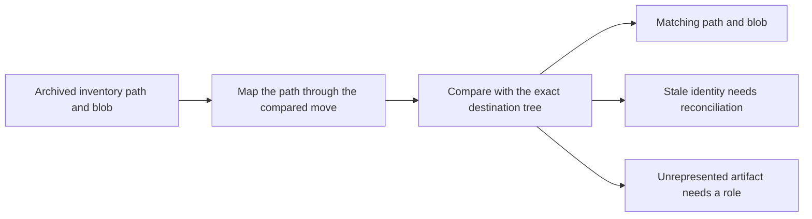

# RT-00 A — Reconcile inventory gaps after research directory moves

**Status:** Exact-tree comparison complete. Role and experiment review pending.

**Evidence type:** Executable Git-object census and local link-target scan.

**Tracking:** PLAN §0.1 and [issue #284](https://github.com/aivibeflow/LLMLang/issues/284).

## Problem and scope

The inventory stores the path, Git blob and byte size of each research artifact. After moving a report, a path-only comparison calls its old record extra and its current path missing. A byte-for-byte comparison can identify an unchanged relocated report. Link repairs can change the blob, even when a report keeps the same role and subject. We compared the exact tree immediately before PR #444 with its merged tree and verified that PR #446’s pinned head and its merged commit have the exact same tree. These observations help triage the evidence used to compare implementation options.

## Method

The [comparison script](../../../.github/scripts/audit_research_relocation.py) reads Git trees rather than workspace files. It excludes the inventory itself from all trees. For #444, it pairs a removed and an added path when they have a unique shared basename among the unmatched paths. Two `README.md` pairs are mapped explicitly by their identical headings and issue numbers for RT-37 and RT-38. It keeps blob changes visible even when there is a path match. For #446, it uses the intermediate move commit as a stronger record. All relocated path pairs must have identical bytes in that commit and cover all additions and deletions in it.



The path mapping reduces the review queue. The final path and blob still determine whether an inventory record identifies current evidence.

## Observations

| Comparison against the 786-record inventory | Research artifacts | Missing | Extra | Stale at a matched path |
| --- | ---: | ---: | ---: | ---: |
| Before #444, `d37245f80ade33b2d4d5d0186381beadb75620df` | 822 | 36 | 0 | 63 |
| After #444, `fe229c3215c42d8bded531d77bbef47761ac5770`, direct path match | 823 | 350 | 313 | 36 |
| Post-#444 tree, after matching relocated paths | 823 | 37 | 0 | 215 |
| Merged #446, `1a5972480c22f534dd00b1c99fd57e0db089e4d5`, after both path mappings | 833 | 47 | 0 | 227 |

PR #444 pairs **318 relocations**. Of those, **135** have the same bytes on main and **183** have changed bytes. There are **39** additional changed blobs on unchanged paths. Across the two trees, the only unpaired addition is the RT-08 index. The basename mapping supports an inventory migration, while identifying semantic edits in the 222 changed blobs requires content review.

The Git tree of PR #446’s reviewed head `29278112fc8559e486c651eff077e41e7b3e8b89` exactly matches its merged tree. Its intermediate commit `822cbf5175b55db0ffd8aac680178cfb5578e5d6` performs **522** exact-blob relocations. The following commit changes **230** surviving artifact blobs and adds **10** navigation files. A rename-first commit therefore gives stronger provenance than reconstructing modified renames from their names after the fact. It still leaves the final content to verify.

The [local index auditor](../../../.github/scripts/audit_research_index_coverage.py) scanned all research Markdown/MDX plus PLAN.md on each pinned tree. It examined **2,756**, **2,800** and **2,867** local-link occurrences, respectively. Each scan found **38** unresolved path occurrences, all from the same four files in the retained upstream OCI and Alive2 snapshots. No unresolved path appeared in LLMLang-authored Markdown within the scanner's scope. The three scans each found 23 documents with no incoming link and 57 with no incoming link from a designated index. Those counts are navigation signals. The scanner excludes fragments and external URLs, and the result does not certify target anchors or prove semantic orphan status.

## Alternatives, reproducibility and decision impact

Direct path matching overstates the number of new studies after relocation. Exact blob matching protects archival evidence, but would leave 183 of the #444 relocations unmatched at the final tree. A unique basename is useful for that migration when corroborated by directory and content context. An intermediate byte-preserving move commit gives a verifiable one-to-one path mapping. In each case the inventory refresh still needs the final Git object identities and a separate review of new roles and changed claims.

The [machine-readable result](RT-00-A-CORPUS-RELOCATION-2026-11-24.json) preserves the moved pairs, identity deltas, unmatched paths, inventory discrepancies and execution environment. Reproduce from a full Git checkout that contains the compared commits:

```sh
git fetch --no-tags origin refs/pull/446/head
python3 -B .github/scripts/audit_research_relocation.py \
  --output /tmp/llmlang-inventory-relocation.json
python3 -B -m unittest discover -s .github/scripts -p 'test_audit_research_index_coverage.py' -v
```

To replay the path scan, extract each pinned commit with `git archive` into a separate empty directory and pass it as `--root` to `audit_research_index_coverage.py`, with the pinned commit as `--revision`. The data describes the complete pinned trees, so the counts have no sampling interval. The diagram source was checked without a local rendering.

The archival manifest stays pinned to its earlier snapshot. Refreshing a live inventory requires rechecking the integrated main tree, including any newly merged studies, and recording review status for its residual records. The semantic duplicate and contradiction review, prototype experiment reruns, and original-run attestations remain open. This audit updates the work needed in §0.1 and leaves the candidate specification in `draft/` untouched.
