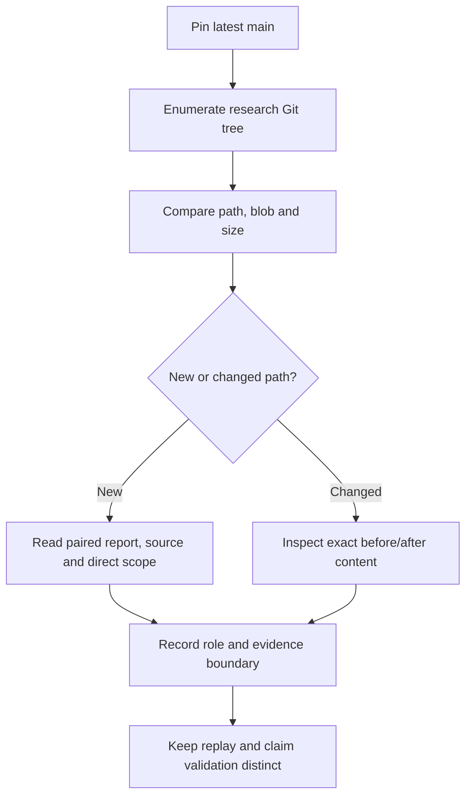

# RT-00 A — Reconcile the corpus after November 24 evidence merges

**Date:** 2026-11-24
**Exact main baseline:** `a396e2709c811ffb1810e2e62d93849c890d8ca6`
**Prior inventory revision:** `07cfa1e9ef24e01eb169d454909076cbd1669ee5`
**Scope:** Exact research path/blob/size reconciliation; first-pass role review of additions; content review of changed existing records; local navigation recheck.
**Disposition:** Exact inventory and role triage for this pinned tree. Claim-level scientific validation, fresh replay of all merged research, external snapshot completeness and architecture selection remain separate.

## Question and method

Does the corpus manifest match `main` after the three additional RT-07 scalar-preservation, valuation-binding, and program-assumptions PRs? I checked open PRs and fetched `origin/main`, enumerated its recursive `research/` Git tree, excluded the manifest itself, and compared exact paths, Git blob IDs and byte sizes with the manifest stored on that baseline. I read the newly merged reports and their paired ledgers or sources, and diffed all changed existing blobs against their prior manifest blobs. I assigned roles from the report, fixture/source, family scope and direct PLAN links. This is artifact-role triage; it does not validate every embedded scientific claim.



## Exact inventory

At main `a396e2709c811ffb1810e2e62d93849c890d8ca6`, `research/` contains **904 artifacts excluding the manifest**. The 884-record inventory from PR #473 is missing **20** tracked paths; it has **zero extra paths**. **Nine** existing records have stale blob IDs or sizes. This PR refreshes those entries; the manifest records all 904 exact current paths.

The 20 paths absent from the last manifest are RT-07/32 additions merged in #472, #474–#479: six proof reports, seven Lean sources, six axiom-output ledgers, and one Python replay. Each receives an individual category and RT/Stage role. The scalar-preservation theorem proves typed Int/Bool expression evaluation preservation through the actual Logos SMT translation under related constant valuations. The valuation-binding theorem proves each successfully resolved CPC constant evaluates to its assigned typed source value and rejects translated-identity aliases. The program bridge theorem proves that the two exact parsed assumptions, at any successfully constructed wire valuation, characterize corresponding concrete source-execution dependence. The #476 upstream-model theorem proves agreement with pinned `Cpc.SmtModel` for every successful restricted-term evaluation when typed constants agree. The #477 single-kernel theorem composes parsed source-program assumptions with that upstream evaluator for related models and successfully lifted wire valuations. The #479 model-extension theorem overlays exact scalar names/sorts on a well-formed model using standard Lean axioms; unconditional model existence uses the pinned upstream `native_decide` axiom, whose origin is inspected. Pinned CI checked the proof targets. Disposition of that upstream computation, lifting every concrete source pair, and complete checker soundness composition remain open.

The earlier RT-05 pilots remain bounded: 15 declared finite cases/45 decisions and two typed-SPG surfaces with 42 observations/21 verdicts. The Linux owned-return study still shows alias-sensitive cleanup outcomes. Together with the RT-07 proof chain, the evidence distinguishes finite checks, general restricted-expression preservation, exact valuation binding, program assumption meaning, and upstream model agreement without claiming full source coverage or checker soundness.

The nine stale entries are `LogosRenderedSorts.lean`, `LogosScalarDenotation.lean`, `SourceQueryEnvelope.lean`, `SymbolicCpcCertificate.lean`, the finite-denotation observation ledger, `lakefile.lean`, Scenario 34, the dependency map, and the taxonomy. Their content changes were compared with the prior recorded blobs. The report also carries an evidence-linked RT-07 update into the option matrix; that matrix record is refreshed to the exact PR-tree blob.

Main contains 432 Markdown, three MDX, 275 Python, 93 JSON, 51 Lean, 29 text, three Rust, four C, three MJS, two CSV, one TOML and one Proto file. The recursive `research/PROTOTYPES/` rule counts 320 prototype-tree files, 136 strict scenario-named reports, 38 taxonomy areas and 262 dependency edges. The refreshed manifest records all 904 research paths, excluding the manifest itself. Repeated exact bytes remain in separate records when query scope or snapshot attribution differs: the two RT-33 solver stdout files and OCI/REAPI Apache licence copies.

## Navigation result

Ran the index audit on a clean archive of main `a396e2709c811ffb1810e2e62d93849c890d8ca6` with CPython 3.12.14 and Git 2.52.0. It scanned 436 documents (435 research Markdown/MDX and `PLAN.md`), 35 index documents and **3,113 local-link occurrences**. It reports 18 research documents with zero incoming links, 52 without a direct designated-index link, 38 unresolved local targets and 772 non-Markdown targets. Four of the zero-inbound reports are scenario documents; 29 scenarios lack a designated-index link. The 38 local unresolved targets remain within partial upstream snapshot references under the earlier bounded classification. The check does not test external URL reachability or upstream snapshot completeness.

The separate B10 graph audit at its pinned baseline reports 849 tracked research artifacts reachable through linked-directory browsing, including every document and artifact in that tree. It reduces the prior unreachable set from 65 to zero. That establishes structural discoverability under its directory-link model, not semantic relevance or correctness.

The B12 overlap screen compares 420 Markdown/MDX documents and 87,990 pairs at its pinned baseline. Its relaxed lexical filter selected 18 candidates, all adjudicated by document role; four known relationship controls were missed. It is a candidate screen and does not replace manual lineage or contradiction review. Scenario 16 remains unresolved pending author or archive evidence.

## Reproduction and boundaries

From a full checkout with the pinned commit:

```sh
git ls-tree -r --full-tree a396e2709c811ffb1810e2e62d93849c890d8ca6 research
python3 .github/scripts/audit_research_index_coverage.py \
  --revision a396e2709c811ffb1810e2e62d93849c890d8ca6
```

The exact inventory workflow compares final PR-head paths, blobs and byte sizes. Its green result does not execute or validate research claims. Other reports have pinned runners and exact inputs, but this environment lacks Lean, cvc5, TLC, LLVM/Wasm and the selected SQLite/Rust toolchains for rerunning all source experiments. The #472–#479 Lean artifacts passed their pinned CI builds; this verifies those proof targets, not every source experiment, universal accepted-input coverage, disposition of the upstream native computation, or complete checker soundness. Original-run attestation, independent review, the integrated comparison workload proposed by the option matrix, external source completeness, historical translation parity and several runtime/backend boundaries remain external dependencies. PLAN names these gates explicitly; the evidence presently narrows implementation options but does not justify a final selection.
