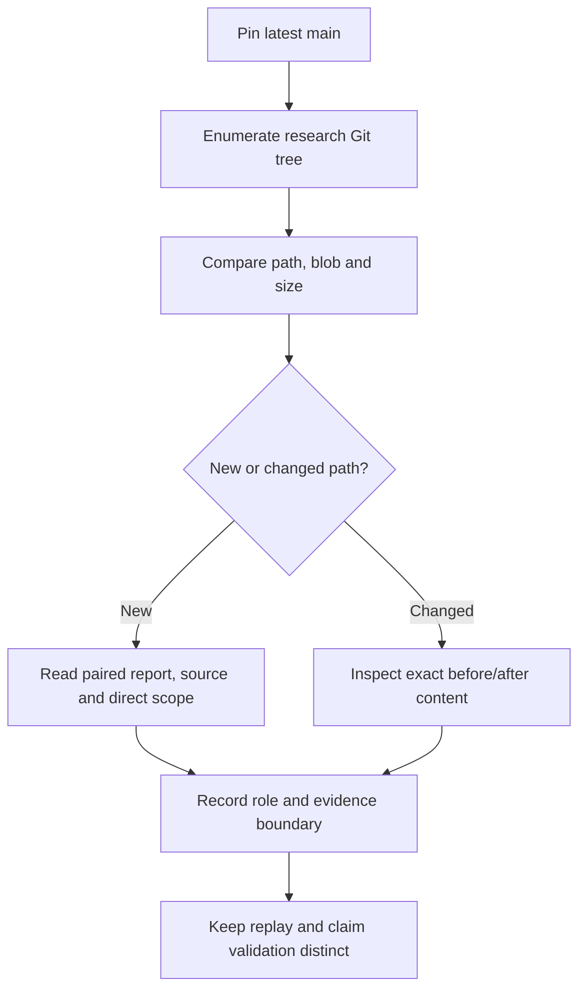

# RT-00 A — Reconcile the corpus after November 24 evidence merges

**Date:** 2026-11-24
**Exact main baseline:** `07cfa1e9ef24e01eb169d454909076cbd1669ee5`
**Prior inventory revision:** `b7a4c0d3ed80eb4dae5c54af1943e00d0d6e78d5`
**Scope:** Exact research path/blob/size reconciliation; first-pass role review of additions; content review of changed existing records; local navigation recheck.
**Disposition:** Exact inventory and role triage for this pinned tree. Claim-level scientific validation, fresh replay of all merged research, external snapshot completeness and architecture selection remain separate.

## Question and method

Does the corpus manifest match `main` after the latest RT-05, Linux FFI and RT-07 evidence PRs? I checked open PRs and fetched `origin/main`, enumerated its recursive `research/` Git tree, excluded the manifest itself, and compared exact paths, Git blob IDs and byte sizes with the manifest stored on that baseline. I read the newly merged reports and their paired ledgers or sources, and diffed all changed existing blobs against their prior manifest blobs. I assigned roles from the report, fixture/source, family scope and direct PLAN links. This is artifact-role triage; it does not validate every embedded scientific claim.



## Exact inventory

At main `07cfa1e9ef24e01eb169d454909076cbd1669ee5`, `research/` contains **884 artifacts excluding the manifest**. The 870-record inventory merged in PR #469 is missing **14** tracked paths; it has **zero extra paths**. **Four** existing records have stale blob IDs or sizes. This PR refreshes those entries; the manifest records all 884 exact current paths.

The 14 additions since the last inventory consist of:

- RT-05/20/32 exact verification-receipt rebind and modular provider caller proof reports, runners, proof sources and ledgers merged in #467/#468;
- the RT-03/04/10 Linux owned-return cleanup probe, with C harness, Python runner and result ledger merged in #470; and
- the RT-07/32 finite scalar-denotation report, Lean adapter and observations merged in #471.

Each added path receives an individual category and RT/Stage role in the inventory. The RT-05 pilot uses 15 declared finite cases over inputs `{0,1,2}`. Signature-only admission accepts cases rejected by behavioral checks. Direct body checking against a public contract and checking both the provider body and provider-contract refinement answer different questions. Python and Lean agree on 45 fixture decisions; the Lean theorem has no axioms and a mutated expected verdict fails. The later typed-SPG observation pilot compares two source surfaces across 42 scalar/effect observations and 21 Lean/Python verdicts; exact rebinding, stale provider promises, effect order and fuel-limited UNKNOWN distinguish admission. The shared fixture lowering and source-to-contract correspondence remain open. The RT-04 owned-return study compares early and staged transfer through 256 generated Rust/reference traces. On 24 failed-cleanup pairs, both report an error, while only early transfer forwards a usable owned handle; subsequent overlapping-call admission also differs. Therefore an error flag alone is too weak an observation for that ownership claim. These results narrow the comparison but select neither public-interface semantics nor a transfer policy.

The four changed files are the RT-05 interface proposal, RT-07 Scenario 34, research taxonomy and dependency map. Their edits register the exact-receipt/modular-proof findings, record finite denotation scope on Scenario 34, and update RT-05/RT-07 cross-links. The new Linux probe shows why resource identity must include aliases: after staged cleanup closes the original descriptor, a surviving `dup` still holds the same Linux file lock and blocks a same-inode competitor. The C fixture reproduces 64 traces (32 inputs at O0 and O3); `fclose` produces EPIPE in the broken-pipe cases and closes its descriptor. This strengthens the required ownership/alias observation but does not select early or staged transfer. The RT-07 scalar pilot agrees with its source evaluator on 1,536 typed-expression evaluations and both rendered assumptions for 96 concrete pairs through the pinned Logos SMT translator. Same-sort mutations change interpreted values, while missing constant meaning and unsupported rational cases fail closed. It supports finite denotation evidence beyond sort preservation; it is not a universal theorem. The inventory refreshes all four changed paths and adds fourteen individually reviewed roles.

Main contains 426 Markdown, three MDX, 274 Python, 93 JSON, 44 Lean, 23 text, three Rust, four C, three MJS, two CSV, one TOML and one Proto file. The exact path rule counts 305 prototype-family files, 136 strict scenario-named reports, 38 taxonomy areas and 262 dependency edges. The refreshed manifest records all 881 tracked research paths, including this report. Repeated exact bytes remain in separate records when query scope or snapshot attribution differs: the two RT-33 solver stdout files and OCI/REAPI Apache licence copies.

## Navigation result

Ran the index audit on a clean archive of main `07cfa1e9ef24e01eb169d454909076cbd1669ee5` with CPython 3.12.14 and Git 2.52.0. It scanned 430 documents (429 research Markdown/MDX and `PLAN.md`), 35 index documents and **3,055 local-link occurrences**. It reports 18 research documents with zero incoming links, 52 without a direct designated-index link, 38 unresolved local targets and 760 non-Markdown targets. Four of the zero-inbound reports are scenario documents; 29 scenarios lack a designated-index link. The 38 local unresolved targets remain within partial upstream snapshot references under the earlier bounded classification. The check does not test external URL reachability or upstream snapshot completeness.

The separate B10 graph audit at its pinned baseline reports 849 tracked research artifacts reachable through linked-directory browsing, including every document and artifact in that tree. It reduces the prior unreachable set from 65 to zero. That establishes structural discoverability under its directory-link model, not semantic relevance or correctness.

The B12 overlap screen compares 420 Markdown/MDX documents and 87,990 pairs at its pinned baseline. Its relaxed lexical filter selected 18 candidates, all adjudicated by document role; four known relationship controls were missed. It is a candidate screen and does not replace manual lineage or contradiction review. Scenario 16 remains unresolved pending author or archive evidence.

## Reproduction and boundaries

From a full checkout with the pinned commit:

```sh
git ls-tree -r --full-tree 07cfa1e9ef24e01eb169d454909076cbd1669ee5 research
python3 .github/scripts/audit_research_index_coverage.py \
  --revision 07cfa1e9ef24e01eb169d454909076cbd1669ee5
```

The exact inventory workflow compares final PR-head paths, blobs and byte sizes. Its green result does not execute or validate research claims. Other reports have pinned runners and exact inputs, but this environment lacks Lean, cvc5, TLC, LLVM/Wasm and the selected SQLite/Rust toolchains for rerunning all source experiments. RT-05's exact Python/Lean pilot result is recorded with input hashes and versions; a fresh Lean rerun requires its pinned Lean toolchain. Original-run attestation, independent review, the integrated comparison workload proposed by the option matrix, external source completeness, historical translation parity and several runtime/backend boundaries remain external dependencies. PLAN names these gates explicitly; the evidence presently narrows implementation options but does not justify a final selection.
