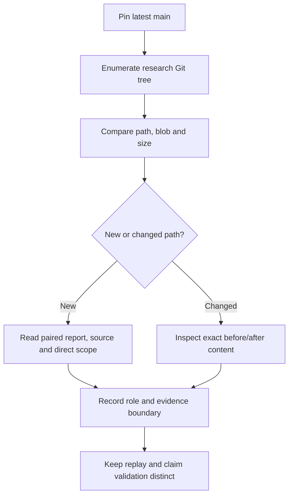

# RT-00 A — Reconcile the corpus after November 24 evidence merges

**Date:** 2026-11-24
**Exact main baseline:** `895a37cd1801d62c17025d20a34f25f634c331b4`
**Prior inventory revision:** `35078012d728f21b054bc90e4715fd7ffc1104f7`
**Scope:** Exact research path/blob/size reconciliation; first-pass role review of additions; content review of changed existing records; local navigation recheck.
**Disposition:** Exact inventory and role triage for this pinned tree. Claim-level scientific validation, fresh replay of all merged research, external snapshot completeness and architecture selection remain separate.

## Question and method

Does the corpus manifest match `main` after the latest inventory, evidence, comparison and overlap PRs? I checked open PRs and fetched `origin/main`, enumerated its recursive `research/` Git tree, excluded the manifest itself, and compared exact paths, Git blob IDs and byte sizes with the manifest stored on that baseline. I read the newly merged reports and their paired ledgers or sources, and diffed all changed existing blobs against their prior manifest blobs. I assigned roles from the report, fixture/source, family scope and direct PLAN links. This is artifact-role triage; it does not validate every embedded scientific claim.



## Exact inventory

At main `895a37cd1801d62c17025d20a34f25f634c331b4`, `research/` contains **876 artifacts excluding the manifest**. The 840-record baseline manifest is missing **36** tracked paths; it has **zero extra paths**. **25** existing records have stale blob IDs or sizes. This PR adds one report, yielding **877 exact inventory records**.

The 36 additions consist of:

- RT-00 B10 reachability, B11 changed-artifact roles and B12 text-overlap studies and ledgers;
- a public-interface evidence audit, a native lifecycle replay, a backend preservation replay, a Provider queue replay and a three-backend proof-evidence replay, with their source and result artifacts;
- the RT-05/20 finite public-interface refinement pilot: report, Python runner, Lean checker, declared fixtures and result ledger.
- the RT-05/20 typed-SPG observation pilot and the RT-04 owned-return cleanup discriminator, each with its runner and result ledger; and RT-05/20/32 exact verification-receipt rebind and modular provider caller proof artifacts.

Each added path receives an individual category and RT/Stage role in the inventory. The RT-05 pilot uses 15 declared finite cases over inputs `{0,1,2}`. Signature-only admission accepts cases rejected by behavioral checks. Direct body checking against a public contract and checking both the provider body and provider-contract refinement answer different questions. Python and Lean agree on 45 fixture decisions; the Lean theorem has no axioms and a mutated expected verdict fails. The later typed-SPG observation pilot compares two source surfaces across 42 scalar/effect observations and 21 Lean/Python verdicts; exact rebinding, stale provider promises, effect order and fuel-limited UNKNOWN distinguish admission. The shared fixture lowering and source-to-contract correspondence remain open. The RT-04 owned-return study compares early and staged transfer through 256 generated Rust/reference traces. On 24 failed-cleanup pairs, both report an error, while only early transfer forwards a usable owned handle; subsequent overlapping-call admission also differs. Therefore an error flag alone is too weak an observation for that ownership claim. These results narrow the comparison but select neither public-interface semantics nor a transfer policy.

The 25 changed files include six navigation-only edits and nineteen claim/proposal/reference or anchor changes. The substantive groups include the option matrix, RT-05 interface/SPG evidence, COR-13 and Plan owned-return comparison, RT-05 taxonomy/dependency registrations, and current-Plan links/status for the exact verification receipt and modular caller proof. Reference-anchor corrections and link-only updates are retained with exact identities. All 25 existing artifacts have exact Git metadata refreshed and their prior content role rechecked. These findings remain scoped and do not constitute a normative architecture decision.

Main contains 423 Markdown, three MDX, 273 Python, 92 JSON, 43 Lean, 22 text, three Rust, three C, three MJS, two CSV, one TOML and one Proto file. The exact path rule counts 303 prototype-family files, 136 strict scenario-named reports, 38 taxonomy areas and 262 dependency edges. The inventory category totals equal the 877 PR-tree records. Repeated exact bytes remain in separate records when query scope or snapshot attribution differs: the two RT-33 solver stdout files and OCI/REAPI Apache licence copies.

## Navigation result

Ran `python3 -B .github/scripts/audit_research_index_coverage.py --revision 895a37cd1801d62c17025d20a34f25f634c331b4` with CPython 3.12.14 and Git 2.52.0. It scanned 428 documents (427 research Markdown/MDX and `PLAN.md`), 35 index documents and **3,044 local-link occurrences**. It reports 18 research documents with zero incoming links, 52 without a direct designated-index link, 38 unresolved local targets and 757 non-Markdown targets. Four of the zero-inbound reports are scenario documents; 29 scenarios lack a designated-index link. The 38 local unresolved targets remain within partial upstream snapshot references under the earlier bounded classification. The check does not test external URL reachability or upstream snapshot completeness.

The separate B10 graph audit at its pinned baseline reports 849 tracked research artifacts reachable through linked-directory browsing, including every document and artifact in that tree. It reduces the prior unreachable set from 65 to zero. That establishes structural discoverability under its directory-link model, not semantic relevance or correctness.

The B12 overlap screen compares 420 Markdown/MDX documents and 87,990 pairs at its pinned baseline. Its relaxed lexical filter selected 18 candidates, all adjudicated by document role; four known relationship controls were missed. It is a candidate screen and does not replace manual lineage or contradiction review. Scenario 16 remains unresolved pending author or archive evidence.

## Reproduction and boundaries

From a full checkout with the pinned commit:

```sh
git ls-tree -r --full-tree 895a37cd1801d62c17025d20a34f25f634c331b4 research
python3 .github/scripts/audit_research_index_coverage.py \
  --revision 895a37cd1801d62c17025d20a34f25f634c331b4
```

The exact inventory workflow compares final PR-head paths, blobs and byte sizes. Its green result does not execute or validate research claims. Other reports have pinned runners and exact inputs, but this environment lacks Lean, cvc5, TLC, LLVM/Wasm and the selected SQLite/Rust toolchains for rerunning all source experiments. RT-05's exact Python/Lean pilot result is recorded with input hashes and versions; a fresh Lean rerun requires its pinned Lean toolchain. Original-run attestation, independent review, the integrated comparison workload proposed by the option matrix, external source completeness, historical translation parity and several runtime/backend boundaries remain external dependencies. PLAN names these gates explicitly; the evidence presently narrows implementation options but does not justify a final selection.
