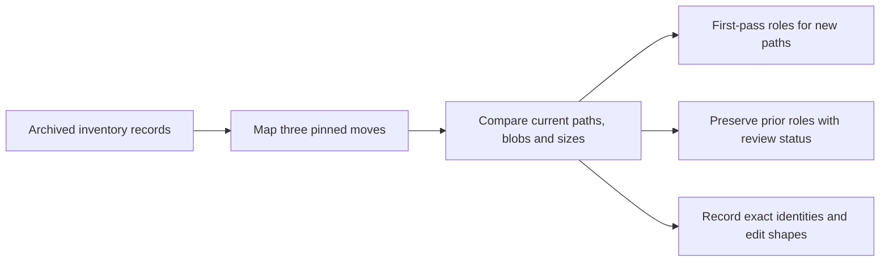

# RT-00 A — Refresh the exact inventory after thematic moves

**Status:** Exact inventory refresh and first-pass role review.

**Evidence type:** Exact Git path, blob and byte-size accounting and a lexical diff check.

**Tracking:** PLAN §0.1 and [issue #284](https://github.com/aivibeflow/LLMLang/issues/284).

## Question and scope

The 786-record inventory predates three directory moves. The [two-migration audit](RT-00-A-CORPUS-RELOCATION-2026-11-24.md) showed why neither direct path comparison nor final blob matching can recover the full inventory. The third move relocated the root registers into research management. This refresh tests whether all archived records can be carried through the three mappings, identifies what still needs review, and binds navigation and evidence records to the current Git tree.

## Method and findings



The first two mappings use the evidence in the relocation audit. The third pairs all removed research-root records with same-name entries under research management. The script requires a one-to-one mapping, enumerates the staged research tree while excluding the inventory itself, and retains the identity and review status of records from the earlier inventory.

Starting from main `35078012d728f21b054bc90e4715fd7ffc1104f7`, all 786 existing records map to current artifacts and 501 map to a different path. The main tree has 839 artifacts excluding the inventory. The staged tree adds this report for **840** records. The new 54 records have first-pass roles based on the file contents and family documentation. They include navigation indexes, CF-006–008 contract cases, RT-33 benchmark sources and generated evidence, RT-36 assumptions research, RT-37/38 feasibility briefs, and RT-00 audits.

The exact census retains all 136 strict Scenario reports and identifies 303 files inside a prototype family directory across the thematic or shared prototype trees. It finds 38 taxonomy research areas and 262 dependency edges. Taxonomy registration and artifact existence establish discoverability. They do not approve a design.

The refresh also revisits the 24 role records explicitly left pending by the old inventory. It confirms their first-pass role by file title or source entry point and family. Three records had empty research items and now map to Stage 0 corpus status, RT-07/Scenario 34 query-envelope work, and RT-24 Git source-closure work respectively. For the two external license copies, shared bytes remain expected. The other exact match is `unsat` output from two distinct RT-33 queries. Keeping the two output records preserves their different query scopes.

Of the 231 archived records whose identity changed against the staged tree, 136 differ only in lexical tokens recognized as inline relative link destinations. The other 95 have changes outside those tokens or use navigation syntax outside the mask. The lexical check neither follows target identity nor inspects the validity of anchor fragments. It also matches syntax in literal examples. Prioritize the 95 for content-level review and check whether changed destinations still support the stated claims. Use the published records to find the source blobs for those comparisons.

## Alternatives and verification

A new inventory built entirely from directories would abandon historical role assignments and could silently misclassify a cross-direction report. A pure exact-blob migration would miss changed reports and links. Mapping from the pinned move history keeps the evidence lineage while independently checking every current path, blob and size. A role check requires opening the relevant file or entry point. A claim check requires the experiment, proof or review that supports the reported conclusion.

From the branch containing this report and its script, with the original PR #446 move commit available locally, reproduce against the commit to be checked:

```sh
git fetch --no-tags origin refs/pull/446/head
python3 -B .github/scripts/refresh_relocated_research_inventory.py \
  --baseline 35078012d728f21b054bc90e4715fd7ffc1104f7 \
  --target-tree HEAD --output /tmp/llmlang-thematic-inventory.json
cmp /tmp/llmlang-thematic-inventory.json research/research-management/RESEARCH-CORPUS-INVENTORY-2026-11-20.json
```

The underlying per-artifact identities and the edit-shape ledger are in the [inventory](../RESEARCH-CORPUS-INVENTORY-2026-11-20.json). The counts enumerate exact trees and have no sampling interval. Mermaid source is available above and was not rendered locally. The release criteria for semantic overlap, compound contradictions, prototype reproduction, and original-run provenance remain open. This refresh does not adopt a candidate design.
