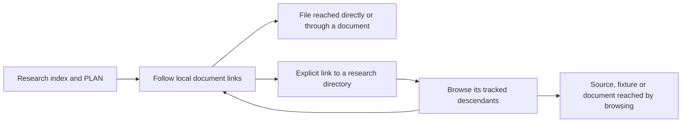

# RT-00 B10 — Follow research navigation to every tracked artifact

**Status:** Exact-tree structural reachability checked.

**Baseline:** `5d0d474848bee4b0c4f103af06dd3cfb5f7c6612`.

**Evidence type:** Exhaustive local navigation graph on two Git archives.

**Tracking:** [PLAN §0.1](../../../PLAN.md#01-reconcile-the-research-corpus), §0.2 discoverability, and [issue #284](https://github.com/aivibeflow/LLMLang/issues/284).

## Question and evidence

The [earlier zero-inbound review](RT-00-B-08-ZERO-INBOUND-CANDIDATE-REVIEW-2026-11-23.md) classifies historical reports and partial upstream snapshots. The index auditor counts direct incoming links. It does not tell a reader whether they can get from a research entry point to a document by following a chain of links or browsing a linked GitHub directory.

We evaluated two models on every tracked file under `research/`, including source, fixtures, result data, Markdown and MDX. Both start from `research/README.md` and `PLAN.md`. The document-link model follows links from reached research Markdown/MDX or the plan and can end at any research file. The directory model also permits browsing the descendants of a linked research directory. Both exclude external URLs, fragment validation, implicit GitHub search, and paths outside the research corpus. A reachable file can remain unreviewed, historical or superseded.



A directory enters the second model only when a reached document links to it. The repository's directory listing is then the navigation surface. A directory that is never linked adds no implicit reachability. The script reuses the repository's local-target parser.

## Results and trade-offs

| Measure | Baseline | Curated link tree |
| --- | ---: | ---: |
| Tracked research files | 847 | 849 |
| Research Markdown/MDX | 416 | 417 |
| Files reachable by document links | 714 | 719 |
| Documents reachable by document links | 393 | 397 |
| Files reachable with linked-directory browsing | 782 | 849 |
| Documents reachable with linked-directory browsing | 408 | 417 |
| Documents without a direct designated-index link | 55 | 52 |
| Documents with no incoming document link in the scanner | 21 | 18 |
| Unresolved local path occurrences inside upstream snapshots | 38 | 38 |

At baseline, the 65 files unreachable in the directory model included 53 Dependency Graph artifacts and 12 retained upstream files. The changes add a link to the Dependency Graph file listing from the shared prototype index, replace plain mentions of Prototype and Scenario 21 with links, and link all four snapshot directories in the existing references register. The two language versions of the formal-verification concept now link to each other. The two new files are this report and its observation data.

Direct links to every source and test would make browsing independent of the GitHub directory view, with substantial index maintenance. Hierarchical links retain the distinction between a primary study and its implementation or snapshot family. The table records both navigation models so the result does not depend on treating a directory listing as a single file link. The remaining 18 no-inbound records have directory routes in this tree. They are not candidates for deletion based on link counts.

## Reproduction and limits

Run from the branch containing the new links with CPython 3.12.14 and Git 2.56.1:

```sh
set -eu
baseline=5d0d474848bee4b0c4f103af06dd3cfb5f7c6612
scratch=$(mktemp -d)
mkdir "$scratch/before" "$scratch/after"
git archive "$baseline" | tar -x -C "$scratch/before"
git archive HEAD | tar -x -C "$scratch/after"
python3 -B .github/scripts/audit_research_index_reachability.py \
  --baseline-dir "$scratch/before" --baseline-revision "$baseline" \
  --target-dir "$scratch/after" --output "$scratch/reachability.json"
cmp "$scratch/reachability.json" \
  research/research-management/RT-00/RT-00-B-10-INDEX-REACHABILITY-2026-11-24.json
```

The [observation ledger](RT-00-B-10-INDEX-REACHABILITY-2026-11-24.json) records both summaries, the directory-only paths, the original unreachable paths and the unresolved local path occurrences. These are exact enumeration counts without a sampling interval. Mermaid source was checked without rendering it locally.

The result covers the structural discoverability portion of the Stage 0 gate for the checked tree. The copied upstream documents and licences are unchanged. Upstream snapshot completeness, external links, fragments, semantic duplicate and contradiction review, translation parity, and experimental claims require separate evidence.
