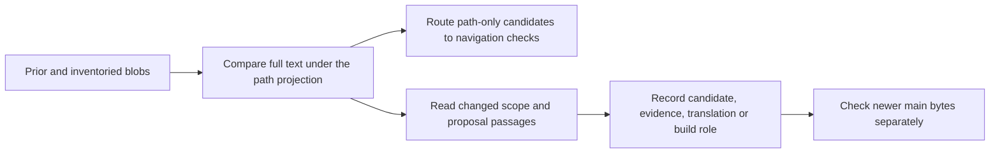

# RT-00 B11 — Review the 95 changed research artifacts left by relocation triage

**Status:** Complete document-role pass for the pinned change queue.

**Baseline:** Inventory commit `6ea8f0891190b9c3029a879fd1f7fa61fb84d7b8`, checked against main `f98df901a0213bd06315dc8878bd5a9f66938f99`.

**Evidence type:** Exact Git blob comparisons, lexical evidence and document-scope review.

**Tracking:** PLAN §0.1 and [issue #284](https://github.com/aivibeflow/LLMLang/issues/284).

## Problem and method

The [thematic inventory](RT-00-A-THEMATIC-INVENTORY-REFRESH-2026-11-24.md) identified 231 revised historical records. Its first comparison reduced 136 to inline relative-destination changes. It left 95 for further routing. This study asks which of those 95 still carry the same visible research result, which extend a candidate proposal, and which add an executable or review obligation. We compared each old and inventoried blob and checked the inventoried path against current main.

The [comparison script](../../../.github/scripts/review_research_delta_roles.py) additionally projects the known thematic prefixes out of research paths written in reproduction commands. It compares the full resulting text after masking recognized local inline-link destinations. The other changed files are classified by the roles evidenced in their changed passages, including the specific build and review artifacts. A role can overlap another. These role counts do not measure changes to scientific claims.



The projection explains the form of edits. It leaves link targets and exact semantic claims for separate inspection. The study keeps historical inputs even when the head has a further edit.

## Observations

| Role or result | Count |
| --- | ---: |
| Records in the reviewed queue | 95 |
| Texts equal under the broader navigation and command-path projection | 30 |
| Public-interface candidate passages or links | 48 |
| Proposed proof assumptions or trust-boundary passages or links | 31 |
| CF-006–008 passages or links | 8 |
| Executable/configuration artifacts with distinct roles | 2 |
| Paths changed again after the inventory pin | 1 |

The [per-path ledger](RT-00-B-11-CHANGED-ARTIFACT-ROLES-2026-11-24.json) records both blob IDs, added headings, role assignments and the main-tree check for every file. The 30 projected texts include many moved command paths. Their comparison does not establish that a new link reaches the same evidence, that every example executes, or that an edited fragment still resolves. The other 65 changes include navigation indexes, the taxonomy, dependency register, contract-corpus references, a translation, the historical citation validation update, and the two executable/configuration artifacts.

The Lean build root adds `SymbolicCpcCertificate`. The [checked replay](RT-00-QUALITY-RULES-PROOF-CHAIN-REPLAY-2026-11-24.md) pins and exercises that module. The LLVM launcher updates the repository-root depth and the two probe paths. The [direct-probe replay](RT-00-C-BACKEND-PRESERVATION-REPLAY-2026-11-24.md) corroborates those probe results. Its host extracted the tool packages, so the run leaves the system-package CI launcher environment untested. Both relevant source identities were checked against current main.

The only later edit among these 95 is the reciprocal Russian-version link added to the English formal-verification concept. The separate Russian LLMLang concept preserves the earlier conditional caller-proof principle but lacks the English concept's later §18A.9 on RT-36's proposed proof-state lifecycle. This is a concrete translation coverage gap. Translation equivalence remains unvalidated.

## Implications for candidate comparison

| Potential tension | Evidence and disposition |
| --- | --- |
| Stable public operation versus exact provider selection | A conditional caller claim can retain the exact public-contract assumption. Its executable result, provider proof and dependent cache entries still bind the selected provider. The [public-interface evidence audit](RT-00-B-PUBLIC-INTERFACE-EVIDENCE-AUDIT-2026-11-24.md) reproduces a bound provider that violates the declared trace. Closing caller proof still needs provider correctness and refinement. |
| Closed proof versus trusted FFI assumptions | [RT-36](../../formal-verification/RT-36/RT-36-FORMAL-VERIFICATION-ASSUMPTIONS-AND-TRUST.md) proposes that local derivation, premise discharge and admission are distinct. [CF-008](../../formal-verification/CONTRACT-FORMALIZATION-CORPUS/cases/CF-008-linux-pipe-transfer.md) assumes blocking syscall behavior and excludes nonblocking outcomes. It complements [the one-call nonblocking fixture](../../runtime-and-systems/RT-10/RT-10-POSIX-NONBLOCKING-PIPE-IO.md), whose result does not discharge those blocking assumptions. |
| POSIX availability versus freestanding execution | RT-37's profile is explicitly freestanding, while RT-38 inherits it and adds privileged target constraints. The two planned pilots need independently verified runtime closure before a common target abstraction can claim support for hosted and non-hosted configurations. [RT-37](../../runtime-and-systems/RT-37/README.md) · [RT-38](../../runtime-and-systems/RT-38/README.md) |

The reviewed passages support distinguishing observation scope, exact subject identity and proof conditions. They do not imply that the proposals compose across the whole corpus or that any profile is selected. The preceding cases are scoped checks. A broader semantic-overlap and contradiction review, original-run attestations, translation comparison, and independent scientific review remain open.

## Reproduction

Run with CPython 3.12.14 and Git 2.56.1 in a full checkout containing both pinned commits:

```sh
python3 -B .github/scripts/review_research_delta_roles.py \
  --output /tmp/llmlang-changed-artifact-roles.json
cmp /tmp/llmlang-changed-artifact-roles.json \
  research/research-management/RT-00/RT-00-B-11-CHANGED-ARTIFACT-ROLES-2026-11-24.json
```

The counts cover all 95 recorded deltas and have no sampling interval. Mermaid source was checked without local rendering. No candidate rule moves into `draft/`.
