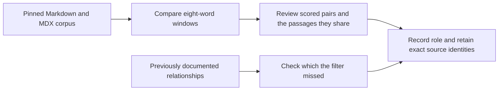

# RT-00 B12 — Screen the full Markdown corpus for textual overlap

**Status:** Exact-tree candidate screen and document-role adjudication complete.

**Baseline:** `43060fa2fb8bfa8178ce4f444e6e5a210ec94f2f`.

**Evidence type:** Exhaustive word-window overlap screen, followed by bounded content review.

**Tracking:** PLAN §0.1 and [issue #284](https://github.com/aivibeflow/LLMLang/issues/284).

## Question and method

Reports can share boilerplate, evidence, or subject matter while documenting different obligations. A later study can also replace an earlier approach using entirely different prose. This study tests what can be learned about duplicate or superseded results from corpus-wide lexical overlap, and compares it with previously documented role and supersession relationships.

The [screen](../../../.github/scripts/review_research_text_overlap.py) reads every tracked Markdown and MDX Git blob under `research/`. After stripping HTML comments, recognizable link destinations and URLs, it case-folds the text, retains Unicode words and indexes each distinct contiguous eight-word sequence. It counts shared sequences for every pair. The **Jaccard score** divides the shared count by the union size. **Containment** divides by the smaller document's distinct sequence count. The second score can surface a shorter result repeated within a longer report.



Exact blob matching was already useful for identical archived evidence. The proposed lexical screen broadens discovery to edited or partially reused prose. The explicit relationship controls test the screen's ability to find section-level supersession and maintained translations.

## Observations and adjudication

The exact baseline contains **420 documents** and **87,990 unordered document pairs**. The initial stricter screen, requiring 64 shared sequences and Jaccard of at least 0.14 or containment of at least 0.33, selected zero. The exploratory follow-up required 24 shared sequences with Jaccard of at least 0.025 or containment of at least 0.07. It selected **18 pairs** and all were reviewed by document role.

| Candidate class | Pairs | Disposition |
| --- | ---: | --- |
| Shared thematic index language | 10 | Keep the navigation template. The indexes point to different study families. |
| English and Russian LLMLang concept companions | 1 | Retain both with their known scope difference. The Russian concept lacks the later English §18A.9 RT-36 proposal. |
| Proposed study and bounded prototype result | 3 | Retain the design and execution material for Scenarios 20, 21 and 28. The bounded output covers only part of the proposal. |
| Distinct experimental scopes | 4 | Keep separate integer and byte-view results, close-call and reentry probes, source and path-sensitive alias work, and CPC parser versus source-wire binding. |

The [pair ledger](RT-00-B-12-TEXT-OVERLAP-2026-11-24.json) preserves both paths, Git blobs, scores and scope findings for every candidate. No reviewed pair justified retiring a whole report. The retained layers matter for implementation selection. For example, the same toolchain in Scenarios 96A and 96B supports different arithmetic and resource obligations, and the source-wire study adds obligations beyond parser validity.

All four control pairs missed the relaxed filter. They include the previously reviewed section-level supersession of Scenario 31's text query by Scenario 32's typed query model, the scoped Git architecture and related-project updates, and the two versions of the formal-verification concept. The first three share zero, two and zero eight-word sequences respectively. The formal-verification translation pair shares 47 sequences but falls below both normalized thresholds. [Prior relationship adjudication](RT-00-B-04-CORPUS-DUPLICATE-AND-SUPERSESSION-AUDIT-2026-11-21.md) · [Formal-verification companions](../../formal-verification/RT-07/LLMLang-FORMAL-VERIFICATION.md)

These controls establish that a text screen cannot replace explicit relationship and claim review. The thresholds were chosen during this exploratory audit. The 18 candidates do not estimate coverage or precision for general semantic overlap. The corpus includes copied reference text, where external source lineage needs its own interpretation.

## Scenario 16 boundary

The pinned tree and reachable main history contain no file matching the repository's Scenario 16 report naming pattern. The repository issue search for the exact phrase yielded no issue. Prototype 16 explicitly references Scenario 15. The source evidence leaves Scenario 16's intent or archival location unresolved. Preserve existing numbering and use an author or archive record to resolve it. [Scenario crosswalk and numbering exception](RT-00-A-SCENARIO-CROSSWALK-RECONCILIATION-2026-11-23.md)

## Reproduction and next gate

Run in a full checkout containing the baseline with CPython 3.12.14 and Git 2.56.1:

```sh
python3 -B .github/scripts/review_research_text_overlap.py \
  --output /tmp/llmlang-corpus-text-overlap.json
cmp /tmp/llmlang-corpus-text-overlap.json \
  research/research-management/RT-00/RT-00-B-12-TEXT-OVERLAP-2026-11-24.json
git log --format='%h %s' 43060fa2fb8bfa8178ce4f444e6e5a210ec94f2f -- \
  ':(glob,icase)research/RESEARCH-SCENARIO-16-*.md' \
  ':(glob,icase)research/**/RESEARCH-SCENARIO-16-*.md'
```

The deterministic count covers this complete Markdown/MDX population. Non-Markdown files and cross-document scientific truth require other methods. Mermaid source was checked without local rendering. Retain the exact-blob, explicit lineage and manual claim results as distinct forms of evidence for cross-area reconciliation.
