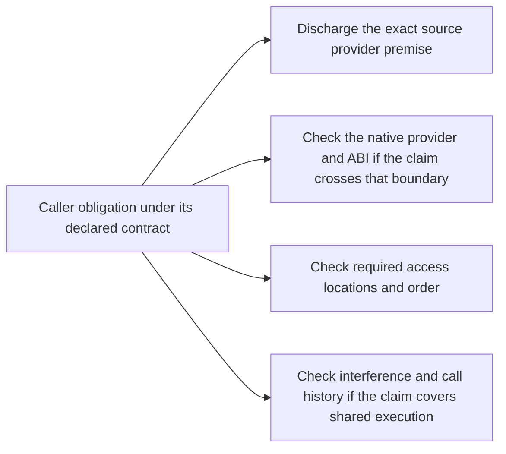

# RT-00 B14 — Dafny contract and proof study relationships

**Scope:** PLAN §0.1, [#284](https://github.com/aivibeflow/LLMLang/issues/284). Bounded content review on `research/all` at `00d01dd4b972f319eaf8db80a450e74688fade5e`.

**Evidence:** Manual claim and artifact comparison, corroborated by a reproducible lexical screen and a navigation check. The four studies retain their own evidence classifications and assumptions.

## Question

Four recent Dafny studies refer to frames, verified contracts, or external assumptions. Should any report be retired as a duplicate or replaced by a newer report? Which findings can LLMLang reuse together when assembling a verification receipt? This review uses the [Dafny transfer analysis](../../DAFNY-TRANSFER-ANALYSIS.md) as a synthesis document and evaluates the four reports it cites as primary evidence.

## Claim and scope review

| Primary report | What was checked | What a receipt still needs |
| --- | --- | --- |
| [Kernel-style table lookup](../../formal-verification/RT-07/RT-07-DAFNY-KERNEL-FOREIGN-BOUNDARY-2026-11-25.md) | The local Dafny implementation establishes the lookup postcondition. The foreign caller assumes it. Swapping the C provider or changing the ABI result interpretation changes native observations under the same caller verification. | Evidence for the exact native provider, representation, adapter and binary when the claim includes execution through the foreign boundary. |
| [Modular source proof closure](../../formal-verification/RT-07/RT-07-DAFNY-MODULAR-PROOF-CLOSURE-2026-11-25.md) | The caller-only Dafny/Boogie result survives an incorrect provider-body substitution. Including the provider obligation exposes the failure. The separate Lean composition and bound CPC certificate check arithmetic claims for their stated models. | Exact inclusion of each required source proof obligation. Transfer of an independently stated arithmetic theorem to the generated obligation requires its own correspondence argument. |
| [Typed overlapping copy](../../semantic-representation/RT-05/RT-05-DAFNY-SPG-COPY-FRAME-2026-11-25.md) | Snapshot and directional implementations establish a final-state array contract in a sequential setting. The same final array can have different ordered accesses. The graph's interval projection is observed on a finite corpus. | State which locations and order the interface exposes. A proof that the final value outside the destination is preserved permits a write followed by restoration. An access guarantee needs evidence about the write itself. |
| [Concurrent frames and native histories](../../formal-verification/RT-07/RT-07-DAFNY-CONCURRENT-FRAME-HISTORY-2026-11-25.md) | The declared empty-frame restriction is discharged for isolated examples. Shared-frame assumptions leave the sequential postcondition conditional for the concurrent use. Native traces expose a missing increment from a split load/store. | For a shared update, establish the necessary interference and synchronization conditions and the designated observation over complete calls under the chosen memory model. |

The first two rows share an assumption pattern: callers may use a contract before the exact provider is justified. The modular check discharges a source-provider premise for its own fixed arithmetic example. It does not attest the separate lookup's C provider or ABI. Suppressing the extern-contract warning also leaves the premise in force. The copy and concurrency rows share frame vocabulary. The copy's sequential framing and old-state conditions concern a single call and a final array. The concurrency report checks restrictions on accesses to pre-existing heap objects and compares histories of multiple calls. The copy assumes no other writer, so there is no tension between its sequential proof and the counter's overlapping-call result.



Each branch identifies a proof or conformance obligation triggered by the claim. Branches can apply together, and checking one cannot supply the evidence for another. A single generic “verified” status would lose information needed for reuse.

## Disposition

All four primary reports have distinct proof or execution boundaries. Retain them and keep the transfer analysis as their synthesis. This review found no supersession or contradiction among the scoped claims above. All five subjects have inbound navigation from [PLAN.md](../../../PLAN.md). The four primary reports are also reachable from the transfer analysis and the [taxonomy](../RESEARCH-TAXONOMY.md) at the examined revision. This establishes navigation for the five subjects.

The alternative of relying on exact blobs or [B12 text overlap](RT-00-B-12-TEXT-OVERLAP-2026-11-24.md) alone would miss these complementary relationships. Across the five documents and their pairs against the 618 other Markdown/MDX documents, the B12 relaxed filter selected 0 of 3,100 unordered pairs. Of the ten within-set pairs, the largest overlap was 30 eight-word windows between the concurrency and foreign-boundary reports. Its Jaccard score was 0.014706 and containment was 0.029615, both below the relaxed thresholds. The shared replay language and toolchain are weak evidence of semantic lineage. The manual review used each report's declared property, assumptions and evidence boundary instead.

## Reproduction and limits

Run from this repository in CPython 3.12.14 with Git 2.56.1. The script uses B12's existing word-window and metric functions on the exact Git tree. It prints the pair denominator, selections, maximum within-set overlap and the five reviewed blob IDs.

```sh
PYTHONPATH=.github/scripts python3 -B - <<'PY'
from itertools import combinations
from pathlib import PurePosixPath
import review_research_text_overlap as b12

b12.BASELINE = "00d01dd4b972f319eaf8db80a450e74688fade5e"
documents = b12.documents()
subjects = {
    path for path in documents
    if (name := PurePosixPath(path).name) == "DAFNY-TRANSFER-ANALYSIS.md"
    or name.startswith(("RT-05-DAFNY-", "RT-07-DAFNY-"))
}
pair_count = 0
selected = []
within = []
for first, second in combinations(documents, 2):
    if first not in subjects and second not in subjects:
        continue
    pair_count += 1
    shared = len(documents[first][1] & documents[second][1])
    jaccard, containment = b12.metrics(documents, first, second, shared)
    if shared >= b12.SHARED_MINIMUM and (
        jaccard >= b12.JACCARD_MINIMUM or containment >= b12.CONTAINMENT_MINIMUM
    ):
        selected.append((first, second))
    if first in subjects and second in subjects:
        within.append((shared, jaccard, containment, first, second))
print(len(documents), len(subjects), pair_count, selected)
print(max(within))
for path in sorted(subjects):
    print(documents[path][0], path)
PY
git grep -n -E 'DAFNY-TRANSFER-ANALYSIS|RT-0[57]-DAFNY-' \
  00d01dd4b972f319eaf8db80a450e74688fade5e -- \
  PLAN.md research/DAFNY-TRANSFER-ANALYSIS.md \
  research/research-management/RESEARCH-TAXONOMY.md
```

The audit compares the five documents' declared scopes and inspects links and Git identities. Dafny, Lean, Logos and the native fixtures were not rerun in this relationship audit. Mermaid syntax was inspected directly. Corpus-wide claim lineage, semantic orphans and cross-family contradictions remain open. No architecture decision follows from this review.
