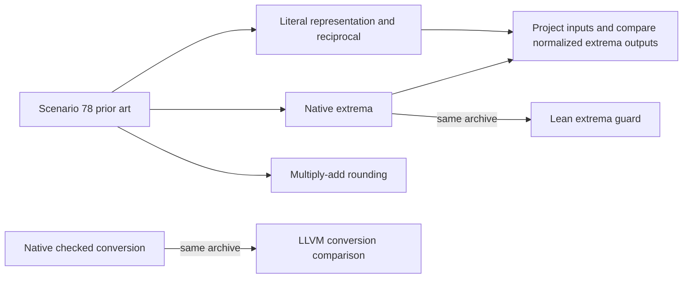

# RT-00 B15 — binary64 research relationships and observation boundaries

**Scope:** PLAN §0.1 and [#284](https://github.com/aivibeflow/LLMLang/issues/284), pinned to `research/all` at `41ce460f60ce9965145ed5767a94b0983e32b5b5`.

An LLMLang semantic identity might treat several distinct binary64 (F64) words as interchangeable. The safety of that choice depends on which operations can observe the distinction. This review compares the floating-point survey and six follow-ups for duplicated or superseded claims, apparent contradictions, and navigation. It also tests whether two literal projections preserve archived extrema results. A *projection* replaces each input by the representative word of its class, such as one canonical quiet Not-a-Number (NaN).

## Claim lineage

| Report | Distinct claim and evidence boundary |
| --- | --- |
| [RT-03 Scenario 78](../../language-design/RT-03/RESEARCH-SCENARIO-78-FLOATING-POINT-REPRODUCIBILITY-AND-IEEE-EDGES.md) | Prior-art survey and test agenda. It covers language-level rounding, special values and optimization, including targets and operations outside the follow-ups. |
| [RT-05 literal identity](../../semantic-representation/RT-05/RT-05-CROSS-RUNTIME-F64-IDENTITY-2026-11-25.md) | Tagged exact bits preserve all 210 words. Canonicalizing NaN preserves the tested vector of classification, self-equality and normalized reciprocal. Merging signed zeros changes a reciprocal result. This experiment also covers storage and JSON. |
| [RT-05 native extrema](../../semantic-representation/RT-05/RT-05-NATIVE-F64-MINMAX-2026-11-25.md) | Native two-argument minima and maxima differ on how they select NaNs and signed zeros. Its comparison projects NaN **outputs** to a common marker. |
| [RT-32 agreement guard](../../formal-verification/RT-32/RT-32-F64-EXTREMA-AGREEMENT-GUARD-2026-11-25.md) | Lean characterizes when all seven modeled extrema policies agree on the *same* pair of exact inputs under the normalized-output observation. It also relates five native families to model rules on the archive. The theorem leaves source/target correspondence and status flags open. |
| [RT-05 checked I64 conversion](../../semantic-representation/RT-05/RT-05-F64-I64-CONVERSION-2026-11-25.md) | Defines the tested distinction between a truncated signed integer, finite range refusal and nonfinite refusal. Native integral-only, wrap, saturation and unbounded alternatives yield different outcomes. |
| [RT-13 LLVM conversion](../../compiler-and-translation/RT-13/RT-13-LLVM-F64-I64-LOWERING-2026-11-25.md) | Reuses the exact RT-05 corpus for LLVM lowering and defines the otherwise unused result field as zero on refusal. Its checks cover scoped LLVM refinement, native pairs and both Vellvm extractions, with saturation outside the validator support. |
| [RT-13 contraction](../../compiler-and-translation/RT-13/RT-13-BINARY64-CONTRACTION-2026-11-25.md) | A separate arithmetic fixture compares one versus two rounding steps for multiply-add. GCC contraction changes 77 of 6,859 outcomes even when output NaNs are projected to a common marker. Rounding remains an independent choice in the operation contract. |

The survey supplies the agenda. The native comparisons address specific parts of it, and two downstream studies explicitly reuse archive inputs and results. All seven reports add distinct material. Six are linked directly from [PLAN.md](../../../PLAN.md), and Scenario 78 is reachable from the literal, extrema and contraction reports. The exact archive hashes confirm both reuse edges in the following diagram.



The lower branch represents this audit's new comparison. The two labeled archive links mean the downstream ledger records the upstream ledger's SHA-256. The remaining arrows indicate conceptual relationships.

## Archived observations and apparent conflicts

For each ordered pair among the 32 common words, the audit compares the recorded output pair before and after replacing both input operands. It applies NaN-only and signed-zero-only replacements separately to isolate their effects. The output comparison canonicalizes all NaNs, retains signed zero, and compares the minimum and maximum as an ordered pair. All replacement words are present in the archive.

| Native family | Pairs changed by NaN input replacement | Pairs changed by signed-zero input replacement |
| --- | ---: | ---: |
| glibc | 216 | 50 |
| SSE2 | 0 | 48 |
| Rust | 0 | 62 |
| Node | 0 | 35 |
| CPython | 0 | 48 |

The denominator is 1,024 original ordered pairs per family and projection, including unchanged inputs. These are exact corpus counts with no sampling inference. For glibc, the signaling NaN `7ff0000000000001` paired with `1.0` produces two NaNs. Replacing the signaling operand with `7ff8000000000000` produces `(1.0, 1.0)`. This falsifies input canonicalization for that extrema observation while preserving the earlier literal finding about the reciprocal vector. For Node, the mixed zero input produces `(−0, +0)`, and replacing `−0` with `+0` produces `(+0, +0)`. The zero differences across families include interactions with other operands, such as a zero selected in the presence of a NaN.

The native archive contains 518 unanimous pairs and 506 disagreements under normalized outputs, matching the counts in the Lean study. That result asks whether different rules agree on fixed inputs. The replacement test asks whether a fixed rule changes when the inputs change. For example, the guard retains the distinction between quiet and signaling inputs even when all NaN outputs share a marker.

For checked conversion, the audit compared all 216 exact input words, result tags and integers for each of four archived native LLVM routes. All match the RT-05 checked-truncation rows after translating success to tag 0, range refusal to tag 1 and nonfinite refusal to tag 2, with a defined zero value for either refusal. Plain saturation differs in 63 rows. The two signed zeros both return success with integer zero. The two example NaNs both return nonfinite refusal. The separate observation contract therefore explains why these pairs agree in the conversion comparison while their distinctions matter in extrema. The agreement on guarded saturation is bounded native evidence. The archived LLVM validators leave the intrinsic unsupported.

## Disposition and limits

Keep the seven reports and their evidence. This review found no duplicate, supersession, navigation orphan or contradiction among the scoped claims. The conflicting behaviors are meaningful alternatives when the operation or observation contract changes. A graph that stores exact input bits supports these distinct operations without discarding either distinction. A graph that uses a coarser identity would need a substitution argument covering every observer in its declared profile, including effects if status flags or traps are observable. A quotient restricted to a single operation can have a smaller proof burden and fewer reuse opportunities. This review does not select any of these designs.

The audit reprocesses exact archived observations with CPython 3.12.14 and Git 2.52.0. It does not rerun the native probes, Lean, Alive2 or Vellvm, and does not inspect the behavior of other platforms or floating-point environments. Mermaid syntax was checked by inspection. Corpus-wide reconciliation, general source correspondence, and independent research review remain open.

```sh
audit=research/research-management/RT-00/F64-RELATIONSHIPS-01
python3 -B "$audit/audit.py" > /tmp/llmlang-f64-relationships.json
cmp "$audit/evidence.json" /tmp/llmlang-f64-relationships.json
```

[Archive comparison script](F64-RELATIONSHIPS-01/audit.py) · [Machine-readable result and exact source identities](F64-RELATIONSHIPS-01/evidence.json)
