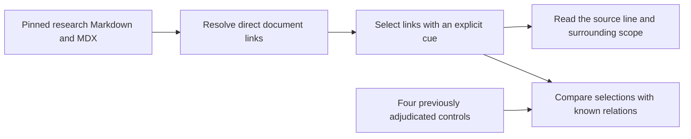

# RT-00 B16 — Screen direct research links for document relationships

## Question and method

Can explicit citation wording recover scoped supersession and translation relationships that lexical overlap missed? The [B12 text screen](RT-00-B-12-TEXT-OVERLAP-2026-11-24.md) missed all four known controls. This experiment uses the same four controls, with unchanged source blobs, on the `research/all` tree at `5cb74cadcb811cef92f89d8abd19cc76c6b6d727`. The alternatives are an unrestricted link graph for discovery, a narrower cue screen for review prioritization, and a curated relation register for adjudicated claims.

The screen reads every tracked research Markdown/MDX blob, including copied references. It resolves simple inline relative links whose destinations are tracked research Markdown/MDX documents. It records an unordered pair when either document directly links to the other. It selects a pair when a link uses the exact English or Russian language label listed in the script, or appears on a line containing a form of `supersede` or the phrase `historical/background research`. It keeps the direction and line of each selected occurrence for manual reading. [Screen source](EXPLICIT-RELATIONSHIPS-01/audit.py) · [Exact tree and candidate evidence](EXPLICIT-RELATIONSHIPS-01/evidence.json)



The direct-link step bounds what this approach can find. A known relationship whose documents lack a direct link can only be recovered with a different signal or explicit relation metadata.

## Results

The screen read 628 documents and found 2,218 distinct directly linked pairs. It selected nine link occurrences covering eight distinct pairs. Both the ordinary link and narrower cue rules recover two of the four controls. The broad link graph also includes 2,210 pairs that lack one of the defined cues.

| B12 control | Direct link | Cue selected | Manual reading |
|---|---|---|---|
| Scenario 31 and Scenario 32 | Absent | No | The earlier query representation is explicitly superseded, but the relation is described through the replacement artifact and the separate review register. |
| Broad Git semantic repository and focused semantic merge | Present | Yes | The broad report delegates current merge architecture guidance and retains its historical context. |
| Initial related-project and deep-comparison reports | Absent | No | The four-project overlap is documented by a separate review rather than a direct document citation. |
| English and Russian formal-verification reports | Present | Yes | Reciprocal labels identify language companions. Translation parity remains unverified. |

The manual dispositions below cover every selected pair. The source and target blobs and exact citation lines are in the ledger.

| Selected pair or group | Pairs | Disposition |
|---|---:|---|
| Formal-verification language companions | 1 | Maintained translation navigation, with one occurrence in each direction. |
| Broad Git semantic repository and focused semantic merge | 1 | Scoped replacement of current merge guidance, consistent with B13. |
| Research corpus audit and RT-00 E link audit | 1 | The later bounded scan supersedes the earlier claim that a scan remained open. Counts and conclusions are scoped to the historical scan. |
| Research index and cross-cutting alignment review | 1 | A citation to the historical report. The same line attributes replacement of its counts to the current taxonomy and dependency map, which are outside this pair. |
| First semantic traceability report and Scenario relationship review | 1 | Citation to an audit that describes supersession between other artifacts. |
| Broad Git semantic repository and RT-20, RT-22, RT-23 | 3 | Complementary sources for current technical context. The shared paragraph assigns current merge guidance specifically to the focused merge report. |

For the eight selected pairs, manual review confirmed one language-companion relationship and two scoped updates. Five pairs carried a cue whose intended relationship did not match the linked pair. These counts describe the selected set. The four preselected controls are insufficient to estimate recall for unrecorded relationships.

## Implication and remaining evidence

An explicit citation cue can recover a few high-value relationships missed by an eight-word overlap filter. A link's local context remains necessary to identify subject, object and superseded scope. LLMLang's synthesis can use these cues to find review candidates and rely on the adjudicated relation register for carry-forward claims. This screen leaves implicit, cross-language and claim-level relationships, contradiction review, semantic orphans and Scenario 16 archival evidence open. [B13 scoped controls](RT-00-B-13-KNOWN-RELATIONSHIP-CONTROLS-2026-11-25.md) · [Corpus reconciliation issue](https://github.com/aivibeflow/LLMLang/issues/284)

## Reproduction

Use CPython 3.12.14 and Git 2.56.1 in a checkout containing the pinned `research/all` revision. The implementation recognizes the fixture's simple inline link form. Reference-style citations, multiline links, aliases and arbitrary Markdown constructs are outside the extraction rule.

```bash
rt00=research/research-management/RT-00
python3 -B "$rt00/EXPLICIT-RELATIONSHIPS-01/audit.py" \
  5cb74cadcb811cef92f89d8abd19cc76c6b6d727 \
  --controls "$rt00/RT-00-B-12-TEXT-OVERLAP-2026-11-24.json" \
  --output /tmp/llmlang-explicit-relationships.json
cmp "$rt00/EXPLICIT-RELATIONSHIPS-01/evidence.json" /tmp/llmlang-explicit-relationships.json
```

The commands reproduce the candidate and control data. Manual dispositions in the table come from the bound source paragraphs. The Mermaid source was checked without local rendering.
