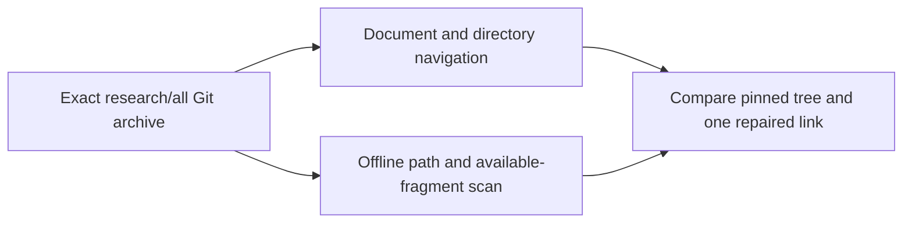

# RT-00 B18 — Shared-branch navigation and citation delta

## Question and method

Do the new research artifacts remain discoverable and do authored citations resolve after the branch grew? [B17](RT-00-B-17-RESEARCH-ALL-NAVIGATION-2026-11-25.md) measured 1,793 artifacts and 634 Markdown/MDX documents at its pinned tree. This check uses the whole shared-branch archive at `c5413e08742e90e3d8c38572a6af771cca600c9d`, then overlays one link correction in the same archive. [PLAN §0.1](../../../PLAN.md#01-reconcile-the-research-corpus) · [#284](https://github.com/aivibeflow/LLMLang/issues/284)

The existing [navigation scanner](../../../.github/scripts/audit_research_index_reachability.py) starts from the plan and research index. One traversal follows only document links. A second also allows browsing explicitly linked research directories. Lychee 0.24.2 independently scans local paths and available fragments in all research Markdown and MDX using the image pinned in the [offline link check](RT-00-A-CURRENT-MAIN-LINK-ANCHOR-AUDIT-2026-11-25.md). The container mount is read-only and networking is disabled.



## Results

| Measure | Pinned tree | With authored link repaired |
| --- | ---: | ---: |
| Tracked research artifacts | 2,080 | 2,080 |
| Markdown/MDX documents | 711 | 711 |
| Artifacts reachable with directory browsing | 2,080 | 2,080 |
| Documents reachable by document links | 704 | 704 |
| Unresolved paths in Python navigation scan | 39 | 38 |
| Links inspected by Lychee | 6,459 | 6,459 |
| Lychee successes | 4,623 | 4,624 |
| Lychee errors | 83 | 82 |

The Python and Lychee scans identify one authored source with a missing target. Its dependency-map link assumed that the map is in the same directory as the report. The corrected path points to the parent research-management directory. No first-party source remains an error origin in the repaired archive. All seven documents that require directory browsing belong to copied upstream snapshots. [Corrected report](RT-00-B-COMPONENT-IMMUTABILITY-AND-RUNTIME-COMMIT-2026-11-25.md)

The remaining Lychee errors originate in the copied MCP, OCI and Alive2 snapshots. The Python scanner counts different path occurrences because it uses different extraction rules and does not check fragments. Its unresolved path list likewise has only copied upstream origins after the repair. This work keeps the upstream snapshot reconciliation separate, while structural indexing covers every tracked artifact in the pinned branch tree.

## Reproduce and limits

Use CPython 3.12.14 and Git 2.56.1 on Linux x86-64 with Docker and the Lychee image at `sha256:e2d19e57cf6ab037026f20b8e449a1f30d9d7f81eef4194763aab2eab20bd28d`. The [record](NAVIGATION-DELTA-01/evidence.json) gives the exact source paths, addresses, source positions, counts and image. Run from the repository root after pulling the pinned image:

```sh
fixture=research/research-management/RT-00/NAVIGATION-DELTA-01
out=$(mktemp)
python3 -B "$fixture/run.py" > "$out" &&
  cmp "$fixture/evidence.json" "$out"
```

The replay overlays the single recorded edit in an extracted historical archive, so later repository growth does not affect the comparison. The machine-readable ledger preserves exact findings and excludes nondeterministic scan durations. These counts establish navigation and local citation integrity for the reported scope. Semantic orphans, external URL availability, omitted upstream pages and external fragments need separate checks. [Runner](NAVIGATION-DELTA-01/run.py)
