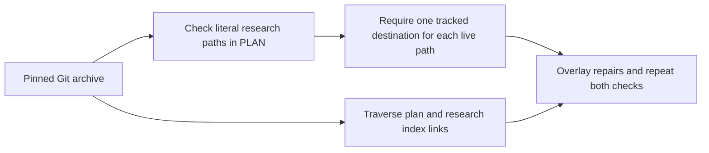

# RT-00 B19 — Plan evidence paths and shared-branch navigation

Scope is PLAN §0.1 and [#284](https://github.com/aivibeflow/LLMLang/issues/284) at `600173d375b4bdf6b1634381bba2dfea1c77469b` on `research/all`. The [previous shared-branch check](RT-00-B-18-NAVIGATION-DELTA-2026-11-25.md) followed Markdown links and directory listings. This pass also inspects backticked research paths in the plan. A path presented as inline code can become stale without a Markdown link scanner seeing it.

## Method and findings

The runner extracts a pinned Git archive, measures document and directory traversal, and checks inline-code research paths ending in `.md` in the plan. For a missing live path it requires an unambiguous basename match inside the archived research tree. It overlays the selected fixes, then reruns the checks on the same tree. This preserves a comparable baseline across later branch growth.



The navigation model treats explicitly linked directories as browsable. That definition explains the difference between reachability by document links and reachability with directory browsing.

| Measure | Observed result |
| --- | ---: |
| Tracked research artifacts reachable with directory browsing | 2,591 / 2,591 |
| Markdown/MDX documents reachable by document links | 820 / 827 |
| Stale live inline-code references converted to links | 24 |
| Distinct moved paths covered by those repairs | 13 |
| First-party unresolved local links before and after the overlay | 1 → 0 |
| Remaining unresolved local paths in copied references | 38 |

The first-party citation error is the [wide division capability report](../../compiler-and-translation/RT-13/RT-13-WIDE-DIVISION-CAPABILITY-2026-11-25.md). The target backend report is in the same directory. The plan repairs point to existing thematic locations. The plan's proposed final audit output stays a designated future output. It is absent at this baseline and was excluded from the repair count.

## Reproduce and limits

Use CPython 3.12.14 and Git 2.52.0. The [runner](PLAN-NAVIGATION-01/run.py) reads the exact archive and the [ledger](PLAN-NAVIGATION-01/evidence.json) stores path replacements, source hashes and occurrence counts.

```sh
fixture=research/research-management/RT-00/PLAN-NAVIGATION-01
PYTHONHASHSEED=1 python3 -B "$fixture/run.py" > /tmp/llmlang-plan-navigation.json
cmp "$fixture/evidence.json" /tmp/llmlang-plan-navigation.json
```

The table contains exact structural counts rather than a sampled measurement. This pass verifies paths and navigation. Fragment resolution, upstream snapshot recovery, external URL availability, and whether the cited claims entail the plan statements require separate checks. Mermaid source was inspected directly.
