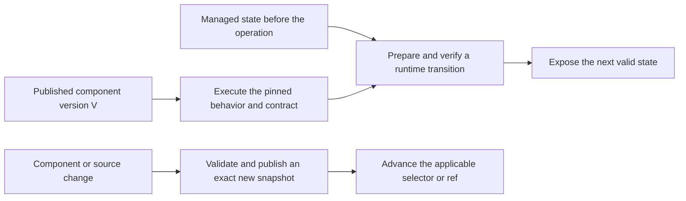

# RT-00 B — Immutable component versions and state commits

## Question and evidence

Does the accepted requirement for immutable published components conflict with the proposed language-level commit for mutable structures? I read the feature registry, accepted draft decision, structure-contract proposal and RT-23 worktree proposal at `0e9dd963980a72d04b5975213c0091c1cef2157c` on `research/all`. I compared the subject of each guarantee and constructed two small counterexamples to conflating the boundaries. This is a scoped contradiction review for Stage 0.1. [Feature registry](../../../FEATURE-REGISTRY.md) · [Accepted architecture decision](../../../draft/ARCHITECTURE-DECISIONS.md) · [Structure-contract proposal](../../toolchain-and-collaboration/RT-20/STRUCTURE-CONTRACTS-AND-ATOMIC-COMMIT-VERIFICATION.md) · [RT-23 proposal](../../toolchain-and-collaboration/RT-23/RT-23-SINGLE-INSTANCE-TOOLCHAIN-AND-INCREMENTAL-MULTI-WORKTREE.md)

| Subject | Identity used in the source | Effect of the change |
|---|---|---|
| Published component version, F-PORT-002, accepted | Exact version of the published component, under a coherent build toolchain | Changing published component contents creates a new component version. |
| Managed runtime structure state, F-REQ-004–006, candidate | Affected structure instances and the program/domain invariant relating them | A verified transition can publish new runtime state. Its temporary state may violate only invariants whose checks are expressly deferred. |
| Toolchain and Git publication, F-SPG-010 and F-GIT-004–005, candidate or proposed | Exact candidate semantic snapshot, file tree and expected publication target | Acceptance creates an immutable snapshot. The mutable selected revision or Git ref may advance after its own validation. |

The accepted decision concerns the component version. The runtime candidate concerns the state of instances acted on by that version. RT-23 concerns the publication of development artifacts and the selector that exposes them. A candidate representation can keep the three subjects distinct. It can still bind transition evidence to the exact behavior and contract version on which it relies. [Dependency map, DEP-046, DEP-058, DEP-068 and DEP-072](RESEARCH-DEPENDENCY-MAP.md)

## Two boundary checks

Consider an unchanged component version implementing a transfer between two nonnegative balances with invariant `a + b = 10`. From `(7, 3)`, a transfer of one unit can prepare `(6, 3)` privately and then propose `(6, 4)`. If the sum check may be deferred to commit and observation is isolated, publishing the final state preserves the invariant while the component version retains its identity. Exposing `(6, 3)` would violate the proposed observation boundary. Treating the running balance bytes as mutable contents of the already published component version would also violate the accepted immutability rule.

For integration, take the invariant `x + y ≤ 1` and the shared base `(0, 0)`. One candidate writes only `x := 1` and the other only `y := 1`. Each result satisfies the invariant on its own. The field write sets are disjoint, but applying both changes yields `(1, 1)` and violates the invariant. A changed-field overlap test cannot substitute for verification of this cross-structure dependency. Rejecting the combined result or deriving new evidence about it is consistent with the separate integration boundary in the structure proposal.

| State | Sum | Outcome |
|---|---:|---|
| Transfer pre-state `(7, 3)` | 10 | Observable and admissible |
| Transfer intermediate `(6, 3)` | 9 | Admissible only as private state with the sum check deferred |
| Transfer final `(6, 4)` | 10 | Eligible for publication after the required checks |
| Independent integration candidates `(1, 0)`, `(0, 1)` | 1 each | Each satisfies the example's invariant |
| Combined candidate `(1, 1)` | 2 | Reject this merged state |

## Disposition

The exact claims are compatible at the scoped conceptual level when component version identity and runtime state identity remain distinct. Source publication and runtime commit still each need their own concurrency, isolation and proof correspondence. The counterexamples identify two failure conditions for later review: an observer with access to a partially prepared runtime state, or an integration check that uses write disjointness to ignore a shared invariant. Neither example proves a concrete storage or synchronization implementation. Boundaries for external effects, nested transactions and evidence reuse across state changes remain open. [Stage 0.1 tracking](https://github.com/aivibeflow/LLMLang/issues/284)

## Source verification

The accepted decision, registry, structure proposal and worktree proposal have Git object IDs `c1cdc4c6c2aafbcb6dadb144d3355cd90a1e96eb`, `0dd98ff90f7e55009c85a21ac4721a1f2c2590fa`, `924b502aed4a2ffa975202ecf950e69662dfada1` and `4122d7a0249be54399fe9995329e3a49caca5cce` respectively. The table follows from the displayed integer predicates. The diagram is illustrative and was checked as Mermaid source.
